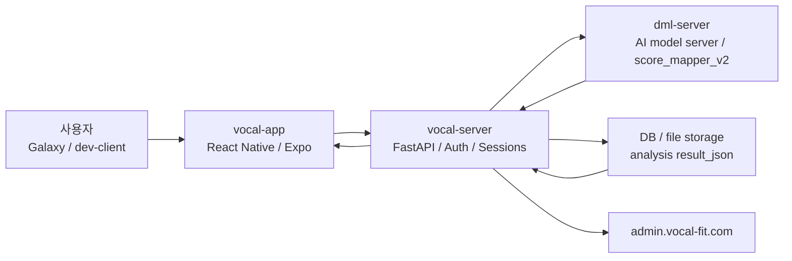
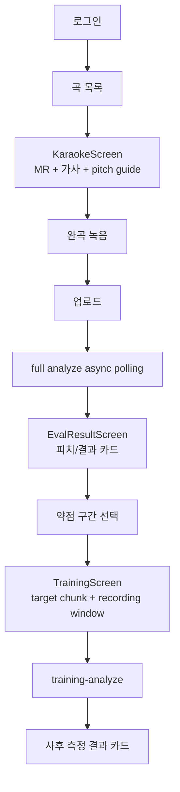
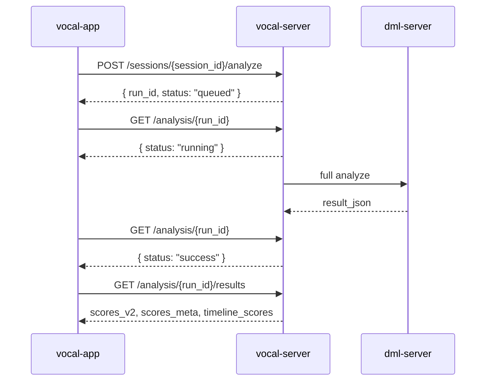

# Vocal Fit - EGG 기반 가창 발성 평가 및 훈련 시스템

순천향대학교 사물인터넷학과 졸업작품으로 개발 중인 보컬 연습 보조 시스템이다. 사용자가 모바일 앱에서 노래를 녹음하면 서버가 음성을 분석하고, EGG 기반 발성 예측 모델과 평가 기준을 바탕으로 피치 비교, 발성 항목 점수, 약점 구간 훈련 흐름을 제공한다.

이 프로젝트는 의료/임상 진단 도구가 아니라 보컬 교육을 보조하기 위한 피드백 시스템이다. 앱에서 제공하는 문구와 점수는 사용자가 발성 상태를 이해하고 연습 방향을 잡도록 돕는 용도다.

## 목차

1. [프로젝트 한 줄 요약](#프로젝트-한-줄-요약)
2. [개발 동기](#개발-동기)
3. [해결하려는 문제](#해결하려는-문제)
4. [EGG 기반 모델 개발 방향](#egg-기반-모델-개발-방향)
5. [보컬 학원 협력 및 데이터 수집](#보컬-학원-협력-및-데이터-수집)
6. [전체 시스템 구조](#전체-시스템-구조)
7. [워크스페이스 역할](#워크스페이스-역할)
8. [앱 사용자 흐름](#앱-사용자-흐름)
9. [API / Schema 핵심 예시](#api--schema-핵심-예시)
10. [현재 개발 단계](#현재-개발-단계)
11. [Batch #1 완료 내용](#batch-1-완료-내용)
12. [Batch #2 완료 내용](#batch-2-완료-내용)
13. [Batch #3 완료 내용](#batch-3-완료-내용)
14. [검증된 내용](#검증된-내용)
15. [남은 Backlog / Roadmap](#남은-backlog--roadmap)
16. [Repository 구조](#repository-구조)
17. [실행 방법](#실행-방법)
18. [주의 사항](#주의-사항)
19. [추가 문서](#추가-문서)

## 프로젝트 한 줄 요약

Vocal Fit은 스마트폰 녹음 기반으로 사용자의 노래 연습을 분석하고, 피치 가이드와 발성 평가 카드, 약점 구간 반복 훈련을 하나의 앱 흐름으로 연결하는 보컬 트레이닝 피드백 시스템이다.

## 개발 동기

보컬 연습은 사용자가 자신의 목소리를 듣고 반복하면서 개선하는 과정이지만, 초보자는 어떤 구간에서 무엇이 문제인지 파악하기 어렵다. 피치가 맞지 않는지, 호흡 소리가 많이 섞이는지, 성대 접촉이 약한지, 입 안쪽 공간이나 혀의 긴장도가 어떤지 같은 정보는 전문 트레이너의 피드백 없이는 구체적으로 확인하기 어렵다.

이 프로젝트는 다음 질문에서 출발했다.

- 사용자가 혼자 연습할 때도 최소한의 객관적 지표를 확인할 수 있을까?
- 녹음 후 전체 점수만 보여주는 대신, 문제가 있는 소절을 바로 다시 연습하게 만들 수 있을까?
- EGG 기반 발성 연구 결과를 앱 UX로 연결해 보컬 교육 보조 피드백으로 사용할 수 있을까?
- 학원 현장에서 받은 평가표와 녹음 데이터를 앱의 설명 문구와 훈련 흐름에 반영할 수 있을까?

## 해결하려는 문제

현재 앱이 집중하는 문제는 “분석 결과를 실제 연습 행동으로 이어지게 만드는 것”이다.

| 문제 | 앱에서의 해결 방향 |
|---|---|
| 사용자가 어느 구간을 다시 불러야 하는지 모름 | timeline score에서 약점 구간을 추출해 `이 부분 연습하기`로 연결 |
| 피치 가이드와 실제 목소리 차이를 보기 어려움 | MR/LRC/pitch-guide와 사용자 pitch를 같은 시간축에 표시 |
| 분석이 오래 걸리거나 timeout처럼 보임 | full analyze를 async polling UX로 전환 |
| 구간훈련 녹음 시작/종료가 target chunk와 어긋남 | recording window와 `chunk_meta`를 선택 구간 기준으로 정렬 |
| v2 평가 항목 중 일부 카드 문구가 비어 있음 | 연구개위치/혀경직도에 보수적 feedback fallback 제공 |
| 신뢰도 표시가 사용자에게 혼동을 줌 | 연구개/혀경직도 high-star 시각 강조 제거, v2 점수 있음 + 측정불가 모순 보정 |

## EGG 기반 모델 개발 방향

이 프로젝트의 DML 방향은 사용자의 일반 음성 녹음만으로 EGG 또는 EGG 기반 발성 평가 지표에 가까운 상태를 추정하고, 이를 교육용 피드백으로 변환하는 것이다.

EGG는 성대 접촉과 관련된 정보를 제공할 수 있는 신호지만, 일반 사용자가 매번 EGG 장비를 착용하고 노래를 부르기는 어렵다. 따라서 프로젝트는 스마트폰 또는 일반 마이크 녹음으로부터 발성 상태를 추정하고, 앱에서는 사용자가 이해할 수 있는 항목으로 변환해 보여주는 방향을 택했다.

현재 monorepo에는 DML 실험 코드와 시각화 산출물이 포함되어 있다.

- 모델/실험 코드: [`dml-server/ai-model/`](dml-server/ai-model/)
- 추론 서버: [`dml-server/model_server/`](dml-server/model_server/)
- 실험/검증 시각화: [`dml-server/figures/`](dml-server/figures/), [`dml-server/images/`](dml-server/images/)

확인된 범위에서 앱이 사용하는 현재 핵심은 `score_mapper_v2`와 4개 우선 표시 항목이다.

| v2 앱 표시 항목 | 의미 |
|---|---|
| 호흡 소리 식별 | 호흡 섞임 또는 기류 관련 상태를 이해하기 위한 항목 |
| 성대 접촉 강도 | 성대 접촉 관련 상태를 이해하기 위한 항목 |
| 연구개 위치 | 입 안쪽 공간과 연구개 위치 경향을 보수적으로 설명하는 항목 |
| 혀/구강 공간의 경직도 | 혀와 구강 공간 긴장 경향을 보수적으로 설명하는 항목 |

정확한 EGG 장비명, 원본 데이터 수, 최종 모델 구조 설명은 현재 README에서 단정하지 않는다. 발표/논문용 최종 수치는 `dml-server` 실험 문서와 최신 평가표 기준으로 별도 확정이 필요하다.

## 보컬 학원 협력 및 데이터 수집

프로젝트는 협력 보컬 학원 또는 협력 기관의 녹음/평가 맥락을 앱 개발 기준에 반영하고 있다. 2026년 4월 6일부터 5월 10일까지의 훈련/검증 녹음본과 평가표를 기준으로, 앱의 점수 해석과 피드백 문구를 점진적으로 맞추는 작업을 진행했다.

현재 README에는 개인정보, 학생명, 계정명, 정확한 학원명, 대표자명은 포함하지 않는다. 확인되지 않은 정보는 문서에 쓰지 않고, 필요한 경우 추후 승인된 공개 범위 안에서 보강한다.

2026년 5월 14일 이후에는 학원 통제 실험과 production API 기반 Galaxy 검증을 염두에 두고 앱 안정화 Batch #1을 마무리했다. 2026년 5월 18일에는 navigation typing, 진단 로그, SDK warning, 연구개/혀경직도 문구, V2 그래프 색상 매핑을 묶은 Batch #2를 5/5로 완료했고, 이어 History/Favorites/Record UX, Karaoke 실패 cleanup, 401 재로그인 UX, 9항목 설명 문구를 묶은 Batch #3도 5/5로 완료했다.

## 전체 시스템 구조



운영 도메인:

| 도메인 | 역할 |
|---|---|
| `api.vocal-fit.com` | 앱 production API |
| `dml.vocal-fit.com` | DML 추론 서버 접근 도메인 |
| `admin.vocal-fit.com` | 운영/관리 화면 |

## 워크스페이스 역할

| 워크스페이스 | 역할 | 주요 기술 |
|---|---|---|
| `vocal-app/` | 모바일 앱, 녹음, 결과 화면, 피치 비교, 구간훈련 UX | Expo, React Native, TypeScript |
| `vocal-server/` | 인증, 세션, 파일 업로드, 분석 요청, 결과 저장, 곡/LRC/pitch-guide API | FastAPI, DB, storage |
| `dml-server/` | full analyze, analyze-chunk, EGG/음향 지표 추정, `score_mapper_v2` | Python, AI model server |

## 앱 사용자 흐름



Batch #1 이후 사용자는 song004 기준으로 MR 재생, 가사 표시, 녹음, 완곡 업로드, async 분석, 결과 화면, 히스토리 저장, 한 소절 구간훈련 사후 측정까지 이어지는 흐름을 확인했다.

## API / Schema 핵심 예시

### full analyze async flow



### analyze start response

```json
{
  "run_id": "analysis-run-id",
  "status": "queued"
}
```

앱은 `queued` 또는 `running` 상태를 분석 진행 중으로 보고 polling을 계속한다. `success` 이후 결과를 조회하고, `failed`, `invalid`, `no_voice`, `error` 같은 terminal failure는 결과 화면 이동을 막고 안내를 표시한다.

### score_mapper_v2 result shape

```json
{
  "score_mapper_version": "v2",
  "scores_v2": {
    "4_breathiness": 3,
    "3_vocal_fold_contact": 2,
    "6_soft_palate": 3,
    "8_tongue_tension": 4
  },
  "scores_meta": {
    "8_tongue_tension": {
      "tier": "high_star",
      "display_mark": "asterisk",
      "rounded_score": 4,
      "tooltip": "metadata tooltip"
    }
  },
  "reliability": {
    "shown_v2": [
      "4_breathiness",
      "3_vocal_fold_contact",
      "6_soft_palate",
      "8_tongue_tension"
    ]
  },
  "low_confidence_items": []
}
```

앱 표시 정책:

- `rounded_score` 0~1: 미달
- `rounded_score` 2~3: 적절
- `rounded_score` 4~5: 과함
- missing score는 적절로 보정하지 않는다.
- low confidence는 별도 표시 정책을 유지한다.
- 연구개위치/혀경직도는 `high_star` 노란 별을 숨긴다.
- v2 점수가 있는 연구개/혀 항목은 legacy `unavailable` 때문에 “측정 불가”로 보이지 않게 한다.

### training-analyze request context

```json
{
  "session_id": "session-id",
  "indicator_key": "tongue_tension",
  "chunk_meta": {
    "chunk_index": 12,
    "start_sec": 58.2,
    "end_sec": 63.7,
    "lrc_text": "target lyric line"
  }
}
```

구간훈련에서는 사용자가 실제로 다시 부르는 target chunk와 녹음 window를 분리한다. Batch #1에서 이 정렬을 보강해 첫 음절이 씹히는 문제를 줄이고, 한 소절 정상 발성 success를 확인했다.

## 현재 개발 단계

현재 상태는 “발표/통제 실험 전 앱 안정화 Batch #3 완료” 단계다.

- production API 기준 앱 진입과 로그인 가능
- 곡 목록 로드 가능
- song004 KaraokeScreen 진입 가능
- MR 재생, 가사 표시, 녹음 가능
- 완곡 업로드와 full analyze async polling 가능
- 결과 화면 이동과 히스토리 저장 가능
- 구간훈련 사후 측정 가능
- 결과 카드 4개 v2 항목 표시 가능
- navigation typing baseline 정리 후 `node_modules/.bin/tsc --noEmit` 통과
- 진단 로그 정리 후 Metro 과다 출력 없음
- 연구개위치/혀경직도 카드 문구와 V2 그래프 색상 매핑 검증 완료
- History/Favorites/SongHistory/Record 빈 상태와 오류 UX 정리 완료
- Karaoke MR 실패 cleanup과 `no_voice` 다시 녹음 retry 확인
- 401 인증 만료 시 재로그인 UX 반영
- 9항목 결과 카드 설명/상태 문구 1차 반영
- Settings 마이크 입력 테스트는 calibration 본기능이 아니라 supporting input test로 정리
- pitch-guide 작업은 현 단계에서 종료, 팀원들이 여러 곡 수동 정렬 중

## Batch #1 완료 내용

Batch #1은 검증 완료 기능 5개 단위로 GitHub에 반영하는 첫 묶음이다.

1. full analyze async polling UX 반영
   - `POST /analyze` 즉시 응답 후 polling하는 production 분석 흐름을 앱 UX에 반영.
2. 구간훈련 녹음 window와 `chunk_meta` 정렬
   - 실제 target chunk와 recording/pre-roll/post-roll window를 분리해 사후 측정 요청을 안정화.
3. production 완곡 업로드 timeout/UX 안정화
   - upload/analyze/result 이동 중 timeout과 실패 상태를 사용자 흐름에서 분리.
4. song004 pitch-guide 현 단계 종료 및 앱 임의 offset 제거
   - 앱에서 임의 offset을 추가하지 않고, asset/listening-anchor 검증 대상으로 정리.
5. 결과 카드 피드백/신뢰도 UI 정리
   - 연구개위치/혀경직도 feedback fallback 추가.
   - 연구개위치/혀경직도 노란 별 제거.
   - v2 표시 항목의 “점수 있음 + 측정 불가” 모순 제거.
   - 호흡소리식별/성대접촉강도 기존 흐름 유지.

## Batch #2 완료 내용

Batch #2는 검증 완료 기능 5개 단위로 GitHub에 반영하는 두 번째 묶음이다.

1. navigation typing baseline 정리
   - Result stack/navigation param 타입을 정리해 source repo 기준 `node_modules/.bin/tsc --noEmit` 통과 상태로 복구.
2. 진단 로그 정리 및 개발 로그 정책
   - API/auth/upload/timing/training/V2 graph 등 임시 진단 로그를 정리하고, 검증용 로그는 명시적으로 임시/제거 대상으로 관리.
3. SDK warning 정리 및 앱 실행 경고 최소화
   - NativeEventEmitter warning은 dev LogBox 방해를 최소화하고, `expo-av` deprecated warning은 SDK migration backlog로 유지.
4. 연구개위치/혀경직도 피드백 문구 정교화
   - 점수/threshold 변경 없이 서버 점수와 zone을 보존하고, 앱 fallback 문구만 보수적인 발성 교육 보조 톤으로 정리.
5. V2 점수 분포/그래프 색상 매핑 검증 및 보정
   - `scores_v2`, `scores_meta`, `timeline_scores`, `low_confidence_items` key mapping을 확인.
   - missing score를 적절로 보정하지 않고, low confidence를 zone 색상보다 우선하도록 결과 그래프 표시 경로를 검증/보정.
   - 검증용 V2 audit 로그는 Batch #2 종료 시 제거.

Supporting cleanup:

- 14번 Settings 마이크 입력 테스트 UX는 개인화 calibration 완성이 아니라 입력 테스트/보류 전환으로 정리했다.
- 개인화 캘리브레이션, 성별/음역대 기준, 노래별 key 조절은 마지막 단계 backlog로 남긴다.

## Batch #3 완료 내용

Batch #3은 검증 완료 기능 5개 단위로 GitHub에 반영하는 세 번째 묶음이다.

1. History/Favorites/Record 회귀 UX polish
   - Favorites v2 4항목 재진입에서 `breathiness`, `vocal_fold_contact`, `soft_palate`, `tongue_tension` app key를 유지하도록 보정.
2. Karaoke MR 실패 cleanup + `no_voice` 다시 녹음 retry
   - MR 시작 실패 시 recorder/sound cleanup을 보강하고, `no_voice` Alert의 다시 녹음이 자동 재시작되도록 정리.
3. 401 인증 만료 재로그인 UX
   - 인증 만료를 일반 네트워크 오류와 분리하고, 로그인 만료 안내 후 로그인 화면으로 돌아가는 흐름 반영.
4. 9항목 평가표 텍스트 매핑 1차
   - 활성 4항목과 비활성/참고 항목의 설명과 상태 문구를 보수적인 발성 교육 보조 톤으로 정리.
5. History/Favorites/Record 빈 상태 오류 UX 정리
   - Favorites/History/SongHistory/RecordScreen에서 데이터 없음과 API 실패를 구분하고, 다음 행동 또는 다시 불러오기 CTA를 제공.

## 검증된 내용

정우 Galaxy 검증 기준:

- production API 기준 앱 진입
- 로그인
- 곡 목록 로드
- song004 KaraokeScreen 진입
- MR 재생
- 가사 표시
- 녹음
- 완곡 업로드 성공
- full analyze async polling 성공
- 결과 화면 이동 정상
- 히스토리 저장 정상
- 구간훈련 녹음 window와 `chunk_meta` 정렬 후 한 소절 정상 발성 success 확인
- 첫 음절 씹힘 해결 확인
- 연구개위치 / 혀경직도 결과 카드 점수와 피드백 표시 확인
- 혀경직도 “측정 불가” 뱃지 제거 확인
- 연구개/혀경직도 노란 별 제거 확인
- 호흡소리식별 / 성대접촉강도 기존 흐름 유지 확인
- 구간훈련 진입과 사후측정 정상 확인
- Settings 마이크 입력 테스트 정상 확인
- V2 그래프 missing/low-confidence 색상 표시 보정 후 임시 audit 로그 제거 확인
- NativeEventEmitter warning은 화면 LogBox 방해 최소화, expo-av deprecated warning은 migration backlog로 유지
- Favorites 목록/빈 상태와 연구개/혀경직도 재진입 확인
- History 목록/빈 상태, SongHistory 목록/빈 상태, RecordScreen 안내/Home 이동 확인
- History -> SongHistory -> EvalResult, Favorites -> Training, SectionList -> TrainingScreen 흐름 확인
- `no_voice` Alert의 다시 녹음 자동 재시작 확인
- 로그인/로그아웃/재로그인과 401 auth-expired 구조 반영 확인
- 9항목 결과 카드 설명/상태 문구 표시 확인
- 빨간 LogBox 없음 확인

개발 검증:

- `git diff --check` 통과
- source repo 기준 `node_modules/.bin/tsc --noEmit` 통과

## 남은 Backlog / Roadmap

| 항목 | 분류 | 메모 |
|---|---|---|
| song004 및 다른 곡 pitch-guide 수동 정렬 완료 후 재반영 | 앱/asset | 팀원 수동 정렬 완료 후 재개 |
| MR/LRC/pitch-guide 정합성 최종 검증 | 앱/asset | 여러 곡에서 청감/화면 timing 검증 |
| 공개 데이터/성별/음역대 기반 개인화 캘리브레이션 | 앱/DML | 입력 테스트와 분리해 마지막 단계에서 설계 |
| 회원가입/설정 음역대 입력 | 앱 UX | 사용자 range 기반 설정 저장 |
| 노래별 key 자동 조절 및 원키 선택 | 앱/asset | 사용자 음역대와 곡 key 매칭 |
| 연구개/혀경직도 미달/과함 의도 녹음 검증 | 앱/DML | 의도 녹음으로 score_mapper 분포 확인 |
| dml-server score_mapper 분포 검증 | DML | 연구개/혀경직도 2~3 쏠림 여부 검토 |
| 4/6~5/10 평가표 기준 추가 피드백 정교화 | 앱 UX/평가표 | 실제 평가표 기준 문구 보강 |
| expo-av deprecated warning | 앱 코드 정리 | Expo SDK 변화에 맞춰 expo-audio migration 검토 |
| NativeEventEmitter warning | 앱 코드 정리 | 원인 라이브러리 교체 또는 native patch 검토 |
| production server auto-start/systemd 운영 정리 | 운영 | 서버 재시작/부팅 자동화 확인 |
| EGG 장비/데이터 수/모델 구조 공개 범위 확정 | 문서 | 확인 필요. 확인 전 README에 단정 기재 금지 |

## Repository 구조

```text
graduation-project/
├── README.md
├── docs/
│   ├── CHANGELOG.md
│   ├── VOCAL_APP_CURRENT_STATE.md
│   └── VOCAL_FIT_PROJECT_OVERVIEW.md
├── vocal-app/
│   ├── src/
│   ├── docs/
│   ├── AGENTS.md
│   └── package.json
├── vocal-server/
│   ├── app/
│   ├── docs/
│   └── scripts/
├── dml-server/
│   ├── ai-model/
│   ├── model_server/
│   ├── figures/
│   └── scripts/
└── demo_responses/
```

## 실행 방법

### vocal-app

```bash
cd vocal-app
npm install
npm run start:tunnel
```

주요 scripts:

```json
{
  "start": "expo start --dev-client",
  "start:lan": "expo start --dev-client --lan",
  "start:tunnel": "expo start --dev-client --tunnel",
  "start:tunnel:clear": "expo start --dev-client --tunnel --clear",
  "start:go": "expo start",
  "android": "expo start --android --dev-client",
  "ios": "expo start --ios --dev-client",
  "web": "expo start --web"
}
```

### vocal-server / dml-server

서버 실행 방법은 각 workspace의 문서를 기준으로 확인한다.

- [`vocal-server/docs/api.md`](vocal-server/docs/api.md)
- [`vocal-server/docs/admin_reference.md`](vocal-server/docs/admin_reference.md)
- [`dml-server/model_server/`](dml-server/model_server/)

서버 시작 명령, production daemon/systemd 운영 방식은 아직 최종 정리 대상이다. 추측으로 명령을 실행하지 말고 현재 서버 문서와 운영 스크립트를 먼저 확인한다.

## 주의 사항

- main 직접 push 금지.
- GitHub merge는 PR 확인 후 별도 승인으로 진행.
- `.env`, `.env.*`, 실제 token/JWT/password/API key commit 금지.
- `node_modules`, `.expo`, `.claude`, `.codex/ACTIVE_PLAN.md`, raw handover docs commit 금지.
- 개인 LAN IP가 박힌 Expo script commit 금지.
- 사용자 녹음 파일, 학생 개인정보, 학원명/대표자명 등 비공개 정보 commit 금지.
- EGG 장비명, 데이터 수, 모델 구조, 협력 기관 실명은 확인된 공개 범위가 아니면 단정하지 않는다.
- 앱 피드백은 발성 교육 보조용이며 임상/의료 진단처럼 표현하지 않는다.

## 추가 문서

- [Vocal Fit Project Overview](docs/VOCAL_FIT_PROJECT_OVERVIEW.md)
- [Vocal App Current State](docs/VOCAL_APP_CURRENT_STATE.md)
- [Changelog](docs/CHANGELOG.md)
- [V2 Closeout Checklist](vocal-app/docs/V2_CLOSEOUT_CHECKLIST.md)
- [App development flow](vocal-app/docs/dev-flow.md)
- [Android install guide](vocal-app/docs/android-install.md)
