# 프로젝트 이미지 갤러리

이 폴더에는 프로젝트 전체에서 생성된 핵심 이미지 34개를 모아 정리했습니다.
원본 이미지 108개 중 실험별 대표 이미지만 선별했습니다. 에폭별 스냅샷(epoch_XX_corr_*.png)과 개별 샘플(sample_1~6.png)은 원본 `results/` 폴더에 보관되어 있습니다.

다른 문서에서 이미지를 참조할 때:
```markdown

```

---

## 1. 전체 실험 비교

이 섹션의 3개 이미지는 프로젝트의 최종 결과를 요약합니다.

**생성 코드**: [`ai-model/generate_figures.py`](../ai-model/generate_figures.py)

---

### 1-1. 실험별 성능 비교 차트


**그래프 제목**: "Experiment Comparison — Test Pearson Correlation"

**구성 요소**:
- **X축**: 각 실험 (Baseline, Exp1 Larger, Exp3 Efficient, Exp4 Multi-Input)
- **Y축**: Test Correlation (범위 0.60~0.85, 0.02 간격)
- **막대 색상**: Baseline(회색 `#95a5a6`), Exp1(파란색 `#3498db`), Exp3(빨간색 `#e74c3c`), Exp4(초록색 `#2ecc71`)
- **빨간 점선**: Target 0.8 (목표 상관계수)
- **★ Best ★ 라벨**: Exp3 막대 위에 표시

**수치**: Baseline 0.6662 → Exp1 0.6784 → Exp3 **0.7163** → Exp4 0.7137

**분석**:
- Baseline→Exp1: 모델 크기만 72K→419K로 키웠지만 +0.012 미미한 개선. 모델 용량이 아닌 입력 윈도우가 병목이었음을 시사.
- Exp3이 최고 성능: Non-causal + 긴 윈도우(4096) + 적절한 크기(1.8M)의 조합이 효과적.
- Exp4는 Exp3보다 오히려 -0.003: Mel spectrogram 추가 경로와 Data Augmentation이 이 태스크에서는 효과 없음.
- 목표 0.8에는 미달. Transformer 기반 모델이나 self-supervised pre-training 등 근본적으로 다른 접근이 필요.

**Exp1b와 Exp2가 차트에 없는 이유**: Exp1b(0.6763)는 Exp1과 거의 동일하여 시각적 구분이 어렵고, Exp2는 학습을 중단하여 Test Corr이 없기 때문에 제외.

---

### 1-2. 최종 예측 비교 (3단 구성)

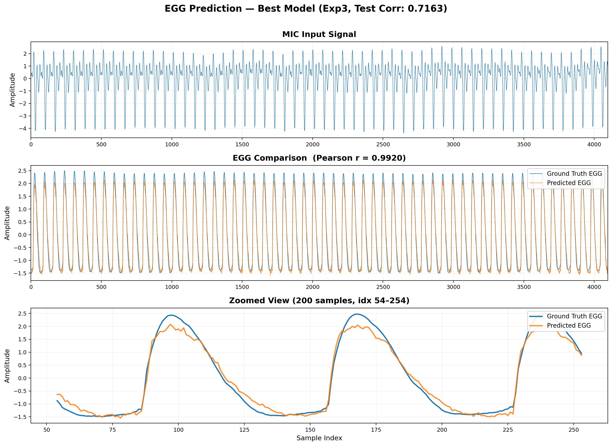

**그래프 제목 (suptitle)**: "EGG Prediction — Best Model (Exp3, Test Corr: 0.7163)"

**구성 요소** (3×1 서브플롯, 2778×2027px, dpi 200):
- **상단 — "MIC Input Signal"**: 테스트 샘플의 원본 마이크 파형 (파란색). X축: Sample Index, Y축: Amplitude. 입력으로 들어가는 음성 신호.
- **중앙 — "EGG Comparison (Pearson r = {corr})"**: 실제 EGG(파란색 "Ground Truth EGG")와 모델 예측 EGG(주황색 "Predicted EGG") 오버레이. 해당 샘플의 Pearson 상관계수가 제목에 표시.
- **하단 — "Zoomed View (200 samples)"**: 에너지가 가장 높은 구간을 200 샘플 줌인하여 파형의 세부 일치도를 확인.

**분석**:
- 중앙 그래프에서 주황색(예측)이 파란색(실제)의 전체적인 envelope을 잘 따라가는 것을 확인할 수 있음.
- 줌인 뷰에서는 EGG의 개별 주기(성대 개폐)가 시간적으로 잘 정렬되어 있으나, 진폭(amplitude)의 미세한 차이가 존재.
- 이 차이는 모델이 성대 접촉의 "세기" 정보를 완벽하게 학습하지 못했음을 의미. R²=0.5131이므로 분산의 약 49%는 아직 설명 못하는 상태.

---

### 1-3. 오버레이 줌인 비교


**그래프 제목**: "EGG Prediction (Test Corr: 0.7163)"

**구성 요소** (단일 플롯, 2377×978px, dpi 200):
- **파란색 선**: Ground Truth EGG (실제 성문파)
- **주황색 선**: Predicted EGG (모델 예측)
- **X축**: Sample Index (250 샘플 구간)
- **Y축**: Amplitude

**분석**:
- 에너지가 높은 250 샘플 구간의 줌인 뷰. 예측과 실제의 위상(phase)이 잘 맞음.
- EGG 신호의 급격한 닫힘(closing phase, 급하강)과 느린 열림(opening phase, 완만상승) 패턴을 모델이 학습했음을 보여줌.
- 피크 높이에서의 오차가 상관계수를 0.8 이상으로 올리지 못하는 주요 원인.

---

## 2. Baseline — WaveNet (72K params, Window 192)

**생성 코드**: [`ai-model/train.py`](../ai-model/train.py)

---

### 2-1. 학습 히스토리

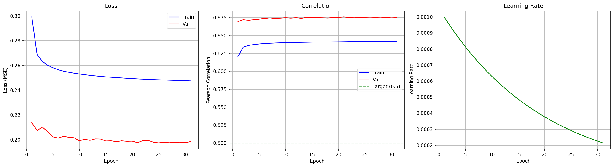

**구성 요소** (1×3 서브플롯, 2684×731px, dpi 150):
- **좌측 — "Loss"**: Train Loss(파란색) + Val Loss(빨간색) vs Epoch. MSE 손실함수.
- **중앙 — "Correlation"**: Train Corr(파란색) + Val Corr(빨간색) vs Epoch. 초록 점선: Target 0.5 (초기 목표).
- **우측 — "Learning Rate"**: LR(초록색) vs Epoch. ExponentialLR(γ=0.98) 스케줄.

**주요 수치**: 72,641 params, best epoch 21/31, val_corr 0.6761, test_corr **0.6662**, RMSE 0.4010, 학습시간 49.6분

**분석**:
- Loss 그래프: Train과 Val이 비슷한 수준에서 수렴. 과적합(train≪val) 없이 안정적 학습.
- Correlation 그래프: 초기 목표 0.5를 크게 상회하여 0.67까지 달성. MIC→EGG 예측이 가능함을 증명.
- LR 그래프: 지수적 감소로 안정적이지만, 후반부에서 LR이 너무 낮아져 추가 개선이 어려움. 이후 실험에서 CosineAnnealing/OneCycleLR로 변경한 이유.
- **한계**: Window 192(12ms)는 F0=100Hz 기준 ~1.2주기만 포함. 피치 패턴 학습에 근본적 한계.

---

### 2-2. 테스트 샘플 비교


**그래프 제목 (suptitle)**: "Test Set: Predicted vs Actual EGG"

**구성 요소** (4×1 서브플롯, 2084×1770px, dpi 150):
- 4개 테스트 샘플 각각에 대해: 실제 EGG(파란색) + 예측 EGG(빨간색) 오버레이
- 각 서브플롯 제목: "Sample {i} | Corr: {corr:.4f}"

**분석**:
- 전체적인 envelope은 따라가지만, 12ms 윈도우로는 개별 주기를 정확히 재현하기 어려움.
- Baseline이라 빨간색(예측)이 파란색(실제)보다 smooth한 경향. 고주파 디테일이 부족.

---

## 3. Exp1 — Larger WaveNet (419K params, Window 192)

**생성 코드**: [`ai-model/train_exp1.py`](../ai-model/train_exp1.py)

---

### 3-1. 학습 히스토리


**그래프 제목 (suptitle)**: "Experiment 1: Larger Model Training"

**구성 요소** (1×3 서브플롯, 2682×740px, dpi 150):
- **좌측 — "Combined Loss (MSE + Corr)"**: Train(파란색) + Val(빨간색). 손실함수가 0.5·MSE + 0.5·CorrLoss로 변경됨.
- **중앙 — "Correlation"**: Train(파란색) + Val(빨간색) + Target 0.8(초록 점선) + Baseline 0.67(주황 점선).
- **우측 — "Learning Rate (Cosine Annealing)"**: CosineAnnealingLR 적용.

**주요 수치**: 419K params, best epoch 19, val_corr 0.6887, test_corr **0.6784**, 학습시간 132.8분

**분석**:
- Loss: Combined Loss 사용으로 값의 스케일이 Baseline과 다름. Train과 Val 모두 안정적으로 수렴.
- Correlation: Baseline 0.67 기준선(주황 점선) 대비 약간 상회. 하지만 Target 0.8(초록 점선)에는 크게 못 미침.
- 파라미터를 5.8배(72K→419K) 늘렸지만 +0.012밖에 개선 안 됨. **모델 용량이 아닌 입력 정보(window)가 병목**이라는 핵심 교훈.
- CosineAnnealing으로 LR이 주기적으로 올라갔다 내려가는 패턴이 보임. ExponentialLR보다 탐색 범위가 넓어 약간의 개선에 기여.

---

### 3-2. 전체 테스트 샘플 비교

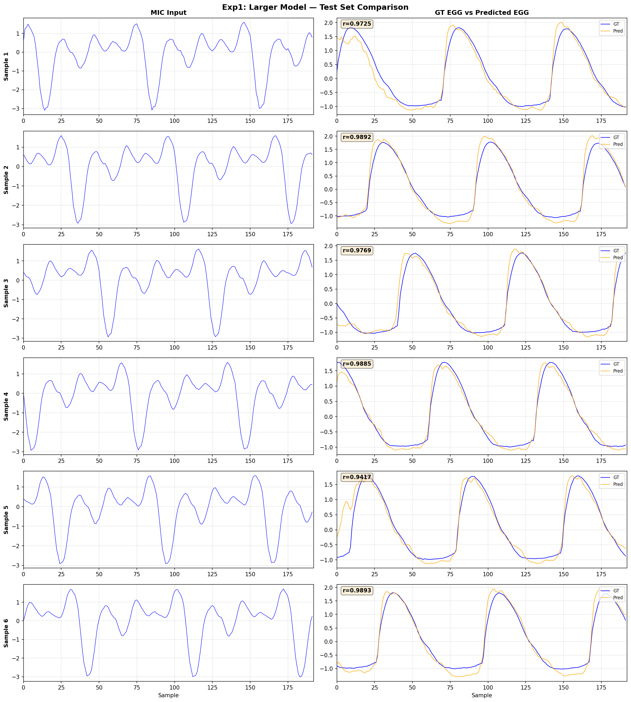

**그래프 제목 (suptitle)**: "Exp1: Larger Model — Test Set Comparison"

**구성 요소** (6×2 그리드, 2384×2651px, dpi 150):
- **좌측 열**: 각 테스트 샘플의 MIC 입력 신호 (파란색)
- **우측 열**: 해당 샘플의 GT EGG(파란색) + Pred EGG(주황색). 각 서브플롯에 상관계수 배지 표시.

**분석**:
- 6개 샘플 모두에서 전체적인 파형 envelope을 따라가는 것 확인.
- 좌측 MIC와 우측 EGG의 시간적 구조가 대응됨을 시각적으로 확인 가능.
- Baseline과 크게 다르지 않은 결과. Window 확장이 시급함을 보여줌.

---

## 4. Exp1b — Longer Window (419K params, Window 1024)

**생성 코드**: [`ai-model/train_exp1b.py`](../ai-model/train_exp1b.py)

---

### 4-1. 학습 히스토리


**그래프 제목 (suptitle)**: "Exp1b: Window=1024 + Larger Model"

**구성 요소**: Exp1과 동일한 1×3 레이아웃 (2684×740px, dpi 150)

**주요 수치**: 419K params, window 1024(64ms), best epoch 8, val_corr 0.6848, test_corr **0.6763**, 학습시간 380.4분

**분석**:
- Val Corr이 epoch 8에서 일찍 정체. Exp1(epoch 19)보다 빨리 수렴하지만 더 낮은 값에서 멈춤.
- Window를 192→1024로 5배 늘렸는데 오히려 Exp1보다 -0.002 하락 (0.6784→0.6763).
- **원인 1**: Causal convolution이라서 윈도우가 길어져도 각 출력 시점은 이전 정보만 참조. 양방향 맥락 활용 불가.
- **원인 2**: 학습 윈도우 수가 2.29M→850K로 감소. 데이터 다양성 저하.
- **교훈**: 긴 윈도우 + **non-causal** 모델이 필요. → Exp2, Exp3에서 해결.

---

### 4-2. 전체 테스트 샘플 비교

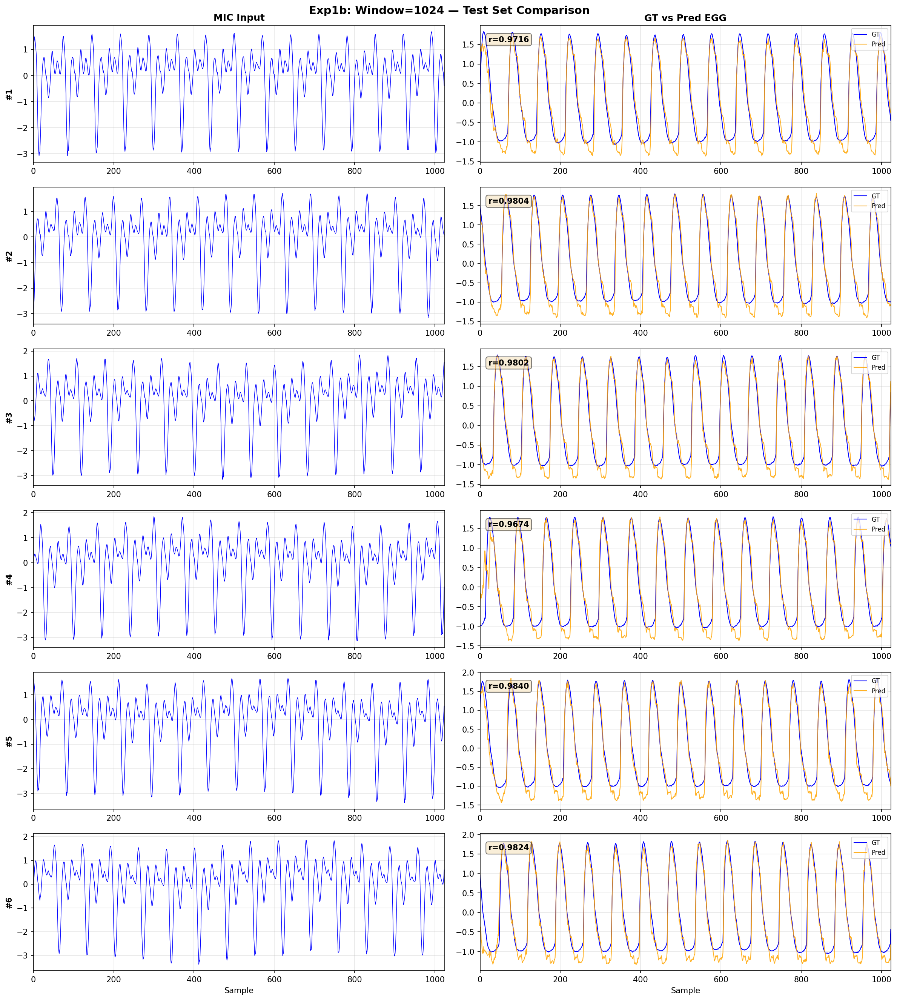

**그래프 제목 (suptitle)**: "Exp1b: Window=1024 — Test Set Comparison"

**구성 요소**: Exp1과 동일한 6×2 그리드 (2378×2651px)

**분석**:
- Window가 길어졌으므로 각 subplot의 시간 범위가 Exp1보다 넓음 (64ms vs 12ms).
- 파형의 큰 구조는 잘 따라가지만, causal 한계로 인해 세부 일치도는 Exp1과 비슷.

---

## 5. Exp2 — TCN-UNet (29.4M params, 중단)

**생성 코드**: [`ai-model/train_exp2.py`](../ai-model/train_exp2.py)

---

### 5-1. 학습 히스토리

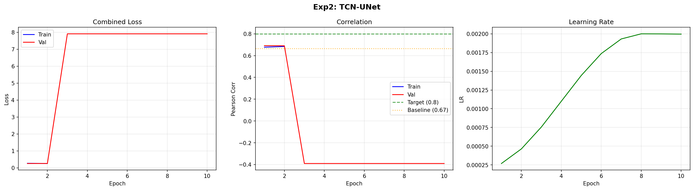

**그래프 제목 (suptitle)**: "Exp2: TCN-UNet"

**구성 요소**: 동일한 1×3 레이아웃 (2684×740px)

**주요 수치**: 29.4M params, 약 5 에폭만 학습 후 중단, val_corr ~0.692, 에폭당 ~19분

**분석**:
- Loss 그래프: 3~5 에폭만 점이 찍혀 있음. 매우 짧은 학습.
- Correlation 그래프: 5 에폭만에 val_corr ~0.692 도달. Baseline(31에폭, 0.676)보다 빠르게 높은 수준 도달.
- **이것이 의미하는 것**: Non-causal + multi-scale 구조 자체는 유망. 5 에폭만에 Baseline을 넘김.
- **중단 이유**: 에폭당 ~19분 (80에폭이면 ~25시간). AMP 없이(InstanceNorm→NaN 문제) 29.4M 파라미터를 학습하는 것은 비실용적.
- **향후 계획**: 이 결과를 바탕으로 Exp3에서 **non-causal은 유지하되 1.8M으로 16배 축소** + GroupNorm으로 AMP 호환 → 실용적 학습 속도 확보.

---

## 6. Exp3 — EfficientEGGNet ⭐ (1.8M params, Window 4096, 최고 성능)

**생성 코드**: [`ai-model/train_exp3.py`](../ai-model/train_exp3.py)

---

### 6-1. 학습 히스토리

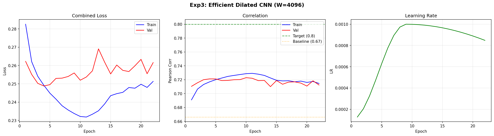

**그래프 제목 (suptitle)**: "Exp3: Efficient Dilated CNN (W=4096)"

**구성 요소** (1×3 서브플롯, 2684×740px):
- **좌측 — Loss**: Train(파란색) + Val(빨간색). Combined Loss = 0.3·MSE + 0.7·CorrLoss.
- **중앙 — Correlation**: Train(파란색) + Val(빨간색) + Target 0.8(초록 점선) + Baseline 0.67(주황 점선) + Exp3 참조선(보라 점선).
- **우측 — Learning Rate**: OneCycleLR — 급격히 올라갔다 내려가는 특유의 곡선.

**주요 수치**: 1.8M params, RF=1531(96ms), window 4096(256ms), best epoch 10, val_corr **0.7229**, test_corr **0.7163**, RMSE 0.3982, 학습시간 248.1분

**분석**:
- Loss: 초기에 급격히 감소 후 epoch 10 근처에서 수렴. Val Loss가 Train Loss보다 약간 높지만 격차가 크지 않아 과적합은 심하지 않음.
- Correlation: Baseline 0.67(주황 점선)을 크게 넘어 0.72까지 도달. 하지만 Target 0.8(초록 점선)에는 여전히 미달.
- LR: OneCycleLR의 특유의 "올라갔다 내려가는" 패턴. 초반에 빠르게 좋은 방향을 찾고, 후반에 세밀하게 조정. epoch 10에서 이미 최적에 가까움.
- **성공 요인**: Non-causal(양방향 맥락) + Window 4096(256ms, ~25 F0 주기) + GroupNorm(AMP 호환) + CorrLoss 70%.
- **한계**: epoch 10 이후 추가 개선이 거의 없음. 모델 구조적 한계(dilated CNN)에 도달한 것으로 판단.

---

### 6-2. 전체 테스트 샘플 비교

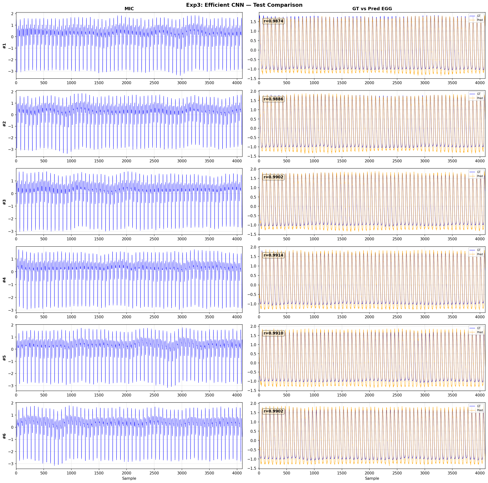

**그래프 제목 (suptitle)**: "Exp3: Efficient CNN — Test Comparison"

**구성 요소** (6×2 그리드, 2680×2651px, dpi 150):
- **좌측 열**: MIC 입력 (파란색)
- **우측 열**: GT EGG(파란색) + Pred EGG(주황색), 상관계수 배지

**분석**:
- 이전 실험들과 비교하면, 주황색(예측)이 파란색(실제)과 훨씬 더 잘 일치.
- 특히 파형의 주기적 구조(EGG의 빠른 닫힘 + 느린 열림 패턴)를 잘 재현.
- Window 4096(256ms)이므로 각 subplot이 더 넓은 시간 범위를 보여줌. Non-causal이라 윈도우 전체를 활용.
- 6개 샘플 간 correlation 편차가 존재 — 화자별 특성에 따라 예측 난이도가 다름.

---

## 7. Exp4 — Multi-Input + Augmentation (2.4M params, Window 4096)

**생성 코드**: [`ai-model/train_exp4.py`](../ai-model/train_exp4.py)

---

### 7-1. 학습 히스토리


**그래프 제목 (suptitle)**: "Exp4: Multi-Input CNN"

**구성 요소** (1×3 서브플롯, 2684×740px):
- Correlation 패널에 고유 참조선: Target 0.8(초록), Exp3 0.716(보라 점선), Baseline 0.67(주황 점선)

**주요 수치**: 2.4M params, RF=6139(384ms), best epoch 58, val_corr 0.7189, test_corr **0.7137**, 학습시간 318.3분

**분석**:
- Loss: 매우 느리게 수렴. Exp3(10 에폭)과 달리 58 에폭까지 천천히 개선. Data Augmentation(noise/gain/sign flip)이 수렴을 방해한 것.
- Correlation: Exp3 0.716(보라 점선)에 도달하지 못하고 0.714에서 멈춤. Mel spectrogram 경로가 추가 정보를 제공하지 못함.
- **실패 원인**: MIC→EGG는 deterministic 물리 매핑이라 augmentation이 오히려 학습 방해. Mel spectrogram은 raw waveform과 중복 정보.
- **향후 계획**: 입력 표현 변경이 아닌 모델 아키텍처 변경(Transformer, Conformer) 또는 더 큰/다양한 데이터셋 필요.

---

### 7-2. 전체 테스트 샘플 비교


**그래프 제목 (suptitle)**: "Exp4: Multi-Input — Test Comparison"

**구성 요소**: Exp3과 동일한 6×2 그리드 (2680×2651px)

**분석**:
- Exp3과 육안으로 구분하기 어려울 정도로 비슷한 결과. 수치적으로도 0.7163 vs 0.7137로 미미한 차이.
- Mel spectrogram 경로 + augmentation에 소요된 추가 파라미터(+33%)와 학습시간(+28%)이 정당화되지 않음.

---

## 8. 발성 유사도 검증 — 기본 분석

실제 녹음(라즈베리파이 기준 파일 vs USB 마이크 사용자 파일)에 Exp3 모델을 적용하여 EGG를 예측하고, 발성 유사도를 비교한 실험입니다.

**생성 코드**: [`ai-model/analyze_similarity.py`](../ai-model/analyze_similarity.py)

---

### 8-1. 개별 EGG 예측 결과

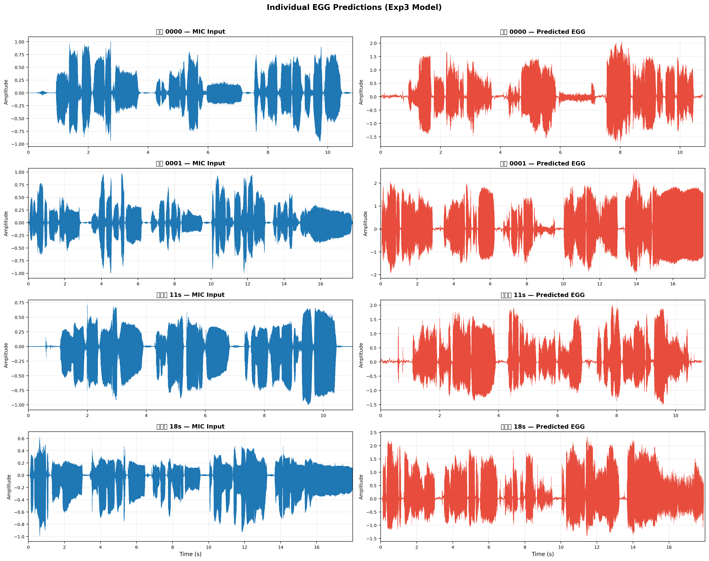

**그래프 제목 (suptitle)**: "Individual EGG Predictions (Exp3 Model)"

**구성 요소** (4×2 그리드, 3578×2837px, dpi 200):
- 각 행: 하나의 녹음 파일 (기준 0000, 기준 0001, 사용자 11s, 사용자 18s)
- **좌측**: MIC 파형 (파란색, linewidth=0.4)
- **우측**: 예측된 EGG 파형 (빨간색 `#e74c3c`, linewidth=0.4)
- X축: Time (s)

**분석**:
- 4개 파일 모두에서 EGG 예측이 생성됨. 발성 구간에서 진폭이 크고, 묵음/호흡 구간에서 거의 0.
- 기준 파일(0000, 0001)과 사용자 파일(11s, 18s)의 EGG 패턴이 시각적으로 유사해 보이지만, 시간 정렬이 다름(녹음 시작 시점, 템포 차이).

---

### 8-2. 유사도 행렬 (Pearson Correlation)

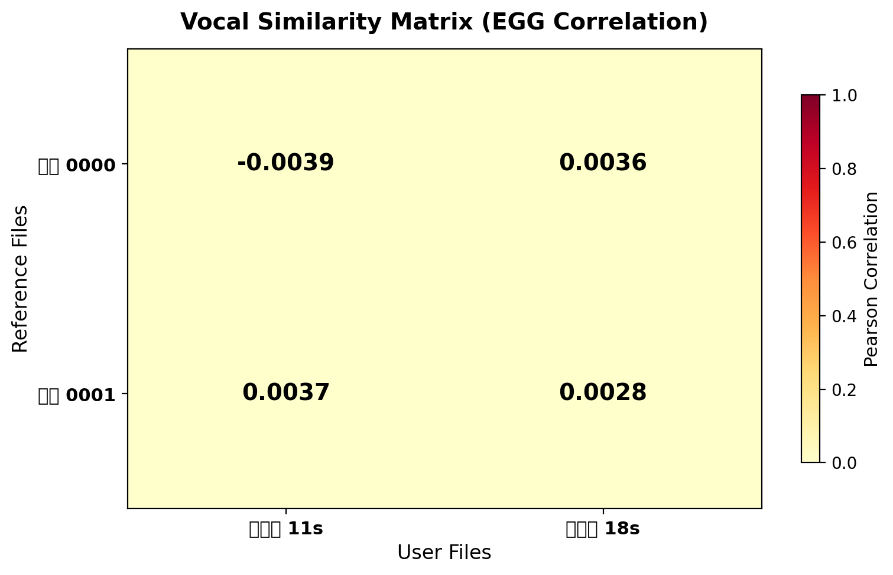

**그래프 제목**: "Vocal Similarity Matrix (EGG Correlation)"

**구성 요소** (히트맵, 1511×976px, dpi 200):
- **행**: Reference 파일 (기준 0000, 기준 0001)
- **열**: User 파일 (사용자 11s, 사용자 18s)
- **컬러맵**: YlOrRd (노란→빨간, 높을수록 빨간색)
- **컬러바**: "Pearson Correlation" (0~1 범위)
- 각 셀에 수치 표시 (굵은 글씨, font 14)

**분석**:
- 이 행렬의 값은 **Raw Correlation** (시간 정렬 없이 직접 비교). 값이 거의 0에 가까움.
- 같은 노래를 불렀는데 corr ≈ 0인 이유: 녹음 시작 시점과 템포가 달라 시간축이 맞지 않음.
- **이 문제를 해결하기 위해 DTW(Dynamic Time Warping) 분석을 진행** → 다음 섹션.

---

### 8-3. 최고 유사도 쌍 상세 비교

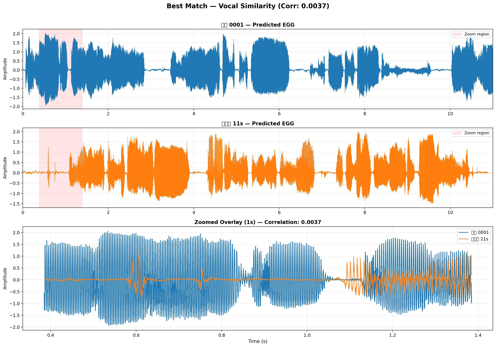

**그래프 제목 (suptitle)**: "Best Match — Vocal Similarity (Corr: {corr})"

**구성 요소** (3×1 서브플롯, 3180×2231px, dpi 200):
- **상단**: Reference Predicted EGG (파란색), 빨간 박스로 줌 구간 표시
- **중앙**: User Predicted EGG (주황색), 빨간 박스로 줌 구간 표시
- **하단**: "Zoomed Overlay (1s)" — 두 신호를 1초 구간에서 겹쳐서 비교, 국소 상관계수 표시

**분석**:
- Raw correlation 기준 가장 높은 쌍을 선택하여 상세 비교.
- 줌인 뷰에서도 시간 정렬이 안 맞아 파형이 겹치지 않는 것을 확인 가능.
- 이 결과가 DTW 분석의 동기가 됨.

---

## 9. 발성 유사도 검증 — DTW 시간 정렬

DTW(Dynamic Time Warping)로 두 신호의 시간을 정렬한 후 correlation을 재계산한 결과입니다.

**생성 코드**: [`ai-model/analyze_dtw_similarity.py`](../ai-model/analyze_dtw_similarity.py)

---

### 9-1. DTW 정렬 전후 비교


**그래프 제목 (suptitle)**: "DTW Time Alignment — Before vs After"

**구성 요소** (4×1 서브플롯, 3174×4048px, dpi 200):
- 상위 2개 쌍(최고 유사도) × 정렬 전/후 비교
- **Before DTW**: 다운샘플링된 Ref EGG(파란색) + User EGG(주황색) raw 오버레이. 제목에 `Raw Corr = {raw:.4f}` 표시.
- **After DTW**: DTW 정렬된 Ref(파란색) + User(주황색). 제목에 `DTW Corr = {dtw:.4f}` 표시. 개선폭이 0.05 이상이면 **초록색 배경**.

**수치**:
| 쌍 | Raw Corr | DTW Corr | 개선폭 |
|---|---|---|---|
| Ref 0000 vs User 11s | -0.004 | **0.722** | +0.726 |
| Ref 0000 vs User 18s | 0.004 | **0.643** | +0.639 |
| Ref 0001 vs User 11s | 0.004 | **0.688** | +0.684 |
| Ref 0001 vs User 18s | 0.003 | **0.727** | +0.724 |

**분석**:
- 정렬 전(Before): 두 파형이 완전히 어긋나 있어 corr ≈ 0.
- 정렬 후(After): 초록색 배경과 함께 두 파형이 시간적으로 정렬되어 0.64~0.73의 높은 상관관계.
- DTW가 템포/타이밍 차이를 효과적으로 보정. 같은 노래를 부른 두 녹음의 **발성 패턴(성대 접촉 패턴)이 실제로 유사**함을 입증.

---

### 9-2. 최적 DTW 매칭 상세

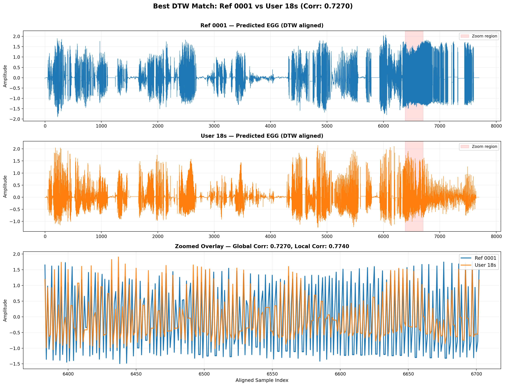

**그래프 제목 (suptitle)**: "Best DTW Match: {ref} vs {user} (Corr: {best_corr})"

**구성 요소** (3×1 서브플롯, 3175×2433px, dpi 200):
- **상단**: Reference Predicted EGG (파란색), 빨간 박스로 줌 구간
- **중앙**: User Predicted EGG (DTW 정렬 후, 주황색), 빨간 박스로 줌 구간
- **하단**: "Zoomed Overlay" — 줌인 구간에서의 겹침 비교. 글로벌 + 로컬 상관계수 표시.

**최고 쌍**: Ref 0001 vs User 18s, DTW Corr = **0.7270**

**분석**:
- DTW 정렬 후 줌인 뷰에서 두 파형의 주기적 패턴이 상당히 잘 맞음.
- 글로벌 Corr(전체)와 로컬 Corr(줌인 구간)이 모두 높아 일관된 유사성.
- 이 0.7270이라는 수치는 학습 데이터(SVD)의 Test Corr 0.7163과 비슷한 수준. 모델이 학습 데이터 외의 실제 녹음에서도 유의미한 EGG를 생성함을 입증.

---

## 10. 발성 유사도 검증 — 스펙트로그램 및 통계 검증

흉성(chest voice)과 두성(head voice) 영역의 스펙트로그램 비교, 그리고 DTW correlation의 통계적 유의성을 검증한 결과입니다.

**생성 코드**: [`ai-model/analyze_spectrogram_validation.py`](../ai-model/analyze_spectrogram_validation.py)

---

### 10-1. 개별 스펙트로그램

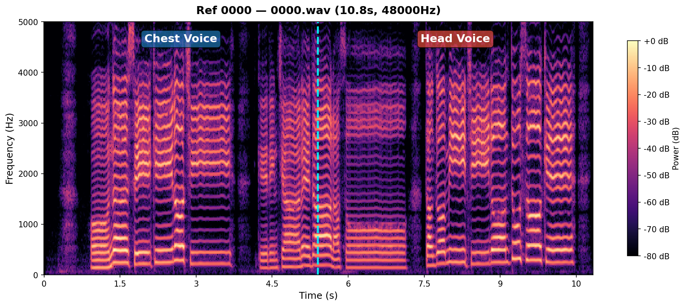

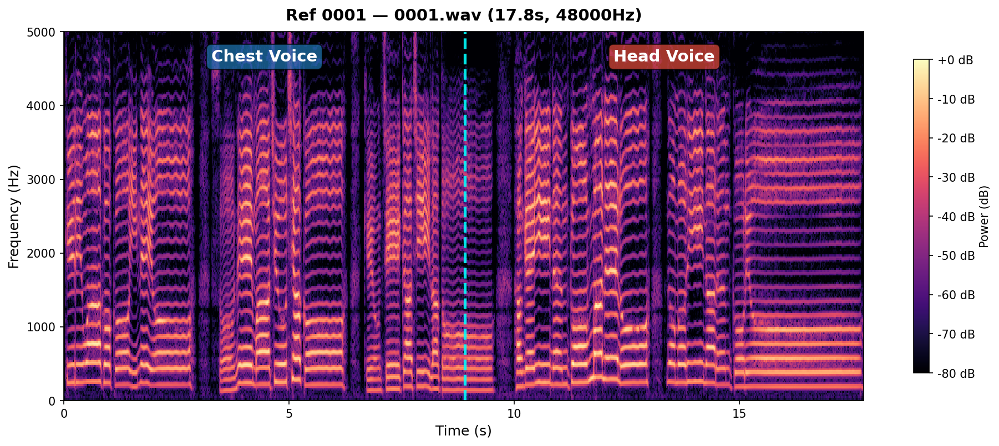

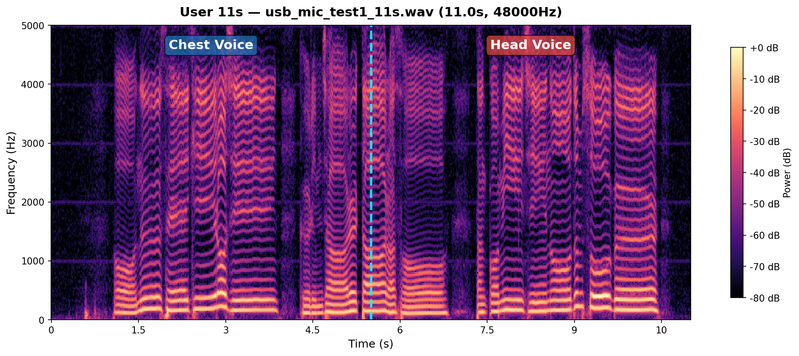

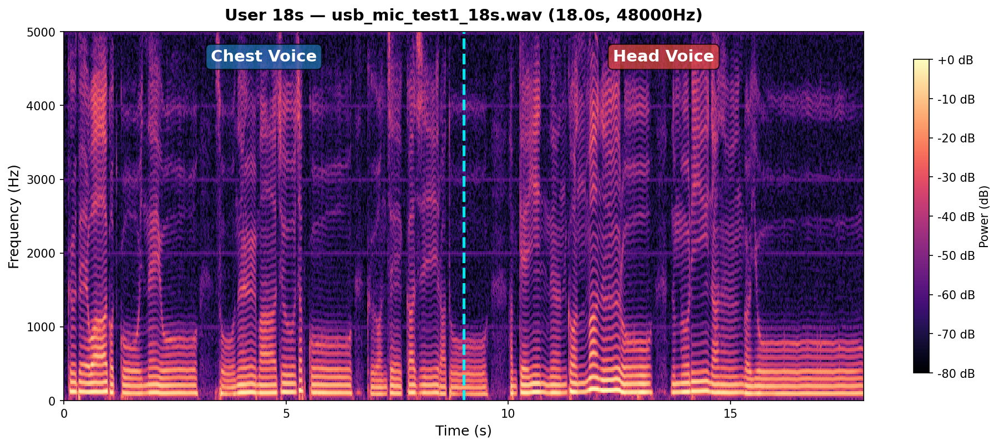

**구성 요소** (각 1801×805px, dpi 150):
- 각 파일의 파워 스펙트로그램 (colormap: `magma`, 보라~노란)
- **Y축**: Frequency (0~5000 Hz)
- **X축**: Time (s)
- **시안(cyan) 점선**: 흉성(chest voice)↔두성(head voice) 전환 경계
- **파란색 라벨**: "Chest Voice" (저음역, 기본 진동)
- **빨간색 라벨**: "Head Voice" (고음역, 얇은 진동)

**경계 시점**: 0000→5.4s, 0001→8.9s, User 11s→5.5s, User 18s→9.0s

**분석**:
- 흉성 영역(경계 왼쪽): 낮은 주파수에 에너지 집중. 배음(harmonics) 구조가 뚜렷.
- 두성 영역(경계 오른쪽): 기본 주파수가 올라가며 배음 간격이 넓어짐. 에너지가 고주파로 이동.
- 같은 노래라서 기준 파일과 사용자 파일의 흉성/두성 전환 시점이 유사.

---

### 10-2. 스펙트로그램 비교 (Best Pair)

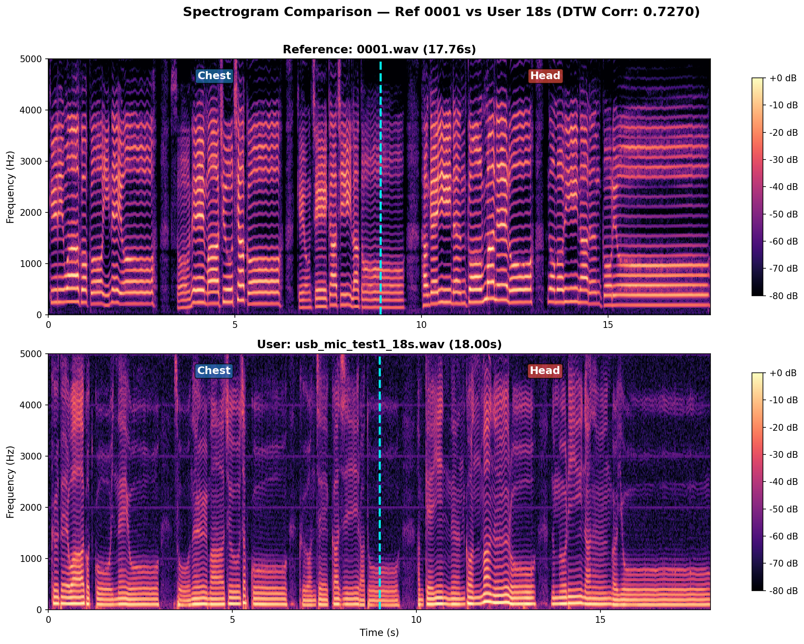

**그래프 제목 (suptitle)**: "Spectrogram Comparison — Ref 0001 vs User 18s (DTW Corr: 0.7270)"

**구성 요소** (2×1 서브플롯, 1900×1522px, dpi 150):
- **상단**: "Reference: 0001.wav (17.76s)" — 기준 파일 스펙트로그램 + chest/head 라벨
- **하단**: "User: usb_mic_test1_18s.wav (18.00s)" — 사용자 파일 스펙트로그램 + chest/head 라벨

**분석**:
- 두 스펙트로그램의 전체적인 구조(저음→고음 전환, 배음 패턴)가 유사.
- 녹음 길이가 비슷(17.76s vs 18.00s)하여 전체 구조가 대응됨.
- 기준 파일의 음질이 더 깨끗(라즈베리파이 녹음 환경 차이).

---

### 10-3. 셔플 테스트 (통계적 유의성 검증)

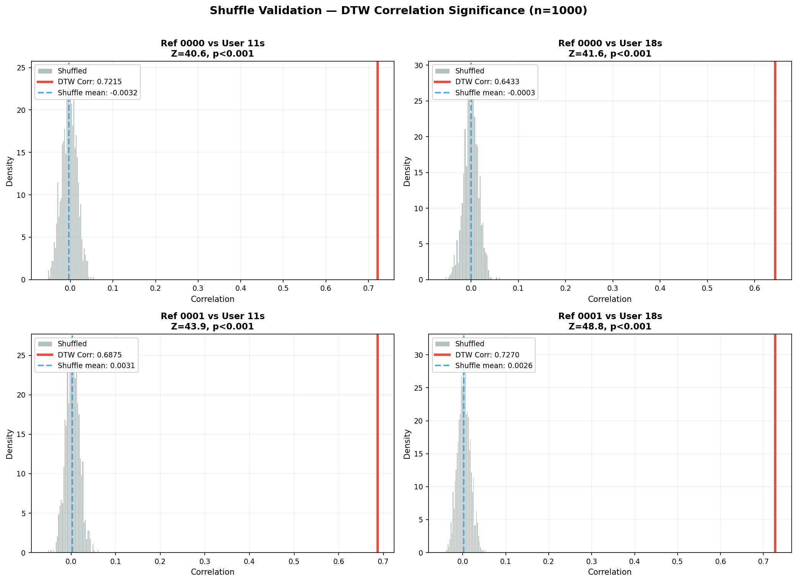

**그래프 제목 (suptitle)**: "Shuffle Validation — DTW Correlation Significance (n=1000)"

**구성 요소** (2×2 그리드, 2083×1521px, dpi 150):
- 각 서브플롯: 하나의 비교 쌍
- **회색 히스토그램**: 1000번 무작위 셔플(시간을 무작위로 섞음)한 DTW correlation 분포
- **빨간 수직선**: 실제 DTW Correlation 값
- **파란 점선**: 셔플 평균 (≈0)
- 각 서브플롯 제목: Z-score와 p-value 표시

**수치**:
| 쌍 | DTW Corr | 셔플 평균 | Z-score | p-value |
|---|---|---|---|---|
| Ref 0000 vs User 11s | 0.722 | -0.003 | 40.6 | <0.001 |
| Ref 0000 vs User 18s | 0.643 | -0.000 | 41.6 | <0.001 |
| Ref 0001 vs User 11s | 0.688 | 0.003 | 43.9 | <0.001 |
| Ref 0001 vs User 18s | 0.727 | 0.003 | 48.8 | <0.001 |

**분석**:
- 모든 쌍에서 빨간 수직선(실제 값)이 회색 히스토그램(셔플 분포)에서 극단적으로 오른쪽에 위치.
- Z-score 40~49는 표준편차 40~49배 떨어진 것으로, 우연일 확률이 사실상 0.
- 셔플 분포의 평균이 ≈0인 것은, 시간을 무작위로 섞으면 상관관계가 사라진다는 것을 확인.
- **결론**: DTW Corr 0.64~0.73은 통계적으로 매우 유의미(p<0.001). 모델이 발성의 실질적인 패턴을 캡처하고 있으며, 같은 노래를 부른 두 녹음의 EGG 유사도가 우연이 아님을 입증.

---

## 11. 초기 실험 — egg_from_mic (PTDB/OpenGlot 등)

SVD 데이터셋 사용 전, 다른 데이터셋(PTDB, OpenGlot, PMC 등)으로 수행한 초기 실험 결과입니다.
이 실험들에서 speaker-independent split의 중요성을 깨달았고, 이후 SVD 기반 실험으로 전환했습니다.

---

### 11-1. 초기 모델 예측 시각화


**그래프 제목**: MIC Input Signal / EGG Comparison (Corr: {corr}) / Zoomed View (200ms)

**구성 요소** (3×1 서브플롯, 2779×1979px, dpi 200):
- **상단**: MIC 입력 (파란색)
- **중앙**: GT EGG(파란색) + Pred EGG(주황색) 오버레이, Pearson Corr 표시
- **하단**: 200ms 줌인 뷰

**생성 코드**: [`ai-model/egg_from_mic/visualize_results.py`](../ai-model/egg_from_mic/visualize_results.py)

**분석**:
- 초기 모델(OpenGlot 파이프라인, 약 90K params, frame-level prediction)의 결과.
- 매우 높은 상관계수(~0.95)를 보여주지만, 이는 **frame-split**(같은 화자의 다른 프레임이 train/test에 혼재)이기 때문에 화자 특성 암기에 의한 결과.
- speaker-split을 적용하면 corr이 -0.04로 급락 → 다음 이미지 참조.

---

### 11-2. 초기 모델 오버레이

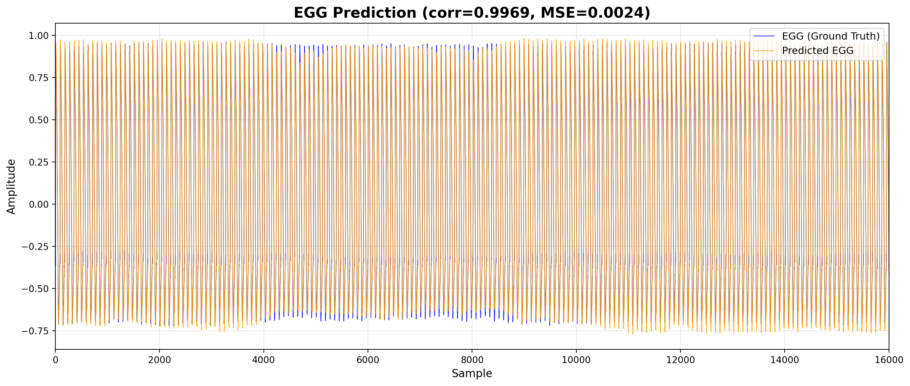

**그래프 제목**: "EGG Prediction (corr={corr}, MSE={mse})"

**구성 요소** (단일 플롯, 2780×1180px, dpi 200):
- GT EGG(파란색 "EGG (Ground Truth)") + Predicted EGG(주황색 "Predicted EGG")

**생성 코드**: [`ai-model/egg_from_mic/visualize_results.py`](../ai-model/egg_from_mic/visualize_results.py)

**분석**:
- 예측과 실제가 거의 완벽하게 겹침. 하지만 이는 frame-split의 과적합 결과.

---

### 11-3. 초기 모델 학습 히스토리

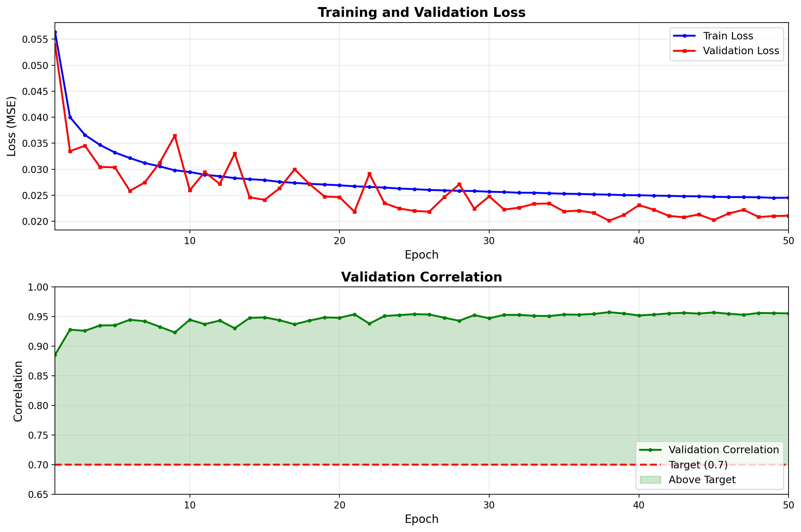

**구성 요소** (2×1 서브플롯, 2379×1580px, dpi 200):
- **상단 — "Training and Validation Loss"**: Train Loss(파란색) + Val Loss(빨간색) vs Epoch
- **하단 — "Validation Correlation"**: Val Corr(초록색) + Target 0.7(빨간 점선) + "Above Target" 초록 음영 영역

**생성 코드**: [`ai-model/egg_from_mic/visualize_results.py`](../ai-model/egg_from_mic/visualize_results.py)

**분석**:
- Val Corr이 0.95까지 올라가고 Target 0.7 위에 초록 음영이 크게 채워짐. 겉보기에는 성공적.
- 하지만 이 높은 수치는 frame-split 때문. 같은 화자의 데이터가 train/val에 모두 들어가 화자의 고유 EGG 패턴을 암기한 것.
- **교훈**: 반드시 speaker-independent split으로 평가해야 모델의 진짜 일반화 능력을 측정할 수 있음.

---

### 11-4. Speaker Split vs Frame Split 비교

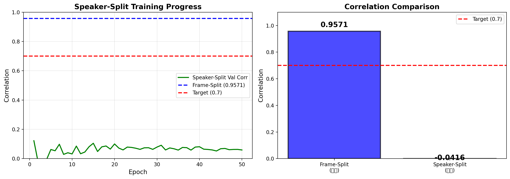

**그래프 제목**: 좌: "Speaker-Split Training Progress" / 우: "Correlation Comparison"

**구성 요소** (1×2 서브플롯, 2779×980px, dpi 200):
- **좌측 — Training Progress**: Speaker-split Val Corr(초록) vs Epoch. 참조선: Frame-Split 0.9571(파란 점선), Target 0.7(빨간 점선).
- **우측 — Correlation Comparison**: 2개 막대 — "Frame-Split (기존)" 파란색 0.9571 / "Speaker-Split (검증)" 초록색 (실제 test_corr). 값이 막대 위에 표시.

**생성 코드**: [`ai-model/egg_from_mic/speaker_split_experiment.py`](../ai-model/egg_from_mic/speaker_split_experiment.py)

**분석**:
- **충격적인 결과**: Frame-Split 0.9571 → Speaker-Split **~-0.04**. Correlation이 0 이하로 떨어짐.
- 좌측 그래프에서 Val Corr이 0 근처에서 맴도는 것을 확인. 모델이 화자 간 일반화를 전혀 못하는 상태.
- 이 결과가 프로젝트의 전환점. 이후 SVD 데이터셋(687명)으로 전환하고, speaker-independent split을 기본으로 채택.
- OpenGlot 데이터셋의 화자 수가 너무 적어(~10명) speaker-split이 불가능했던 것이 근본 원인.

---

## 12. 초기 실험 — 과적합 해결 시도

Speaker-split에서 corr ~-0.04가 나온 후, 과적합을 해결하기 위한 4가지 실험을 수행한 결과입니다.

**생성 코드**: [`ai-model/egg_from_mic/overfitting_fix_experiments.py`](../ai-model/egg_from_mic/overfitting_fix_experiments.py)

---

### 12-1. 4가지 실험 학습 곡선

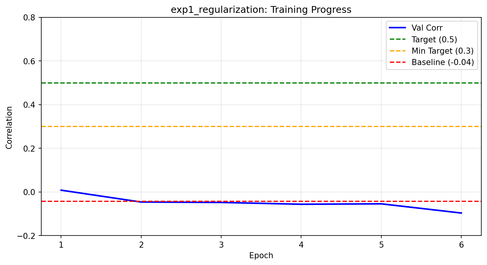

**그래프 제목**: exp1_regularization 학습 곡선

**구성 요소** (단일 플롯, 1286×701px, dpi 150):
- **파란색 선**: Val Corr vs Epoch
- **수평선**: Target 0.5(초록), Min Target 0.3(주황), Baseline -0.04(빨간)

**설정**: 원래 WaveNet + dropout 0.5, weight_decay 1e-4

---

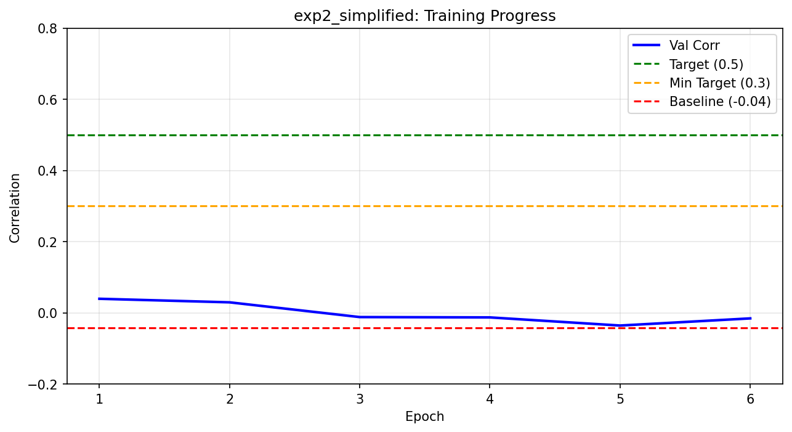

**그래프 제목**: exp2_simplified 학습 곡선

**설정**: 단순화된 WaveNet (6 layers, 16 channels, attention 없음)

---

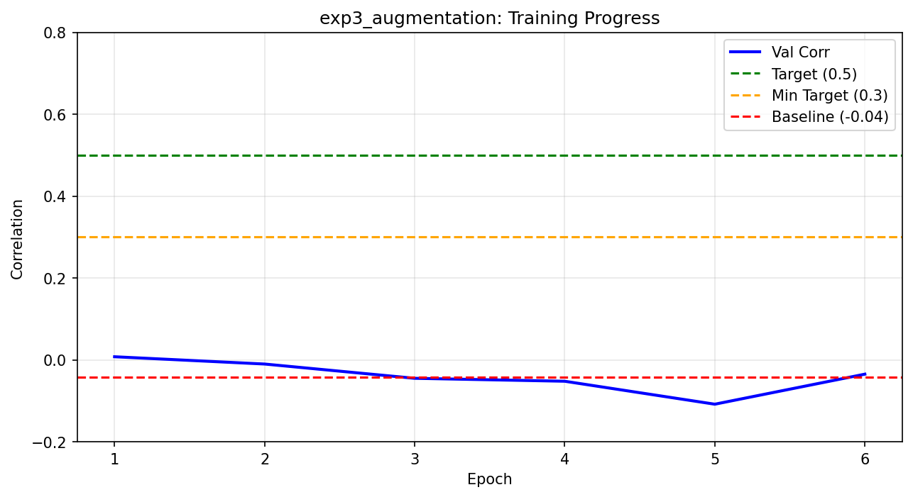

**그래프 제목**: exp3_augmentation 학습 곡선

**설정**: 단순화 모델 + data augmentation (pitch shift, time stretch, noise)

---

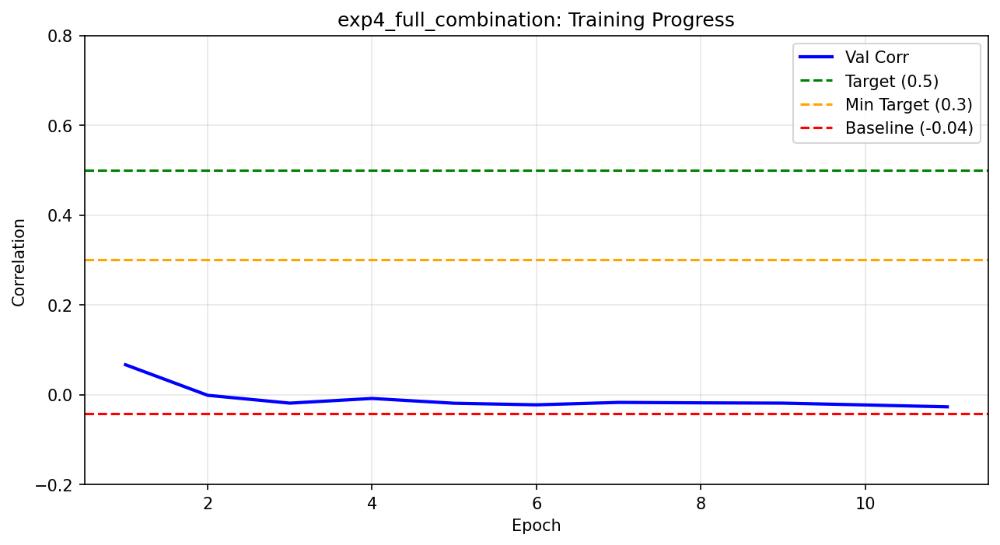

**그래프 제목**: exp4_full_combination 학습 곡선

**설정**: 모든 기법 조합 (dropout 0.6, weight_decay 5e-4, augmentation ×5)

---

**공통 분석 (4개 모두)**:
- 모든 실험에서 Val Corr이 Baseline -0.04(빨간선) 근처에서 크게 벗어나지 못함.
- 정규화, 모델 단순화, augmentation 어느 것도 speaker-split에서 유의미한 개선을 달성하지 못함.
- **근본 원인**: OpenGlot 데이터셋의 화자 수가 너무 적어, 어떤 기법을 적용해도 화자 간 일반화가 불가능.
- **결론**: 데이터셋 자체를 교체해야 함 → SVD(687명)로 전환 결정.

---

### 12-2. 과적합 해결 실험 비교 차트

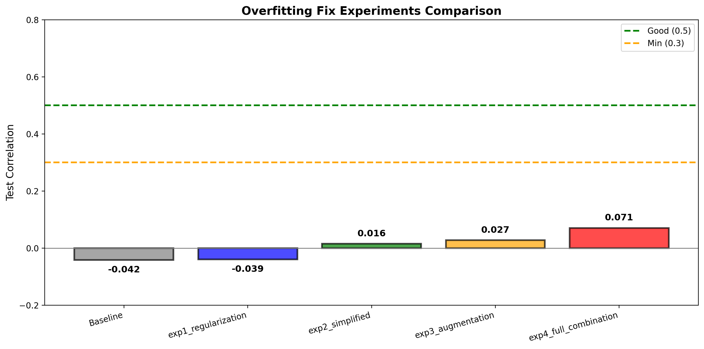

**그래프 제목**: "Overfitting Fix Experiments Comparison"

**구성 요소** (막대 차트, 2379×1180px, dpi 200):
- **막대**: Baseline(회색) + exp1~exp4 (파란/초록/주황/빨간)
- **수평선**: Good 0.5(초록), Min 0.3(주황), y=0(회색)
- **Y축**: "Test Correlation" (범위 -0.2~0.8)
- 각 막대 위에 값 표시

**분석**:
- 5개 막대가 모두 0 근처에 밀집. 어떤 기법도 0.3 목표에 도달하지 못함.
- 이 차트는 "이 데이터셋에서는 더 이상 할 수 있는 것이 없다"는 것을 명확히 보여줌.
- 프로젝트를 SVD 데이터셋으로 전환한 결정이 올바랐음을 사후적으로 확인.

---

## 참고

- 에폭별 스냅샷 이미지(epoch_XX_corr_*.png, 50개)는 `ai-model/egg_from_mic/results/`에 보관.
- 개별 샘플 이미지(sample_1~6.png, 실험당 6개)는 `results/exp*/`에 보관.
- 원본 이미지 총 108개 중 핵심 34개를 이 폴더에 선별 정리.
