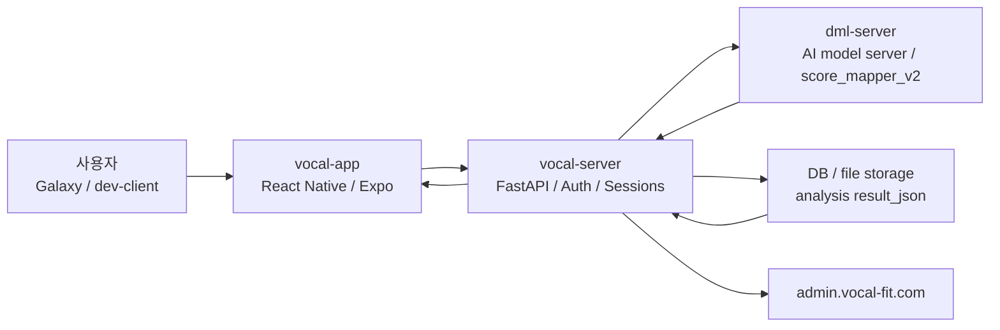
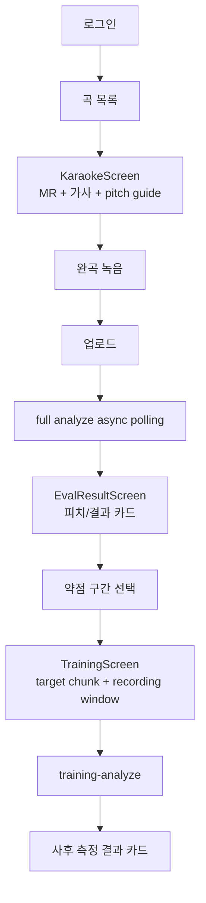
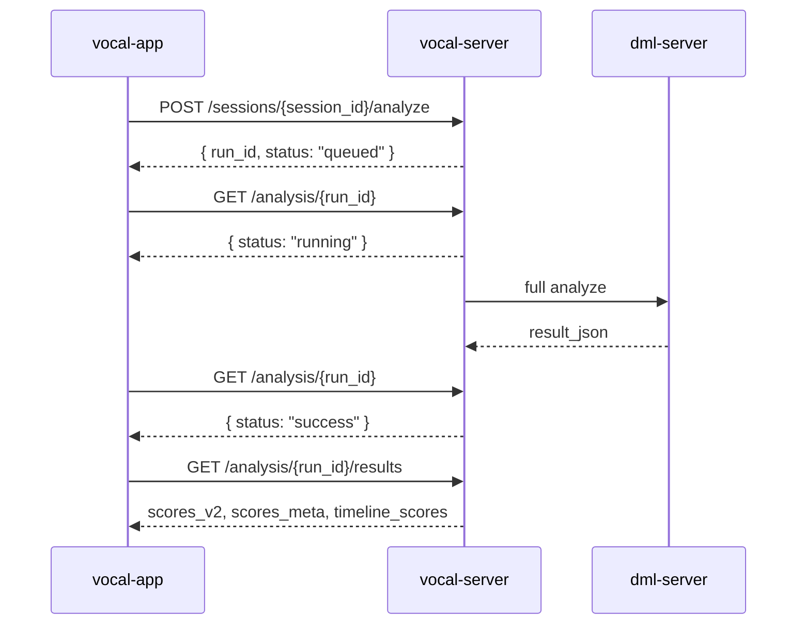
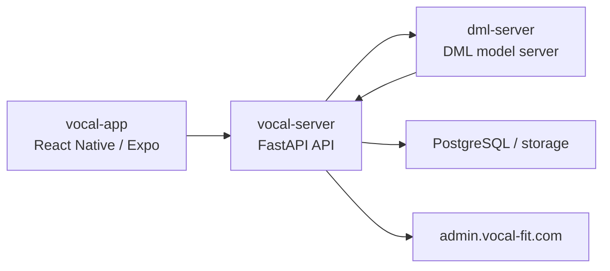
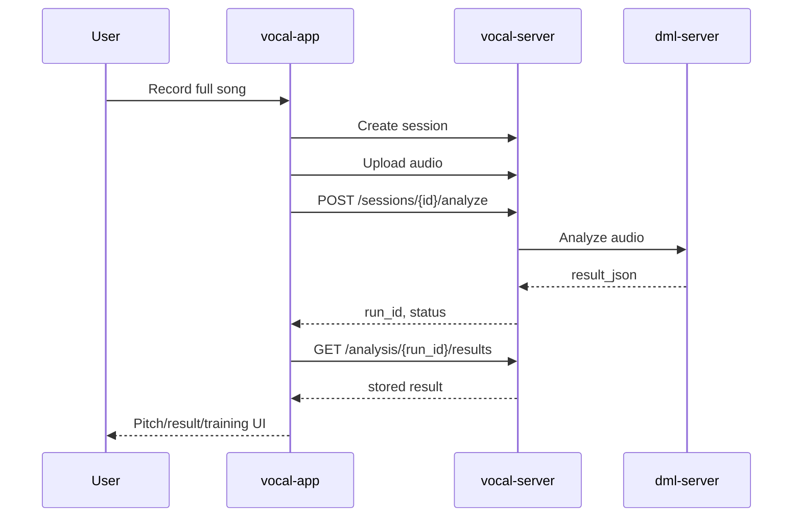
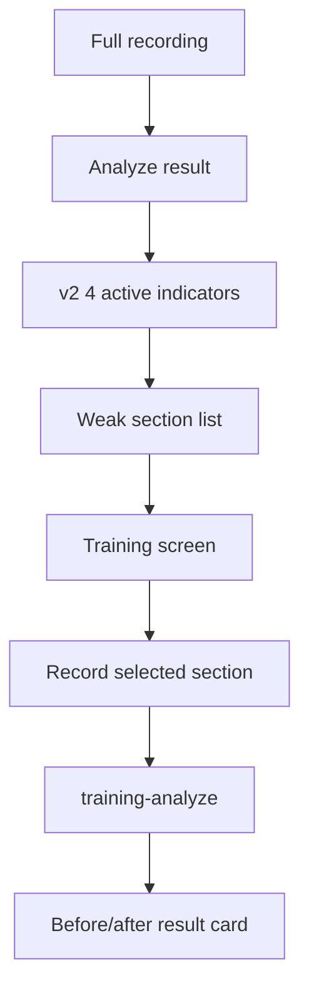

# AI_CONTEXT_FULL — 전체 원문 통합본

> **이 파일은 사람이 읽으라고 만든 것이 아니다.** AI 에이전트에게 프로젝트 전체 맥락을
> 한 번에 주입하기 위한 단일 파일이며, 아래 문서들의 **원문을 요약 없이 그대로** 이어붙였다.
> 사람이 읽을 정리본은 [`docs/LESSONS_LEARNED.md`](LESSONS_LEARNED.md) 를 볼 것.

- **생성**: 2026-08-05 12:14 · `python docs/build_docs.py` 로 재생성 가능
- **포함 파일**: 36개
- **원문 무손실**: 각 파일은 `## ▶ FILE:` 구분선 뒤에 바이트 단위 그대로 들어 있다 (편집·요약·생략 없음).
- **주의**: 문서 간 내용이 상충할 수 있다. 날짜가 늦은 기술이 우선하며,
  2026-07-26 자 `docs/research/40-rediag-selection-bias-2026-07.md` 가
  검증 수치에 관해서는 가장 최신이자 가장 정확하다.

## 수록 파일 목록

| 파일 | 크기 | 섹션 |
|---|---:|---|
| `README.md` | 29,616 B | A |
| `CLAUDE.md` | 3,964 B | A |
| `AGENTS.md` | 556 B | A |
| `docs/VOCAL_FIT_PROJECT_OVERVIEW.md` | 21,860 B | A |
| `docs/LESSONS_LEARNED.md` | 16,244 B | B |
| `dml-server/CLAUDE.md` | 18,097 B | C |
| `dml-server/AGENTS.md` | 10,588 B | C |
| `dml-server/PROJECT_LOG.md` | 52,297 B | C |
| `dml-server/ai-model/EXPERIMENT_REPORT.md` | 11,335 B | C |
| `dml-server/docs/VERIFY_dmlserver.md` | 18,681 B | C |
| `dml-server/docs/DML_RESPONSE_SPEC.md` | 16,758 B | C |
| `dml-server/docs/vocal_app_score_mapper_v2_spec.md` | 11,296 B | C |
| `dml-server/HANDOVER_TO_GPT.md` | 14,030 B | C |
| `dml-server/docs/HANDOVER_TO_CLAUDE_dmlserver.md` | 32,251 B | C |
| `vocal-server/docs/vocal_server_code_audit_2026-06-16.md` | 45,582 B | D |
| `vocal-server/PROGRESS.md` | 16,889 B | D |
| `vocal-app/docs/V2_CLOSEOUT_CHECKLIST.md` | 2,850 B | D |
| `docs/CHANGELOG.md` | 15,582 B | D |
| `docs/VOCAL_APP_CURRENT_STATE.md` | 14,278 B | D |
| `docs/research/01-model-experiments-full.md` | 3,323 B | E |
| `docs/research/02-dataset-reference.md` | 2,393 B | E |
| `docs/research/03-folder-structure.md` | 4,987 B | E |
| `docs/research/10-matching-diagnosis-summary.md` | 7,233 B | E |
| `docs/research/11-matching-diagnosis-slides.md` | 5,221 B | E |
| `docs/research/20-icc-510-report.md` | 4,477 B | E |
| `docs/research/21-midi-octave-check-510.md` | 1,337 B | E |
| `docs/research/22-sign-reversal-analysis.md` | 7,384 B | E |
| `docs/research/23-b1-difference-root-cause.md` | 3,530 B | E |
| `docs/research/24-d3-compatibility-test.md` | 2,996 B | E |
| `docs/research/25-handover-2026-05-11.md` | 10,317 B | E |
| `docs/research/26-presentation-key-messages.md` | 6,963 B | E |
| `docs/research/30-egg-model-contribution.md` | 1,197 B | E |
| `docs/research/31-final-validation-report.md` | 4,778 B | E |
| `docs/research/32-graduation-final-summary.md` | 4,842 B | E |
| `docs/research/40-rediag-selection-bias-2026-07.md` | 22,982 B | E |
| `docs/research/33-validation-feedback-report.md` | 112,089 B | F |

## 읽는 순서 권장

1. `A` — 프로젝트가 무엇인지
2. `B` — 무엇이 어려웠고 무엇을 배웠는지 (정리본)
3. `E` 의 `40-rediag-*` — 검증 신뢰성에 관한 **최신 결론**
4. 나머지는 필요 시 참조


====================================================================================================
# A. 프로젝트 개요 / 운영 지침
====================================================================================================


----------------------------------------------------------------------------------------------------
## ▶ FILE: `README.md`
<!-- bytes=29616 sha8=afc9c5a3 -->
----------------------------------------------------------------------------------------------------

# Vocal Fit - EGG 기반 가창 발성 평가 및 훈련 시스템

순천향대학교 사물인터넷학과 졸업작품으로 개발 중인 보컬 연습 보조 시스템이다. 사용자가 모바일 앱에서 노래를 녹음하면 서버가 음성을 분석하고, EGG 기반 발성 예측 모델과 평가 기준을 바탕으로 피치 비교, 발성 항목 점수, 약점 구간 훈련 흐름을 제공한다.

이 프로젝트는 의료/임상 진단 도구가 아니라 보컬 교육을 보조하기 위한 피드백 시스템이다. 앱에서 제공하는 문구와 점수는 사용자가 발성 상태를 이해하고 연습 방향을 잡도록 돕는 용도다.

## 목차

1. [프로젝트 한 줄 요약](#프로젝트-한-줄-요약)
2. [개발 동기](#개발-동기)
3. [해결하려는 문제](#해결하려는-문제)
4. [EGG 기반 모델 개발 방향](#egg-기반-모델-개발-방향)
5. [보컬 학원 협력 및 데이터 수집](#보컬-학원-협력-및-데이터-수집)
6. [전체 시스템 구조](#전체-시스템-구조)
7. [워크스페이스 역할](#워크스페이스-역할)
8. [앱 사용자 흐름](#앱-사용자-흐름)
9. [API / Schema 핵심 예시](#api--schema-핵심-예시)
10. [현재 개발 단계](#현재-개발-단계)
11. [Batch #1 완료 내용](#batch-1-완료-내용)
12. [Batch #2 완료 내용](#batch-2-완료-내용)
13. [Batch #3 완료 내용](#batch-3-완료-내용)
14. [Batch #4 완료 내용](#batch-4-완료-내용)
15. [Batch #5 완료 내용](#batch-5-완료-내용)
16. [APK 피드백 hotfix 45](#apk-피드백-hotfix-45)
17. [검증된 내용](#검증된-내용)
18. [남은 Backlog / Roadmap](#남은-backlog--roadmap)
19. [Repository 구조](#repository-구조)
20. [실행 방법](#실행-방법)
21. [주의 사항](#주의-사항)
22. [추가 문서](#추가-문서)

## 프로젝트 한 줄 요약

Vocal Fit은 스마트폰 녹음 기반으로 사용자의 노래 연습을 분석하고, 피치 가이드와 발성 평가 카드, 약점 구간 반복 훈련을 하나의 앱 흐름으로 연결하는 보컬 트레이닝 피드백 시스템이다.

## 개발 동기

보컬 연습은 사용자가 자신의 목소리를 듣고 반복하면서 개선하는 과정이지만, 초보자는 어떤 구간에서 무엇이 문제인지 파악하기 어렵다. 피치가 맞지 않는지, 호흡 소리가 많이 섞이는지, 성대 접촉이 약한지, 입 안쪽 공간이나 혀의 긴장도가 어떤지 같은 정보는 전문 트레이너의 피드백 없이는 구체적으로 확인하기 어렵다.

이 프로젝트는 다음 질문에서 출발했다.

- 사용자가 혼자 연습할 때도 최소한의 객관적 지표를 확인할 수 있을까?
- 녹음 후 전체 점수만 보여주는 대신, 문제가 있는 소절을 바로 다시 연습하게 만들 수 있을까?
- EGG 기반 발성 연구 결과를 앱 UX로 연결해 보컬 교육 보조 피드백으로 사용할 수 있을까?
- 학원 현장에서 받은 평가표와 녹음 데이터를 앱의 설명 문구와 훈련 흐름에 반영할 수 있을까?

## 해결하려는 문제

현재 앱이 집중하는 문제는 “분석 결과를 실제 연습 행동으로 이어지게 만드는 것”이다.

| 문제 | 앱에서의 해결 방향 |
|---|---|
| 사용자가 어느 구간을 다시 불러야 하는지 모름 | timeline score에서 약점 구간을 추출해 `이 부분 연습하기`로 연결 |
| 피치 가이드와 실제 목소리 차이를 보기 어려움 | MR/LRC/pitch-guide와 사용자 pitch를 같은 시간축에 표시 |
| 분석이 오래 걸리거나 timeout처럼 보임 | full analyze를 async polling UX로 전환 |
| 구간훈련 녹음 시작/종료가 target chunk와 어긋남 | recording window와 `chunk_meta`를 선택 구간 기준으로 정렬 |
| v2 평가 항목 중 일부 카드 문구가 비어 있음 | 연구개위치/혀경직도에 보수적 feedback fallback 제공 |
| 신뢰도 표시가 사용자에게 혼동을 줌 | 연구개/혀경직도 high-star 시각 강조 제거, v2 점수 있음 + 측정불가 모순 보정 |

## EGG 기반 모델 개발 방향

이 프로젝트의 DML 방향은 사용자의 일반 음성 녹음만으로 EGG 또는 EGG 기반 발성 평가 지표에 가까운 상태를 추정하고, 이를 교육용 피드백으로 변환하는 것이다.

EGG는 성대 접촉과 관련된 정보를 제공할 수 있는 신호지만, 일반 사용자가 매번 EGG 장비를 착용하고 노래를 부르기는 어렵다. 따라서 프로젝트는 스마트폰 또는 일반 마이크 녹음으로부터 발성 상태를 추정하고, 앱에서는 사용자가 이해할 수 있는 항목으로 변환해 보여주는 방향을 택했다.

현재 monorepo에는 DML 실험 코드와 시각화 산출물이 포함되어 있다.

- 모델/실험 코드: [`dml-server/ai-model/`](dml-server/ai-model/)
- 추론 서버: [`dml-server/model_server/`](dml-server/model_server/)
- 실험/검증 시각화: [`dml-server/figures/`](dml-server/figures/), [`dml-server/images/`](dml-server/images/)

확인된 범위에서 앱이 사용하는 현재 핵심은 `score_mapper_v2`와 4개 우선 표시 항목이다.

| v2 앱 표시 항목 | 의미 |
|---|---|
| 호흡 소리 식별 | 호흡 섞임 또는 기류 관련 상태를 이해하기 위한 항목 |
| 성대 접촉 강도 | 성대 접촉 관련 상태를 이해하기 위한 항목 |
| 연구개 위치 | 입 안쪽 공간과 연구개 위치 경향을 보수적으로 설명하는 항목 |
| 혀/구강 공간의 경직도 | 혀와 구강 공간 긴장 경향을 보수적으로 설명하는 항목 |

정확한 EGG 장비명, 원본 데이터 수, 최종 모델 구조 설명은 현재 README에서 단정하지 않는다. 발표/논문용 최종 수치는 `dml-server` 실험 문서와 최신 평가표 기준으로 별도 확정이 필요하다.

## 보컬 학원 협력 및 데이터 수집

프로젝트는 협력 보컬 학원 또는 협력 기관의 녹음/평가 맥락을 앱 개발 기준에 반영하고 있다. 2026년 4월 6일부터 5월 10일까지의 훈련/검증 녹음본과 평가표를 기준으로, 앱의 점수 해석과 피드백 문구를 점진적으로 맞추는 작업을 진행했다.

현재 README에는 개인정보, 학생명, 계정명, 정확한 학원명, 대표자명은 포함하지 않는다. 확인되지 않은 정보는 문서에 쓰지 않고, 필요한 경우 추후 승인된 공개 범위 안에서 보강한다.

2026년 5월 14일 이후에는 학원 통제 실험과 production API 기반 Galaxy 검증을 염두에 두고 앱 안정화 Batch #1을 마무리했다. 2026년 5월 18일에는 navigation typing, 진단 로그, SDK warning, 연구개/혀경직도 문구, V2 그래프 색상 매핑을 묶은 Batch #2를 5/5로 완료했고, 이어 History/Favorites/Record UX, Karaoke 실패 cleanup, 401 재로그인 UX, 9항목 설명 문구를 묶은 Batch #3도 5/5로 완료했다. 2026년 5월 19일에는 평가표 기반 피드백 문구, 구간훈련 피드백 동기화, 평가 기준 보기, 비활성 5항목 UX, Cloudflare dev tunnel 실행 스크립트를 묶은 Batch #4를 5/5로 완료했다. 같은 날 Batch #5에서는 song004 pitch-guide 회귀 hotfix, 목표관리 탭 제거, 구간훈련 타이밍 보완, 구간훈련 피드백 영상 연결, `target_chunks` 미사용/weakSections 구조 정리를 5/5로 완료했다.

## 전체 시스템 구조



운영 도메인:

| 도메인 | 역할 |
|---|---|
| `api.vocal-fit.com` | 앱 production API |
| `dml.vocal-fit.com` | DML 추론 서버 접근 도메인 |
| `admin.vocal-fit.com` | 운영/관리 화면 |

## 워크스페이스 역할

| 워크스페이스 | 역할 | 주요 기술 |
|---|---|---|
| `vocal-app/` | 모바일 앱, 녹음, 결과 화면, 피치 비교, 구간훈련 UX | Expo, React Native, TypeScript |
| `vocal-server/` | 인증, 세션, 파일 업로드, 분석 요청, 결과 저장, 곡/LRC/pitch-guide API | FastAPI, DB, storage |
| `dml-server/` | full analyze, analyze-chunk, EGG/음향 지표 추정, `score_mapper_v2` | Python, AI model server |

## 앱 사용자 흐름



Batch #1 이후 사용자는 song004 기준으로 MR 재생, 가사 표시, 녹음, 완곡 업로드, async 분석, 결과 화면, 히스토리 저장, 한 소절 구간훈련 사후 측정까지 이어지는 흐름을 확인했다.

## API / Schema 핵심 예시

### full analyze async flow



### analyze start response

```json
{
  "run_id": "analysis-run-id",
  "status": "queued"
}
```

앱은 `queued` 또는 `running` 상태를 분석 진행 중으로 보고 polling을 계속한다. `success` 이후 결과를 조회하고, `failed`, `invalid`, `no_voice`, `error` 같은 terminal failure는 결과 화면 이동을 막고 안내를 표시한다.

### score_mapper_v2 result shape

```json
{
  "score_mapper_version": "v2",
  "scores_v2": {
    "4_breathiness": 3,
    "3_vocal_fold_contact": 2,
    "6_soft_palate": 3,
    "8_tongue_tension": 4
  },
  "scores_meta": {
    "8_tongue_tension": {
      "tier": "high_star",
      "display_mark": "asterisk",
      "rounded_score": 4,
      "tooltip": "metadata tooltip"
    }
  },
  "reliability": {
    "shown_v2": [
      "4_breathiness",
      "3_vocal_fold_contact",
      "6_soft_palate",
      "8_tongue_tension"
    ]
  },
  "low_confidence_items": []
}
```

앱 표시 정책:

- `rounded_score` 0~1: 미달
- `rounded_score` 2~3: 적절
- `rounded_score` 4~5: 과함
- missing score는 적절로 보정하지 않는다.
- low confidence는 별도 표시 정책을 유지한다.
- 연구개위치/혀경직도는 `high_star` 노란 별을 숨긴다.
- v2 점수가 있는 연구개/혀 항목은 legacy `unavailable` 때문에 “측정 불가”로 보이지 않게 한다.

### training-analyze request context

```json
{
  "session_id": "session-id",
  "indicator_key": "tongue_tension",
  "chunk_meta": {
    "chunk_index": 12,
    "start_sec": 58.2,
    "end_sec": 63.7,
    "lrc_text": "target lyric line"
  }
}
```

구간훈련에서는 사용자가 실제로 다시 부르는 target chunk와 녹음 window를 분리한다. Batch #1에서 이 정렬을 보강해 첫 음절이 씹히는 문제를 줄이고, 한 소절 정상 발성 success를 확인했다.

## APK 피드백 hotfix 45

Preview APK 공유 후 Galaxy 검증에서 확인된 UX와 upload 문제를 앱 hotfix로 반영했다. 하단 bottom tab은 Android navigation bar와 겹치지 않도록 top tab row로 이동했고, 분석 중 이탈/이전 polling 완료가 새 녹음 화면을 강제 결과 화면으로 보내는 race를 analysis attempt guard로 차단했다. 녹음 중 pause/resume은 MR, 가사, 피치가이드, currentTime, 녹음 segment를 함께 멈추고 재개하며, resume 시 어두운 배경 없는 3-2-1 countdown을 사용한다.

paused recording segment는 최종 분석 전 cached WAV `file://` 파일로 저장해 기존 multipart upload 경로로 전달한다. React Native에서 실패하던 ArrayBuffer/Uint8Array 기반 Blob upload는 사용하지 않으며, 이를 위해 `expo-file-system`을 추가했다. Galaxy dev-client에서 pause 없음/1회/여러 회 후 분석 성공, 결과 화면 이동, no_voice retry, stale navigation 미재현, 빨간 LogBox 없음이 확인됐다.

## APK follow-up hotfix 47/48

PR #9 이후 Galaxy dev-client에서 확인된 audio focus / media playback 문제를 app-only hotfix로 보강했다.

- 47: 대표님 기기 Karaoke MR start failure 대응. MR local cache fallback을 추가하고 MR download/load/play/recorder-start stage를 분리했다.
- 48: TrainingScreen `AudioFocusNotAcquiredException` 대응. AppState active, screen focus, record+playback audio mode를 구간훈련 시작 전 확인한다.
- 추천 영상 modal은 visible 상태에서만 `Video`를 mount하고, custom play/pause 버튼으로 `playAsync()` / `pauseAsync()`를 직접 호출한다.
- expected TrainingScreen audio focus failure는 빨간 LogBox 대신 사용자 Alert로 안내한다.

Galaxy 검증에서 TrainingScreen MR 시작, 녹음 시작, pause/resume, 구간 종료 후 분석, 추천 영상 열기/재생/닫기, 영상 닫은 뒤 MR 재시작, Karaoke MR/pause/resume/full analyze 유지, 빨간 LogBox 없음이 확인됐다. 이 변경은 merge 후 새 preview APK build와 대표님 수정 APK 링크 재공유가 필요하다.

## 현재 개발 단계

현재 상태는 “발표/통제 실험 전 앱 안정화 Batch #5 완료 + release-prep 설정 정리 완료 + APK 피드백 hotfix 45 및 follow-up 47/48 Galaxy 검증 완료” 단계다.

- production API 기준 앱 진입과 로그인 가능
- 곡 목록 로드 가능
- song004 KaraokeScreen 진입 가능
- MR 재생, 가사 표시, 녹음 가능
- 완곡 업로드와 full analyze async polling 가능
- 결과 화면 이동과 히스토리 저장 가능
- 구간훈련 사후 측정 가능
- 결과 카드 4개 v2 항목 표시 가능
- navigation typing baseline 정리 후 `node_modules/.bin/tsc --noEmit` 통과
- 진단 로그 정리 후 Metro 과다 출력 없음
- 연구개위치/혀경직도 카드 문구와 V2 그래프 색상 매핑 검증 완료
- History/Favorites/SongHistory/Record 빈 상태와 오류 UX 정리 완료
- Karaoke MR 실패 cleanup과 `no_voice` 다시 녹음 retry 확인
- 401 인증 만료 시 재로그인 UX 반영
- 9항목 결과 카드 설명/상태 문구 1차 반영
- Settings 마이크 입력 테스트는 calibration 본기능이 아니라 supporting input test로 정리
- 5곡 production song asset 앱 검증 완료: 004, 006, 002, 014, 007
- song004 pitch-guide cache/parser/rendering 회귀 hotfix와 GO_BACK safe navigation 확인
- 목표관리 탭 제거 또는 숨김 처리 완료
- 구간훈련 초록 target 끝 잘림 보완, MR/pitch-guide/target 정합성 확인
- 구간훈련 피드백 영상 3개 압축 asset 연결. 하압 영상은 `pressure_balance` 비활성 항목이라 노출 보류
- `target_chunks`는 현재 vocal-app에서 미사용이며, `timeline_scores -> extractWeakSections -> SectionList -> TrainingScreen -> trainingAnalyze` 흐름 유지
- Android release 설정은 `usesCleartextTraffic=false`, scheme=`vocal-app`, EAS profile environment 명시 상태
- API client fallback은 production API 기준이며, local/ngrok concrete fallback URL은 포함하지 않음
- `.easignore`와 production-safe `.env.example` 반영 완료
- Karaoke MR start failure hardening, TrainingScreen audio focus guard, feedback video playback fix Galaxy 검증 완료
- EAS build/submit은 아직 실행하지 않음

## Batch #1 완료 내용

Batch #1은 검증 완료 기능 5개 단위로 GitHub에 반영하는 첫 묶음이다.

1. full analyze async polling UX 반영
   - `POST /analyze` 즉시 응답 후 polling하는 production 분석 흐름을 앱 UX에 반영.
2. 구간훈련 녹음 window와 `chunk_meta` 정렬
   - 실제 target chunk와 recording/pre-roll/post-roll window를 분리해 사후 측정 요청을 안정화.
3. production 완곡 업로드 timeout/UX 안정화
   - upload/analyze/result 이동 중 timeout과 실패 상태를 사용자 흐름에서 분리.
4. song004 pitch-guide 현 단계 종료 및 앱 임의 offset 제거
   - 앱에서 임의 offset을 추가하지 않고, asset/listening-anchor 검증 대상으로 정리.
5. 결과 카드 피드백/신뢰도 UI 정리
   - 연구개위치/혀경직도 feedback fallback 추가.
   - 연구개위치/혀경직도 노란 별 제거.
   - v2 표시 항목의 “점수 있음 + 측정 불가” 모순 제거.
   - 호흡소리식별/성대접촉강도 기존 흐름 유지.

## Batch #2 완료 내용

Batch #2는 검증 완료 기능 5개 단위로 GitHub에 반영하는 두 번째 묶음이다.

1. navigation typing baseline 정리
   - Result stack/navigation param 타입을 정리해 source repo 기준 `node_modules/.bin/tsc --noEmit` 통과 상태로 복구.
2. 진단 로그 정리 및 개발 로그 정책
   - API/auth/upload/timing/training/V2 graph 등 임시 진단 로그를 정리하고, 검증용 로그는 명시적으로 임시/제거 대상으로 관리.
3. SDK warning 정리 및 앱 실행 경고 최소화
   - NativeEventEmitter warning은 dev LogBox 방해를 최소화하고, `expo-av` deprecated warning은 SDK migration backlog로 유지.
4. 연구개위치/혀경직도 피드백 문구 정교화
   - 점수/threshold 변경 없이 서버 점수와 zone을 보존하고, 앱 fallback 문구만 보수적인 발성 교육 보조 톤으로 정리.
5. V2 점수 분포/그래프 색상 매핑 검증 및 보정
   - `scores_v2`, `scores_meta`, `timeline_scores`, `low_confidence_items` key mapping을 확인.
   - missing score를 적절로 보정하지 않고, low confidence를 zone 색상보다 우선하도록 결과 그래프 표시 경로를 검증/보정.
   - 검증용 V2 audit 로그는 Batch #2 종료 시 제거.

Supporting cleanup:

- 14번 Settings 마이크 입력 테스트 UX는 개인화 calibration 완성이 아니라 입력 테스트/보류 전환으로 정리했다.
- 개인화 캘리브레이션, 성별/음역대 기준, 노래별 key 조절은 마지막 단계 backlog로 남긴다.

## Batch #3 완료 내용

Batch #3은 검증 완료 기능 5개 단위로 GitHub에 반영하는 세 번째 묶음이다.

1. History/Favorites/Record 회귀 UX polish
   - Favorites v2 4항목 재진입에서 `breathiness`, `vocal_fold_contact`, `soft_palate`, `tongue_tension` app key를 유지하도록 보정.
2. Karaoke MR 실패 cleanup + `no_voice` 다시 녹음 retry
   - MR 시작 실패 시 recorder/sound cleanup을 보강하고, `no_voice` Alert의 다시 녹음이 자동 재시작되도록 정리.
3. 401 인증 만료 재로그인 UX
   - 인증 만료를 일반 네트워크 오류와 분리하고, 로그인 만료 안내 후 로그인 화면으로 돌아가는 흐름 반영.
4. 9항목 평가표 텍스트 매핑 1차
   - 활성 4항목과 비활성/참고 항목의 설명과 상태 문구를 보수적인 발성 교육 보조 톤으로 정리.
5. History/Favorites/Record 빈 상태 오류 UX 정리
   - Favorites/History/SongHistory/RecordScreen에서 데이터 없음과 API 실패를 구분하고, 다음 행동 또는 다시 불러오기 CTA를 제공.

## Batch #4 완료 내용

Batch #4는 평가표 기반 문구와 구간훈련 피드백 흐름을 맞추고, Cloudflare dev tunnel 기반 실행 방법을 정리한 네 번째 묶음이다.

1. 평가표 기반 피드백 문구 앱 반영 1차
   - 활성 4항목 결과 카드 문구를 0~1 미달, 2~3 적절, 4~5 과함 방향으로 정리.
2. 구간훈련 피드백 문구 동기화 최종 점검
   - SectionList와 TrainingScreen에서 선택 구간 zone 기준 피드백이 이어지도록 보정.
3. 평가 기준 보기 문구 동기화
   - 결과 카드의 평가 기준 설명을 활성 4항목 평가표 방향과 맞춤.
4. 비활성 5항목 카드 UX 최종 점검
   - 비활성 항목은 참고용/측정 불가로 보이고, 훈련 진입 CTA를 노출하지 않도록 정리.
5. Cloudflare dev tunnel 실행 스크립트 정리
   - `npm run start:cf`가 `expo-dev.vocal-fit.com` 기반 Expo dev-client를 8081 포트로 실행하도록 문서와 script를 정리.

## Batch #5 완료 내용

Batch #5는 5곡 production song asset 앱 검증 이후 발표/통제 실험용 앱 흐름을 안정화한 다섯 번째 묶음이다.

1. 004 pitch-guide cache/parser/rendering 회귀 hotfix + GO_BACK safe navigation
   - song004 회색 pitch-guide, user pitch, full analyze, result, 구간훈련 흐름을 복구하고, 무음 Alert 닫기에서 unhandled GO_BACK LogBox가 뜨지 않도록 정리.
2. 목표관리 탭 제거 또는 숨김 처리
   - 실험 앱 목적과 맞지 않는 목표관리 bottom tab을 제거하고 기존 기능 파일은 보존.
3. 구간훈련 타이밍 보완
   - 초록 target 구간이 한 소절 끝을 자르던 문제를 보완하고, 녹음 시작/끝 window와 `chunk_meta`를 선택 구간 기준으로 정렬.
4. 구간훈련 피드백 영상 연결
   - 성대접촉 미달/과함, 혀경직도 과함에 대한 압축 피드백 영상 3개 asset을 포함하고 TrainingScreen에서 indicator + zone 기준으로 노출.
   - 하압 영상은 `pressure_balance` 비활성 항목이라 노출 보류.
5. `target_chunks` 사용 여부 정리
   - 현재 vocal-app은 `target_chunks`를 사용하지 않고 `timeline_scores` 기반 `weakSections`로 구간추천을 만든다.
   - 현재 흐름은 `full analyze result -> timeline_scores -> extractWeakSections -> SectionList -> TrainingScreen -> trainingAnalyze`다.
   - `target_chunks`는 서버 schema/endpoint/app 전환 여부가 확정되면 별도 작업으로 검토한다.

## 검증된 내용

정우 Galaxy 검증 기준:

- production API 기준 앱 진입
- 로그인
- 곡 목록 로드
- song004 KaraokeScreen 진입
- MR 재생
- 가사 표시
- 녹음
- 완곡 업로드 성공
- full analyze async polling 성공
- 결과 화면 이동 정상
- 히스토리 저장 정상
- 구간훈련 녹음 window와 `chunk_meta` 정렬 후 한 소절 정상 발성 success 확인
- 첫 음절 씹힘 해결 확인
- 연구개위치 / 혀경직도 결과 카드 점수와 피드백 표시 확인
- 혀경직도 “측정 불가” 뱃지 제거 확인
- 연구개/혀경직도 노란 별 제거 확인
- 호흡소리식별 / 성대접촉강도 기존 흐름 유지 확인
- 구간훈련 진입과 사후측정 정상 확인
- Settings 마이크 입력 테스트 정상 확인
- V2 그래프 missing/low-confidence 색상 표시 보정 후 임시 audit 로그 제거 확인
- NativeEventEmitter warning은 화면 LogBox 방해 최소화, expo-av deprecated warning은 migration backlog로 유지
- Favorites 목록/빈 상태와 연구개/혀경직도 재진입 확인
- History 목록/빈 상태, SongHistory 목록/빈 상태, RecordScreen 안내/Home 이동 확인
- History -> SongHistory -> EvalResult, Favorites -> Training, SectionList -> TrainingScreen 흐름 확인
- `no_voice` Alert의 다시 녹음 자동 재시작 확인
- 로그인/로그아웃/재로그인과 401 auth-expired 구조 반영 확인
- 9항목 결과 카드 설명/상태 문구 표시 확인
- 빨간 LogBox 없음 확인
- 활성 4항목 결과 카드 피드백 문구 확인
- SectionList / TrainingScreen 구간별 피드백 문구 동기화 확인
- 평가 기준 보기 문구 방향 확인
- 비활성 5항목 참고용/측정 불가 UX 확인
- 비활성 5항목에서 `이 부분 연습하기` 버튼 없음 확인
- `npm run start:cf` 실행, `expo-dev.vocal-fit.com` Metro URL, `/status` 응답 확인
- 004 LRC/MR/회색 pitch-guide/user pitch/full analyze/result/구간훈련 정상 확인
- 004 no_voice/무음 Alert 닫기에서 GO_BACK LogBox 없음 확인
- 목표관리 탭 제거 확인
- 004/006 구간훈련 초록 target 끝 잘림 해결 확인
- MR/pitch-guide/초록 target 정합성 확인
- 구간훈련 사후측정 성공 확인
- 성대접촉 미달 구간에서 추천 영상 버튼/modal/재생 정상 확인
- 하압 영상은 `pressure_balance` 비활성이라 노출 보류
- `target_chunks`는 현재 vocal-app 미사용, weakSections 기반 구간추천 구조 유지

개발 검증:

- `git diff --check` 통과
- source repo 기준 `node_modules/.bin/tsc --noEmit` 통과
- release-prep 기준 `app.json` / `package.json` / `eas.json` JSON parse 통과
- secret/local IP/ngrok scan에서 실제 token, credential, concrete local IP, concrete ngrok URL 없음 확인

## 남은 Backlog / Roadmap

| 항목 | 분류 | 메모 |
|---|---|---|
| 대표님 피드백 후 문구 수정 | 앱 UX/평가표 | 최종 피드백 기준 copy 재검토 |
| 연구개/혀경직도 미달/과함 의도 녹음 검증 | 앱/DML | 의도 녹음으로 score_mapper 분포 확인 |
| dml-server score_mapper 분포 검증 | DML | 연구개/혀경직도 2~3 쏠림 여부 검토 |
| target_chunks 서버 schema/endpoint/app 전환 여부 검토 | 앱/서버 계약 | 서버 production 반영과 앱 전환 기준 확정 |
| pressure_balance 활성화 여부와 하압 영상 노출 여부 결정 | 앱/DML/UX | 비활성 항목 활성화 결정 후 노출 |
| 공개 데이터/성별/음역대 기반 개인화 캘리브레이션 | 앱/DML | 입력 테스트와 분리해 마지막 단계에서 설계 |
| 회원가입/설정 음역대 입력 | 앱 UX | 사용자 range 기반 설정 저장 |
| 노래별 key 자동 조절 및 원키 선택 | 앱/asset | 사용자 음역대와 곡 key 매칭 |
| expo-av deprecated warning | 앱 코드 정리 | Expo SDK 변화에 맞춰 expo-audio migration 검토 |
| NativeEventEmitter warning | 앱 코드 정리 | 원인 라이브러리 교체 또는 native patch 검토 |
| production server auto-start/systemd 운영 정리 | 운영 | 서버 재시작/부팅 자동화 확인 |
| EGG 장비/데이터 수/모델 구조 공개 범위 확정 | 문서 | 확인 필요. 확인 전 README에 단정 기재 금지 |

## Repository 구조

```text
graduation-project/
├── README.md
├── docs/
│   ├── CHANGELOG.md
│   ├── VOCAL_APP_CURRENT_STATE.md
│   └── VOCAL_FIT_PROJECT_OVERVIEW.md
├── vocal-app/
│   ├── src/
│   ├── docs/
│   ├── AGENTS.md
│   └── package.json
├── vocal-server/
│   ├── app/
│   ├── docs/
│   └── scripts/
├── dml-server/
│   ├── ai-model/
│   ├── model_server/
│   ├── figures/
│   └── scripts/
└── demo_responses/
```

## 실행 방법

### vocal-app

```bash
cd vocal-app
npm install
npm run start:cf
```

주요 scripts:

```json
{
  "start": "expo start --dev-client",
  "start:lan": "expo start --dev-client --lan",
  "start:tunnel": "expo start --dev-client --tunnel",
  "start:tunnel:clear": "expo start --dev-client --tunnel --clear",
  "start:cf": "./scripts/start-expo-cloudflare.sh",
  "start:go": "expo start",
  "android": "expo start --android --dev-client",
  "ios": "expo start --ios --dev-client",
  "web": "expo start --web"
}
```

### vocal-server / dml-server

서버 실행 방법은 각 workspace의 문서를 기준으로 확인한다.

- [`vocal-server/docs/api.md`](vocal-server/docs/api.md)
- [`vocal-server/docs/admin_reference.md`](vocal-server/docs/admin_reference.md)
- [`dml-server/model_server/`](dml-server/model_server/)

서버 시작 명령, production daemon/systemd 운영 방식은 아직 최종 정리 대상이다. 추측으로 명령을 실행하지 말고 현재 서버 문서와 운영 스크립트를 먼저 확인한다.

## 주의 사항

- main 직접 push 금지.
- GitHub merge는 PR 확인 후 별도 승인으로 진행.
- `.env`, `.env.*`, 실제 token/JWT/password/API key commit 금지.
- `node_modules`, `.expo`, `.claude`, `.codex/ACTIVE_PLAN.md`, raw handover docs commit 금지.
- 개인 LAN IP가 박힌 Expo script commit 금지.
- Cloudflare token, credential, `/etc/cloudflared/config.yml`, credential json commit 금지. `start:cf`는 Cloudflare service가 이미 설정되어 있다는 전제로만 사용한다.
- EAS build 전 production environment에 `EXPO_PUBLIC_API_URL=https://api.vocal-fit.com`, `EXPO_PUBLIC_USE_MOCK=false`가 설정되어 있는지 확인한다.
- release build source는 dirty local checkout이 아니라 GitHub main clean snapshot 기준을 권장한다.
- `version` / Android `versionCode` bump와 EAS submit profile은 실제 release 직전에 결정한다.
- 사용자 녹음 파일, 학생 개인정보, 학원명/대표자명 등 비공개 정보 commit 금지.
- EGG 장비명, 데이터 수, 모델 구조, 협력 기관 실명은 확인된 공개 범위가 아니면 단정하지 않는다.
- 앱 피드백은 발성 교육 보조용이며 임상/의료 진단처럼 표현하지 않는다.

## 추가 문서

- [Vocal Fit Project Overview](docs/VOCAL_FIT_PROJECT_OVERVIEW.md)
- [Vocal App Current State](docs/VOCAL_APP_CURRENT_STATE.md)
- [Changelog](docs/CHANGELOG.md)
- [V2 Closeout Checklist](vocal-app/docs/V2_CLOSEOUT_CHECKLIST.md)
- [App development flow](vocal-app/docs/dev-flow.md)
- [Android install guide](vocal-app/docs/android-install.md)


----------------------------------------------------------------------------------------------------
## ▶ FILE: `CLAUDE.md`
<!-- bytes=3964 sha8=4a9069a6 -->
----------------------------------------------------------------------------------------------------

# CLAUDE.md

This file provides guidance to Claude Code (claude.ai/code) when working with code in this repository.

## 모노레포 구조

순천향대학교 졸업작품: 딥러닝 EGG 추정 기반 가창 발성 평가 시스템.

| 서브프로젝트 | 머신 | 포트 | 역할 |
|---|---|---|---|
| `vocal-server/` | Mac Studio | 8000 | FastAPI 백엔드 (인증, 세션, DB) |
| `dml-server/` | dmlserver GPU | 8001 | AI 추론 서버 + 모델 학습 |
| `app/` | — | — | Expo 앱 |

**각 서브프로젝트의 상세 운영 지침은 해당 `CLAUDE.md`/`AGENTS.md`를 반드시 먼저 읽을 것.**

---

## 시스템 흐름

```
[스마트폰 앱]
  ↓ 녹음 + 업로드 (m4a/wav)
[vocal-server :8000]  ← FastAPI, PostgreSQL, SQLAlchemy 2.0, Python 3.14
  ↓ POST /analyze (WAV + song_id)
[dml-server/model_server :8001]  ← FastAPI, PyTorch, Python 3.11, Conda: EGGDML
  ↓ EGG 추정 + 음향 지표 (CPP, CQ, F0) + 9항목 점수 + 피드백
[vocal-server에 결과 저장 → 앱 시각화]
```

실외/LTE 접근: Cloudflare named tunnel → `https://dml.vocal-fit.com` (dml-server 전용, 비표준 포트 우회).

---

## 서브프로젝트별 진입점

**dml-server** (이 머신, GPU 서버):
```bash
cd ~/projects/egg_prediction && conda activate EGGDML
# 서비스 상태
systemctl status dml-server.service
# 로그 확인
tail -n 80 /var/log/dml-server.log
# 로컬 health check
python -c "import urllib.request; print(urllib.request.urlopen('http://localhost:8001/health', timeout=8).read().decode())"
# 스크립트 실행 (repo root 기준)
python dml-server/scripts/data_prep/run_all.py
```

**vocal-server** (Mac Studio — 이 머신에서 직접 실행 불가):
```bash
cd /Users/kimjeongwoo/vocal-server/vocal-server
source ../vocalserver/bin/activate
uvicorn app.main:app --reload --host 0.0.0.0 --port 8000
# psql
/opt/homebrew/Cellar/postgresql@17/17.8/bin/psql vocal_db
```

---

## dml-server 핵심 아키텍처

- **모델**: EfficientEGGNet (non-causal dilated CNN, 5.99M params). 체크포인트: `checkpoints/exp20_progressive/best_model.pt` (disk-only, gitignored).
- **엔드포인트**:
  - `POST /analyze` — 전곡 분석 (StreamingResponse + leading whitespace keepalive, Cloudflare 125s timeout 우회)
  - `POST /analyze-chunk` — 단구간 통합 점수
  - `GET /ws/realtime` — WebSocket 실시간 (200ms 음정 + 5s 호흡)
  - `POST /predict` — EGG wav 반환
  - `GET /health`
- **서비스 모듈** (`model_server/services/`): `timeline_analysis.py`, `realtime.py`, `chunk_analysis.py`
- **production**: `dml-server.service` (systemd). 수동 nohup은 비상 rollback 전용.

## vocal-server 핵심 아키텍처

- FastAPI + SQLAlchemy 2.0 + Alembic 마이그레이션. 스키마 변경은 `alembic revision + upgrade`만.
- ORM 모델: `User`, `Session`, `Song`, `SessionFile`, `AnalysisRun`, `AnalysisResult` (`app/models/models.py`)
- 노래방 파일 (`app/storage/songs/`): MR 음원, LRC, 피치 가이드 — 삭제 금지.
- `/songs/*` 엔드포인트는 인증 필요하지만 user_id 검증 없음.

---

## 에이전트 공통 규칙

- **서브폴더 분리**: `vocal-server/`와 `dml-server/`는 서로 손대지 않음. 작업 범위 CLAUDE.md 먼저 읽을 것.
- `dml-server` 작업 시: `AGENTS.md`가 primary 운영 지침. `CLAUDE.md`는 pitfall/이력 보조.
- **force push 금지**. DB DROP/DELETE는 사용자 확인 후 실행.
- **schema 변경 시** 영향받는 모든 endpoint 명시 (`/analyze`, `/analyze-chunk`, `/ws/realtime`, `/predict`, `/health`).
- `/analyze`는 HTTP 200 streaming 고정. 오류도 body `status` 필드로 반환 (`"invalid"` / `"failed"`).
- 스크립트 root 계산: `dml-server/scripts/` 직하위 → `parents[2]`, `scripts/data_prep/` 내부 → `parents[3]`.
- Python `-c` 인라인 멀티라인 금지 — `.py` 파일로 만들어 실행.
- macOS 업로드 파일명 NFC 정규화 필수: `unicodedata.normalize('NFC', name)`.


----------------------------------------------------------------------------------------------------
## ▶ FILE: `AGENTS.md`
<!-- bytes=556 sha8=f7dcf13d -->
----------------------------------------------------------------------------------------------------

# AGENTS.md — graduation-project (모노레포)

## 구조
```
graduation-project/
├── vocal-server/   FastAPI 백엔드 (Mac Studio)       → vocal-server/AGENTS.md
├── dml-server/     AI 모델 + 추론 서버 (dmlserver GPU) → dml-server/AGENTS.md
└── app/            Expo 앱 (별도 작업)
```

## 에이전트 공통 규칙
- 작업 범위에 맞는 서브폴더 AGENTS.md를 먼저 읽을 것.
- `vocal-server/`와 `dml-server/`는 서로 손대지 않음.
- force push 금지. DB DROP/DELETE는 사용자 확인 후 실행.


----------------------------------------------------------------------------------------------------
## ▶ FILE: `docs/VOCAL_FIT_PROJECT_OVERVIEW.md`
<!-- bytes=21860 sha8=24d176d4 -->
----------------------------------------------------------------------------------------------------

# Vocal Fit Project Overview

작성 기준: 2026-05-22
범위: `graduation-project` monorepo 안의 `vocal-app`, `vocal-server`, `dml-server`

## 목차

1. [프로젝트 개요](#프로젝트-개요)
2. [졸업작품 목표](#졸업작품-목표)
3. [전체 아키텍처](#전체-아키텍처)
4. [3개 워크스페이스 구조](#3개-워크스페이스-구조)
5. [도메인/인프라](#도메인인프라)
6. [사용자 흐름](#사용자-흐름)
7. [분석 흐름](#분석-흐름)
8. [v2 score_mapper 정책](#v2-score_mapper-정책)
9. [표시 4항목과 분류 정책](#표시-4항목과-분류-정책)
10. [API schema 요약](#api-schema-요약)
11. [앱 화면 구조](#앱-화면-구조)
12. [현재까지 구현된 기능](#현재까지-구현된-기능)
13. [5/10~5/13 진행 로그](#510513-진행-로그)
14. [현재 남은 검증 항목](#현재-남은-검증-항목)
15. [미해결 백로그](#미해결-백로그)
16. [실험 계획](#실험-계획)
17. [핵심 코드 스니펫](#핵심-코드-스니펫)
18. [Mermaid 시각화](#mermaid-시각화)
19. [앞으로의 개발 운영 방식](#앞으로의-개발-운영-방식)

## 프로젝트 개요

Vocal Fit은 보컬 연습 녹음, 서버 기반 발성 분석, 피치 비교, 약점 구간 훈련을 하나의 모바일 앱 흐름으로 연결하는 졸업작품 프로젝트다. 사용자는 앱에서 노래를 선택하고 녹음한 뒤, 백엔드가 DML 추론 서버에 분석을 요청한다. 분석 결과는 앱에서 피치 가이드, 실시간 피치, 9개 발성 평가 항목, 약점 구간, 훈련 화면으로 표시된다.

프로젝트는 GitHub `graduation-project` monorepo에서 관리한다. 기존 `vocal-server`와 `dml-server`를 보존하면서 `vocal-app/`을 새 하위 워크스페이스로 추가했다.

### 문서 기준과 출처

이 문서는 2026-05-13에 추가된 `vocal-app/` snapshot, 2026-05-14 Batch #1 안정화, 2026-05-18 Batch #2/Batch #3 안정화, 2026-05-19 Batch #4 피드백/Cloudflare dev 실행 정리, Batch #5 구간훈련/pitch-guide/feedback video 정리, release-prep 설정 정리, APK feedback hotfix 45, 그리고 47/48 audio focus follow-up hotfix 반영 상태를 기준으로 작성했다.

| 기준 | 값 |
|---|---|
| GitHub repo | `kim-jeongwoo/graduation-project` |
| 작업 branch | `codex/vocal-app-audio-focus-hotfix-2026-05-22` |
| base branch | `main` |
| base commit | `beb0911 Merge pull request #9 from kim-jeongwoo/codex/vocal-app-apk-feedback-hotfix-2026-05-21` |
| 앱 원본 작업 경로 | `/Users/kimjeongwoo/vocal-app` |
| 포함 범위 | Batch #1~#5 검증 완료 앱 source/docs snapshot + release-prep 설정 정리 + APK feedback hotfix 45/47/48 |
| 제외 범위 | `.git/`, `node_modules/`, `.expo/`, `.claude/`, 실제 `.env*`, `*.bak`, raw handover docs, `.codex/ACTIVE_PLAN.md` |

## 졸업작품 목표

- 스마트폰 앱에서 실제 보컬 연습 흐름을 기록한다.
- 서버에서 음성 파일을 받아 DML 모델 분석을 수행한다.
- AI 분석 결과를 보컬 트레이닝에 이해 가능한 항목으로 변환한다.
- 피치 정확도, 리듬 정확도, 발성 평가 항목을 앱에서 시각화한다.
- 사용자가 약점 구간을 다시 연습하고 사후 측정 결과를 비교할 수 있게 한다.

## 전체 아키텍처

| 레이어 | 워크스페이스 | 역할 |
|---|---|---|
| Mobile App | `vocal-app/` | React Native/Expo 앱, 녹음/피치 표시/분석 결과/훈련 UI |
| API Server | `vocal-server/` | FastAPI API, 인증, 세션, 파일 업로드, 분석 결과 저장 |
| DML Server | `dml-server/` | EGG 추정/음향 지표/score mapper/분석 추론 |

## 3개 워크스페이스 구조

### vocal-app

- React Native 0.81 / Expo SDK 54 / TypeScript 5.9
- React Navigation v7
- Axios + `expo-secure-store` JWT 저장
- `expo-av`, `react-native-pitchy`, `react-native-audio-record`
- `react-native-svg` 기반 피치/타임라인 시각화

### vocal-server

- FastAPI 백엔드
- 인증, 사용자, 세션, 파일 업로드, 곡/가사/피치가이드, 분석 결과 API
- DML 서버와 통신해 분석 결과를 저장하고 앱에 전달
- admin 화면과 운영 스크립트 포함

### dml-server

- EGG 추정 모델과 분석 파이프라인
- score mapper와 v2 지표 매핑
- 모델 서버, 데이터 준비 스크립트, 실험/검증 산출물 포함

## 도메인/인프라

| 도메인 | 역할 |
|---|---|
| `vocal-fit.com` | 서비스 대표 도메인 |
| `api.vocal-fit.com` | 앱이 접근하는 production API |
| `dml.vocal-fit.com` | DML 실시간/분석 서버 접근 도메인 |
| `admin.vocal-fit.com` | 운영/관리 화면 도메인 |

개발 검증은 당분간 tunnel dev-client와 local API 조합을 사용한다. 외부 검증 전에는 API URL을 production API로 전환한다.

## 사용자 흐름

1. 로그인 또는 회원가입
2. 홈/곡 선택
3. 노래방 화면에서 MR/가사/피치 가이드 확인
4. 완곡 녹음
5. 서버 분석 요청
6. 분석 결과 화면 진입
7. 피치 가이드와 사용자 피치 비교
8. 9개 발성 항목 카드 확인
9. 활성 항목의 약점 구간 선택
10. 훈련 화면에서 구간 반복 녹음 및 사후 측정

## 분석 흐름

1. `vocal-app`이 세션을 생성한다.
2. 녹음 파일을 `vocal-server`에 업로드한다.
3. `POST /sessions/{session_id}/analyze`로 분석을 요청한다.
4. `vocal-server`가 DML 서버에 분석을 위임한다.
5. DML 서버가 피치, timeline, score mapper 결과를 생성한다.
6. `vocal-server`가 결과 JSON을 저장한다.
7. 앱이 run id로 분석 결과를 조회한다.
8. 앱 adapter가 서버 JSON을 화면 타입으로 변환한다.

## v2 score_mapper 정책

v2는 서버 응답의 `score_mapper_version === "v2"`와 `scores_v2` 존재 여부를 기준으로 앱에서 분기한다. 앱은 v1 응답 호환을 유지하면서 v2 필드를 선택적으로 사용한다.

주요 v2 필드:

- `scores_v2`
- `scores_meta`
- `reliability.shown_v2`
- `reliability.academic_only_v2`
- `reliability.deferred_v2`
- `low_confidence_items`
- timeline chunk별 4항목 점수

## 표시 4항목과 분류 정책

앱에서 우선 활성 표시하는 v2 4항목:

| 서버 key | 앱 key | 화면 표시 | 상태 |
|---|---|---|---|
| `4_breathiness` | `breathiness` | 호흡식별 | 활성 |
| `3_vocal_fold_contact` | `vocal_fold_contact` | 접촉강도 | 활성 |
| `6_soft_palate` | `soft_palate` | 연구개위치 | 활성 |
| `8_tongue_tension` | `tongue_tension` | 혀경직도 | 활성 |

분류 정책:

- `shown_v2`: 앱에서 우선 표시/훈련 진입을 허용하는 항목
- `academic_only_v2`: 논문/연구 설명에는 남기되 앱 핵심 UX에서는 제한적으로 표시하는 항목
- `deferred_v2`: 데이터/검증이 더 필요해 후순위로 미루는 항목
- `excluded`: 현재 앱 UX와 분석 신뢰도 기준에서 제외하는 항목

Batch #1 결과 카드 표시 정책:

- 호흡식별 / 성대 접촉 강도는 기존 서버 feedback과 `high_star` 표시 흐름을 유지한다.
- 연구개 위치 / 혀 경직도는 서버 feedback이 비어 있을 때 zone 기반 보수 문구를 fallback으로 표시한다.
- 연구개 위치 / 혀 경직도는 `high_star` 노란 별을 표시하지 않는다.
- `shown_v2`에 포함되고 v2 점수가 있는 연구개/혀 항목은 legacy `unavailable` 때문에 “측정 불가” 뱃지가 뜨지 않도록 보정한다.
- low confidence 표시는 별도 hint로 유지하며 점수 계산이나 timeline threshold는 앱에서 바꾸지 않는다.
- V2 graph는 timeline chunk의 해당 indicator `rounded_score`가 있을 때만 zone 색을 쓰고, missing score를 적절로 보정하지 않는다.

## API schema 요약

| API | 앱 역할 | 핵심 응답 |
|---|---|---|
| `POST /sessions` | 세션 생성 | `session_id` |
| `POST /sessions/{id}/files` | 녹음 파일 업로드 | file metadata |
| `POST /sessions/{id}/analyze` | 완곡 분석 시작 | `run_id`, `status` |
| `GET /analysis/{run_id}` | 분석 상태 확인 | `status` |
| `GET /analysis/{run_id}/results` | 분석 결과 조회 | `result_json` |
| `GET /songs/{id}/pitch-guide` | 피치 가이드 | points, midi segments, offset |
| `POST /sessions/{id}/training-analyze` | 약점 구간 사후 측정 | `scores_v2`, `scores_meta`, `low_confidence_items` |

### 주요 request/response shape

#### `POST /sessions/{id}/analyze`

앱은 완곡 녹음 파일 업로드 후 이 API를 호출한다. 현재 앱은 즉시 응답 body의 `status`를 확인하고 실패 terminal status면 결과 화면으로 이동하지 않는다.

```json
{
  "run_id": "analysis-run-id",
  "status": "success",
  "reason": null
}
```

앱에서 성공으로 처리하는 status:

- `success`
- `completed`
- `complete`
- `done`

앱에서 실패로 처리하는 status:

- `failed`
- `invalid`
- `no_voice`
- `error`

`no_voice`는 사용자가 목소리 없이 녹음했을 때 결과 화면으로 이동하지 않고 안내를 표시하는 검증이 완료된 상태다.

#### `GET /analysis/{run_id}/results`

분석 결과 조회는 서버가 저장한 `result_json`을 앱 adapter가 화면 타입으로 변환한다. v1/v2 모두 유지한다.

```json
{
  "run_id": "analysis-run-id",
  "status": "success",
  "result_json": {
    "score_mapper_version": "v2",
    "scores_v2": {
      "4_breathiness": 3.0,
      "3_vocal_fold_contact": 2.0
    },
    "scores_meta": {
      "4_breathiness": {
        "zone": "appropriate",
        "tier": "A",
        "tooltip": "..."
      }
    },
    "reliability": {
      "shown_v2": ["4_breathiness", "3_vocal_fold_contact", "6_soft_palate", "8_tongue_tension"],
      "academic_only_v2": [],
      "deferred_v2": []
    },
    "timeline_scores": []
  }
}
```

#### `POST /sessions/{id}/training-analyze`

약점 구간 훈련 후 사후 측정에 사용한다. `chunk_meta`는 선택된 구간 정보를 담고, 응답은 v2 필드를 optional로 처리한다.

```json
{
  "status": "success",
  "scores_v2": {
    "6_soft_palate": 2.0
  },
  "scores_meta": {
    "6_soft_palate": {
      "zone": "appropriate",
      "tier": "B"
    }
  },
  "low_confidence_items": []
}
```

v2 필드가 없거나 null이어도 앱은 기존 v1 흐름을 깨지 않도록 optional/null-safe로 처리한다.

## 앱 화면 구조

주요 화면:

- Auth: 로그인/회원가입
- Home: 홈, 세션 진입
- Karaoke: MR/가사/피치 가이드 기반 녹음
- EvalResult: 분석 결과, 피치/리듬, 9항목 카드, timeline
- SectionList: 약점 구간 리스트
- Training: 구간 반복 연습, 실시간 피드백, 사후 측정
- History: 곡별 기록
- Goals/Settings: 목표와 개발/설정 보조 화면

## 현재까지 구현된 기능

- 인증 화면과 JWT 저장
- 곡 목록, MR, LRC, pitch guide 연동
- 노래방 녹음과 분석 요청
- 분석 결과 화면
- 피치 가이드/사용자 피치 비교
- v1/v2 분석 결과 adapter
- 9개 발성 항목 카드
- v2 4항목 우선 표시
- 약점 구간 추출
- 훈련 화면과 사후 측정
- `no_voice` 등 실패 status에서 결과 화면 이동 차단
- pitch guide 중복 요청 캐시 및 과거 결과 재진입 안정화
- full analyze async polling UX
- 구간훈련 녹음 window와 `chunk_meta` 정렬
- production 완곡 업로드 timeout/UX 안정화
- song004 pitch-guide 현 단계 종료 및 앱 임의 offset 제거
- 결과 카드 피드백/신뢰도 UI 정리
- navigation typing baseline cleanup
- diagnostic log cleanup and development logging policy
- SDK warning triage and limited NativeEventEmitter LogBox filtering
- 연구개위치 / 혀경직도 피드백 문구 정교화
- V2 score distribution / graph color mapping 검증 및 보정
- Settings microphone input test supporting cleanup
- Favorites v2 4항목 재진입 mapping 보정
- Karaoke MR 실패 cleanup과 `no_voice` 다시 녹음 retry
- 401 인증 만료 재로그인 UX
- 9항목 평가표 텍스트 매핑 1차
- Favorites/History/SongHistory/Record 빈 상태와 오류 UX 정리
- song004 pitch-guide cache/parser/rendering 회귀 hotfix와 GO_BACK safe navigation
- 목표관리 탭 제거 또는 숨김 처리
- 5곡 production song asset 앱 검증 완료
- 구간훈련 타이밍 보완
- 구간훈련 피드백 영상 연결
- `target_chunks` 미사용 확인 및 weakSections 기반 구간추천 구조 문서화

## 5/10~5/19 진행 로그

| 날짜 | 진행 |
|---|---|
| 2026-05-10 | v1 baseline 안정 동작 상태 정리, `v1.0.0-pre-v2` tag 생성 |
| 2026-05-11~05-12 | v2 score mapper adapter, shown_v2, TierBadge, timeline 5 mode, weakSections 4항목 매핑 |
| 2026-05-12 | full analyze status UX hardening, no_voice/failed/invalid/error 처리 |
| 2026-05-13 | pitch-guide 재진입/중복 요청 문제 수정 검증, monorepo에 `vocal-app/` snapshot 추가 |
| 2026-05-14 | Batch #1 5/5 완료: async polling, 구간훈련 window/chunk_meta, production upload UX, song004 pitch-guide closeout, 결과 카드 신뢰도 UI |
| 2026-05-18 | Batch #2 5/5 완료: navigation typing, 진단 로그 정책, SDK warning triage, 연구개/혀경직도 문구, V2 graph 색상 매핑 |
| 2026-05-18 | Batch #3 5/5 완료: History/Favorites/Record UX, Karaoke MR cleanup/no_voice retry, 401 재로그인 UX, 9항목 설명 문구, 빈 상태/오류 UX |
| 2026-05-19 | Batch #4 5/5 완료: 평가표 기반 피드백 문구, 구간훈련 피드백 동기화, 평가 기준 보기, 비활성 5항목 UX, Cloudflare dev tunnel 실행 script |
| 2026-05-21 | APK feedback hotfix: stale analysis navigation guard, analyzing back confirm, top tab row, pause/resume, no-dim resume countdown, cached WAV upload, Blob upload 오류 수정 |
| 2026-05-19 | Batch #5 5/5 완료: 004 pitch-guide 회귀 hotfix, 목표관리 탭 제거, 구간훈련 timing 보완, feedback video 연결, target_chunks 사용 여부 정리 |
| 2026-05-19 | Release prep 완료: Android cleartext false, app scheme, EAS environment profile, `.easignore`, production-safe `.env.example`, production API fallback only |

## 현재 남은 검증 항목

| 항목 | 분류 | 완료 기준 |
|---|---|---|
| 대표님 피드백 후 문구 수정 | 앱 UX/평가표 | 최종 피드백 기준 copy 재검토 |
| 연구개/혀경직도 미달/과함 의도 녹음 검증 | 앱/DML | 의도 녹음으로 score_mapper 분포 확인 |
| dml-server score_mapper 분포 검증 | DML | 연구개/혀경직도 2~3 쏠림 여부 검토 |
| target_chunks 서버 schema/endpoint/app 전환 여부 검토 | 앱/서버 계약 | 서버 production 반영과 앱 전환 기준 확정 |
| pressure_balance 활성화 여부와 하압 영상 노출 여부 결정 | 앱/DML/UX | 비활성 항목 활성화 결정 후 노출 |
| 공개 데이터/성별/음역대 기반 개인화 캘리브레이션 | 앱/DML | 입력 테스트와 분리해 마지막 단계에서 설계 |
| 회원가입/설정 음역대 입력 | 앱 UX | 사용자 range 기반 설정 저장 |
| 노래별 key 자동 조절 및 원키 선택 | 앱/asset | 사용자 음역대와 곡 key 매칭 |
| expo-av -> expo-audio migration | 앱 코드 정리 | Expo SDK 변화에 맞춰 대체 API 검토 |
| NativeEventEmitter root cause library replacement or native patch | 앱 코드 정리 | 원인 모듈 확인 후 warning 제거 |
| production server auto-start/systemd 운영 정리 | 운영 | 서버 재시작/부팅 자동화 확인 |

## 미해결 백로그

| 항목 | 영역 | 우선순위 | 비고 |
|---|---|---|---|
| 401 token 만료 UX | vocal-app | 발표 전 권장 | 만료 시 로그인 화면 유도 |
| OTA 업데이트 전략 | vocal-app/운영 | 선택 | 네이티브 변경 없는 빠른 수정 배포용 |
| admin 사용자 상세/운영 화면 고도화 | vocal-server | 선택 | 운영 편의 |
| DML PCM/VAD 임계값 조정 | dml-server | 운영 검증 필요 | no_voice 민감도와 관련 |
| 마이크 입력 정규화 | vocal-app/dml-server | 운영 검증 필요 | 기기/환경별 입력 편차 완화 |
| deferred 항목 활성화 기준 정리 | dml-server/문서 | 연구 검증 필요 | 추가 데이터/검증 후 앱 표시 확대 |

## 검증 근거와 한계

2026-05-13 기준 Galaxy dev-client에서 곡 004를 사용한 완곡 녹음/분석 흐름이 확인되었다. 과거 분석 결과 재진입 시 pitch guide가 유지되고, 목소리 없는 녹음은 결과 화면으로 이동하지 않는 것도 확인되었다.

2026-05-14 Batch #1 검증에서는 production API 기준 앱 진입, 로그인, 곡 목록 로드, song004 Karaoke 진입, MR/가사/녹음, 완곡 업로드, full analyze async polling, 결과 화면 이동, 히스토리 저장, 구간훈련 한 소절 success, 연구개/혀경직도 결과 카드 feedback과 badge 보정이 확인되었다.

2026-05-18 Batch #2 검증에서는 navigation typing 정리 후 TypeScript noEmit 통과, 진단 로그 정리, NativeEventEmitter warning LogBox 방해 최소화, 연구개/혀경직도 문구 표시, V2 graph missing/low-confidence 색상 경로, 구간훈련 사후측정, Settings 마이크 입력 테스트가 확인되었다.

2026-05-18 Batch #3 검증에서는 Favorites 목록/빈 상태와 4항목 재진입, History/SongHistory/RecordScreen 목록과 빈 상태, History -> SongHistory -> EvalResult, Favorites -> Training, SectionList -> TrainingScreen, `no_voice` 다시 녹음 retry, 로그인/로그아웃/재로그인, 9항목 결과 카드 설명/상태 문구, 빨간 LogBox 없음이 확인되었다.

2026-05-19 Batch #4 검증에서는 활성 4항목 결과 카드 문구, SectionList / TrainingScreen 구간별 피드백 문구, 사후측정 기능, 평가 기준 보기 문구, 비활성 5항목 참고용/측정 불가 UX, `npm run start:cf`와 `expo-dev.vocal-fit.com` dev tunnel 실행, 빨간 LogBox 없음이 확인되었다.

2026-05-19 Batch #5 검증에서는 004 LRC/MR/회색 pitch-guide/user pitch/full analyze/result/구간훈련, no_voice/무음 Alert safe navigation, 목표관리 탭 제거, 004/006 구간훈련 target 끝 잘림 해결, 사후측정 성공, 성대접촉 미달 추천 영상 재생, `target_chunks` 미사용과 weakSections 기반 추천 구조가 확인되었다.

현재 한계:

- 2026-05-21 APK feedback hotfix는 Galaxy dev-client에서 top tab, pause/resume, pause 없음/1회/여러 회 분석, no_voice retry, stale navigation guard가 확인되었다.
- merge 후 새 preview APK build를 생성해 수정 APK를 재공유해야 한다.
- Batch #5 기준 source repo에서 `node_modules/.bin/tsc --noEmit`이 통과한다.
- Release prep 기준 EAS build/submit은 아직 실행하지 않았고, production env 확인과 version/versionCode 결정은 release 직전 checklist로 남아 있다.
- 이 문서는 서버/DML 최신 runtime을 직접 고정하지 않는다. server contract가 바뀌면 `vocal-server`와 `dml-server` 문서를 함께 확인해야 한다.
- pitch-guide asset 정렬은 현 단계에서 종료했으며, 여러 곡 수동 정렬 완료 후 재개한다.

## 실험 계획

1. 내부 Galaxy dev-client 반복 검증
2. 대표 노래 004 기준 완곡 분석 회귀 테스트
3. no_voice, 분석 실패, timeout UX 확인
4. 4항목 약점 구간 훈련 플로우 확인
5. 외부 검증 전 production API 전환
6. 발표 전 demo path 고정

## 핵심 코드 스니펫

### v2 항목 key mapping

```typescript
const SERVER_INDICATOR_KEY = {
  breathiness: '4_breathiness',
  vocal_fold_contact: '3_vocal_fold_contact',
  soft_palate: '6_soft_palate',
  tongue_tension: '8_tongue_tension',
};
```

### analyze status gate

```typescript
export function assertAnalyzeBodyStatus<T extends StartAnalysisResponse>(response: T): T {
  const normalized = normalizeAnalyzeStatus(response.status);
  if (normalized === undefined || isAnalyzeSuccessStatus(normalized)) return response;
  throw new AnalyzeStatusError(response);
}
```

### pitch-guide cache

```typescript
const pitchGuideCache = new Map<string, ServerPitchGuide>();
const pitchGuideRequests = new Map<string, Promise<ServerPitchGuide>>();
```

## Mermaid 시각화

### Architecture



### Analyze sequence



### Analyze to training



## 앞으로의 개발 운영 방식

- 기존 monorepo root와 server workspaces는 보존한다.
- 앱 변경은 `vocal-app/` 하위에서만 수행한다.
- root `README.md`는 졸업작품 전체 설명, 동기, 시스템 구조, 검증 상태를 담는 GitHub 진입 문서로 유지한다.
- 기능 확정 단위로 branch/commit/push한다.
- `main` 직접 push는 하지 않고 PR 또는 명시 승인 후 병합한다.
- force push, reset/revert, root overwrite는 금지한다.
- 민감 파일, 음원, 사용자 음성, 모델 가중치, `.env`는 commit하지 않는다.
- README는 hub 역할만 유지하고 상세 내용은 `docs/`와 각 workspace 문서로 분리한다.


====================================================================================================
# B. 시행착오 정리 (사람용 문서와 동일 원문)
====================================================================================================


----------------------------------------------------------------------------------------------------
## ▶ FILE: `docs/LESSONS_LEARNED.md`
<!-- bytes=16244 sha8=c89dd665 -->
----------------------------------------------------------------------------------------------------

# 시행착오 및 난관 정리 (Lessons Learned)

졸업작품 「딥러닝 EGG 추정 기반 가창 발성 평가 시스템」을 진행하며 겪은 실패·난관·교훈을 한 곳에 모은 문서.
여러 문서에 흩어져 있던 내용과, 그동안 dmlserver 로컬에만 있던 분석 문서를 함께 재구성했다.

**작성** 2026-07-26 · **대상 기간** 2026-04 ~ 2026-07
**원문 전체**는 [`docs/research/`](research/) 에, AI 주입용 통합본은 [`docs/AI_CONTEXT_FULL.md`](AI_CONTEXT_FULL.md) 에 있다.

---

## 목차

1. [AI 모델 실험 — 20회 중 성공 6회](#1-ai-모델-실험--20회-중-성공-6회)
2. [데이터 파이프라인 — 조용히 틀리는 실수들](#2-데이터-파이프라인--조용히-틀리는-실수들)
3. [평가·통계 설계 — 가장 큰 난관](#3-평가통계-설계--가장-큰-난관)
4. [서버·네트워크 운영](#4-서버네트워크-운영)
5. [협업·프로세스](#5-협업프로세스)
6. [미해결 항목](#6-미해결-항목)
7. [종합 교훈](#7-종합-교훈)
8. [문서 지도](#8-문서-지도)

---

## 1. AI 모델 실험 — 20회 중 성공 6회

> 원문: [`research/01-model-experiments-full.md`](research/01-model-experiments-full.md) ·
> [`dml-server/ai-model/EXPERIMENT_REPORT.md`](../dml-server/ai-model/EXPERIMENT_REPORT.md)

### 1-1. 성능 궤적

| 실험 | 모델 | Params | Window | Test Corr | 핵심 변경 |
|---|---|---:|---|---:|---|
| Baseline | WaveNet (causal) | 72K | 192 (12ms) | 0.6662 | 초기 모델 |
| Exp1 | Larger WaveNet | 419K | 192 | 0.6784 | 크기 증가 |
| Exp3 | EfficientEGGNet | 1.8M | 4096 (256ms) | 0.7163 | **non-causal 전환** |
| Exp10 | Large Efficient | 5.99M | 4096 | 0.7205 | 스케일업 |
| Exp11 | Multiscale | 5.99M | 8192 (512ms) | 0.7484 | **window 확장** |
| **Exp20** | **Progressive** | **5.99M** | **16384 (1024ms)** | **0.8249** | **window 1024ms ★** |

최종 모델: `EfficientEGGNet`, Test Corr 0.8249 / Val 0.8218, Train-Test Gap 0.022, 화자 90%가 Corr ≥ 0.7.

### 1-2. 실패·중단한 실험 14건

| 실험 | 결과 | 실패 원인 |
|---|---|---|
| Exp1b | 0.6763 | window를 192→1024로 늘렸으나 **causal 구조라 효과 없음** |
| Exp2 (TCN-UNet) | 중단 | 29.4M params, **InstanceNorm + AMP → epoch 3에서 loss=NaN**, 에폭당 19분 |
| Exp4 (Multi-Input) | 0.7137 | Mel spectrogram이 중복 정보, augmentation 무효 |
| Exp5 (고품질 필터) | 0.6956 | 저품질 제거 → **데이터 절반 삭제 → 오히려 하락** |
| Exp6 (Transformer) | 0.7030 | 에폭당 ~32분, 수렴 느림 |
| Exp7 (Conformer) | OOM | self-attention O(N²) → CUDA OOM |
| Exp8 (wav2vec2) | ≈ 0 | 90M 사전학습 모델, **학습 완전 실패** |
| Exp9 (Curriculum) | 0.7126 | 난이도 순 학습 효과 없음 |
| Exp12 (Ensemble) | 0.7191 | 단일 모델보다 낮음 |
| Exp13~19 | 0.74~0.75 | 정규화 / attention / augmentation — 전부 정체 |

### 1-3. 교훈

1. **모델 크기보다 수용 영역(receptive field)이 병목이었다.** Window 192(12ms)는 F0 100Hz 기준 약 1주기뿐 — 파라미터를 72K→419K로 6배 키워도 +0.012에 그쳤다. 반면 non-causal 전환(+0.038)과 window 1024ms(+0.077)가 결정적이었다.
2. **모델이 크면 실험 자체가 불가능해진다.** Exp2는 5 epoch에 0.692로 유망했으나 완주에 25시간이 필요해 중단했다. "가벼운 non-causal + 긴 window + AMP" 조합으로 선회한 것이 Exp3 성공으로 이어졌다.
3. **InstanceNorm은 AMP(float16)와 수치적으로 불안정하다.** GroupNorm(groups=8)으로 대체.
4. **사전학습 모델이 항상 유리하지는 않다.** wav2vec2는 음성인식 표현이라 EGG 파형 회귀로 전이되지 않았다.

---

## 2. 데이터 파이프라인 — 조용히 틀리는 실수들

> 원문: [`dml-server/CLAUDE.md`](../dml-server/CLAUDE.md) §"⚠️ 반복하지 말 것" ·
> [`research/21-midi-octave-check-510.md`](research/21-midi-octave-check-510.md)

| 사건 | 증상 | 원인 | 대응 |
|---|---|---|---|
| **macOS 파일명 NFD** | Linux에서 경로 불일치, 파일을 못 찾음 | macOS가 한글 자모를 분해(NFD)해 저장 | 모든 파일명 비교에 `unicodedata.normalize('NFC', name)` 강제 |
| **LRC 오매칭** | `007 지아 - 물론`, `011 양다일 - 요즘`에 전혀 다른 곡 가사가 붙음 | LRCLIB 검색이 유사 제목을 반환 | title similarity 0.4 미만 auto-accept 금지 |
| **배치 순서 실수** | pitch_guide가 LRC 없는 상태로 생성됨 | `fetch_lrc.py --all` 직후 Stage 2 배치 실행 | Stage 2 전에 `lrc/parsed/` 파일 수 확인 필수 |
| **외부 MIDI 옥타브** | 가이드 음정이 실제 보컬보다 1옥타브 높음 | midiex.net 등의 Steinway Grand Piano 멜로디 트랙이 +12 semitone으로 작성됨 | 자체 F0 추출(`--dry-run`)로 먼저 비교 후 채택 → 이후 **자체 F0 추출로 전환** |
| **CREPE GPU 미지원** | GPU 가속 불가, CPU 84~98s/곡 | RTX 5080(Blackwell)을 TF 2.21이 미지원 | 14곡 캐시로 회피 |
| **import 순서** | ImportError | font 설정 블록을 `from pathlib import Path`보다 위에 배치 | `from pathlib import Path`는 항상 최상단 |

**교훈**: 이 범주의 버그는 **에러 없이 잘못된 결과를 만든다**. 옥타브 문제도 "가수 음역이 이상하다"고 바로 재처리하는 대신 가수 개별 정보를 먼저 조회하는 습관(윤하 진성 A5, F#3 저음 시작은 정상)이 오진을 막았다.

---

## 3. 평가·통계 설계 — 가장 큰 난관

프로젝트에서 가장 오래 붙잡고, 가장 여러 번 방향을 튼 영역이다.

### 3-1. 매칭 방식 아티팩트 (2026-05-03)

> 원문: [`research/10-matching-diagnosis-summary.md`](research/10-matching-diagnosis-summary.md)

**발단**: AI가 EGG를 Test Corr 0.8249로 잘 추정하는데, 흉성두성 항목의 트레이너 점수 상관이 **r = −0.282(음수)** 로 나왔다.

원인은 모델이 아니라 **집계 단위**였다.

| 항목 | per-register (당시 방식) | per-session | 검증 per-session |
|---|---:|---:|---:|
| 흉성두성 | **−0.282** (n=57) | **+0.139** (n=28) | **+0.554** (n=11) |
| 접촉강도 | +0.087 (n=57) | −0.101 (n=19) | +0.627 (n=11) |
| 호흡식별 | +0.569 (n=69) | +0.664 (n=23) | +0.314 (n=11) |

- per-register는 같은 가수 내 "저→고로 갈수록 CQ가 변하는" 패턴을 **가수 간 차이로 오인**한다.
- 게다가 호흡식별(cpp)·전방공명(spectral_centroid)은 파일 전역 지표라 per-register n=69가 **의사반복(pseudoreplication)** 이었다. 실제 독립 관측은 23회.

**결정**: 데이터가 더 올 때까지 매칭 방식을 바꾸지 않았다. per-session이 흉성두성은 개선하지만 접촉강도는 악화시켰고(−0.101), n=11에서의 +0.554가 우연일 가능성을 배제할 수 없었기 때문이다. — **성급한 전환을 참은 것이 옳았다.**

### 3-2. 지표 탐색 실패

흉성두성 개선을 위해 CQ 파생 지표 4종(`cq_high−cq_low`, `cq_high/cq_low`, `cq_variance`, `cq_high_normalized`)을 시도했으나 **4종 모두 실패**. 음역대 간 CQ 변동은 흉성두성과 무관했다.

### 3-3. 마이크 도메인 시프트 (2026-05-10~11)

> 원문: [`research/22-sign-reversal-analysis.md`](research/22-sign-reversal-analysis.md)

학습은 학원 구강 마이크, 검증은 스마트폰이었다.

- **전방공명 클리핑**: `spectral_centroid` 학습 평균 1047Hz vs 5/10 1580Hz(+50%). 학습 매핑의 상한(1095)을 검증 데이터 평균이 넘어 **전원 0점으로 클리핑**됐다.
- **부호 반전**: 비강사용·전방공명에서 학습 시 양(+)이던 관계가 검증에서 음(−)으로 완전히 뒤집혔다. Ridge 기반 phone→oral mapper로도 회복되지 않았다.

**결론**: 마이크가 바뀌면 지표의 **측정값뿐 아니라 의미 자체가 바뀔 수 있다**. 학습 corr이 약한 지표일수록 환경 변경 시 부호 반전 위험이 커진다. 해당 2항목은 `tier="academic_only"`로 앱 표시에서 제외했다.

### 3-4. 검증 신뢰성 재확인 (2026-07-26)

> 원문: [`research/40-rediag-selection-bias-2026-07.md`](research/40-rediag-selection-bias-2026-07.md)
> — **검증 수치에 관해서는 이 문서가 가장 최신이자 가장 정확하다.**

위 대응 이후에도 남아 있던 문제가 확인됐다.

1. **선택 편향** — 9항목 × 24 config 그리드에서 검증셋 상관이 가장 높은 모델을 골랐다. n=17에서 21개 모델 중 최댓값을 고르면 **우연만으로도 \|r\| ≈ 0.62(95분위)** 가 나온다. 보고된 val corr은 성능 추정치가 아니라 선택 편향이 들어간 최댓값 통계량이다.

   | 항목 | 배포 val corr | 선택보정 p | 부트 95% CI | 중첩 CV \|r\| | 판정 |
   |---|---:|---:|---|---:|---|
   | 접촉강도 | +0.733 | 0.023 | [+0.19, +0.92] | 0.506 | ✅ 유의 |
   | 혀경직도 | +0.694 | 0.014 | [+0.37, +0.93] | 0.562 | ✅ 유의 |
   | 연구개위치 | −0.624 | 0.054 | [−0.87, −0.24] | 0.603 | ❌ 미확보 + **부호 반전** |
   | 호흡식별 | +0.434 | **0.333** | **[−0.05, +0.80]** | 0.362 | ❌ 미확보 |

2. **연구개위치 부호 반전** — 전 코호트에서 상관이 음수인데 `tier=high_star`로 앱에 표시 중이다. 3-3에서 잡아낸 것과 같은 증상이 표시 항목에도 있었다.
3. **화자 누설** — 기존 `train_5fold`가 unit 단위 KFold라 같은 가수의 다른 곡이 train/test에 동시 등장했다. 화자 GroupKFold로 바로잡으면 접촉강도 0.470 → **0.103**.
4. **재현성 단절** — 배포 모델을 만든 학습 스크립트가 저장소에 없었다. 역추적해 복원 완료(`rediag/retrain_v2.py`, 기계 정밀도 재현).
5. **표본 대비 차원 과다** — feature 38개에 표본 24개, 설계행렬 rank 23. `a1_p0`와 `h1_a1`은 완전 중복(r = −1.0).
6. **mapper 무용** — phone→oral Ridge mapper는 직접 산출 대비 성능 이득이 없고(중첩 CV 0.507 vs 0.501), 외삽에서 붕괴하며(spectral_centroid OOS r = −0.008), 분산을 1/3로 축소한다.

**교훈**: 검증셋을 모델 선택에 쓰면 그 검증셋으로는 더 이상 성능을 추정할 수 없다. 선택 절차를 포함한 중첩 CV나 별도 홀드아웃이 필요했다.

---

## 4. 서버·네트워크 운영

> 원문: [`dml-server/PROJECT_LOG.md`](../dml-server/PROJECT_LOG.md) §15 배포 이력

| 사건 | 증상 | 원인 | 대응 |
|---|---|---|---|
| **LTE 비표준 포트 차단** (05-09) | 학교 Wi-Fi는 되는데 LTE에서 접속 불가 | SKT/KT/LGU+ 가 8001 포트 차단 | Cloudflare Tunnel → named tunnel `https://dml.vocal-fit.com` 고정 |
| **Cloudflare 125s edge timeout** (05-12) | 전곡 `/analyze`가 524 Origin Time Out. 실측 105s OK / 200s·300s 모두 125.6s에서 실패 | cloudflared edge의 TTFB 상한 | `StreamingResponse` + 5s 간격 공백 keepalive로 TTFB ~0s. 표준 JSON 파서는 leading whitespace 무시(RFC 7159)라 **응답 schema 변경 0** |
| **streaming 중 status code 변경 불가** (05-12) | 분석 중 예외가 나도 HTTP 400을 못 보냄 | StreamingResponse는 첫 바이트 송신 시 status 확정 | 모든 예외를 catch해 `200 + body의 status 필드`로 통일 |
| **health check timeout** (05-04) | 정상인데 실패로 판정 | 기본 5초 부족 | 30초 + 3회 재시도 |
| **재시작 누락** (05-11) | 디스크의 새 코드가 반영되지 않음 | 수동/nohup 운영이라 auto-reload 없음 | `dml-server.service` systemd 전환(05-13). nohup은 emergency rollback 전용 |
| **chunk 임계값 불안정** (05-05) | 접촉강도 chunk 점수 신뢰 불가 | score_mapper 임계값이 좁음(cq_p90 0.5297이 4회 반복) | 접촉강도 timeline 비활성화, `MIN_VOICED_S` 2.0s로 완화 |

---

## 5. 협업·프로세스

### 5-1. endpoint 간 정보 동기화 누락 (05-12)

schema를 바꾸면서 `/analyze`만 vocal-server·앱 측과 사전 공유하고 `/analyze-chunk`를 빠뜨렸다. 5/12 갤럭시 검증에서야 발견됐다.

**대응 규칙**: schema 변경 시 영향받는 **모든 endpoint를 명시**한다 (`/analyze`, `/analyze-chunk`, `/ws/realtime`, `/predict`, `/health`). 각 endpoint별 적용 시점과 변경 내용을 분리 기술하고, 사전 공유 → P1 검증 → P2 본격 적용 순서를 따른다.

### 5-2. 서브프로젝트 경계

`vocal-server/`(Mac Studio)와 `dml-server/`(GPU 서버)를 서로 손대지 않는 규칙을 세웠다. 모노레포 전환 후 경로 계산 실수(`parents[2]` vs `parents[3]`)가 반복돼 규칙으로 못박았다.

### 5-3. 결과 문서가 `.gitignore` 뒤에 갇혀 있었다

분석 보고서 대부분이 `data/`·`results/` 아래에 있어 `.gitignore`(42·46·47행)에 걸려 커밋되지 않았다. 원시 데이터를 제외하려던 규칙이 **문서까지 같이 제외**한 것이다. 2026-07-26에 [`docs/research/`](research/) 로 이관해 해소했다.

---

## 6. 미해결 항목

| 항목 | 내용 | 상태 |
|---|---|---|
| **B1 sample 비결정성** | B1만 pipeline 통과 시 캐시와 Δ 0.3~0.6 차이. direct call은 33 indicator 전부 0% 차이 → pipeline 내부 어딘가의 비결정적 상호작용 ([원문](research/23-b1-difference-root-cause.md)) | 원인 미규명 |
| **연구개위치 부호** | 표시 중인 항목이 사람 평가와 반대 방향 | 2026-07 발견, 조치 대기 |
| **호흡식별 유의성** | 선택 편향 보정 후 p=0.333 | 조치 대기 |
| 실시간 추론 지연 | 모델 window 1024ms → 최소 1s 딜레이 | UX 허용 범위로 판단 |
| 모델 경량화 | 5.99M params, ONNX 변환 미시도 | 백로그 |
| 데이터셋 규모 | paired 표본 29 unit / 19화자. 도메인 갭과 표본 부족을 분리 불가 | **가장 큰 학술적 한계** |

---

## 7. 종합 교훈

1. **성능 병목은 대개 모델 크기가 아니다.** 20회 실험 중 결정적이었던 두 변화는 non-causal 전환과 window 확장이었고, 파라미터를 6배 키운 실험은 +0.012에 그쳤다.
2. **집계 단위가 상관계수의 부호를 바꾼다.** per-register vs per-session 하나로 흉성두성이 −0.282 ↔ +0.554를 오갔다. 의사반복은 n을 3배로 부풀려 통계적 신뢰를 착각하게 만든다.
3. **학습 환경과 배포 환경의 마이크가 다르면 지표의 의미가 달라진다.** 단순 선형 보정(Ridge mapper)으로 회복되지 않는 영역이 존재한다.
4. **검증셋으로 모델을 고르면 그 검증셋은 성능 추정에 쓸 수 없다.** 선택 편향은 n이 작을수록 치명적이다(n=17에서 우연 최댓값 0.62).
5. **재현 스크립트를 남기지 않으면 3개월 뒤 자기 결과를 검증할 수 없다.** 배포 모델의 학습 코드가 없어 역추적에 상당한 공수가 들었다.
6. **`.gitignore`는 데이터를 막되 기록까지 막으면 안 된다.** 가장 값진 분석 문서가 로컬에만 남아 있었다.

---

## 8. 문서 지도

### 사람용

| 문서 | 용도 |
|---|---|
| **이 문서** | 시행착오 전체 조망 |
| [`dml-server/CLAUDE.md`](../dml-server/CLAUDE.md) §"⚠️ 반복하지 말 것" | 재발 방지 체크리스트 15건 |
| [`dml-server/PROJECT_LOG.md`](../dml-server/PROJECT_LOG.md) | 시간순 진행 일지 (947행) |
| [`docs/research/`](research/) | 개별 분석 보고서 원문 17건 |

### AI용

| 문서 | 용도 |
|---|---|
| [`docs/AI_CONTEXT_FULL.md`](AI_CONTEXT_FULL.md) | 위 문서 전체를 **요약 없이** 이어붙인 단일 파일 |
| [`docs/build_docs.py`](build_docs.py) | 이관 + 통합본 재생성 스크립트 |

### 아직 dmlserver 에만 있는 것

원시 데이터와 계산 산출물은 이관하지 않았다.

- `data/vocal_academy/singer_01..22/` — 가수 녹음 원본 (oral/nasal/phone wav)
- `data/vocal_academy/results/sidetrack/*.csv|json` — 지표·모델 산출물
- `data/vocal_academy/results/sidetrack/rediag/` — 2단계 진단 스크립트·JSON (결론은 [40번 문서](research/40-rediag-selection-bias-2026-07.md)에 이관 완료)
- `checkpoints/exp20_progressive/best_model.pt` — 모델 가중치


====================================================================================================
# C. dml-server 엔지니어링 로그 (GitHub 기존)
====================================================================================================


----------------------------------------------------------------------------------------------------
## ▶ FILE: `dml-server/CLAUDE.md`
<!-- bytes=18097 sha8=444c1e57 -->
----------------------------------------------------------------------------------------------------

# CLAUDE.md — dml-server (AI 모델 / 데이터 파이프라인)

> Legacy Claude handover. Current Codex/GPT operating rules live in `AGENTS.md`; stale manual/nohup service commands here are superseded by `PROJECT_LOG.md` §15 latest entries and `dml-server.service`.

## 프로젝트 한 줄 요약
MIC 음성으로 EGG 추정 + 노래방 데이터 파이프라인. 순천향대 IoT학과 졸업 프로젝트.
GitHub: https://github.com/kim-jeongwoo/graduation-project.git (branch: main, 서브폴더: dml-server/)

---

## 환경

- Ubuntu 25.10 / RTX 5080 (16.6GB) / PyTorch 2.10.0+cu128 / Python 3.11 / Conda: **EGGDML**
- 실제 작업 디렉토리: `~/projects/egg_prediction/` (데이터·체크포인트는 여기 disk에 있음)
- 레포 서브폴더: `dml-server/` (git 추적 파일들)
- 서버 IP: 114.71.220.144 (집/학교 LAN용)
- **외부 시연 URL**: `https://dml.vocal-fit.com` (Cloudflare named tunnel, 영구 도메인)
  - tunnel: `dml-server` (UUID 725417d8-d2f7-4725-a126-6526fd41ebe5)
  - DNS: dml.vocal-fit.com → cfargotunnel (자동 CNAME)
  - HTTPS/WSS 자동, SKT/KT/LGU+ LTE 비표준 포트 차단 우회
  - 인증서: `~/.cloudflared/cert.pem` (vocal-fit.com 권한)
  - WAF 주의: 기본 봇 보호로 `Python-urllib`, `curl` 같은 UA 일부 403. 정상 모바일/브라우저 UA는 통과.
  - systemd: `cloudflared-tunnel.service` (User=dmlserver, Restart=always, RestartSec=10). 재기동 시 다운타임 ~10초, 안정화 ~20초. URL 유지.
  - 진단: `systemctl status cloudflared-tunnel` / `journalctl -u cloudflared-tunnel -f`

```bash
# 환경 활성화
cd ~/projects/egg_prediction && conda activate EGGDML
nvidia-smi

# model_server 실행
# Dev/manual example only. Production is managed by `dml-server.service`; see `AGENTS.md` and `PROJECT_LOG.md` §15 latest.
conda activate EGGDML
python dml-server/model_server/server.py

# data_prep 스크립트 실행 예시
python dml-server/scripts/data_prep/run_all.py
```

---

## 현재 상태 (Best: Exp20 Progressive Window)

| 항목 | 값 |
|------|------|
| 모델 | EfficientEGGNet (non-causal dilated CNN) |
| 구조 | channels=128, n_layers=30, kernel_size=5, n_stacks=5, dropout=0.05 |
| 파라미터 | 5.99M |
| Window | 16384 samples (1024ms @16kHz) |
| Loss | 0.2·MSE + 0.8·CorrLoss |
| **Test Corr** | **0.8249** |
| Val Corr | 0.8218 |
| 체크포인트 | `checkpoints/exp20_progressive/best_model.pt` (disk-only, gitignored) |

검증 완료: Data Leak 없음, Train-Test Gap 0.022, 화자 90%가 Corr ≥ 0.7, Median = 0.8532

---

## 폴더 구조 (레포 내)

```
dml-server/
  ai-model/            # EGG 추정 모델 코드
  model_server/        # FastAPI 추론 서버 (port 8001)
    server.py          # /analyze 엔드포인트
    predictor.py       # EfficientEGGNet 추론 래퍼
    schemas.py
  scripts/
    data_prep/         # 노래방 파이프라인 (Stage 0~2 + t_mr 변환)
    sync_songs.sh      # Mac Studio → dmlserver pull (Mac Studio에서 실행)
    *.py               # 분석·평가 스크립트
  docs/                # dml 관련 문서
  figures/, images/    # 논문/보고서용 시각화
  server/              # 레거시 placeholder
  tests/               # test_analyze.py 등
  PROJECT_LOG.md
  CLAUDE.md            # 이 파일
```

disk-only (gitignored):
```
checkpoints/           # best_model.pt 등 (삭제 금지)
data/                  # 학습 데이터 + 노래방 14곡 산출물
results/               # 실험 결과 JSON
.claude/refs/          # 실험 히스토리·데이터셋 레퍼런스
```

---

## 상세 레퍼런스 (필요할 때만 읽을 것)

- 실험 히스토리 & 실패 원인: `.claude/refs/experiments.md`
- 데이터셋 & 전처리 파이프라인: `.claude/refs/dataset.md`
- 폴더 구조: `.claude/refs/folder-structure.md`
- 자주 쓰는 명령어: `.claude/refs/commands.md`

---

## 에이전트 행동 규칙 (Karpathy 4원칙)

### 1. Think Before Coding (추측 금지)
- 가정은 명시적으로 진술. 불확실하면 추측하지 말고 질문 — 여러 개면 한 번에 묶어 질문.
- 해석이 여러 개 가능하면 조용히 하나 고르지 말고 모두 제시.
- 더 단순한 방법이 있으면 그걸 제안 (push back).
- 혼란스러우면 멈추고 뭐가 불명확한지 명시 후 질문.
- 코드 작성 전 접근 방법 3~5줄 요약 → 사용자 OK 후 진행.
- 파일 수정 전 뭘 바꿀 건지 먼저 설명.
- 되돌릴 수 있는 작업은 물어보지 말고 바로 진행. 삭제·전송 같은 비가역 작업만 확인.
- 모든 작업 시작 전 아래 "반복하지 말 것"을 먼저 읽는다.

### 2. Simplicity First (단순함 우선)
- 요청한 것만 구현. 추측성 기능 금지.
- 일회성 코드에 추상화 만들지 말 것.
- 요청되지 않은 "유연성", "설정 가능성" 추가 금지.
- 일어날 수 없는 시나리오에 에러 핸들링 추가 금지.
- 200줄로 될 걸 1000줄로 만들지 말 것. 시니어 엔지니어가 보면 과한가? 그러면 단순화.

### 3. Surgical Changes (외과적 수정)
- 수정해야 할 곳만 건드림. 인접 코드/주석/포맷 임의 개선 금지.
- 망가지지 않은 것 리팩토링 금지.
- 기존 스타일이 마음에 안 들어도 그 스타일을 따를 것.
- 무관한 죽은 코드 발견 시 — 언급만 하고 삭제는 하지 말 것.
- 단, 내 수정 때문에 생긴 고아(unused import/variable)는 정리.
- **테스트: 모든 수정 라인이 사용자 요청과 직접 연결되는가?**
- 탐색은 좁게: 디렉토리 전체 덤프 금지. grep/glob으로 후보 좁힌 뒤 타겟 파일만 read.
- 이번 세션에 이미 읽은 파일은 다시 읽지 않는다.
- 터미널 멀티라인 주의 — Python 코드는 `.py` 파일로 만들어 실행. `-c` 인라인 멀티라인은 쉘 오염.

### 4. Goal-Driven Execution (목표 기반 실행)
- 명령형 작업을 검증 가능한 목표로 변환.
  "버그 고쳐" → "버그 재현하는 테스트 작성 후 통과시킴"
  "검증 추가" → "잘못된 입력에 대한 테스트 작성 후 통과시킴"
- 다단계 작업은 짧은 계획 진술:
  1. [단계] → 검증: [체크]
  2. [단계] → 검증: [체크]
- 강한 성공 기준이 있으면 자율 루프, 약하면 매번 확인 요청.
- ML 특수성: 실험 코드는 'corr X 이상 달성' 같은 측정 가능한 목표로, 학습 스크립트 변경 시 `results/experiment_log*.txt`에 기록되는 것까지가 완료.
- 분석만 하고 멈추지 말 것. 구현 → 검증 → 결과 설명까지.

### 출력 형식
- 출력은 diff 중심. 파일 전체 재출력 / 불필요한 서론·마무리 금지.
- 완료 요약은 "뭘 바꿨는지 / 왜 / 테스트 필요 여부" 3줄 이내.

---

## 절대 규칙

1. `checkpoints/exp20_progressive/best_model.pt` **삭제 금지**.
2. **화자 독립 분할(seed=42) 변경 금지**. 프레임 분할은 Corr 0.95로 보이지만 데이터 누수.
3. **시각화는 중앙값 샘플 사용**. cherry-picking 금지.
4. **model_server 리샘플링 불일치 주의** (scipy vs librosa). 수정 시 양쪽 동기화.
5. 실험 결과는 `results/experiment_log*.txt`에 기록.
6. 시각화 한국어 폰트: `/usr/share/fonts/opentype/noto/NotoSansCJK-Regular.ttc`
7. `data/songs/` 디렉토리 파일 삭제 금지 (원곡 MP3, 보컬 WAV, 피치 JSON).
8. `.env` 파일 내용 출력/로그 금지.

---

## ⚠️ 반복하지 말 것 (Known Pitfalls)

- [2026-05-04] [외부 MIDI 옥타브] midiex.net 등 외부 MIDI의 Steinway Grand Piano 멜로디 트랙은 실제 보컬보다 +12 semitone(1옥타브) 높게 작성된 경우 있음. 자체 F0 추출(`f0_to_midi_segments.py --dry-run`)으로 먼저 비교 후 채택 결정.

- [2026-05-04] [음역 진단] 가수 음역 이상하다고 바로 재처리하지 말 것. 가수 개별 정보 검색 먼저 (윤하 진성 A5까지, F#3 저음 발라드 시작 정상).

- [2026-05-04] [model_server health] `health check timeout` 기본값 5초 부족 → 30초 + 3회 재시도로 설정.

- [2026-05-05] [chunk MIN_VOICED_S] chunk 단위 분석은 `min_voiced_s=2.0s` 사용 (전체 wav 5.0s와 분리). `timeline_analysis.py`의 `CHUNK_MIN_VOICED_S = 2.0`. **5/10 재검토 대상** — skip 비율 개선 효과와 부정확 증가 여부 측정 필요.

- [2026-05-05] [접촉강도 chunk 비활성화] `TIMELINE_ITEMS = ["4_breathiness"]`로 변경. score_mapper 임계값 narrow (cq_p90 0.5297 4회 반복) → chunk 통계 불안정으로 신뢰 불가. `DEFERRED_ITEMS = ["3_vocal_fold_contact"]`. **5/10 per-session 재학습 후 재활성화 검토.**


- [2026-05-12] [페이지 간 정보 동기화] schema 변경 시 일부 endpoint만 공유, 다른 endpoint 누락. 원인: dml-server 측 작업 시 endpoint별 변경 사항 분리 인지 부족 (5/11 F4에서 `/analyze`만 vocal-server/app과 사전 공유, `/analyze-chunk` 빠뜨림 → 5/12 갤럭시 검증에서 발견). **대신 어떻게**: schema 변경 시 영향 받는 **모든 endpoint** 명시 (`/analyze`, `/analyze-chunk`, `/ws/realtime`, `/predict`, `/health`) + 각 endpoint별 적용 시점/변경 내용 분리 기술. PROJECT_LOG `§15` 운영 규칙 + `§15-6` 현황표 참고. 사전 공유 → P1 검증 → P2 본격 적용 → 자동 통과 패턴 권장.

- [2026-05-12] [Cloudflare Tunnel 125s edge timeout] cloudflared 통과 응답 TTFB > 125s → 524 Origin Time Out. 실측: 105s OK, 200s/300s 모두 524 at 125.6s. 곡 전체 `/analyze` (~150~180s) 위험. **대신 어떻게**: `StreamingResponse` + leading whitespace keepalive (5s 간격 `b" "` ping) → TTFB ~0s 우회. 표준 JSON parser는 leading whitespace 무시 (RFC 7159) → 응답 schema 변경 0. PROJECT_LOG `§15-3` / `§15-4` 참고.

- [2026-05-12] [streaming response 시작 후 status code 변경 불가] StreamingResponse는 첫 byte 송신 시 HTTP status code 확정 (200 고정). 분석 중 발생한 예외(ValueError/Exception)도 200 + body status 필드로 통일 필요. **대신 어떻게**: `_analyze_sync` 안에서 모든 예외 catch → `{"status":"invalid"|"failed", "error":...}` dict 반환. file 검증 실패(400) / 모듈 미로드(503)는 streaming 시작 전 raise 가능.

- [2026-05-11] [model_server restart 누락 — legacy pre-systemd note] disk에 새 코드가 있어도 가동 process가 자동 reload 되지 않는 문제는 과거 수동/nohup 운영 시 발생했다. 2026-05-13 이후 production 기준은 `dml-server.service`다. 코드/운영 변경 후 재시작이 명시적으로 승인된 경우 systemd 기준으로 처리하고, broad `fuser -k`는 사용하지 않는다. manual `nohup python server.py`는 systemd 실패 시 emergency rollback/fallback로만 사용한다.

- [2026-05-09] [SKT/KT/LGU+ LTE 비표준 포트 차단] 8001 외부 직접 접속 LTE에서 차단됨. 학교/공유 Wi-Fi는 OK. **외부 시연용 endpoint는 항상 Cloudflare Tunnel(trycloudflared) 사용**. 임시 URL은 cloudflared 프로세스 살아 있는 동안만 유효 (재시작 시 변경). 현재 URL: `~/.cloudflared/current-url.txt`.

- [2026-05-09] [스크립트 parents 경로] `dml-server/scripts/` 직하위 스크립트는 `parents[2]`로 egg_prediction root 계산. `parents[3]`은 `scripts/data_prep/` 한 단계 더 깊은 경우에만 사용.

- [2026-05-03] [모노레포] dml-server 코드는 `dml-server/` 서브폴더 안.
  스크립트 실행: `cd ~/projects/egg_prediction && python dml-server/scripts/data_prep/run_all.py`
  data_prep 스크립트는 `parents[3]`으로 project root(`egg_prediction/`) 계산. `parents[2]` 아님.

- [2026-04] [import 순서] font 설정 블록(`Path(_NOTO).exists()`)을 `from pathlib import Path` 전에 배치 → ImportError. **`from pathlib import Path`는 항상 최상단.**

- [2026-04] [배치 실행] `fetch_lrc.py --all` 1회 실행 후 바로 Stage 2 배치 돌림 → LRC 누락 상태로 pitch_guide 생성. **Stage 2 전에 `lrc/parsed/` 파일 수 확인 필수.**

- [2026-04] [파일명] macOS 업로드 파일명이 NFD(jamo 분해)로 저장됨 → Linux에서 경로 불일치. **모든 파일명 비교 시 `unicodedata.normalize('NFC', name)` 적용.**

- [2026-04] [LRC 매칭] `007 지아 - 물론`, `011 양다일 - 요즘` LRCLIB 검색 시 전혀 다른 곡 반환 → title similarity 0.4 미달 곡 auto-accept 금지.

- [2026-04] [환경] CREPE GPU: RTX 5080(Blackwell) TF 2.21 미지원 → CPU fallback. 14곡 캐시 완료로 재실행 부담 없음.

---

## 🗓 프로젝트 현황 (2026-05-10)

### 현재 진행 위치
Historical snapshot; current production/deployment status is `AGENTS.md` + `PROJECT_LOG.md` §15 latest.

**Phase 1+2 완료 + 데이터 카탈로그 보강 (2026-05-11). Phase 3 새 채팅방에서 진행 예정.**

**필독 인계 자료** (새 채팅방 시작 시):
- `PROJECT_LOG.md` §11 — Phase 1 (5/10 ICC + MIDI 옥타브)
- `PROJECT_LOG.md` §12 — Phase 2 (per-register 채택 + 신뢰도 재분류)
- `PROJECT_LOG.md` §13 — **데이터 자산 카탈로그** (14곡 / 학습 22명 / validation 11명 / 5/10 21명 / phone 19명 / 평가지 메타)
- `PROJECT_LOG.md` §14 — score_mapper 학습 명세 (510 rows, n=99 매핑, 7항목 임계값)

**핵심 명세 (요약)**:
- 학습 22명 oral+nasal 보유 (singer_01~22). **phone 채널 19명 보유** (singer_01,04,22 미보유). raw_2026 12명은 학습 디렉토리에 통합됨 확인.
- score_mapper: oral.wav만 학습. 매핑 단위 (singer, song, register), n=99. 7항목 매핑 / 2항목 skip.
- 평가자 ID 1~5는 학습(20260427)/5/10(20260509) 양쪽 동일 — 동일인 가능성 강함.
- 5/10 21명 곡: 대부분 14곡 외 학원 자유곡. A1/A9/A10만 14곡 매칭(007/004/007).
- 가수 ID 누설: 명명체계 다름(1~22 / test_NN / A·B). 가수 실명 메타 부재 → 직접 비교 불가. **학원에 실명 매핑 요청 권장**.
- 마이크 분포: spectral_centroid +50% shift (1047→1576), 전방공명 클리핑 원인. cq/cpp 계열은 마이크 강건.

### AI 모델 — 완료 ✓
Exp20 Progressive Window, Test Corr 0.8249. 체크포인트 보존됨.

### T1 데이터 파이프라인 — 완료 ✓
14/14곡 Stage 0~2. pitch_guide (guide_source=f0) + _mr.json 생성. Mac Studio 동기화 완료.

### model_server endpoints — 완료 ✓
- `/analyze` (9항목 + timeline + user_f0)
- `/ws/realtime` (200ms 음정 + 5s 호흡)
- `/analyze-chunk` (Phase 4 통합 점수)
- 무음 가드 Guard A/B 4종 endpoint 공통
- `https://dml.vocal-fit.com` Cloudflare named tunnel + systemd 자동 재시작 (LTE 우회)

### 자체 F0 추출 파이프라인 — 완료 ✓
외부 MIDI Steinway 트랙 옥타브 +12 어긋남 발견 → 자체 vocals.wav F0 추출로 전환.
002/004 처리 완료. 5/10 도착 외부 미디 6곡은 옥타브 정상 (자체 F0 불필요).

### Phase 1+2 (5/10 데이터) — 완료 ✓ (2026-05-10)
- A 10명 + B 11명 + 평가지 5개 + 미디 6곡 정리 완료
- ICC: A+B 통합 9항목 평균 0.793 (호흡식별 0.796 / 접촉강도 0.898 / 상압하압 0.910)
- **per-register 채택** (per-session 가설 기각, 학습 데이터 z corr ≈0)
- **신뢰도 재분류: high 0개 / medium 2개(호흡식별·상압하압) / unavailable 7개**
- 전방공명 클리핑 원인 — spectral_centroid 마이크 의존 (학습 1047 → 5/10 1580)

### 백엔드 서버 — vocal-server 페이지 담당
진행 중. 이 페이지에서는 손대지 않음.

---

## 🔑 결정 사항 누적

- 라즈베리파이 → 미사용
- 14곡 자유곡 + KOMCA 라이센스
- CREPE CPU 사용 (RTX 5080 + TF 2.21 미호환)
- LRC 미확보 3곡(001, 007, 011) → manual_required.txt 기록, Whisper 처리 미실행
- timeline 분석은 high 신뢰 항목만 (접촉강도 `3_vocal_fold_contact`, 호흡식별 `4_breathiness`)
- **guide_source 정책**: `"f0"` 우선 → `"midi"` fallback (옥타브 검증 필수) → `"crepe"` 최후
- score_mapper per-session 매칭 채택은 5월 10일 데이터 후 결정 (현재 per-register 유지)
- 외부 MIDI(midiex.net 등) 직접 사용 금지 — 옥타브 검증 없이 쓰면 +12 오류 발생

---

## ✅ 다음 작업 큐 (2026-05-10 갱신)

### Phase 3 (새 채팅방, 즉시 진행 예정)
- [ ] **K-9 마이크 강건성 분석**: training/validation/A/B 항목별 corr 비교 + Δ corr 시각화 (발표 슬라이드 D)
- [ ] **K-10 매핑 재학습 결정**: per-register 유지 + 5/10 데이터로 임계값 재학습 (특히 전방공명) / 마이크별 매핑 분리 검토
- [ ] **K-11 종합 보고서** `phase2_report.md`
- [ ] **score_mapper per-session 가설 기각 확정** (Phase 2에서 결정, per-register 채택)

### 5/24 이후
- [ ] B그룹 After 도착 → Before/After 비교 (사전/사후 분석)
- [ ] 통제 실험 결과 분석

### 백로그
- [ ] 14곡 활성화 (vocal-server DB 메타 갱신)
- [ ] vocal-app 갤럭시 재검증 결과 대기 (002 가이드라인 피치 일치 여부)
- [ ] WS 인증 추가 / 세션 영속화 / WS idle timeout (운영 환경 전환 시)
- [ ] 흉성두성/접촉강도 본질 지표 재검토 (cq_mean/cq_peak 외 후보 탐색)
- [ ] 접촉강도 timeline 재활성화 검토 (DEFERRED_ITEMS, score_mapper 재학습 후)
- [x] LRC 3곡(001/007/011) Whisper ASR — 완료 (001: 26줄, 007: 23줄 conf 0.93, 011: 34줄 conf 0.96)
- [x] 무음 입력 가드 — Guard A (voiced_s<5s) + Guard B (voiced_ratio>0.95 & cpp<0.15) → 200 no_voice
- [x] user_f0 응답 추가 — 25Hz sparse null, schemas.py UserF0, 실측 최대 ~100KB
- [x] timeline_scores 진단 — vocal-server song_id 미전달 원인 확정. dml-server 수정 없음.
- [x] /ws/realtime WebSocket — 음정 일치율(200ms binary PCM→pitch_match) + 호흡 chunk(5초→breathiness_chunk). pitch latency p95=2.9ms. services/realtime.py 신규.
- [x] /analyze-chunk endpoint (Phase 4 사후 측정) — 호흡/접촉 통합 점수 1개. duration<3s→400, voiced_s<dur×0.4→no_voice. 5s=368ms / 10s=716ms. services/chunk_analysis.py 신규.


----------------------------------------------------------------------------------------------------
## ▶ FILE: `dml-server/AGENTS.md`
<!-- bytes=10588 sha8=e8d0c102 -->
----------------------------------------------------------------------------------------------------

# AGENTS.md — dml-server Codex/GPT operating rules

이 문서는 dml-server에서 Codex/GPT 계열 코드 에이전트가 먼저 읽는 primary 운영 지침이다.
`CLAUDE.md`와 `HANDOVER_TO_GPT.md`는 삭제하지 말고, 과거 Claude 작업 이력과 상세 컨텍스트 보조 문서로 유지한다. 오래된 수동/nohup 운영 지시는 `PROJECT_LOG.md` §15 최신 항목과 이 파일의 systemd 기준이 우선한다.

## Role split

- GPT/ChatGPT is the discussion, review, and instruction-validation hub.
- Codex is the code-editing and server-inspection agent.
- Do not infer missing production details. Inspect files, logs, processes, and service state first.

## 현재 운영 기준

- Repo: `/home/dmlserver/projects/egg_prediction/dml-server`
- Project root: `/home/dmlserver/projects/egg_prediction`
- Model server working dir: `/home/dmlserver/projects/egg_prediction/dml-server/model_server`
- Conda env: `/home/dmlserver/miniconda3/envs/EGGDML`
- Entrypoint: `server.py`
- Service: `dml-server.service`
- External URL: `https://dml.vocal-fit.com`
- Cloudflare target: `http://localhost:8001`
- Log: `/var/log/dml-server.log`
- Health:
  - local: `http://localhost:8001/health`
  - production: `https://dml.vocal-fit.com/health`

`curl` may be unavailable on this host. Use the EGGDML Python `urllib` for health checks when needed.

## Must Read Before Changes

1. `PROJECT_LOG.md` §15 latest deployment history and endpoint status.
2. `CLAUDE.md` for legacy project-specific pitfalls and historical detail only. If CLAUDE.md "현재 진행 위치" or manual service commands conflict with this file or `PROJECT_LOG.md` §15 latest entries, this file and `PROJECT_LOG.md` §15 take precedence.
3. `HANDOVER_TO_GPT.md` only as historical handover context. Some operational notes there may be stale after `dml-server.service` was added; prefer `PROJECT_LOG.md` §15 and this file for current operations.

## Context and ExecPlan workflow

- Short tasks can be handled directly in the Codex chat.
- Long tasks, multi-file changes, debugging sessions, and work that spans days should use the ExecPlan workflow.
- Persistent operating rules live in `AGENTS.md`.
- Long-running plan templates and operating guidance live in `.codex/PLANS.md`.
- The active working state lives in `.codex/ACTIVE_PLAN.md`.
- At the start of a substantial task, read both `AGENTS.md` and `.codex/ACTIVE_PLAN.md` before making changes.
- During long tasks, keep `.codex/ACTIVE_PLAN.md` updated with the current goal, decisions, discovered facts, files changed, validation run, remaining risks, and next action.
- After `/compact` or automatic context compression, resume from `.codex/ACTIVE_PLAN.md` instead of asking for the full prior chat.
- Do not store secrets, credentials, private tokens, raw long logs, or large pasted handovers in `.codex/ACTIVE_PLAN.md`.
- Whether `.codex/ACTIVE_PLAN.md` is committed or left local/untracked is decided per task.
- Subagents are limited to read-only audit, compare, and log-summary work. The main Codex agent owns all file edits.

## Hard invariants

- Do not change model logic, endpoint schemas, `StreamingResponse` P2-A behavior, `score_mapper_v2`, or `analysis_pipeline` unless the user explicitly asks for that exact work.
- `/analyze` keeps HTTP 200 streaming with final body `status`; do not change this status-code policy.
- Cloudflare 125s edge timeout is treated as TTFB-based and handled by early streaming TTFB. Do not remove keepalive behavior.
- Keep per-register matching and the 4-fold criterion unless explicitly instructed otherwise.
- Preserve display categories including `academic_only`, `deferred`, and `excluded`.
- Keep single uvicorn worker unless explicitly instructed otherwise. Current production is `dml-server.service` with ExecStart `python server.py`; do not switch to multi-worker `uvicorn` or `gunicorn`.
- Do not run long `/analyze` verification without explicit permission.
- Do not print `.env`, credentials, tunnel token files, certificates, or private data.
- Do not delete checkpoints, `data/songs/`, `data/vocal_academy/singer_NN/`, or experiment data.
- Do not revert existing dirty git changes unless the user explicitly asks.

## Production safety

- Before modifying production behavior, report the plan and affected files.
- Do not perform state-changing production actions unless the user explicitly requests that exact action.
- This includes deploys, service file edits, `systemctl restart/stop/start/reload`, process signals or kill commands, database/data mutations, checkpoint deletion, and git mutations such as commit, reset, checkout, merge, rebase, or push.
- Do not use broad process kills such as `fuser -k`.
- For dml-server process changes, use targeted PID checks with cwd/exe/cmdline.
- After production changes, verify local and production `/health`.
- Do not run long `/analyze` tests unless explicitly approved.
- Prefer read-only inspection before any operational recommendation.

## Service Operations

Safe read-only checks:

```bash
git status --short
systemctl is-active dml-server.service
systemctl is-enabled dml-server.service
systemctl show dml-server.service -p MainPID -p Restart -p RestartUSec -p RuntimeMaxUSec --no-pager
tail -n 80 /var/log/dml-server.log
```

Health checks with Python:

```bash
/home/dmlserver/miniconda3/envs/EGGDML/bin/python -c "import urllib.request; print(urllib.request.urlopen('http://localhost:8001/health', timeout=8).read().decode())"
/home/dmlserver/miniconda3/envs/EGGDML/bin/python -c "import urllib.request; req=urllib.request.Request('https://dml.vocal-fit.com/health', headers={'User-Agent':'Mozilla/5.0 (Macintosh; Intel Mac OS X 10_15_7) AppleWebKit/537.36 (KHTML, like Gecko) Chrome/120.0 Safari/537.36'}); print(urllib.request.urlopen(req, timeout=15).read().decode())"
```

Restart/stop/start/reload operations require an explicit user request. Use targeted process operations only when the user approves them; avoid broad commands such as `fuser -k`.

## systemd baseline

- `dml-server.service` runs `/home/dmlserver/miniconda3/envs/EGGDML/bin/python server.py` from `model_server`.
- Port 8001 and cloudflared target `http://localhost:8001` are preserved.
- Logs append to `/var/log/dml-server.log`.
- `RuntimeMaxSec=3600` is the current periodic restart policy.
- 50-request restart is not implemented unless an explicit app-side mechanism is added.

## Deployment Log Discipline

- `PROJECT_LOG.md` §15 is the deployment source of truth.
- Add a new §15 entry for production restart, endpoint/schema changes, service changes, or model-serving behavior changes.
- For docs-only cleanups, do not update `PROJECT_LOG.md` unless the user asks or the documentation change affects operating procedure materially.

## Change scope discipline

- Keep diffs narrowly scoped to the user-requested task.
- Do not perform opportunistic refactors, formatting churn, dependency updates, or documentation rewrites unless they are required for the requested change.
- Preserve unrelated dirty work. If existing changes affect the task, work around them carefully and mention the interaction in the final response.

## Validation style

- Use the narrowest validation that proves the change: targeted tests, focused scripts, import checks, or read-only health checks as appropriate.
- Do not run long `/analyze`, load-heavy model checks, production traffic tests, or service verification with side effects without explicit permission.
- In final responses, state what validation was run and what was intentionally skipped.

## Parallel subagent usage

Use Codex subagents/parallel work when the task is naturally parallel, such as:

- codebase exploration,
- document migration audits,
- independent endpoint/schema review,
- log/test-result summarization,
- comparing multiple implementation options,
- auditing stale instructions across docs,
- comparing endpoint/schema references across files,
- checking test or script coverage.

Constraints:

- Subagents may only read, audit, compare, and summarize.
- Do not use subagents for state-changing production actions: `systemctl start/stop/restart`, process kill, deployment, database or file deletion, git reset/revert, or writing final patches without main-agent review.
- Do not delegate file edits, git operations, `systemctl`, process signals, kill commands, deployment, or service verification to subagents.
- Give each subagent a narrow, non-overlapping question and ask for file paths plus line references.
- The main Codex agent must synthesize subagent findings, decide the final plan, own all edits, run final verification, and keep the final diff scoped.

## Reporting

- Separate confirmed facts from assumptions.
- Report changed files/paths, validation commands, and remaining risks.
- Keep final reports concise and diff-centered.

## Legacy project-specific pitfalls

- Use median samples for visualization; do not cherry-pick examples.
- Keep `model_server` scipy/librosa resampling behavior synchronized when touching audio preprocessing.
- Record experiment results in `results/experiment_log*.txt` when changing experiment/training code.
- Use `/usr/share/fonts/opentype/noto/NotoSansCJK-Regular.ttc` for Korean visualization text.
- Before adopting external MIDI, compare octave with the self F0 pipeline dry run; external MIDI can be +12 semitones.
- Before reprocessing apparently unusual singer ranges, verify singer/song-specific range expectations.
- Preserve chunk-analysis voiced-time decisions unless explicitly changing that endpoint: `CHUNK_MIN_VOICED_S = 2.0` for chunks.
- Keep script root calculations straight: scripts directly under `dml-server/scripts/` use `parents[2]`; deeper `scripts/data_prep/` scripts may need `parents[3]`.
- Import `Path` before font config blocks that call `Path(...)`.
- Before Stage 2 batch pitch-guide generation, verify `lrc/parsed/` file count.
- Normalize macOS-uploaded filenames to NFC before comparing paths.
- Do not auto-accept LRCLIB results below title similarity threshold; known mismatches include `007 지아 - 물론` and `011 양다일 - 요즘`.
- CREPE GPU is unsupported on RTX 5080 with TF 2.21; use CPU fallback/cache behavior.

## Documentation Ownership

- `AGENTS.md`: primary Codex/GPT operating guide.
- `PROJECT_LOG.md`: project history and production deployment log.
- `CLAUDE.md`: legacy Claude-oriented project memory; keep for pitfalls and historical detail.
- `HANDOVER_TO_GPT.md`: one-time Claude-to-Codex handover; keep as archived context unless the user approves rename/deletion.


----------------------------------------------------------------------------------------------------
## ▶ FILE: `dml-server/PROJECT_LOG.md`
<!-- bytes=52297 sha8=745b4a44 -->
----------------------------------------------------------------------------------------------------

# PROJECT_LOG.md — 졸업작품 진행 일지
순천향대 IoT학과 | 김정우 | 최종 갱신: 2026-05-04

---

## 0. 현황 요약 (2026-05-04 — 새 채팅방용 빠른 참조)

### 완료된 Phase

| Phase | 내용 | 산출물 |
|-------|------|--------|
| **T1** | 14곡 Demucs 분리 + CREPE F0 + LRC 수집 + MR 정렬 | `data/songs/{audio,lrc,pitch_guide,stems}` |
| **W** | LRC Whisper ASR — 001·007·011 3곡 완료 ✓ | `lrc/parsed/00{1,7,11}*.json` (총 42개) |
| **L** | model_server `/analyze` 9항목 + timeline_scores | `services/timeline_analysis.py`, `demo_responses/` |
| **F** | 자체 F0 추출 파이프라인 (외부 MIDI 옥타브 오류 발견 → 전환) | `f0_to_midi_segments.py`, `batch_f0_to_midi_segments.sh` |
| **T2 준비** | `run_t2_pipeline.sh` 3가지 모드 사전 검증 완료 | 5월 10일 데이터 도착 즉시 실행 가능 |
| **진단** | score_mapper per-register vs per-session 매칭 아티팩트 규명 | `results/sidetrack/matching_diagnosis_*.png` |

### Whisper ASR 결과 (이전 세션 완료)

| ID | 곡명 | 줄 수 | avg_conf | alignment_status | whisper_snr |
|----|------|-------|----------|-----------------|-------------|
| 001 | 한로로 - 시간을 달리네 | 26줄 | — | auto | 1.21 |
| 007 | 지아 - 물론 | 23줄 | 0.93 | auto | 1.15 |
| 011 | 양다일 - 요즘 | 34줄 | 0.96 | auto | 1.21 |

- songs.json + pitch_guide 메타 갱신 완료
- Mac Studio sync 완료 (lrc/parsed 42 json)
- 001 특이사항: manual_review 1줄 (곡말 "감사합니다" 노이즈)

### 현재 상태 (2026-05-04)

- **dml-server**: 대기 모드. 5월 10일 학원 데이터 도착 전까지 score_mapper 변경 금지.
- **LRC**: 14/14곡 완료 (11곡 LRCLIB + 3곡 Whisper ASR)
- **pitch_guide**: 002(F#3~A#5), 004(B2~A5) `guide_source=f0` 처리 완료. 나머지 12곡은 5월 10일 이후 일괄 처리.
- **Mac Studio sync**: `cd /Users/kimjeongwoo/vocal-server && bash dml-server/scripts/sync_songs.sh`
- **vocal-app**: 갤럭시 재검증 진행 중.

### 다음 액션 (2026-05-10 갱신)

1. **5/10 도착 데이터 Phase 1+2 분석 완료** ✓ (자세히는 §11, §12)
2. **Phase 3 (새 채팅방)**:
   - K-9 마이크 강건성 분석 (학습 vs 5/10 indicator 분포 비교)
   - K-10 매핑 재학습 결정 (5/10 데이터 활용 또는 마이크별 분리)
   - K-11 종합 보고서
3. **5/10~24**: 통제 실험 진행 (학원 측, dml-server 모델 변경 금지)
4. **5/24+**: B그룹 After 도착 → Before/After 비교 + 사전/사후 분석
5. **6월 초**: PPT 발표 자료 작성
6. **6월 15일**: 발표

### 발표 자료 후보 (기 생성)

- `results/sidetrack/matching_diagnosis_bars/heatmap/focus.png` + `diagnosis_slides.md` (5종 슬라이드)
- `results/sidetrack/004_midi_vs_f0_comparison.png` (외부 MIDI 옥타브 오류 시각화)
- `results/timeline_validation_test_11.json` (타임라인 검증 데이터)

### 미해결 의문점

- score_mapper per-session 채택 시 9개 항목 영향 (5월 10일 데이터 후 결정)
- 상압하압 마이크 차이 영향 정량화 (학원 스마트폰 환경으로 재검증 예정)
- vocal-app 002/004 가이드라인 피치 일치 여부 (갤럭시 재검증 대기)

---

## 1. 프로젝트 개요

| 항목 | 내용 |
|------|------|
| 주제 | MIC 음성으로 EGG(성대접촉파형) 추정 + 노래방 앱 |
| 구성 | ① EGG 추정 AI 모델 ② 노래방 데이터 파이프라인 ③ 서버/앱 |
| 목표 | 발성 피드백이 없는 노래방 환경에서 실시간 음정·발성 분석 제공 |
| 개발환경 | Ubuntu 25.10 / RTX 5080 / PyTorch 2.10.0+cu128 / Python 3.11 |

---

## 2. 페이지별 진행 현황

### 2-A. AI 모델 (EGG 추정)

**상태: 완료 ✓**

| 실험 | 모델 | Test Corr | 비고 |
|------|------|-----------|------|
| Exp01~10 | 초기 CNN 변형 | 0.60~0.71 | 구조 탐색 |
| Exp11~15 | Window 크기 실험 | 0.71~0.78 | 512→4096→8192 |
| Exp16~19 | Loss 조합 실험 | 0.78~0.82 | MSE+CorrLoss 비율 조정 |
| **Exp20** | **EfficientEGGNet** | **0.8249** | **Best. 고정.** |

**Exp20 최종 구성**
- 모델: non-causal dilated CNN, channels=128, n_layers=30, kernel_size=5, n_stacks=5, dropout=0.05
- 파라미터: 5.99M
- 윈도우: 16384 samples (1024ms @16kHz)
- Loss: 0.2·MSE + 0.8·CorrLoss

**검증 결과**
- Data Leak 없음 (화자 독립 분할, seed=42)
- Train-Test Gap: 0.022 (과적합 없음)
- 화자 분포: 90%가 Corr ≥ 0.7, Median = 0.8532
- 체크포인트: `checkpoints/exp20_progressive/best_model.pt`

---

### 2-B. 노래방 데이터 파이프라인 (T1)

**상태: 완료 ✓ (2026-04-30)**

14곡 선정 기준: 발성 난이도 분포, 장르 다양성, 공개 LRC 가용성

| Stage | 내용 | 결과 |
|-------|------|------|
| Stage 0 | 파일 분류 (master/MR 식별) | 14/14 ✓ |
| Stage 1 | LRC 수집 (LRCLIB API) | 11/14 ✓ · 3곡 manual_required |
| Stage 2 | Demucs 보컬 분리 + CREPE F0 추출 + MR 정렬 | 14/14 ✓ |
| Stage 3 | 배치 실행 + 검증 | ✓ |

**14곡 처리 결과**

| ID | 아티스트 - 곡명 | LRC | offset_sec | 특이사항 |
|----|----------------|-----|-----------|---------|
| 001 | 한로로 - 시간을 달리네 | ✗ | — | LRCLIB 없음 |
| 002 | 윤하 - 기다리다 | ✓ (35줄) | 측정 | — |
| 003 | 보보 - 늦은 후회 | ✓ (7줄) | 측정 | — |
| 004 | 김범수 - 보고싶다 | ✓ (14줄) | 측정 | 파이프라인 시범 검증곡 |
| 005 | 이적 - 다행이다 | ✓ (5줄) | 측정 | — |
| 006 | 폴킴 - 모든 날 모든 순간 | ✓ (2줄) | 측정 | — |
| 007 | 지아 - 물론 | ✗ | +2.854s | LRCLIB 없음. pitch curve 정상 |
| 008 | Lee Hi - Breathe (한숨) | ✓ (3줄) | 측정 | 마지막 7.7s review_segment = 페이드아웃 정상 |
| 009 | 거미 - 친구라도 될걸 그랬어 | ✓ | 측정 | — |
| 010 | 나윤권 - 나였으면 | ✓ (4줄) | 측정 | — |
| 011 | 양다일 - 요즘 | ✗ | — | LRCLIB 없음 |
| 012 | 조성모 - 슬픈 영혼식 | ✓ (1줄) | +2.249s | 0~20s Demucs leakage = 정상 |
| 013 | 케이윌 - Love Blossom | ✓ (5줄) | 측정 | — |
| 014 | 성시경 - 너의 모든 순간 | ✓ (14줄) | 측정 | — |

**산출물 위치**
```
data/songs/
  meta/songs.json               # 14곡 메타데이터
  meta/results_summary.json     # Stage 2 통계 (전곡)
  meta/manual_required.txt      # 001, 007, 011
  lrc/raw/{id}.lrc              # 원본 LRC (11개)
  lrc/parsed/{id}.json          # 파싱된 LRC (11개)
  lrc/parsed/{id}_aligned.json  # offset 적용 LRC (11개)
  pitch_guide/{id}_pitch_guide.json  # F0 curve JSON (14개)
  pitch_guide/{id}_pitch_guide.png   # 시각화 PNG (14개)
  pitch_guide/00_grid_all_songs.png  # 전체 4×4 그리드
stems/{id}/
  vocals.wav, no_vocals.wav     # Demucs 분리 결과
  crepe_cache.npz               # CREPE 캐시 (재실행 ~1s)
```

---

### 2-C. 서버 / 앱

**상태: 미시작 (다음 단계)**

계획:
- songs DB 테이블 (id, artist, title, master_path, mr_path, lrc_offset_sec, ...)
- API 엔드포인트: 곡 목록 · pitch_guide JSON · lrc_aligned JSON
- 앱: MR 재생 + 가사 표시 + 실시간 음정 곡선 오버레이
- rsync: `data/songs/` → 114.71.220.144 동기화 (미실행)

---

## 3. 대표님 협의 결과 / 학원 일정

<!-- 협의 내용 추가 필요 -->

| 날짜 | 협의 내용 | 결정/액션 |
|------|----------|---------|
| — | — | — |

> 학원 일정, 발표 시연 조건, 데이터 활용 범위 등 협의 결과를 여기에 기록.

---

## 4. 검증 결과 + 한계 분석

### 검증된 것

| 항목 | 결과 | 방법 |
|------|------|------|
| Data Leak 없음 | ✓ | 화자 독립 분할 검증 |
| 오프셋 정확도 (012) | ✓ | LRC 첫 라인 [21.25s] ↔ CREPE 고신뢰 개시 일치 |
| review_segment 신뢰도 (008) | ✓ | 마지막 7.7s = 페이드아웃, conf 0.142 = 무발성 정상 |
| 007 pitch quality | ✓ | F#3~B4 여성 보컬 범위, 130~155s 공백 = 간주 구간 |
| Demucs leakage | ✓ 정상 범위 | 도입 악기음 bleed → conf 0.67~0.75 (보컬 0.87+와 구분) |

### 한계 / 미해결

| 항목 | 내용 | 영향도 |
|------|------|--------|
| CREPE GPU 미지원 | RTX 5080(Blackwell) TF 2.21 미지원. CPU 84~98s/곡 | 낮음 (캐시로 보완) |
| LRC 3곡 미확보 | 001·007·011 LRCLIB 없음. 가사 표시 불가 | 중간 (앱 완성도) |
| pitch_guide 타임라인 | JSON 내 시간 = master 기준. 앱에서 `t_mr = t - lrc_offset_sec` 변환 필요 | 중간 (앱 구현 시 주의) |
| EGG 실시간 추론 지연 | 모델 윈도우 1024ms → 실시간 피드백 최소 1s 딜레이 | 중간 (UX) |
| 데이터셋 크기 | 실험 데이터 규모 제한적. 일반화 성능 추가 검증 필요 | 높음 (학술적) |

---

## 5. 발표용 핵심 메시지

### 한 줄 요약
> "마이크 소리만으로 성대 진동 파형을 추정하는 AI — 노래방에서 발성 피드백을 가능하게 한다"

### 핵심 수치 (슬라이드용)
- **Test Corr 0.8249** — 실제 EGG 파형과 AI 추정값의 상관계수
- **화자 독립 검증** — 학습에 없던 화자에 대해 90%가 Corr ≥ 0.7
- **5.99M 파라미터** — 경량 모델, 실시간 처리 가능
- **14곡 파이프라인 완성** — 자동 MR 정렬 + 음정 곡선 생성

### 차별점
1. EGG 센서 없이 MIC만으로 성대 접촉 패턴 추정
2. 음정 정확도 + 발성 품질을 동시에 피드백 가능
3. 기존 노래방 장비 교체 없이 소프트웨어만으로 구현 가능

### 예상 질문 & 답변
| 질문 | 답변 요지 |
|------|---------|
| 실제 EGG와 얼마나 같냐? | Corr 0.8249. 절대적 수치보다 패턴 유사성이 발성 피드백에 중요. |
| 실시간으로 되냐? | 1024ms 윈도우로 ~1s 딜레이. 노래 피드백 용도로 허용 범위. |
| 데이터는 어디서? | 연구용 공개 EGG+MIC 동시 녹음 데이터셋 활용. |
| 노래방에서 쓰려면? | 기존 MIC 신호만 있으면 됨. MR 파일과 pitch guide JSON으로 앱 연동. |

---

## 6. 미해결 의문점

<!-- 답 나오면 해당 항목 삭제하고 결정 사항 누적에 기록 -->

- [ ] **앱 아키텍처**: 실시간 EGG 추론을 클라이언트(앱)에서 할지 서버에서 할지 미결정.
- [x] **LRC 3곡**: ~~001·007·011 Whisper ASR 자동 생성 vs 수동 작성~~ → Whisper ASR 완료. 14/14곡 LRC 확보.
- [ ] **pitch_guide 앱 연동 타임라인**: `t_mr = t_master - lrc_offset_sec` 변환을 JSON에 미리 적용할지, 앱에서 런타임 계산할지.
- [ ] **모델 경량화**: 앱 온디바이스 추론 가능 여부 미검토 (현재 5.99M 파라미터, ONNX 변환 미시도).
- [ ] **발표 시연 방식**: 실시간 녹음 vs 미리 녹음한 시연 파일 재생 — 네트워크/하드웨어 리스크 고려 필요.
- [ ] **대표님 협의 사항**: 학원 데이터 활용 범위, 시연 조건, 이후 상용화 계획 미기록.

---

## 7. 변경 이력

| 날짜 | 내용 |
|------|------|
| 2026-05-03 | PROJECT_LOG.md 최초 작성. T1 파이프라인 완료 기준 현황 기록. |
| 2026-05-03 | score_mapper per-register vs per-session 매칭 방식 진단. 아래 섹션 참조. |
| 2026-05-04 | MIDI 파이프라인 + /analyze timeline 확장 + 자체 F0 추출 전환. 섹션 9·10 참조. |
| 2026-05-04 | Whisper ASR 완료 (001·007·011). 14/14곡 LRC 확보. songs.json + Mac Studio sync 완료. |
| 2026-05-05 | 무음 입력 가드 (SilentInputError Guard A/B) 구현. HTTP 422 → 200 no_voice 응답 변환. 6종 합성 wav 검증 PASS. |
| 2026-05-05 | user_f0 응답 추가 (25Hz sparse null). schemas.py UserF0, AnalysisResponse 확장. 실측: 103s→42KB, 224s→80KB. |
| 2026-05-05 | CLAUDE.md 에이전트 행동 규칙 → Karpathy 4원칙으로 재구성. |
| 2026-05-05 | timeline_scores 빈 배열 진단 완료. 원인: vocal-server song_id 미전달. dml-server 정상. |
| 2026-05-05 | chunk MIN_VOICED_S 2.0s 완화 + 접촉강도 timeline 비활성화 (threshold unstable). |
| 2026-05-09 | /ws/realtime WebSocket 엔드포인트 구현. 음정 일치율(200ms)+호흡 chunk(5s) 동시 제공. 검증: pitch latency p95=2.9ms, 호흡 chunk 3.12 vs 전체 3.36 (차이 0.24 ✓). |
| 2026-05-09 | /analyze-chunk endpoint 신설 (Phase 4 사후 측정). 호흡/접촉 통합 점수 1개. duration<3s→400, voiced_s<dur×0.4→no_voice. 7케이스 검증 PASS, 일관성 차이 0.07. 5s=368ms / 10s=716ms (목표 5000ms ≪ 달성). |
| 2026-05-09 | SKT LTE 8001 비표준 포트 차단 발견 → Cloudflare Tunnel(trycloudflare) 셋업. 3 endpoint 모두 검증 PASS: /health 818ms, WSS RTT 22ms, /analyze-chunk 628ms. URL: `~/.cloudflared/current-url.txt`. nohup 백그라운드 실행 중 (systemd는 사용자 sudo 보류). |
| 2026-05-09 | trycloudflare → named tunnel 전환. **`https://dml.vocal-fit.com`** 영구 도메인 발급. tunnel UUID 725417d8-...ebe5. 4 connection (icn01/05/06×2). 검증 PASS: /health 666ms, WSS connect 688ms, /analyze-chunk 2346ms. systemd 등록은 사용자 sudo 보류 (현재 nohup 운영). |
| 2026-05-09 | systemd 등록 + K-9 재기동 시뮬레이션 PASS. Restart=always 작동 확인 (다운타임 ~10초, 안정화 ~20초). 동일 URL 유지. 14일 안정 운영 + 6/15 발표까지 보장. dml-server 측 작업 종료. |
| 2026-05-10 | 5/10 데이터(A10+B11+미디6+평가지5) Phase 1 분석 PASS. 5 raters 평가지 → 315행. 통합 ICC: 호흡식별 0.796 / 접촉강도 0.898 / 상압하압 0.910. A 단독: 호흡 0.770 / 접촉 0.898. B 단독: 호흡 0.836 / 접촉 0.897 / 연구개위치 0.321 (poor). 외부 MIDI 6곡 옥타브 모두 정상. Phase 2 진행 가능. |
| 2026-05-10 | Phase 2 매칭 비교 + 신뢰도 재분류 완료. per-register 채택(per-session 효과 없음, 학습 z corr ≈0). 5/10 corr: 호흡식별 +0.705 / 상압하압 +0.564 / 접촉강도 +0.358 / 흉성두성 +0.004 / 전방공명 -0.231(클리핑). 신뢰도 재분류: high 0개 / medium 2개(호흡식별·상압하압) / unavailable 7개. 전방공명 클리핑 원인 — spectral_centroid 학습 1047 vs 5/10 1580 (마이크 차이). |

---

## 8. Per-register vs Per-session 매칭 진단 (2026-05-03)

`dml-server/scripts/sidetrack/chest_head_indicators.py` 실행 결과 기록.

### 8-1. 발단

흉성두성 검증 r=-0.215 (현재 AI 점수 기준) 문제 해결 시도.
4가지 신규 CQ 지표 후보(cq_high-cq_low, cq_high/cq_low, cq_variance, cq_high_normalized) 탐색.

**결론: 4종 모두 실패.** 음역대 간 CQ 변동은 흉성두성과 무관.

### 8-2. 부수 발견: 매칭 방식 아티팩트

흉성두성의 학습-검증 r 불일치 원인 규명.

| 항목 | 학습 per-register (mapper 현행) | 학습 per-session | 검증 per-session (n=11) |
|---|---|---|---|
| 비강사용 | +0.025 (n=69) | +0.089 (n=23) | N/A |
| **흉성두성** | **-0.282 (n=57)** | **+0.139 (n=28)** | **+0.554 (n=11)** |
| **접촉강도** | **+0.087 (n=57)** | **-0.101 (n=19)** | **+0.627 (n=11)** |
| 호흡식별 * | +0.569 (n=69) | +0.664 (n=23) | +0.314 (n=11) |
| 전방공명 * | -0.317 (n=69) | -0.344 (n=23) | -0.456 (n=11) |
| 연구개위치 | -0.210 (n=69) | -0.137 (n=23) | N/A |
| 상압하압 | +0.556 (n=69) | +0.587 (n=23) | -0.240 (n=11) |

\* 호흡식별(cpp)·전방공명(spectral_centroid)은 global-only 지표 → per-register n=69가 의사반복(pseudoreplication).  
실제 독립 관측 수는 각 23회 (session 수).

**흉성두성 원인 분석:**
- per-register: 같은 가수 내 "저→고로 갈수록 CQ 변동"이 가수 간 차이로 오인됨
- per-session: 가수당 1값 → 음역대 변동 평균화 → 이론적 양의 상관 (+0.139) 회복
- 검증에서 +0.554로 더 강한 양의 상관 → 이론 방향 확인

**추가 주목 항목:**
- **상압하압**: 학습 +0.556/+0.587 → 강하고 일관. 검증 -0.240 → 방향 역전. n=11 과소 표본 가능성.
- **접촉강도**: 학습 per-session -0.101이지만 검증 +0.627 → 불일치. 학습 데이터 singers 2-12(n=19)에서 per-session이 노이즈 발생.
- **호흡식별**: 학습/검증 모두 양의 상관으로 가장 안정적인 항목.
- **전방공명**: 모든 방식에서 음의 상관 → spectral_centroid 지표 방향 자체가 반대일 가능성.

### 8-3. 결정 (2026-05-03)

**5월 10일 데이터 수령 전 score_mapper 매칭 방식 변경 안 함.**

근거:
- 학습 per-session 흉성두성 r=+0.139는 통계적으로 약함 (95% CI: [-0.247, +0.486])
- 검증 n=11에서 r=+0.554가 우연일 가능성 배제 불가
- 접촉강도처럼 per-session이 오히려 악화되는 항목도 존재
- 9개 항목에 일관 적용하려면 더 많은 데이터 필요

### 8-4. 5월 10일 데이터 도착 시 후속 작업

1. **per-session 재검증**: T2 데이터(10명 신규 가수) 추가 후 per-session r 재계산
2. **일관 적용 여부 결정**: 흉성두성·접촉강도·상압하압 모두 방향 일치하면 per-session으로 전환
3. **pseudoreplication 수정**: 호흡식별·전방공명을 per-session으로 통일
4. **검증 n 확보**: 현재 n=11 → T2 추가로 n=21~22 → 통계 신뢰도 향상

스크립트 위치: `dml-server/scripts/sidetrack/chest_head_indicators.py`

### 8-5. 발표 자료 시각화 (2026-05-03 완료)

---

## 9. MIDI 파이프라인 + 타임라인 분석 (2026-05-04 완료)

### 9-1. 구현 요약

**MIDI → pitch_guide 변환**
- `dml-server/scripts/data_prep/inspect_midi.py` — MIDI 트랙 구조 분석 + 멜로디 트랙 자동 추정
  - 휴리스틱: poly_pct < 5%(+25점), 이름 키워드(+50점), 보컬 음역 [48,84](+20/10점), 평균 음표 길이 0.25~3.0s(+10점), 음표 수 > 400(-10점)
  - 004.mid 결과: instrument #0 "Split Chan 1", score=65.0 → C4~C6, 265음표, onset=31.47s ✓
- `dml-server/scripts/data_prep/midi_to_pitch_guide.py` — MIDI → `midi_segments` JSON 변환
  - 화음 처리: 겹치는 음표에서 최고음 선택
  - MIDI 범위 [36,96] 필터
  - `{id}.json` 업데이트 (`guide_source:"midi"`, `midi_segments` 추가) + `{id}_mr.json` 생성
- `dml-server/scripts/data_prep/batch_midi_to_pitch_guide.sh` — 전곡 일괄 변환

**004.mid 검증 결과**
- 265 segments, MIDI 60~84 (C4~C6), intro 공백 확인(31.469s 시작), poly=0%
- `004_mr.json` 생성 완료 (lrc_offset_sec=0.0s)

**타임라인 분석 (`/analyze` 확장)**
- `dml-server/model_server/services/timeline_analysis.py` (신규)
  - `build_chunks()`: LRC 세그먼트 병합(<2s) + 분할(>15s)
  - `analyze_with_timeline()`: 청크별 파이프라인 호출, voiced 부족 시 null 처리
- `schemas.py`: `TimelineScore`, `TimelineMetadata` 추가 (Optional, 하위 호환)
- `server.py`: `song_id` 쿼리 파라미터 추가 → LRC 자동 로드 → 타임라인 분석 통합

### 9-2. 타임라인 검증 결과 (test_11, 2026-05-04)

**입력**: `data/vocal_academy/validation_t2/test_11.wav` (223.6s, excellent_high 케이스)
**LRC**: `data/songs/lrc/parsed/004_aligned.json` (25 lines → 28 chunks 병합/분할)

| 검증 항목 | 결과 | 판정 |
|-----------|------|------|
| Audio 내 skip 비율 | 4/22 = **18.2%** | ✓ (< 20%) |
| 접촉강도 전곡↔chunk 일관성 | \|0.00 − 0.20\| = **0.20점** | ✓ (< 1.0점) |
| 호흡식별 전곡↔chunk 일관성 | \|3.36 − 3.17\| = **0.19점** | ✓ (< 1.0점) |
| 호흡식별 chunk별 변동 | 0.00~5.00 (음절/구문 단위 포착) | ✓ 음악적 합리적 |

**처리 시간**: 전곡 17.3s + 타임라인 10.9s = **총 28.2s** (162~224s 오디오 기준)

**한계 (예상됨)**: 접촉강도 대부분 0.00 클리핑 → per-register 아티팩트 잔존.
5월 10일 score_mapper 재학습 후 재검증 필요.

**산출물**: `dml-server/results/timeline_validation_test_11.json`

### 9-3. 5월 10일 후속 작업 큐

1. `bash dml-server/scripts/data_prep/batch_midi_to_pitch_guide.sh` — 나머지 13곡 MIDI 변환
2. `bash dml-server/scripts/data_prep_t2/run_t2_pipeline.sh` — T2 데이터 처리
3. per-session score_mapper 재학습 (흉성두성·접촉강도·호흡식별 우선)
4. demo_responses 5종 재생성 (song_id 파라미터 포함)
5. timeline 검증 재실행 — 접촉강도 클리핑 개선 확인

**생성 파일**: `dml-server/results/sidetrack/`
- `matching_diagnosis_bars.png` — 항목별 Pearson r 비교 (grouped bar + 95% CI, 흉성두성 금색 강조)
- `matching_diagnosis_heatmap.png` — 7×3 히트맵 (RdYlGn, 흉성두성 행 금색 테두리)
- `matching_diagnosis_focus.png` — 흉성두성 집중 분석 + 아티팩트 메커니즘 설명 패널
- `diagnosis_summary.md` — 전체 진단 보고서 (항목별 해석 + 향후 작업)

**슬라이드 활용 포인트**:
1. heatmap → "AI 지표와 트레이너 점수의 상관계수 전체 조망" (한 장에 21개 데이터 포인트)
2. focus → "흉성두성 음의 상관의 실체: 훈련 데이터 특이성, 독립 검증에서 +0.554로 반전"
3. bars → "매칭 방식에 따른 r 변화: 5월 10일 데이터로 재학습 방향 결정"

**학술적 가치 진술**:
> "EGG 기반 AI 지표의 생리적 타당도는 독립 검증 데이터(n=11)에서 확인되었으나,
> 기존 훈련 데이터(n=19~23)에서의 역상관은 매칭 방식의 방법론적 제약과 데이터 분포 특이성에서 기인한다.
> 5월 10일 데이터(n≈10 추가) 수집 후 per-session 재학습으로 이 한계를 해소할 예정이다."

---

## 10. 외부 MIDI 옥타브 차이 발견 + 자체 F0 추출 전환 (2026-05-04)

### 10-1. 발견

앱 검증 중 외부 MIDI(midiex.net 등) 기반 pitch guide가 가수 실제 음역과 1옥타브 어긋나는 문제 발견.

| 항목 | 외부 MIDI (Steinway) | 자체 F0 (vocals.wav) |
|------|---------------------|---------------------|
| segments 수 | 265 | 214 |
| 음역대 min | C4 (MIDI 60) | B2 (MIDI 47) |
| 음역대 max | C6 (MIDI 84) | A5 (MIDI 81) |
| 평균 MIDI | 73.3 | 61.1 |
| 차이 중앙값 | — | +12.0 (정확히 1옥타브) |

**진단**: 외부 MIDI Steinway 트랙이 보컬 옥타브 위에 작성된 데이터.  
자체 F0 음역 B2~A5 (MIDI 47~81)이 김범수 테너 음역과 일치.

### 10-2. 결론 및 방향

- **외부 카라오케 MIDI** (midiex.net 등)는 트랙 구조 표준화 부족 → 직접 사용 시 옥타브 transpose 검증 필수
- **자체 vocals.wav F0 추출**이 가창 가이드라인으로 더 안전하고 정확
- `guide_source` 필드: `"midi"` (외부) / `"f0"` (자체 추출) / `"crepe"` (raw)로 구분

### 10-3. 구현

**신규 스크립트**: `dml-server/scripts/data_prep/f0_to_midi_segments.py`
- 입력: `pitch_guide/{id}.json`의 `points[]` (CREPE 재실행 불필요)
- 알고리즘: voiced 프레임 추출 → 임계값 기반 경계 탐지 → 평균 MIDI 반올림 → 짧은 구간 제거 → 인접 동일음 병합
- CLI: `--midi-threshold` (0.5), `--min-segment-ms` (100), `--voiced-gap-ms` (100), `--smoothing` (median 옵션), `--dry-run`
- `--dry-run` 모드: JSON 수정 없이 비교 테이블 + PNG만 출력

**일괄 처리**: `dml-server/scripts/data_prep/batch_f0_to_midi_segments.sh`

### 10-4. 처리 결과 (2026-05-04)

| 곡 | guide_source | segments | 음역 (MIDI) | lrc_offset |
|----|-------------|----------|------------|-----------|
| 004 김범수 보고싶다 | f0 | 214 | 47~81 (B2~A5) | 0.000s |
| 002 윤하 기다리다 | f0 | 334 | 54~82 (F#3~A#5) | −0.069s |

백업: `data/songs/pitch_guide/004_external_midi.json` (외부 MIDI 원본 보존)

### 10-5. 발표 자료 활용

- "외부 데이터 신뢰성 검증" 슬라이드 후보
- 자체 F0 추출 파이프라인의 가치: "공개 MIDI 데이터의 옥타브 오류를 검출하고 보컬에서 직접 추출"
- 졸업작품 분석 깊이 강조 포인트

### 10-6. 5월 10일 학원 MIDI 도착 시 처리 방침

외부 MIDI 받더라도 **옥타브 검증 필수**:
```bash
# 1. 외부 MIDI 비교 (dry-run)
python dml-server/scripts/data_prep/f0_to_midi_segments.py --song NNN --dry-run

# 2. 옥타브 차이 확인 후 자체 F0 채택
bash dml-server/scripts/data_prep/batch_f0_to_midi_segments.sh
```

---

## 11. Phase 1: 5/10 데이터 정리 + ICC (완료, 2026-05-10)

### 11-1. 입력
- A그룹 10명 wav (`validation_510/`, 방음부스 스마트폰)
- B그룹 11명 wav (`control_pre_510/`, 일반환경 스마트폰, 통제 실험 Before)
- 평가지 5개 docx (`_new_eval_510/`, 5명 평가자, 21명 평가, 9항목 × 3 register)
- 외부 미디 6곡 (`midi_510/`)

### 11-2. 데이터 정리
- 평가지 NFC 정규화 + 사용자 자체 수정 완료(평가5 B12 제거 + B10/B11 정정, 평가3 (앱) 표기)
- 디렉토리 분리: `validation_510 / control_pre_510 / _new_eval_510 / midi_510`
- 외부 MIDI 6곡 옥타브 모두 정상 (|diff|<3 semitone, 자체 F0 추출 불필요)

### 11-3. ICC 결과 (315 rows = 5 raters × 21 singers × 3 registers)

| 데이터셋 | n | 환경 | 호흡식별 ICC | 접촉강도 ICC | 9항목 평균 ICC |
|---|---:|---|---:|---:|---:|
| training (v2) | 10 (5 raters) | 학원 일반마이크 | 0.965 | 0.970 | 0.916 |
| validation (v2) | 11 (5 raters) | 학원 일반마이크 | 0.917 | 0.892 | 0.817 |
| **5/10 A그룹** | **10 (5 raters)** | **방음부스 + 스마트폰** | **0.770** | **0.898** | **0.797** |
| **5/10 B그룹** | **11 (5 raters)** | **일반환경 (앱 7명 포함)** | **0.836** | **0.897** | **0.764** |
| **5/10 A+B 통합** | **21 (5 raters)** | **혼합** | **0.796** | **0.898** | **0.793** |

핵심 관찰:
- **접촉강도 ICC 0.898** — 환경 무관 안정 (학습 0.970, validation 0.892와 거의 동등)
- **호흡식별 ICC 0.770~0.836** — 학습 0.965 대비 하락. 마이크 차이 가설.
- **상압하압 ICC 0.910** — 전 환경 excellent
- **B 단독 연구개위치 0.321 (poor) ⚠** — 11명 작은 표본 + 일반환경 noise. 통제 실험 분석 시 신중.

### 11-4. 산출물
- `data/vocal_academy/trainer_scores_510{,_a,_b}.csv` (315/150/165행)
- `data/vocal_academy/results/sidetrack/icc_510_{ab,a,b}.json`
- `data/vocal_academy/results/sidetrack/icc_510_report.md` (종합)
- `data/vocal_academy/results/sidetrack/midi_octave_check_510.md`
- `dml-server/scripts/sidetrack/{organize_510_data,parse_510_evals,verify_midi_octave_510}.py`

---

## 12. Phase 2: 매칭 비교 + 신뢰도 재분류 (완료, 2026-05-10)

### 12-1. K-6 추론
- `pipeline.analyze()` 21명 일괄 (총 361.6s, 평균 17.2s/곡)
- 9항목 ai_score + indicators(cq_peak, cpp_mean, ...) JSON 21개
- voiced_ratio 0.518~0.772 (mean 0.683) — 모두 정상
- A5 cq_peak outlier 1건 (z=+2.9) — per-session에서 자동 완화 예상이었으나 per-session 효과 없음(아래)

### 12-2. K-7 per-register vs per-session 매칭 결정

**per-session 매핑 학습 결과 (학습 데이터 99 entries):**
- 흉성두성: z vs trainer corr = -0.043
- 접촉강도: z vs trainer corr = +0.044
- 상압하압: z vs trainer corr = +0.101
- → 모두 거의 0. 임계값 모두 0 근처 수렴.

**결론: per-register 채택 (모든 항목)**
- 평가자는 register 간 상대 차이가 아닌 **절대값 기반**으로 점수 매김
- per-session 가설 기각 (학습 데이터에서도 정보 없음)

**5/10 21명 점수 vs 평가자 5명 평균 corr (n=63):**

| 항목 | per-register | per-session | Δ | 채택 |
|---|---:|---:|---:|---|
| 호흡식별 | **+0.705** | n/a (cpp register-invariant) | — | per-register |
| 상압하압 | +0.564 | -0.462 | -1.03 | per-register |
| 접촉강도 | +0.358 | -0.362 | -0.72 | per-register |
| 흉성두성 | +0.004 | +0.033 | +0.03 | per-register |
| 전방공명 | -0.231 | n/a | — | per-register (클리핑) |
| 비강사용/연구개위치/공명개방/혀경직도 | n/a | n/a | — | n/a |

### 12-3. K-8 신뢰도 재분류

| 항목 | ICC | corr | 분류 (이전 → 5/10 검증 후) |
|---|---:|---:|---|
| 호흡식별 | 0.796 | +0.705 | high → **medium** (ICC 0.796<0.8 경계 + corr 강함) |
| 상압하압 | 0.910 | +0.564 | medium → **medium** (유지) |
| 흉성두성 | 0.805 | +0.004 | medium → **unavailable** (corr 무상관) |
| 접촉강도 | 0.898 | +0.358 | high → **unavailable** (corr 부족) |
| 전방공명 | 0.762 | -0.231 | medium → **unavailable** (클리핑) |
| 비강사용 | 0.796 | — | medium → **unavailable** (지표 없음) |
| 연구개위치 | 0.643 | — | medium → **unavailable** |
| 공명개방 | 0.728 | — | unavail → unavail |
| 혀경직도 | 0.802 | — | unavail → unavail |

→ **high 0개 / medium 2개 / unavailable 7개**. 이전 high 2개(호흡식별·접촉강도) → medium/unavailable로 강등.

### 12-4. 전방공명 클리핑 원인 (마이크 의존)

```
spectral_centroid_mean:
  학습 데이터:  713~1394, mean 1047, median 1032
  5/10 데이터:  1224~2198, mean 1580, median 1537   (+50%)
  학습 매핑 임계값(decreasing): 1095(점수0) → 801(점수5)
  5/10 mean 1580 > 학습 max 1095 → 모두 점수 0 클리핑
```

원인: 5/10 마이크(스마트폰/방음부스)와 학습 마이크(학원 일반)의 spectral 응답 차이.
대처: K-9 마이크 강건성 분석 + K-10 매핑 재학습 (Phase 3).

### 12-5. 의외 발견 (Phase 3 검토)

1. **접촉강도 corr 0.358** — 학습 시 0.087과 동일한 약한 패턴. score_mapper 학습 자체가 약한 항목. cq_peak이 접촉강도 본질 지표인지 의문.
2. **흉성두성 corr 0.004** — 학습 시 -0.282였고 5/10에서 무상관. cq_mean이 흉성두성 본질 지표가 아닐 가능성 ↑
3. **호흡식별 corr 0.705** — 5/10에서 가장 강한 corr (학습 0.569 대비 ↑). 진짜 가창 본질 측정 항목으로 부각.

### 12-6. 산출물
- `data/vocal_academy/results/sidetrack/inference_510/{A1..A10,B1..B11}.json` (21개)
- `data/vocal_academy/results/sidetrack/matching_comparison_510.csv`
- `data/vocal_academy/results/sidetrack/reliability_510.csv`
- `dml-server/scripts/sidetrack/{inference_510,matching_comparison_510}.py`

### 12-7. 다음 단계 (Phase 3, 새 채팅방에서 진행)

- **K-9 마이크 강건성 분석**:
  - training/validation/A/B 항목별 corr 비교 + Δ corr 시각화
  - 마이크 강건 항목(Δ<0.1) vs 마이크 의존 항목(Δ≥0.1) 분류
  - 발표 슬라이드 D 갱신용
- **K-10 매핑 재학습 결정**:
  - per-register 유지 (Phase 2 결정)
  - 옵션 A: 5/10 데이터로 매핑 임계값 재학습 (특히 전방공명)
  - 옵션 B: 마이크별 매핑 분리 (학원 vs 스마트폰)
  - 흉성두성/접촉강도 corr 약함은 매핑으로 해결 어려움 → 지표 자체 재검토 필요
- **K-11 종합 보고서** (`phase2_report.md`)

---

## 13. 데이터 자산 카탈로그 (2026-05-11 보강)

데이터 디렉토리 직접 확인 결과. 새 채팅방 인계용. 추측 없음.

### 13-1. 14곡 노래방 가이드 (`data/songs/`)

| ID | 아티스트 - 곡명 | guide_source | 외부MIDI | LRC | 음역 (자체 F0) | 비고 |
|---|---|:-:|:-:|:-:|---|---|
| 001 | 한로로 - 시간을 달리네 | (default crepe?) | ✗ | ✓ | C#3-B5 | Whisper ASR LRC |
| 002 | 윤하 - 기다리다 | **f0** | ✗ | ✓ | C#3-B5 | 자체 F0 처리 완료 |
| 003 | 보보 - 늦은 후회 | (default crepe?) | ✗ | ✓ | D#3-A#5 | |
| 004 | 김범수 - 보고싶다 | **f0** | ✓ | ✓ | G2-A5 | **외부MIDI +12 옥타브 → 자체 F0 채택**, 백업: `pitch_guide/004_external_midi.json` |
| 005 | 이적 - 다행이다 | (default) | ✗ | ✓ | E2-E5 | |
| 006 | 폴킴 - 모든 날 모든 순간 | (default) | ✗ | ✓ | D3-E5 | |
| 007 | 지아 - 물론 | (default) | ✗ | ✓ | C3-E5 | Whisper ASR LRC |
| 008 | 이하이 - 한숨 | (default) | ✗ | ✓ | C#3-A#5 | |
| 009 | 거미 - 친구라도 될걸 그랬어 | (default) | ✗ | ✓ | C#3-A5 | |
| 010 | 나윤권 - 나였으면 | (default) | ✗ | ✓ | A#2-D#5 | |
| 011 | 양다일 - 요즘 | (default) | ✗ | ✓ | A2-G#5 | Whisper ASR LRC |
| 012 | 조성모 - 슬픈 영혼식 | (default) | ✗ | ✓ | D#3-C#5 | |
| 013 | 케이윌 - Love Blossom | (default) | ✗ | ✓ | C#3-G#5 | |
| 014 | 성시경 - 너의 모든 순간 | (default) | ✗ | ✓ | G#2-F5 | |

- pitch_guide JSON 위치: `data/songs/pitch_guide/{ID}.json` + `{ID}_mr.json`
- LRC 위치: `data/songs/lrc/parsed/{ID}.json` 또는 `{ID}_aligned.json`
- 외부 MIDI는 004만 보유 (`data/songs/midi/004.mid`). 002/004 자체 F0 처리 완료.
- 002/004 외 12곡의 guide_source는 명시 안 됨 (기본값 crepe 추정, 코드 default).

### 13-2. score_mapper 학습 데이터 (`data/vocal_academy/singer_01..22/`)

총 22명. 명명: `{singer}-{song}_{oral|nasal|phone}.wav`. ground truth: `trainer_scores.csv` 510 rows (5 raters).

| singer | wav 수 | 곡 수 | 채널 보유 | 평가 곡 (trainer_scores) |
|---:|---:|---:|---|---|
| 01 | 4 | 2 | oral+nasal | 1, 2 |
| 02 | 6 | 2 | oral+nasal+**phone** | 2, 3 |
| 03 | 6 | 2 | oral+nasal+**phone** | 2, 3 |
| 04 | 4 | 2 | oral+nasal | 4, 6 |
| 05 | 9 | 3 | oral+nasal+**phone** | 4, 5, 6 |
| 06 | 6 | 2 | oral+nasal+**phone** | 7, 8 |
| 07 | 3 | 1 | oral+nasal+**phone** | 9 |
| 08 | 3 | 1 | oral+nasal+**phone** | 10 |
| 09 | 3 | 1 | oral+nasal+**phone** | 10 |
| 10 | 3 | 1 | oral+nasal+**phone** | 11 |
| 11 | 6 | 2 | oral+nasal+**phone** | 4, 6 |
| 12 | 15 | 5 | oral+nasal+**phone** | 4, 5, 6, 12, 13 |
| 13~21 | 3×9 | 1×9 | oral+nasal+**phone** | (song 컬럼 일부 빈값) |
| 22 | 2 | 1 | oral+nasal | (song 빈값) |

- **phone 채널 보유 가수: 19명** (총 phone wav 29개). 미보유: 1, 4, 22.
- score_mapper 학습 마이크: **oral.wav만 사용** (`score_mapper.get_ai_value`).
- 녹음 일자: 평가지(`_new_eval_v2/평가지N.docx`) 평가 일시 **20260427** 기준 약 4월말.

### 13-3. validation 11명 (`data/vocal_academy/validation_t2/`)

- 파일: `test_01.wav ~ test_11.wav` (11개)
- 메타: 48000Hz / PCM_24 / mono (11개 모두 동일)
- duration: mean 181s [101~268]
- ground truth: `trainer_scores_validation.csv` (test_01~test_11, 5 raters)
- 마이크: 단일 채널 (학원 일반 마이크 추정)
- 녹음 환경: 학습 22명과 같은 학원 환경 (CLAUDE.md 기준)

### 13-4. 5/10 신규 데이터 (`data/vocal_academy/{validation_510, control_pre_510}/`)

| 그룹 | 디렉토리 | 인원 | 환경 | 마이크 | 비고 |
|---|---|:-:|---|---|---|
| **A** | `validation_510/` | 10 (A1~A10) | **방음부스** | 스마트폰 | A9.wav만 PCM_16, 나머지 9개 PCM_24 |
| **B** | `control_pre_510/` | 11 (B1~B11) | 일반환경 | 스마트폰 | 7명 (B6~B11) "(앱)" 표기 — 앱 사용 녹음 |

- sample_rate: 48000Hz / mono (전부 동일)
- duration: A 평균 189s [152~216], B 평균 218s [162~301]
- ground truth: `trainer_scores_510.csv` (315 rows = 5 raters × 21 singers × 3 register)
- ID-곡명 매핑 (평가1.docx 첫 표 기준):

| ID | 곡 | 14곡 매칭 |
|---|---|---|
| A1 | 물론 | 007 |
| A2 | 세상이그대를속일지라도 | 14곡 외 |
| A3 | 눈사람 | 14곡 외 |
| A4 | 화장을고치고 | 14곡 외 |
| A5 | 시든꽃에물을주듯 | 14곡 외 |
| A6 | 응급실 | 14곡 외 |
| A7 | 사랑해요 | 14곡 외 |
| A8 | Brave heart | 14곡 외 |
| A9 | 보고싶다 | 004 |
| A10 | 물론 | 007 (허각? 14곡 외) |
| B1 | 응급실 | 14곡 외 |
| B2 | 봄이와도 | 14곡 외 |
| B3 | 꽃길 | 14곡 외 |
| B4 | 늘 | 14곡 외 |
| B5 | Happy Birthday | 14곡 외 |
| B6~B11 | 앱 사용 곡 | 14곡 외 |

→ 5/10 21명 중 14곡 매칭은 A1, A9, A10 정도. **대부분 14곡 외 자유곡.**

### 13-5. raw_2026 phone 별도 인벤토리

위치: `~/egg_prediction/data/vocal_academy/raw_2026_phone_inventory/구강_비강_폰/보컬 데이터/` (평면 구조, NFD 인코딩)

- 69 wav (oral 24 + nasal 24 + phone 21)
- 12명 가수 (1~12), 24 (singer, song) pairs, triplet 20 pairs
- **이 데이터는 `singer_NN/` 학습 디렉토리에 이미 통합됨** (md5 동일 확인)
- 재인벤토리 스크립트: `scripts/sidetrack/phone_inventory_2026_05.csv`

### 13-6. 평가지 메타데이터

| 데이터셋 | 디렉토리 | 평가일 | 평가자 ID |
|---|---|---|---|
| 학습 (4월) | `_new_eval_v2/평가지1~5.docx` | **20260427** | 1, 2, 3, 4, 5 |
| 5/10 | `_new_eval_510/평가1~5.docx` | **20260509** | 1, 2, 3, 4, 5 |

- 평가자 ID 동일 (1~5 양쪽). Phase 2 §12-2 K-8.5c 평가자 통합 분포 |d|≥0.5 항목 0~1개 → **동일인 가능성 강함** (메타데이터로도 ID 일치).
- 평가일 차이: 약 12일 (4/27 → 5/9).

### 13-7. 가수 ID 누설 점검

가수 실명 메타 미확보 (`song_map.json`은 곡 매핑만, 가수 매핑 없음).

| 비교 | 명명체계 | 직접 비교 |
|---|---|---|
| 학습 22명 | 정수 1~22 | — |
| validation 11명 | test_01~test_11 | — |
| 5/10 A그룹 10명 | A1~A10 | — |
| 5/10 B그룹 11명 | B1~B11 | — |

→ **명명체계 완전 다름. 직접 ID 매칭 불가.**

간접 추론:
- 학습 22명은 14곡 자유곡 위주 (대부분 매칭). 5/10 21명은 **대부분 14곡 외 곡** (A1/A9/A10 일부만).
- 5/10 A그룹 곡명에 "응급실", "꽃길", "안녕" 등 학원 자유 선곡으로 추정 → **다른 가수 풀** 추정.
- 단 **확정 불가**. 학원에 가수 실명 매핑 요청 필요.

### 13-8. 마이크 종류별 indicator 분포 (K-9 사전 준비)

| indicator | 학습 (oral) | 5/10 (스마트폰) | shift |
|---|---|---|---|
| spectral_centroid_mean | 1047 (std 165, n=69) | **1576** (std 250, n=21) | **⚠ +50%** |
| spectral_tilt | -0.978 (std 0.269) | -0.737 (std 0.152) | ⚠ shift +0.24 |
| cq_peak (cq_p90) | 0.551 (std 0.058, n=57) | 0.551 (std 0.040, n=21) | ✓ 동등 |
| cpp_mean | 0.386 (std 0.052, n=69) | 0.394 (std 0.053, n=21) | ✓ 동등 |
| cq_mean | 0.460 (std 0.018) | 0.448 (std 0.012) | ✓ 동등 |
| nasal_ratio | 0.325 (std 0.078, n=69) | — (5/10 nasal mic 미보유) | n/a |

→ **spectral 계열(centroid/tilt)이 마이크 의존**, **EGG 계열(cq/cpp)은 강건**. 전방공명 5/10 클리핑 원인 = centroid +50% shift.

---

## 14. score_mapper 학습 명세 정리 (§13-2 + 임계값)

### 14-1. 학습 데이터 단위

- **데이터**: `trainer_scores.csv` 510 rows = 22 singers × 5 raters × 33 (singer, song) sessions × 3 register
- **매핑 단위**: `(singer, song, register)` — n=99 entries (excludes pair (6, 8))
- **마이크**: oral.wav만 사용 (score_mapper.get_ai_value)
- **9항목 분류**: 7개 매핑 학습 / 2개 skip (공명개방, 혀경직도 — indicator 없음)

### 14-2. 항목별 매핑 임계값

| 항목 | indicator | n_pairs | 학습 corr | method | thresholds (점수 0→5) |
|---|---|---:|---:|---|---|
| 비강사용 | nasal_ratio | 69 | +0.025 | percentile | 0.317 / 0.317 / 0.331 / 0.293 / 0.293 / 0.293 |
| 흉성두성 | cq_mean | 57 | -0.282 | linear | (decreasing) |
| 접촉강도 | cq_peak | 57 | +0.087 | percentile | 0.5297 ×4 ... narrow |
| 호흡식별 | cpp | 69 | **+0.569** | linear | (increasing) |
| 전방공명 | spectral_centroid | 69 | -0.317 | linear | **1095/1095/1095/1004/801/801** (decreasing) |
| 연구개위치 | nasal_ratio | 69 | -0.210 | linear | (decreasing) |
| 상압하압 | spectral_tilt | 69 | **+0.556** | linear | (increasing) |

전방공명 임계값 max=1095 → **5/10 mean 1576 > 1095** → 모두 점수 0 클리핑 (Phase 2 §12-4 확인).

---

## 15. 배포 이력 (Deployment History)

**운영 규칙**:
- dml-server 코드 변경 또는 production restart 시 새 항목 추가
- vocal-server / vocal-app 페이지가 새 작업 시작 시 §15 최신 항목 확인
- 트리거: 응답 schema 변경, endpoint 변경, production process restart

### §15-0 소급 정리 (알려진 이전 배포)

| 일자 | 배포 내용 | 영향 / 공유 상태 |
|---|---|---|
| 2026-04-17 | ai-model Exp20 Best (Test Corr 0.8249), model_server FastAPI 가동 (port 8001) | 초기 배포 |
| 2026-04-22 | 3개 워크스페이스 `.claude/settings.json` 생성 | 개발환경 설정 |
| 2026-05-04 | `/analyze` 응답에 `user_f0` 필드 추가 (옵션 C: 25Hz sparse null) | vocal-server result_json 통과 OK, **사후 공유 누락 사례** |

### §15-1 — 2026-05-11 22:50 score_mapper_v2 production restart (F4 완료)

**변경 내용**:
- F4: `timeline_scores` 4항목 확장 (`3_vocal_fold_contact`, `4_breathiness`, `6_soft_palate`, `8_tongue_tension`)
- `/analyze` 응답 schema 확장:
  `scores_v2`, `scores_meta`, `academic_analysis_scores`, `score_mapper_version`, `reliability.shown_v2`
- `/analyze-chunk` 응답 schema 확장:
  `scores_v2`, `scores_meta`, `low_confidence_items`, `chunk_duration_s`, `score_mapper_version`
  - **⚠ 정정 (5/12 추가)**: 본 항목은 F4 작업 시 `/analyze`와 함께 통합되었으나 vocal-server / vocal-app **사전 공유 누락**.
    5/12 vocal-app 갤럭시 검증에서 `/sessions/{id}/training-analyze` forward 시 v2 필드 누락 발견. 상세는 §15-5.
- `timeline_scores[i].scores` 형식 변경: float → dict (`ai_score` / `rounded_score` / `tier`)  ← **breaking**
- `analysis_pipeline.py` + `timeline_analysis.py` + `score_mapper_v2.py` 통합
- `mapping_params_v2.json` 적용 (6 모델: Ridge/ElasticNet/GB/Lasso)

**영향 받는 페이지**:
- **vocal-server**: result_json 통째 저장 패턴 → 자동 통과 (schema 변경 무영향)
- **vocal-app**: v1 → v2 분기 처리 추가 필요
  - detect: `result.score_mapper_version === "v2" && result.scores_v2` 사용
  - tier별 UI: `high` 기본 / `high_star` 별표+툴팁
  - `timeline_scores[i].scores.4_breathiness` dict로 변경 (이전 float)

**배포 과정**:
- 22:00 — F4 코드 작성 시작
- 22:40 — F4 검증 완료 (21명 578 chunks, out_of_range 0, full-song ref corr 0.69~0.89)
- 22:50 — production restart (`fuser -k 8001/tcp` → `nohup python server.py`)
- 22:55 — 검증: `localhost:8001/analyze` + `dml.vocal-fit.com/analyze` 양쪽 v2 키 정상 반환 확인

**배포 누락 사고 (root cause)**:
- model_server `python server.py` (PID 3362489)이 **5/9부터 가동 중**, F4 코드 변경 후 restart 미수행
- vocal-app / vocal-server에서 "v2 필드 없음" 보고 → 22:50 emergency restart로 해결
- **재발 방지**: §15 배포 이력 + 5/13 systemd unit 작업 예정

**알려진 한계** (학원 실험 중 모니터링):
- B1 sequential state leak (11+ sample 누적 시): 실 endpoint 영향 작음, periodic restart로 회피
- 호흡식별 `train_val_sign_diverged`, `val_total_below_0_5` (tier=high_star caveat 명시)
- 연구개위치/혀경직도 `train_weak_external_only` (tier=high_star caveat 명시)
- 비강사용/전방공명 `sign_reversed` (academic_only, 앱 표시 X)

**산출물**:
- `dml-server/model_server/services/timeline_analysis.py` (수정)
- `dml-server/model_server/server.py` (수정)
- `dml-server/model_server/analysis_pipeline.py` (D3 통합 시 기 적용)
- `dml-server/docs/vocal_app_score_mapper_v2_spec.md` (§8 신규)
- `data/vocal_academy/results/sidetrack/timeline_scores_4items_validation.csv` (578 rows)
- `data/vocal_academy/results/sidetrack/timeline_scores_4items_summary.csv` (21 wavs)
- `data/vocal_academy/results/sidetrack/sample_response_analyze.json` (vocal-app 명세용)

### §15-2 — 5/14 학원 실험 운영 권고 (5가지)

1. **single uvicorn worker**: `python server.py` (현재 단일 worker로 가동 중) — 멀티 worker 시 score_mapper_v2 메모리 중복
2. **periodic restart**: 50 req마다 또는 1시간마다 worker restart (cron 또는 supervisor) — sequential state leak 회피
3. **학원 기간 모니터링**:
   - 동일 가수 점수가 다른 시점에 다르게 나오는지 주기 확인
   - `timeline_scores` chunk 점수 분포 합리성 (mean/std 트래킹)
   - 응답 schema 정상 (`score_mapper_version="v2"` 유지) 확인
4. **dml-server systemd unit** (5/13 작업 예정): `cloudflared-tunnel.service`와 유사 패턴. `systemctl restart dml-server` 1줄로 자동화. nohup 수동 launch 의존 제거.
5. **§15 배포 이력 작성**: 모든 dml-server 코드 변경/restart 시 §15에 새 항목 추가. vocal-server / vocal-app 페이지가 새 작업 시작 시 §15 최신 항목 확인.

### §15-3 — 2026-05-12 `/analyze` StreamingResponse 적용 (Cloudflare 125s 우회)

**배경**:
- vocal-server 측 critical 발견 보고: Cloudflare Tunnel TTFB 한계로 곡 분석 응답이 524 위험
- 실측 (`/_debug_sleep` probe): 105s OK, **200s/300s 모두 524 at 125.6s** — 실제 한계 ≈ 125s
- 곡 전체 `/analyze` 비용 ~150~180s → 125s 초과 위험 매우 큼

**변경 내용** (`dml-server/model_server/server.py`):
- `/analyze` handler를 `StreamingResponse(media_type="application/json")`로 변환
- 동작:
  1. 첫 byte 즉시 송신 (leading whitespace `b" "`) → **TTFB ~0s, Cloudflare 524 우회**
  2. 분석은 `asyncio.to_thread(_analyze_sync, ...)`로 별도 thread 실행
  3. 5s마다 leading whitespace `b" "` keepalive ping
  4. 처리 완료 후 최종 JSON body 송신
- 표준 JSON parser는 leading whitespace 무시 (RFC 7159) → **응답 schema 변경 0**
- `_analyze_sync` 함수 분리 (sync, thread pool 실행용)

**예외 처리 통일 (P2-A 채택)** — streaming 시작 후 HTTP status code 변경 불가:
| 케이스 | 변경 전 | 변경 후 |
|---|---|---|
| 정상 | 200 + status='success' | (동일) |
| 무음/잡음 | 200 + status='no_voice' | (동일) |
| `ValueError` | **HTTP 422** | **200 + status='invalid' + error** |
| 일반 `Exception` | **HTTP 500** | **200 + status='failed' + error** |
| file 검증 실패 | 400 | (동일, streaming 시작 전 raise) |
| 모듈 미로드 | 503 | (동일, streaming 시작 전 raise) |

**검증 결과** (5/12 검증):
| 시나리오 | HTTP | TTFB | read | body.status |
|---|---:|---:|---:|---|
| B6 301s 곡 전체 (tunnel) | 200 | 6.0s | **147.2s** | success — **125s 초과 정상 응답, 524 회피** |
| B1 30s (tunnel) | 200 | 2.3s | 15.1s | success |
| 무음 10s | 200 | 1.5s | 1.6s | no_voice |
| 너무 작은 file (200B) | **400** | — | — | — |
| garbage 5KB | 200 | 0.0s | 0.0s | failed |

P1 사전 검증 양쪽 통과 확인:
- vocal-server (commit 52710c9): `/_test_stream?duration=130` response.json() 자동 파싱 OK
- vocal-app (run_id 451329b0...): 동일 endpoint OK
- 코드 수정 0줄 양쪽

**영향**:
- **vocal-server** (result_json 통째 저장 패턴): **자동 통과**. 422/500 → 200 변경으로 dict 저장 분기에 영향 없음
- **vocal-app**: 422/500 status code를 명시적으로 분기 처리한 코드가 있다면 미세 변경 필요 (body의 `status` 필드로 분기 권장)
  - body 형태: `{"run_id":..., "status":"invalid"|"failed", "error":...}`
  - 정상 케이스는 영향 0

**추가 변경**:
- 임시 `/_test_stream` endpoint 제거 (P1 검증 완료 후)
- `/analyze-chunk`는 ~3~5s 응답이라 125s 마진 충분, 변경 없음 (5/12 검증에서 v2 응답 정상 확인됨)
- `/predict`, `/health`, `/ws/realtime` 변경 없음

**배포 과정**:
- 5/12 ~00:00 — Phase 1 사전 점검 (`/_test_stream`) → 양쪽 통과
- 5/12 — Phase 2 구현 + 검증 (B6 301s 정상, 4 시나리오 통과)
- restart: `fuser -k 8001/tcp` → `nohup python server.py`

**기타 알려진 한계**:
- `garbage` 케이스에서 `soundfile.LibsndfileError`가 `ValueError`가 아닌 일반 `Exception`로 잡혀서 `status='failed'`. spec 의도는 'invalid'였으나 vocal-server/app 측 영향 없으므로 그대로 두기.
- streaming response가 leading whitespace 18~30 bytes 추가됨 (총 응답 130KB 기준 0.02% 오버헤드, 무시 가능)

**§15-3 적용 범위 명확화 (보강 5/12)**:
- §15 "응답 schema 변경" 정의: 응답 body의 키/값/형식이 바뀌는 모든 변경. status code 변경 포함.
- **모든 endpoint 명시 의무**: 변경 작업 시 영향 받는 endpoint를 빠짐없이 나열 (`/analyze`, `/analyze-chunk`, `/ws/realtime`, `/predict`, `/health`)
- **endpoint별 변경 사항 명시 의무**: endpoint마다 schema 변경 내용을 항목별로 분리 기술 (한 항목에 묶어 쓰지 말 것)
- **사전 공유 → 검증 → 자동 통과 패턴**: P1 사전 검증 (vocal-server/vocal-app 양쪽 OK) → P2 본격 적용 → 자동 통과. 향후 모든 schema 변경 시 본 패턴 적용.

### §15-4 — 2026-05-12 Phase 2 StreamingResponse 적용 (회고)

**요약**: §15-3에 기술된 `/analyze` StreamingResponse 적용에 대한 메타 회고.

**변경 단계**:
1. **Phase 1 사전 점검**: `/_test_stream?duration=130` 임시 endpoint 추가 → vocal-server / vocal-app 양쪽 호출 검증
2. **Phase 2 본격 적용**: `/analyze` handler StreamingResponse + 예외 status 통일
3. **검증**: B6 301s 곡 tunnel HTTP 200, read 147.2s (125s 초과 정상 응답)
4. **임시 endpoint 제거**: `/_test_stream` 제거

**영향 결과**:
- vocal-server: 자동 통과 (P1 검증에서 commit 52710c9로 확정 — 코드 수정 0줄)
- vocal-app: 코드 수정 0 (status 422/500 명시 처리 코드 없음 — P1 검증 결과)
- vocal-app run_id: 451329b0...로 P1 검증 완료

**§15-3 패턴 두 번째 성공**:
- 첫 번째: §15-1 v2 통합 → 5/11 22:50 restart 누락 사고 → 사후 수습
- 두 번째: §15-4 StreamingResponse → P1 사전 공유 → 자동 통과 → **무사고 배포 성공**
- 결론: 사전 공유 패턴이 무사고 배포에 결정적. 향후 모든 schema 변경에 적용.

### §15-5 — 2026-05-11 F4 시점 `/analyze-chunk` v2 통합 사전 공유 누락 (소급 정정)

**사고 내용**:
- 5/11 F4 작업 시 `/analyze-chunk`도 `scores_v2` / `scores_meta` / `low_confidence_items` / `chunk_duration_s` / `score_mapper_version` 추가
- §15-1 (F4 배포 항목)에서 `/analyze-chunk`도 v2 통합 명시했으나, **vocal-server / vocal-app 측 사전 공유 누락**
- 5/12 vocal-app 갤럭시 검증에서 `/sessions/{id}/training-analyze` forward 시 v2 필드 누락 발견
- 원인: dml-server 작업 시 `/analyze`만 사전 공유 + `/analyze-chunk`는 빠뜨림 (endpoint별 변경 분리 인지 부족)

**대응**:
- §15-3 보강: 응답 schema 변경 시 영향 받는 모든 endpoint 명시 의무화
- §15-1 정정: `/analyze-chunk` v2 통합 항목에 "사전 공유 누락" 노트 추가
- CLAUDE.md `#반복하지말것` 추가: [페이지 간 정보 동기화] 항목

**검증** (5/12, F4-3 chunk endpoint 점검):
- localhost / 8s, tunnel / 8s, localhost / 3.5s, tunnel / 3.5s 모두 v2 키 정상 응답
- legacy `scores` (2 항목) 호환 유지 확인
- vocal-app Step 3 G 작업 진행 가능 알림 완료

### §15-6 — endpoint별 v2 적용 현황 (2026-05-12 기준)

| endpoint | v2 적용 시점 | streaming | schema 변경 |
|---|---|---|---|
| `/analyze` | 2026-05-11 (F4) + 2026-05-12 (Phase 2) | ✅ StreamingResponse | `scores_v2`, `scores_meta`, `academic_analysis_scores`, `score_mapper_version`, `reliability.shown_v2/shown_v2_tiers/academic_only_v2/deferred_v2`, `timeline_scores`(4항목 dict), `timeline_metadata.shown_indicators` 등 |
| `/analyze-chunk` | 2026-05-11 (F4) | ❌ (3~5s 응답) | `scores_v2`, `scores_meta`, `low_confidence_items`, `chunk_duration_s`, `score_mapper_version` (legacy `scores` 2항목 호환 유지) |
| `/ws/realtime` | v1 유지 | WebSocket | latency 부담으로 v2 비적용 확정. 200ms binary PCM → pitch_match, 5s chunk → breathiness_chunk (v1 cpp_mean) |
| `/predict` | v1 유지 | ❌ | 변경 없음 (EGG wav 반환) |
| `/health` | v1 유지 | ❌ | 변경 없음 (`{status, model_loaded, gpu_available, device}`) |

### §15-7 — 2026-05-13 dml-server systemd unit 전환

- `dml-server.service` 추가: 기존 수동/nohup `python server.py` 실행을 systemd로 이관, `User=dmlserver`, `WorkingDirectory=model_server`, port 8001 유지.
- single uvicorn worker 유지: `server.py`의 uvicorn 기본 단일 worker 실행, cloudflared target `http://localhost:8001` 변경 없음.
- 운영 안정화: `Restart=always`, `RestartSec=10`, `RuntimeMaxSec=3600`, stdout/stderr `/var/log/dml-server.log` append 기록.
- 검증: local `/health` 및 production `https://dml.vocal-fit.com/health` OK. `/analyze` StreamingResponse P2-A/status body 정책 변경 없음.


----------------------------------------------------------------------------------------------------
## ▶ FILE: `dml-server/ai-model/EXPERIMENT_REPORT.md`
<!-- bytes=11335 sha8=8feab9ac -->
----------------------------------------------------------------------------------------------------

# 🔬 SVD EGG Prediction — 실험 종합 보고서

> **프로젝트**: 마이크 음성(MIC)으로부터 EGG(Electroglottography) 신호 예측  
> **데이터셋**: Saarbrücken Voice Database (SVD) — 687명, 건강한 화자  
> **환경**: Ubuntu 25.10 / RTX 5080 (16.6GB) / PyTorch 2.10.0+cu128 / Python 3.11  
> **평가**: Speaker-independent split (549 train / 68 val / 70 test), Pearson Correlation  
> **날짜**: 2026년 2월 7일  

---

## 📊 결과 총괄표

| 실험 | 모델 | 파라미터 | Window | RF | Test Corr | Δ Baseline | 학습시간 | Best Epoch |
|------|------|----------|--------|----|-----------|------------|----------|------------|
| **Baseline** | WaveNet | 72K | 192 (12ms) | ~50 | **0.6662** | — | 49.6 min | 31 |
| **Exp1** | Larger WaveNet | 419K | 192 (12ms) | ~120 | **0.6784** | +0.012 | 132.8 min | 19 |
| **Exp1b** | WaveNet + Long Window | 419K | 1024 (64ms) | ~120 | **0.6763** | +0.010 | 380.4 min | 8 |
| **Exp2** | TCN-UNet | 29.4M | 1024 (64ms) | multi-scale | — (중단) | — | ~94 min (5ep) | 3 |
| **Exp3** | Efficient Dilated CNN | 1.8M | 4096 (256ms) | 1531 (96ms) | **0.7163** | **+0.050** | 248.1 min | 10 |
| **Exp4** | Multi-Input + Aug | 2.4M | 4096 (256ms) | 6139 (384ms) | **0.7137** | +0.048 | 318.3 min | 58 |

> 🏆 **최고 성능: Exp3 — Test Corr 0.7163**  
> ❌ **목표 0.8 미달**

---

## 🧪 실험 0: Baseline

### 설정
- **모델**: WaveNet (causal dilated conv + self-attention)
- **파라미터**: 72K (layers=8, channels=32, heads=4)
- **Window**: 192 samples (12ms) — non-overlapping hop
- **손실함수**: MSE only
- **스케줄러**: ExponentialLR (γ=0.98)
- **배치 크기**: 128
- **학습 윈도우 수**: 2,293,686

### 결과
| Metric | Value |
|--------|-------|
| Best Val Corr | 0.6765 |
| **Test Corr** | **0.6662** |
| Test RMSE | 0.406 |
| 학습 시간 | 49.6 min (31 epochs) |

### 의의
- 초기 목표 Test Corr ≥ 0.5 **달성** ✅
- Window 192 = F0 100Hz 기준 **약 1 주기**만 포함 → 근본적 한계 확인

---

## 🧪 실험 1: Larger WaveNet + Combined Loss

### 변경 사항 (vs Baseline)
| 항목 | Baseline → Exp1 |
|------|----------------|
| Layers | 8 → **12** |
| Channels | 32 → **64** |
| Attention Heads | 4 → **8** |
| Dropout | 0.2 → **0.4** |
| Loss | MSE → **0.5·MSE + 0.5·CorrLoss** |
| Scheduler | ExponentialLR → **CosineAnnealingLR** |
| LR | 0.001 → **0.0005** |

### 가설
> 모델 용량을 6배 늘리고 상관계수를 직접 최적화하면 성능이 크게 오를 것

### 결과
| Metric | Value |
|--------|-------|
| Best Val Corr | 0.6887 |
| **Test Corr** | **0.6784** (+0.012) |
| Test RMSE | 0.393 |
| 학습 시간 | 132.8 min (19 epochs) |

### 교훈
- ✅ Combined Loss (CorrLoss)가 약간의 개선 기여
- ⚠️ 파라미터 6배 증가 대비 **개선폭이 미미** (+0.012)
- 💡 **Window 192 (12ms)가 근본적 병목** — 모델을 키워도 한계

---

## 🧪 실험 1b: Window 확장 (192 → 1024)

### 핵심 분석
```
F0 = 100Hz → 주기 = 160 samples (10ms)
Window 192 = ~1.2 주기 (너무 짧음!)
Window 1024 = ~6.4 주기 (64ms) → 충분한 맥락
```

### 변경 사항 (vs Exp1)
| 항목 | Exp1 → Exp1b |
|------|-------------|
| Window | 192 → **1024** (64ms) |
| Hop | 192 → **512** (50% overlap) |
| Batch | 128 → **64** (메모리) |
| Dropout | 0.4 → **0.3** |
| LR | 0.0005 → **0.001** |
| Windows 수 | 2.29M → **850K** |

### 가설
> 더 긴 윈도우로 여러 주기를 포함시키면 피치 패턴을 더 잘 학습할 것

### 결과
| Metric | Value |
|--------|-------|
| Best Val Corr | 0.6848 |
| **Test Corr** | **0.6763** (+0.010) |
| Test RMSE | 0.410 |
| 학습 시간 | 380.4 min (8 epochs, early stop) |

### 교훈
- ❌ 기대와 달리 Exp1보다 오히려 약간 낮음 (-0.002)
- 🔍 **Causal WaveNet의 한계**: 한 방향으로만 보기 때문에 긴 window 활용 부족
- 🔍 **윈도우 수 감소** (2.29M → 850K): 학습 데이터 다양성 하락
- 💡 **Non-causal 모델**이 양방향 맥락을 활용하여 더 효과적일 것

---

## 🧪 실험 2: TCN-UNet (중단됨)

### 설계
- **모델**: U-Net 인코더-디코더 + TCN(Temporal Convolutional Network) 블록
- **핵심**: Multi-scale feature extraction, non-causal
- **구조**: DownBlock×4 → Attention Bottleneck → UpBlock×4
- **파라미터**: 29.4M (base_channels=64, depth=4)

### 시행착오 과정

#### 🐛 버그 1: 디코더 채널 불일치
```
# 원래 코드 (잘못됨)
dec_in = channels[-(i+1)]  # skip과 차원 불일치

# 수정 코드
dec_in = previous decoder output channels  # 명시적 추적
```

#### 🐛 버그 2: InstanceNorm + AMP → NaN
- **문제**: InstanceNorm이 AMP(float16)에서 수치 불안정 → epoch 3에서 loss=NaN
- **해결**: InstanceNorm → **GroupNorm** (groups=8), AMP 비활성화

#### ⚠️ 성능 문제
- 29.4M params + AMP 없이 → **에폭당 ~19분** (너무 느림)
- 5 에폭 학습 후 Val Corr ~0.692 → 유망하지만 실용적이지 않아 **중단**

### 결과
| Metric | Value |
|--------|-------|
| Val Corr (5 ep) | ~0.692 |
| **Test Corr** | **미평가** (중단) |
| Epoch 속도 | ~19 min/epoch |
| 예상 완료 시간 | ~25시간 (80 epochs) |

### 교훈
- ✅ Non-causal + multi-scale 접근이 유망함 (5ep만에 0.692)
- ❌ 모델이 너무 크면 실험 반복이 불가능
- ❌ InstanceNorm은 AMP와 호환 문제 → GroupNorm 사용
- 💡 **가벼운 non-causal 모델** + **긴 window** + **AMP** 조합 필요

---

## 🧪 실험 3: Efficient Dilated CNN ⭐ (최고 성능)

### 설계 (Exp2 교훈 반영)
- **모델**: EfficientEGGNet — WaveNet-style dilated conv, **non-causal**
- **핵심 개선점**:
  - Non-causal conv (양방향 맥락)
  - Gated activation (tanh ⊗ sigmoid)
  - GroupNorm (AMP 안정성)
  - 3 stacks × 8 layers = 24 dilated layers
  - Skip connections (WaveNet 방식)
  - **AMP 활성화** (빠른 학습)
- **파라미터**: 1.8M (channels=96, 기존 29M → 16배 축소)
- **Receptive Field**: 1531 samples (96ms)
- **Window**: 4096 samples (256ms)

### 변경 사항 총괄 (vs 이전 실험들)
| 항목 | 이전 | Exp3 |
|------|------|------|
| 인과성 | Causal | **Non-causal** |
| Window | 192~1024 | **4096 (256ms)** |
| 정규화 | LayerNorm/InstanceNorm | **GroupNorm** |
| AMP | ✗ (Exp2) | **✓** |
| 파라미터 | 29M (Exp2) | **1.8M** |
| Loss α | 0.5 | **0.3** (MSE 30%, Corr 70%) |
| Batch | 64~128 | **32** |

### 결과
| Metric | Value |
|--------|-------|
| Best Val Corr | **0.7229** |
| **Test Corr** | **0.7163** (+0.050) |
| Test RMSE | 0.398 |
| 학습 시간 | 248.1 min (10 epochs best, 22 total) |
| Epoch 속도 | ~11 min/epoch |

### 왜 성공했나?
1. **Non-causal**: 양방향 맥락으로 EGG 신호의 대칭적 특성 활용
2. **Window 4096**: 256ms = F0 100Hz 기준 ~25 주기 포함
3. **적절한 모델 크기**: 1.8M으로 과적합 없이 충분한 표현력
4. **AMP**: 학습 속도 ~2배 향상
5. **CorrLoss 비중 증가** (70%): 상관계수 직접 최적화

---

## 🧪 실험 4: Multi-Input + Data Augmentation

### 설계 (Exp3 확장)
- **모델**: MultiInputEGGNet — 이중 경로 아키텍처
  - **Path 1**: Raw waveform → Dilated CNN (30 layers, 3 stacks)
  - **Path 2**: Mel Spectrogram → 2D CNN → 1D projection
  - **Fusion**: 두 경로 출력을 합산 → 최종 output conv
- **파라미터**: 2.4M (Exp3 대비 +33%)
- **RF**: 6139 samples (384ms) — Exp3 대비 4배

### 새로운 요소: Data Augmentation
| 증강 기법 | 확률 | 설정 |
|-----------|------|------|
| Noise injection | 50% | σ = 0.01 |
| Gain variation | 30% | ×0.8 ~ ×1.2 |
| Sign flip | 30% | ×(-1) |

### 스케줄러
- CosineAnnealingLR (T_max=60)
- 초기 LR: 0.0008

### 학습 곡선 특성
```
Epoch  1: Val Corr 0.6876  (증강으로 초기 수렴 느림)
Epoch 10: Val Corr 0.7025  (꾸준히 상승)
Epoch 20: Val Corr 0.7110
Epoch 29: Val Corr 0.7142
Epoch 40: Val Corr 0.7166
Epoch 54: Val Corr 0.7187
Epoch 58: Val Corr 0.7189  ★ Best
Epoch 60: Val Corr 0.7189  (마지막)
```
- Augmentation으로 인해 **수렴이 매우 느림** (58 에폭까지 개선 지속)
- Cosine LR이 후반부에 미세 조정 역할

### 결과
| Metric | Value |
|--------|-------|
| Best Val Corr | 0.7189 |
| **Test Corr** | **0.7137** (+0.048 vs Baseline) |
| Test RMSE | 0.397 |
| vs Exp3 | **-0.0026** (약간 하락) |
| 학습 시간 | 318.3 min (58 epochs best, 60 total) |
| Epoch 속도 | ~5.3 min/epoch |

### 교훈
- ❌ Mel spectrogram path가 raw waveform path 대비 **추가 정보를 제공하지 못함**
- ❌ Data augmentation이 이 태스크에서는 **제한적 효과** (EGG는 deterministic mapping)
- 🔍 Augmentation이 수렴을 늦추고, 최종 성능은 Exp3과 거의 동일
- 🔍 RF 4배 확장(96ms→384ms)도 유의미한 개선 없음
- 💡 입력 표현보다 **모델 구조 자체의 혁신**이 필요할 수 있음

---

## 🔑 핵심 교훈 종합

### ✅ 효과적이었던 전략
| 전략 | 개선폭 | 실험 |
|------|--------|------|
| Non-causal convolution | +0.038 (Exp1b→Exp3) | Exp3 |
| Window 확장 (192→4096) | +0.038 (Exp1→Exp3) | Exp3 |
| CorrLoss 비중 증가 (50→70%) | ~+0.01 | Exp3 |
| GroupNorm + AMP | 안정성+속도 | Exp3 |

### ❌ 효과 제한적이었던 전략
| 전략 | 결과 | 실험 |
|------|------|------|
| 모델 크기만 증가 (72K→419K) | +0.012 | Exp1 |
| Causal conv + 긴 window | +0.010 | Exp1b |
| 매우 큰 모델 (29M) | 느리고 불안정 | Exp2 |
| Mel spectrogram 추가 경로 | 개선 없음 | Exp4 |
| Data augmentation (noise/gain) | 수렴 지연만 | Exp4 |
| RF 확장 (96→384ms) | 개선 없음 | Exp4 |

### 📈 성능 변화 그래프
```
Test Corr
0.80 ┤ ............................................. TARGET
     │
0.75 ┤
     │
0.72 ┤                               ★ Exp3 (0.716)
0.71 ┤                                     ○ Exp4 (0.714)
0.70 ┤
     │
0.68 ┤         ○ Exp1 (0.678)
0.67 ┤              ○ Exp1b (0.676)
0.66 ┤ ● Baseline (0.666)
0.65 ┤
     └──────────────────────────────────────────────
       Base   Exp1  Exp1b  Exp2   Exp3   Exp4
```

### 🔮 현재 병목 분석
1. **0.72 벽**: Non-causal dilated CNN으로 도달 가능한 한계에 근접
2. **입력 표현**: Raw waveform + Mel → 추가 이득 없음
3. **데이터 규모**: SVD 687명 (건강) → 다양성 부족 가능
4. **태스크 특성**: MIC→EGG는 성문 접촉 정보를 음향에서 추론 → 본질적 한계 존재

---

## 📁 산출물 정리

| 실험 | 결과 폴더 | 산출물 |
|------|-----------|--------|
| Exp1 | `results/exp1_larger_model/` | metrics.txt/json, history.json, training_history.png, sample_1~6.png, all_samples_comparison.png |
| Exp1b | `results/exp1b_longer_window/` | 〃 |
| Exp2 | `results/exp2_tcn_unet/` | training.log, training_history.png (중단됨) |
| Exp3 | `results/exp3_efficient/` | metrics.txt/json, history.json, training.log, training_history.png, sample_1~6.png, all_samples_comparison.png |
| Exp4 | `results/exp4_multi_input/` | 〃 |

---

*보고서 생성: 2026-02-07*


----------------------------------------------------------------------------------------------------
## ▶ FILE: `dml-server/docs/VERIFY_dmlserver.md`
<!-- bytes=18681 sha8=57ec6812 -->
----------------------------------------------------------------------------------------------------

# VERIFY_dmlserver.md — dmlserver 저장소/서버 상태 검증

- 검증 일시: 2026-07-07 (nvidia-smi 기준 `Tue Jul 7 02:11:51 2026`)
- 범위: read-only. 코드/로그 원문 + `파일:라인`만. 판단·수정·제안 없음.
- 확인 불가 항목은 "미확인" 명시.

---

## [추가검증 2026-07-07] A. dml.vocal-fit.com 라우팅 실측

**결론: `https://dml.vocal-fit.com` → tunnel `dml-server`(UUID `725417d8`) → `http://localhost:8001`. 라우팅 주체 = `cloudflared-tunnel.service`(PID 3114). dml→:8001 ingress는 로컬 config.yml이 아니라 Cloudflare 대시보드(원격 관리) config.**

### A1. health 실측
- `curl -s https://dml.vocal-fit.com/health` → `{"status":"ok","model_loaded":true,"gpu_available":true,"device":"cuda"}` **HTTP 200** (via edge 172.67.193.189). `Python-urllib`/기본 curl UA도 통과(브라우저 UA와 동일 결과).

### A2. 라우팅 주체 전수 확인
- cloudflared 프로세스 **2개** 실행 중:
  1. **PID 3114** (user dmlserver) = `cloudflared-tunnel.service`:
     `ExecStart=.../cloudflared --config /home/dmlserver/.cloudflared/config.yml tunnel run dml-server`
     → CLI 인자 `dml-server`(이름)가 config의 `tunnel: de85a116`을 **오버라이드** → 실제 실행 터널 = `dml-server` = **UUID 725417d8** (`cloudflared tunnel list`로 확정). 자격증명 `~/.cloudflared/725417d8-….json` 존재.
  2. **PID 230566** (root) = `cloudflared.service`:
     `ExecStart=.../cloudflared --no-autoupdate --config /etc/cloudflared/config.yml tunnel run` (이름 없음)
     → config의 `tunnel: de85a116` = 터널 **`lab-tunnel`** 사용.
- **터널 이름 ↔ UUID** (`cloudflared tunnel list`):
  - `dml-server` = `725417d8-d2f7-4725-a126-6526fd41ebe5` (생성 2026-05-09, 활성 연결 2xicn01/2xicn06) — **CLAUDE.md 기재 UUID와 일치**.
  - `lab-tunnel` = `de85a116-…` (생성 2026-06-20), `vocal-fit-api` = `b929f13d-…`, `speech-web-dev`, `vocal-app-dev` 등도 존재.
- docker: 없음(컨테이너 0). systemd cloudflared 유닛: `cloudflared-tunnel.service`(active) + `cloudflared.service`(active) + update timer.

### A3. dml→:8001 ingress 출처 = 원격(대시보드) config
- `cloudflared-tunnel.service` 로그(`~/.cloudflared/systemd.log`)에 `dest=https://dml.vocal-fit.com/analyze-chunk`(및 `/ws/realtime`, `/_debug_sleep`) 요청이 `originService=http://localhost:8001`, `ingressRule=0`으로 기록됨.
- 그러나 로컬 `~/.cloudflared/config.yml`의 ingressRule[0]은 `ssh://localhost:22`이고 **`dml.vocal-fit.com`/`:8001` 규칙은 로컬 config에 없음**. → 725417d8 터널은 **Cloudflare 대시보드(원격 관리) ingress**로 `dml.vocal-fit.com → http://localhost:8001`을 라우팅. 온-디스크 사본 없음(CLI/토큰 없이 덤프 불가) — 대시보드에서만 확인 가능.
- 반면 root `cloudflared.service`(lab-tunnel) 로그는 `originService=http://localhost:8000`(`ingressRule=1`, `/etc/cloudflared/config.yml`의 ax-api 규칙)만 → **dml.vocal-fit.com은 이 프로세스가 나르지 않음**.

### A4. vocal-server 재기동 관련 사실
- dml.vocal-fit.com은 **dmlserver 머신의 `cloudflared-tunnel.service`(725417d8)** 가 담당하며 `:8001`(dml-server)로만 라우팅. 로컬/`/etc` config.yml(둘 다 de85a116/lab-tunnel, ingress ssh/ax-api:8000/ax:3000)은 dml 라우팅과 **무관**.
- 즉 vocal-server(:8000) 재기동은 dml.vocal-fit.com→:8001 경로에 영향 없음(별도 터널). ax-api.vocal-fit.com(:8000)만 lab-tunnel 경유.

---

## [최우선] 1. GPU

- `nvidia-smi`: **정상 응답**. Driver `595.71.05`, CUDA `13.2`, GPU `NVIDIA GeForce RTX 5080`, 16303MiB 중 1238MiB 사용, GPU-Util 0%, 온도 39C, Perf P8.
  - 프로세스 목록에 `.../conda3/envs/EGGDML/bin/python` (PID 3767914, 330MiB) 존재 — dml-server 프로세스가 GPU에 상주 중.
- EGGDML 환경 `torch`:
  - `torch 2.10.0+cu128`
  - `torch.cuda.is_available() = True`
  - `device_count = 1`, `torch.version.cuda = 12.8`, `get_device_name(0) = NVIDIA GeForce RTX 5080`
- 드라이버-런타임 통신: torch(cu128) ↔ 드라이버 595.71.05(CUDA 13.2) **정상 통신 확인** (is_available True + 디바이스명 조회 성공).

**결론: GPU 정상.**

---

## 2. Production이 실제 로드하는 checkpoint 경로 / CHECKPOINT_PATH override

- 코드 기본값 [server.py:31-36](../model_server/server.py#L31):
  ```python
  CHECKPOINT_PATH = os.getenv(
      "CHECKPOINT_PATH",
      os.path.expanduser(
          "~/projects/egg_prediction/checkpoints/exp20_progressive/best_model.pt"
      ),
  )
  ```
- 로드 지점 [server.py:65-69](../model_server/server.py#L65): `@app.on_event("startup")` → `EGGPredictor(CHECKPOINT_PATH)` + `AnalysisPipeline(CHECKPOINT_PATH, ...)`.
- 가중치 로드 [predictor.py:48-49](../model_server/predictor.py#L48): `torch.load(checkpoint_path, map_location=..., weights_only=False)` → `load_state_dict(ckpt["model_state_dict"])`. (동일 패턴 [analysis_pipeline.py:314](../model_server/analysis_pipeline.py#L314))
- **env override 여부: 있음.** systemd `EnvironmentFile=.../model_server/.env` 로드([dml-server.service] 아래), `.env`에 `CHECKPOINT_PATH` 1줄 정의됨 (내용은 규칙상 비공개, 존재만 확인).
- **실제 로드 경로 확정** (실행 프로세스 PID 3767914 `/proc/<pid>/environ`에서 해당 변수만 추출):
  - `CHECKPOINT_PATH=/home/dmlserver/projects/egg_prediction/checkpoints/exp20_progressive/best_model.pt`
  - 즉 override 값이 코드 기본값과 **동일 경로**를 가리킴.
- 파일 실측: `-rw-rw-r-- 24056837 bytes, Feb 21 02:08`, `md5 = 81a5c80eb5bf6f6051722f169397a453`.

**결론: production은 `.env`의 CHECKPOINT_PATH override로 로드하나, 값이 기본 경로와 동일 → `checkpoints/exp20_progressive/best_model.pt` (md5 81a5c80e…) 로드.**

---

## 3. /analyze, /analyze-chunk 응답에 EGG model_version / checkpoint hash 포함 여부

- 전체 grep 결과 응답에 존재하는 버전 필드는 **`score_mapper_version`("v2")뿐** — EGG 모델 자체 버전/해시 아님.
  - `/analyze` 성공 응답: [server.py:177-181](../model_server/server.py#L177) `{**result, ...}`. `result`는 `pipeline.analyze()` 반환 — 여기에 `score_mapper_version: "v2"` ([analysis_pipeline.py:684](../model_server/analysis_pipeline.py#L684), [timeline_analysis.py:272](../model_server/services/timeline_analysis.py#L272)) 만 있음. EGG model_version/checkpoint hash 필드 **없음**.
  - `/analyze-chunk` 응답 [server.py:381-393](../model_server/server.py#L381): `score_mapper_version: result.get("score_mapper_version")` 만. EGG 모델 버전/해시 **없음**.
  - `/health` [server.py:74-81](../model_server/server.py#L74): `status/model_loaded/gpu_available/device` 만. 버전/해시 **없음**.

**결론: EGG 모델 자체 version 또는 checkpoint hash는 어떤 응답에도 없음.** (존재하는 것은 score_mapper_version="v2" 뿐)

---

## 4. ChunkTooShortError → 최종 HTTP status

- 정의 [chunk_analysis.py:30-35](../model_server/services/chunk_analysis.py#L30): `duration < MIN_CHUNK_SEC(=3.0)` 시 raise ([chunk_analysis.py:66-67](../model_server/services/chunk_analysis.py#L66)).
- 핸들러 [server.py:293-302](../model_server/server.py#L293):
  ```python
  except ChunkTooShortError as e:
      return JSONResponse(
          status_code=400,
          content={"error":"chunk_too_short", "reason":"...최소 3초...",
                   "duration_sec": round(e.duration,2),
                   "min_required_sec": e.min_required},
      )
  ```

**결론: HTTP 400 (body `error:"chunk_too_short"`). `/analyze-chunk` 전용, streaming 아님이라 status code 변경 가능.**

---

## 5. no_voice 판정 상수 실측

전부 [analysis_pipeline.py](../model_server/analysis_pipeline.py) 및 [chunk_analysis.py](../model_server/services/chunk_analysis.py) 원문.

- frame hop: `HOP = 256` ([analysis_pipeline.py:52](../model_server/analysis_pipeline.py#L52)), `TARGET_SR = 16000` → hop = 256/16000 = **0.016s**.
  - `voiced_s = voiced_frames * HOP / TARGET_SR` ([analysis_pipeline.py:369](../model_server/analysis_pipeline.py#L369))
- `min_voiced_s` 기본값: `MIN_VOICED_S = 5.0` ([analysis_pipeline.py:57](../model_server/analysis_pipeline.py#L57)), `analyze(self, audio_data, min_voiced_s=MIN_VOICED_S)` ([analysis_pipeline.py:353](../model_server/analysis_pipeline.py#L353)).
  - **`/analyze` 전곡**: override 없이 호출 ([server.py:149](../model_server/server.py#L149) `pipeline.analyze(audio_bytes)`) → `min_voiced_s = 5.0` 고정. (프롬프트의 `duration*0.4`는 여기 미적용)
  - **`/analyze-chunk`**: `min_voiced_s = duration × 0.4` 계산 후 전달. `VOICED_FRACTION = 0.4` ([chunk_analysis.py:27](../model_server/services/chunk_analysis.py#L27), `min_voiced_s = duration * VOICED_FRACTION` [chunk_analysis.py:69](../model_server/services/chunk_analysis.py#L69)) → `pipeline.analyze(wav_bytes, min_voiced_s=min_voiced_s)` ([server.py:308](../model_server/server.py#L308)).
- **Guard A** ([analysis_pipeline.py:380-387](../model_server/analysis_pipeline.py#L380)): `if voiced_s < min_voiced_s:` → `SilentInputError(guard="A")`.
- **Guard B** ([analysis_pipeline.py:389-401](../model_server/analysis_pipeline.py#L389)):
  ```python
  if voiced_ratio > 0.95:
      cpp_pre = [_cpp_frame(audio, i) for i in range(n_frames) if vad_mask[i]]
      cpp_pre = [v for v in cpp_pre if not np.isnan(v)]
      cpp_pre_mean = float(np.mean(cpp_pre)) if cpp_pre else 0.0
      if cpp_pre_mean < 0.15:
          raise SilentInputError(guard="B", ...)
  ```
  → 조건: `voiced_ratio > 0.95` **AND** `cpp_pre_mean < 0.15`.
- SilentInputError → 응답: `/analyze` [server.py:150-158](../model_server/server.py#L150) `status:"no_voice"` (HTTP 200, streaming), `/analyze-chunk` [server.py:309-323](../model_server/server.py#L309) `status:"no_voice"` (HTTP 200).

**결론: 프롬프트 값과 코드 일치. 단 `min_voiced_s = duration*0.4`는 `/analyze-chunk` 한정이고 `/analyze` 전곡은 고정 5.0s. Guard B 임계 voiced_ratio>0.95 & cpp_mean<0.15 일치.**

---

## 6. indicators_v2 phone indicator / feature_order 차원 / force_positive

주의: production 파이프라인이 실제 사용하는 v2 경로는 [analysis_pipeline.py:43](../model_server/analysis_pipeline.py#L43) `from score_mapper_v2 import ScoreMapperV2` → `scripts/sidetrack/score_mapper_v2.py` → `import indicators_v2 as iv`.

### phone indicator 개수/이름 (33개)
- `INDICATORS` dict [indicators_v2.py:512-546](../scripts/sidetrack/indicators_v2.py#L512), `compute_all()` [indicators_v2.py:549-554](../scripts/sidetrack/indicators_v2.py#L549) 이 산출. **총 33개**:
  `hnr, h1_h2, h1_a1, h1_a3, F1, F2, F3, F1_bw, F2_bw, F3_bw, jitter_local, jitter_rap, shimmer_local, shimmer_apq3, flatness_b1_200_500, flatness_b2_500_1k, flatness_b3_1k_2k, flatness_b4_2k_4k, flatness_b5_4k_8k, band_ratio_low_mid, band_ratio_high_mid, anti_formant_250_500, anti_formant_500_800, F2_F1_ratio, F2_F1_distance, F2_stability, formant_transition_speed, spectral_entropy, spectral_centroid_variability, f0_std, f0_range, a1_p0, singers_formant_ratio`
- `score_mapper_v2.py` 주석과 일치: "33 phone indicator" ([score_mapper_v2.py:49,52](../scripts/sidetrack/score_mapper_v2.py#L49)).

### feature_order 차원 (문서 "38차원" 검증 → 확인)
- feature_order는 `mapping_params_v2.json`에서 로드 ([score_mapper_v2.py:84](../scripts/sidetrack/score_mapper_v2.py#L84) `feat_order = self.params["feature_order"]`).
- 실측: `data/vocal_academy/results/sidetrack/mapping_params_v2.json` → `len(feature_order) = 38`. **"38차원" 일치.**
  - 동 파일 top keys: `version, feature_order, feature_translation, deferred_indicators, models, shown_indicators_v2, academic_analysis_only, deferred_indicators_v2`. `feature_translation` len=7. `models` 6개: `접촉강도, 호흡식별, 연구개위치, 혀경직도, 비강사용, 전방공명`.

### force_positive 적용 항목
- **production v2 경로(`score_mapper_v2.py` / `mapping_params_v2.json`)에는 `force_positive` 없음.** (grep 0건)
- `force_positive`는 별도 이론기반 매핑 경로에만 존재: [j1_theory_based_mapping.py:45,80,92,96,171,201,266](../scripts/j1_theory_based_mapping.py#L45), 값은 `data/vocal_academy/results/theory_mapping.json`:
  - True: `흉성두성, 접촉강도, 호흡식별, 상압하압`
  - False: `비강사용, 전방공명, 연구개위치`

**결론: phone indicator 33개(목록 상기), feature_order 38차원(문서 일치), force_positive는 production v2 미적용 — theory_mapping 경로 전용(True 4항목/False 3항목).**

---

## 7. 5/14~28 학원 통제 실험분의 학습 반영 여부 (논문 신뢰성)

- **score_mapper_v2 산출물 타임스탬프 (전부 5/11)**:
  - `mapping_params_v2.json` — May 11 20:36
  - `phone_to_oral_mapper_v2.pkl` — May 11 16:04
  - `phone_mapper_training_set.csv` — May 11 01:29 (헤더 `singer,song,oral_path,nasal_path,phone_path,triplet_complete`, 34 데이터행)
  - `sidetrack/` 디렉토리 최신 파일 = May 11 22:45 (`timeline_scores_4items_*.csv`). **5/11 이후 재학습 산출물 없음.**
- **5/14~28 데이터 존재 여부**: `find data -newermt 2026-05-14 ! -newermt 2026-05-29 -type f` → **0건**. `*after*`/`*before*`/B그룹 통제실험 녹음 파일 **없음**.
- **git 측**: dml-server 코드/데이터를 바꾼 원격 커밋 없음 (§9 참조, 원격 49커밋 전부 vocal-server/app, `dml-server/` 미변경). 로컬 전용 2커밋도 5/13 이전 스냅샷.
- CLAUDE.md 백로그 원문: "`5/24 이후 — B그룹 After 도착 → Before/After 비교 (사전/사후 분석)`" — 통제실험 분석은 미착수 예정 작업으로 기재됨.

**결론: 5/14~28 통제 실험분은 학습에 반영되지 않음. score_mapper 학습 산출물은 전부 5/11 이전이며, 5/14~28 데이터 파일 자체가 저장소에 없음. 재학습 로그/실행 이력 없음.**
- train/test split 누출 여부: 5/14~28 데이터가 학습에 없으므로 해당 데이터 관련 누출은 성립하지 않음. (기존 화자독립 split seed=42 원칙은 CLAUDE.md 명시이나, 이번 실측 범위에서 split 코드 재실행 검증은 **미확인**.)

---

## 8. systemd unit 원문 / cloudflared config

### dml-server.service (`/etc/systemd/system/dml-server.service`)
```ini
[Service]
Type=simple
User=dmlserver
Group=dmlserver
WorkingDirectory=/home/dmlserver/projects/egg_prediction/dml-server/model_server
Environment=PYTHONUNBUFFERED=1
EnvironmentFile=/home/dmlserver/projects/egg_prediction/dml-server/model_server/.env
ExecStart=/home/dmlserver/miniconda3/envs/EGGDML/bin/python server.py
Restart=always
RestartSec=10
RuntimeMaxSec=3600
TimeoutStopSec=240
KillSignal=SIGTERM
StandardOutput=append:/var/log/dml-server.log
StandardError=append:/var/log/dml-server.log
```
- 상태: `active (running)`, MainPID `3767914` (프로세스 `.../EGGDML/bin/python server.py`, cwd = `.../model_server`).
- `[Unit]` StartLimitIntervalSec=300 / StartLimitBurst=6, After/Wants network-online.

### cloudflared-tunnel.service (`/etc/systemd/system/cloudflared-tunnel.service`)
```ini
ExecStart=/usr/local/bin/cloudflared --config /home/dmlserver/.cloudflared/config.yml tunnel run dml-server
Restart=always
RestartSec=10
StandardOutput=append:/home/dmlserver/.cloudflared/systemd.log
```

### cloudflared config (`/home/dmlserver/.cloudflared/config.yml`, `/etc/cloudflared/config.yml` 동일 내용)
```yaml
tunnel: de85a116-7d1f-4c25-9c1d-1692d216ea1f
credentials-file: /home/dmlserver/.cloudflared/de85a116-7d1f-4c25-9c1d-1692d216ea1f.json
ingress:
  - hostname: ssh.vocal-fit.com
    service: ssh://localhost:22
  - hostname: ax-api.vocal-fit.com
    service: http://localhost:8000
  - hostname: ax.vocal-fit.com
    service: http://localhost:3000
  - service: http_status:404
```

**사실 기록 (판단 아님):**
- 활성 config의 tunnel UUID = `de85a116-…`. CLAUDE.md에 기재된 tunnel UUID(`725417d8-…`) 및 hostname `dml.vocal-fit.com`, port 8001 매핑은 **현재 활성 config.yml ingress에 없음**. 현재 ingress는 `ssh/ax-api(8000)/ax(3000)` 3건 + 404 fallback.

---

## 9. git 상태 (push 없음, 상태만)

- 원격: `origin = git@github.com:kim-jeongwoo/graduation-project.git` (fetch/push 동일).
- **로컬 HEAD**: `5ffdee5` (branch main). ahead 0 / behind 2 는 **stale 추적정보**였음 — `git ls-remote origin`(서버 실측) 기준:
  - `refs/heads/main = 8e939c02…` (원격 실제 main)
  - `HEAD = 8e939c02…`
  - `refs/tags/v2.x-gpt-final = 8e939c02…` (원격 태그)
- **분기 구조** (공통 base = `b95ddc1`):
  - 로컬: `b95ddc1 → acb71d0 → 5ffdee5(HEAD)` — **로컬 전용 2커밋** (원격에 없음):
    - `5ffdee5 docs: add Claude handover state` (docs/HANDOVER_TO_CLAUDE.md, environment.yml)
    - `acb71d0 chore: capture pre-handover state` — **dml-server production 코드 실체 포함** (analysis_pipeline.py, server.py, services/{chunk_analysis,realtime,timeline_analysis}.py, schemas.py, AGENTS.md, PROJECT_LOG.md 등). 즉 현재 운영 중인 dml-server 코드는 origin에 push되지 않은 로컬 전용 커밋.
  - 원격: `b95ddc1 → … → 4bd8fb3(Merge PR#10) → 8e939c0` — **원격 전용 49커밋** (`git rev-list --count b95ddc1..8e939c0 = 49`). 전부 vocal-server/vocal-app 관련(PR #1~#10, batch1~5, release prep 등). `git log b95ddc1..8e939c0 -- dml-server/` = **0건** (원격 커밋 중 dml-server/ 건드린 것 없음).
  - `8e939c0`은 로컬 HEAD 히스토리에 **없음** (`merge-base --is-ancestor` 실패). → 로컬과 원격 main은 `b95ddc1`에서 **양방향 분기** 상태.
- **로컬 태그**: `v2.x-gpt-final` → `acb71d0` (로컬 커밋).
  - 원격 태그 `v2.x-gpt-final` → `8e939c0`. **동명 태그가 로컬/원격 서로 다른 커밋을 가리킴** — `git fetch --tags` 시 `! [거부됨] v2.x-gpt-final (would clobber existing tag)`로 갱신 거부됨.

**결론 (사실):**
- 로컬 전용 커밋 2개(`acb71d0`, `5ffdee5`) — origin 미반영. 특히 `acb71d0`에 dml-server 운영 코드 실체.
- origin/main은 로컬에 없는 49커밋(전부 vocal-server/app, dml-server 무변경)만큼 전진 → 로컬↔원격 diverge.
- 태그 `v2.x-gpt-final` 로컬(acb71d0) ≠ 원격(8e939c0).
- (지시대로 push/tag 갱신 미수행. fetch만 수행하여 원격 상태 조회.)

---

## 미확인 항목
- 화자독립 train/test split(seed=42) 누출 여부: split 생성 코드 재실행 검증은 이번 read-only 범위에서 수행 안 함 (§7).
- `.env` 내 CHECKPOINT_PATH 외 다른 변수: 규칙상 미조회.


----------------------------------------------------------------------------------------------------
## ▶ FILE: `dml-server/docs/DML_RESPONSE_SPEC.md`
<!-- bytes=16758 sha8=f9b0f670 -->
----------------------------------------------------------------------------------------------------

# DML_RESPONSE_SPEC.md — dml-server 응답 스펙 (vocal-server / vocal-app 소비자용)

- 작성 기준: 코드 실측 (2026-07-07). 판단이 아닌 코드 사실만. 근거는 `파일:라인`.
- 대상 코드: `dml-server/model_server/{server.py, analysis_pipeline.py, schemas.py, services/{chunk_analysis,timeline_analysis}.py, score_mapper_v2 경유}`
- 라우팅: 외부 `https://dml.vocal-fit.com` → tunnel `dml-server`(UUID 725417d8) → `http://localhost:8001` (근거는 `VERIFY_dmlserver.md` 및 본 세션 라우팅 실측 보고).

---

## 0. 공통

- 9항목 key 체계 (`CSV_TO_CRITERIA`, [analysis_pipeline.py:73-84](../model_server/analysis_pipeline.py#L73)):
  `1_nasal_oral_ratio`(비강사용), `2_chest_head_voice`(흉성두성), `3_vocal_fold_contact`(접촉강도), `4_breathiness`(호흡식별), `5_forward_resonance`(전방공명), `6_soft_palate`(연구개위치), `7_larynx_tongue_root`(공명개방), `8_tongue_tension`(혀경직도), `9_pressure_balance`(상압하압).
- **score_mapper_version**: 문자열 `"v2"` — score_mapper(=v2 매핑) 버전. 응답에 포함 ([analysis_pipeline.py:684](../model_server/analysis_pipeline.py#L684)).
- **EGG 모델 자체 version / checkpoint hash: 응답 어디에도 없음 (사실).** `/health`도 미포함 ([server.py:74-81](../model_server/server.py#L74)). 소비자는 EGG 모델 버전을 응답에서 알 수 없다.

---

## 1. `POST /analyze`

전곡 종합 분석. **StreamingResponse** (`media_type="application/json"`), leading-whitespace keepalive(5s 간격 `b" "`) → Cloudflare 125s edge timeout 우회. 표준 JSON 파서는 leading whitespace 무시. ([server.py:184-255](../model_server/server.py#L184))

Query: `run_id`(opt, 없으면 자동 생성), `song_id`(opt, 지정 시 LRC 타임라인 포함).

### HTTP status
| 상황 | HTTP | 근거 |
|---|---|---|
| 정상/무음/잡음/분석오류 (스트리밍 시작 후) | **200 고정** | [server.py:234-255](../model_server/server.py#L234) |
| 파일 read 실패 | 400 | [server.py:228-229](../model_server/server.py#L228) |
| 파일 < 1000 bytes | 400 | [server.py:231-232](../model_server/server.py#L231) |
| pipeline 미로드 | 503 | [server.py:219-220](../model_server/server.py#L219) |

> 스트리밍 시작(첫 byte) 이후 HTTP status 변경 불가 → 아래 body `status` 필드로 결과 구분.

### body `status` enum (실제 방출값)
`success` | `no_voice` | `invalid` | `failed` ([server.py:150-162,178](../model_server/server.py#L150))
- (참고: `schemas.AnalysisStatus`에는 `success/completed/failed/no_voice`만 정의, `invalid`는 enum 미등록 — 실제 방출은 문자열. [schemas.py:14-18](../model_server/schemas.py#L14))

### 성공 응답 schema (`status:"success"`)
`server.py`가 `{run_id, status:"success", **result, timeline_scores, timeline_metadata}` 조립 ([server.py:177-181](../model_server/server.py#L177)). `result`는 `pipeline.analyze()` 반환 ([analysis_pipeline.py:663-704](../model_server/analysis_pipeline.py#L663)).

| 필드 | 타입 | 비고 |
|---|---|---|
| `run_id` | str | |
| `status` | "success" | |
| `processing_time_ms` | float | |
| `audio_info` | obj | `{duration_s, sample_rate(=16000), voiced_ratio, voiced_duration_s, f0_min?, f0_max?, f0_mean?}` |
| `register_boundaries` | obj | `{low_max, mid_max}` (Hz) |
| `registers` | obj | key `low/mid/high`, 각 `{n_frames, cq_mean, cq_peak, cpp, hnr, spectral_centroid, spectral_tilt, h1_h2, singers_formant_ratio, a1_p0}` (값은 float 또는 null) [analysis_pipeline.py:520-527](../model_server/analysis_pipeline.py#L520) |
| `indicators` | obj | `{cq_mean, cq_peak, cpp_mean, hnr_mean, spectral_centroid_mean, spectral_tilt_mean, h1_h2_mean, singers_formant_ratio_mean, a1_p0_mean, nasal_ratio(=항상 null)}` [analysis_pipeline.py:539-548](../model_server/analysis_pipeline.py#L539) |
| `scores` | obj | **v1 legacy, 9 key**. 각 `{ai_score(float|null), rounded_score(int|null), zone(str|null), confidence("high"/"medium"/"unavailable")}` [analysis_pipeline.py:587-592](../model_server/analysis_pipeline.py#L587) |
| `scores_v2` | obj | **표시 4 key만** (tier high/high_star). `{key: ai_score(float)}` — 값이 점수 자체 [analysis_pipeline.py:638-639](../model_server/analysis_pipeline.py#L638) |
| `scores_meta` | obj | 표시 4 key. 각 `{tier, caveats[], display_mark("asterisk"|null), tooltip(str|null), rounded_score(int), icc, icc_ratio}` [analysis_pipeline.py:640-649](../model_server/analysis_pipeline.py#L640) |
| `academic_analysis_scores` | obj | academic_only 2 key (앱 표시 X). 각 `{ai_score, caveats[], note}` [analysis_pipeline.py:650-655](../model_server/analysis_pipeline.py#L650) |
| `score_mapper_version` | str | `"v2"` |
| `feedback` | obj | 9 key. 각 `{name_ko, ai_score, score_description, feedback_text, zone, zone_label("미달"/"적절"/"과함"/""), ai_indicator:{name, value}}` [analysis_pipeline.py:598-609](../model_server/analysis_pipeline.py#L598) |
| `reliability` | obj | §3 tier 매핑 참조 [analysis_pipeline.py:686-702](../model_server/analysis_pipeline.py#L686) |
| `user_f0` | obj | `{frame_hz:25, values:[float|null,...]}` — voiced=Hz, unvoiced=null (sparse-null) [analysis_pipeline.py:242-247](../model_server/analysis_pipeline.py#L242) |
| `timeline_scores` | list \| null | `song_id` 지정 & LRC 존재 시에만 값. 아니면 null. §4 |
| `timeline_metadata` | obj \| null | 위와 동일 조건. LRC 없으면 null; 타임라인 예외 시 `{error:str}` [server.py:164-176](../model_server/server.py#L164) |

### 비-성공 응답
- `no_voice` ([server.py:150-158](../model_server/server.py#L150)): `{run_id, status:"no_voice", reason, processing_time_ms, audio_info, scores:null, feedback:null, reliability:null, registers:null, register_boundaries:null, indicators:null, timeline_scores:null, timeline_metadata:null, user_f0:null}`. (Guard A/B — §무음가드)
- `invalid` ([server.py:159-160](../model_server/server.py#L159)): `{run_id, status:"invalid", error}`.
- `failed` ([server.py:161-162,249-253](../model_server/server.py#L161)): `{run_id, status:"failed", error}`.

### 무음 가드 (Guard A/B, `/analyze`는 min_voiced_s=5.0 고정)
- Guard A ([analysis_pipeline.py:380-387](../model_server/analysis_pipeline.py#L380)): `voiced_s < min_voiced_s` → no_voice. (`/analyze`는 기본 `MIN_VOICED_S=5.0`)
- Guard B ([analysis_pipeline.py:389-401](../model_server/analysis_pipeline.py#L389)): `voiced_ratio > 0.95` **AND** voiced 프레임 `cpp_mean < 0.15` → no_voice.

---

## 2. `POST /analyze-chunk`

단일 chunk(3~10초 권장) 사후 분석. **StreamingResponse 아님 → 실제 HTTP status 사용.** ([server.py:259-393](../model_server/server.py#L259))

Query: `run_id`(opt), `start_sec`(opt), `end_sec`(opt), `song_id`(opt, **현재 미사용**).

### HTTP status
| 상황 | HTTP | body | 근거 |
|---|---|---|---|
| pipeline 미로드 | 503 | detail | [server.py:275-276](../model_server/server.py#L275) |
| 파일 read 실패 / <1000B | 400 | detail | [server.py:283-286](../model_server/server.py#L283) |
| **chunk < 3.0s** | **400** | `{error:"chunk_too_short", reason, duration_sec, min_required_sec:3.0}` | [server.py:293-302](../model_server/server.py#L293) |
| 디코드 실패 | 400 | detail | [server.py:303-304](../model_server/server.py#L303) |
| 무음(SilentInputError) | **200** | `status:"no_voice"` | [server.py:309-323](../model_server/server.py#L309) |
| 정상 | **200** | `status:"success"` | [server.py:381-393](../model_server/server.py#L381) |
| 내부 예외 | 500 | `{run_id, status:"failed", error}` | [server.py:324-328](../model_server/server.py#L324) |

- chunk confidence: `duration ≥ 5.0` → "high", `3.0 ≤ duration < 5.0` → "medium" ([chunk_analysis.py:70](../model_server/services/chunk_analysis.py#L70)).
- min_voiced_s = `duration × 0.4` (chunk 전용, [chunk_analysis.py:69](../model_server/services/chunk_analysis.py#L69)) → Guard A 판정에 사용.

### 성공 응답 (`status:"success"`, HTTP 200)
| 필드 | 타입 | 비고 |
|---|---|---|
| `run_id` | str | |
| `status` | "success" | |
| `duration_sec` | float | slice 후 chunk 길이 |
| `chunk_duration_s` | float | 동일 값(소수 3자리) |
| `scores` | obj | **v1 legacy 2 key**: `3_vocal_fold_contact`, `4_breathiness`. 각 `{ai_score, rounded_score, zone, confidence}` (confidence는 chunk confidence 또는 "unavailable") [server.py:344-352](../model_server/server.py#L344) |
| `scores_v2` | obj | **4 key**: `3_vocal_fold_contact,4_breathiness,6_soft_palate,8_tongue_tension`. 각 `{ai_score, rounded_score, zone("insufficient"/"appropriate"/"excessive"/null), confidence, tier}` [server.py:357-367](../model_server/server.py#L357) |
| `scores_meta` | obj | v2 meta 원본 [server.py:388](../model_server/server.py#L388) |
| `low_confidence_items` | list[str] | `duration<5.0` → `["4_breathiness","6_soft_palate","8_tongue_tension"]`, else `[]` [server.py:368-371](../model_server/server.py#L368) |
| `score_mapper_version` | str | `"v2"` |
| `indicators` | obj | `{voiced_ratio, cpp_mean, cq_p90(=cq_peak)}` [server.py:373-379](../model_server/server.py#L373) |
| `processing_time_ms` | float | |

### no_voice 응답 (HTTP 200, [server.py:309-323](../model_server/server.py#L309))
`{run_id, status:"no_voice", reason, duration_sec, chunk_duration_s, scores:null, scores_v2:null, scores_meta:null, low_confidence_items:null, score_mapper_version:null, indicators:null, processing_time_ms}`.

---

## 3. `scores_meta.tier` / reliability 매핑 (analysis_pipeline.py:686-701)

포함 규칙: v2 mapper 6항목 중 tier에 따라 응답 분기 ([analysis_pipeline.py:637-655](../model_server/analysis_pipeline.py#L637)).

| 그룹 | key | tier | 응답 위치 |
|---|---|---|---|
| 표시 (shown_v2) | `3_vocal_fold_contact` | **high** | `scores_v2` + `scores_meta` |
| 표시 (shown_v2) | `4_breathiness` | **high_star** | `scores_v2` + `scores_meta` (display_mark=asterisk) |
| 표시 (shown_v2) | `6_soft_palate` | **high_star** | `scores_v2` + `scores_meta` (asterisk) |
| 표시 (shown_v2) | `8_tongue_tension` | **high_star** | `scores_v2` + `scores_meta` (asterisk) |
| academic_only_v2 | `1_nasal_oral_ratio` | academic_only | `academic_analysis_scores` (앱 표시 X) |
| academic_only_v2 | `5_forward_resonance` | academic_only | `academic_analysis_scores` (앱 표시 X) |
| deferred_v2 (제외) | `2_chest_head_voice` | — | **미산출** (응답에 점수 없음) |
| deferred_v2 (제외) | `7_larynx_tongue_root` | — | **미산출** |
| deferred_v2 (제외) | `9_pressure_balance` | — | **미산출** |

- 정확한 key 목록은 `reliability` 객체에 그대로 노출 ([analysis_pipeline.py:691-701](../model_server/analysis_pipeline.py#L691)):
  - `shown_v2 = ["3_vocal_fold_contact","4_breathiness","6_soft_palate","8_tongue_tension"]`
  - `shown_v2_tiers = {3_vocal_fold_contact:"high", 4_breathiness:"high_star", 6_soft_palate:"high_star", 8_tongue_tension:"high_star"}`
  - `academic_only_v2 = ["1_nasal_oral_ratio","5_forward_resonance"]`
  - `deferred_v2 = ["2_chest_head_voice","7_larynx_tongue_root","9_pressure_balance"]`
- (별개) v1 reliability 분류 ([analysis_pipeline.py:65-70](../model_server/analysis_pipeline.py#L65)): `high_reliability=[3,4]`, `medium_reliability=[1,2,5,6,9]`, `unavailable=[7,8]` — `scores[*].confidence` 계산에 사용. **v2 tier와 다른 분류이므로 혼동 주의.**

---

## 4. `timeline_scores` 원소 shape & **null 계약** (앱 크래시 방지)

`song_id` 지정 + LRC 파싱 파일 존재 시에만 생성. 소스: [timeline_analysis.py:153-278](../model_server/services/timeline_analysis.py#L153).

### 원소 shape ([timeline_analysis.py:237-244](../model_server/services/timeline_analysis.py#L237))
```
{
  "start_sec": float, "end_sec": float,
  "lrc_text": str,
  "chunk_duration_s": float,
  "scores": {                       # 4 key 고정
     "3_vocal_fold_contact": {ai_score, rounded_score, tier} | null,
     "4_breathiness":        {...} | null,
     "6_soft_palate":        {...} | null,
     "8_tongue_tension":     {...} | null
  },
  "low_confidence_items": [str, ...]
}
```

### `scores[*]`가 **null**이 되는 조건 — **설계된 출력** (의도치 않은 누락 아님)
1. **초기화**: 매 chunk `scores_out = {k: None for k in TIMELINE_ITEMS}` — 기본이 4개 모두 null ([timeline_analysis.py:199](../model_server/services/timeline_analysis.py#L199)).
2. **skip 경로**: `not v2_available` **또는** `chunk_dur < CHUNK_MIN_VOICED_S(=2.0s)` → 4개 모두 null 유지, `n_skipped++` ([timeline_analysis.py:202-205](../model_server/services/timeline_analysis.py#L202), 상수 [:67](../model_server/services/timeline_analysis.py#L67)).
3. **예외 경로**: chunk 채점 중 예외 → 4개 모두 null, `n_skipped++` ([timeline_analysis.py:225-228](../model_server/services/timeline_analysis.py#L225)).
4. **부분 누락(이론상)**: 채점 성공했으나 특정 key 미반환 시 해당 key만 null 유지 ([timeline_analysis.py:220-223](../model_server/services/timeline_analysis.py#L220)). 단 `ScoreMapperV2._build_scores`는 항상 4개 모두 non-None `ai_score`를 반환하므로([score_mapper_v2.py:129-138](../scripts/sidetrack/score_mapper_v2.py#L129)) **실무상 partial-null은 발생하지 않음 → chunk 단위 all-or-nothing.**

**판정: 설계된 출력.** `scores` 하위 4 key는 값(dict) 또는 null이며, chunk가 skip/예외이면 **4개 전부 null**. 실측 366청크 중 258 null은 위 2·3 경로(주로 `chunk_dur < 2.0s` skip)와 정합 — 코드상 의도된 skip이다. 정확한 원인 분해(skip vs 예외)는 `timeline_metadata.n_skipped`/`n_ok`로 확인 가능(§4 metadata).

### 소비자(앱) 계약 — **반드시 null 처리**
- `timeline_scores` 자체가 `null`일 수 있다 (song_id 미지정 / LRC 없음 → [server.py:165-176](../model_server/server.py#L165)).
- `timeline_scores`가 배열이어도 각 원소의 `scores[key]`가 `null`일 수 있다 (위 조건). **`scores[key]`를 역참조하기 전 null 검사 필수.** null인 항목은 "해당 구간 신뢰 가능한 점수 없음"으로 표시/스킵해야 한다.
- `low_confidence_items`에 포함된 key는 값이 있어도 저신뢰 — 별도 표기 대상.

### `timeline_metadata` shape ([timeline_analysis.py:256-276](../model_server/services/timeline_analysis.py#L256))
`{n_chunks, n_ok, n_skipped, processing_time_ms, items, shown_indicators, shown_indicators_meta, shown_indicators_reason, chunk_score_items, deferred_indicators(=["2_chest_head_voice","7_larynx_tongue_root","9_pressure_balance"]), deferred_reason, deferred_revisit_after, chunk_min_voiced_s(=2.0), low_confidence_threshold_s(=5.0), max_chunk_sec(=15.0), score_mapper_version("v2"), v2_chunk_cost_avg_ms}`.

---

## 5. `low_confidence_items` shape

- **`/analyze-chunk` 최상위**: `list[str]`. `duration<5.0` → `["4_breathiness","6_soft_palate","8_tongue_tension"]`, else `[]` ([server.py:368-371](../model_server/server.py#L368)).
- **`timeline_scores` 원소별**: `list[str]`. 구성 ([timeline_analysis.py:200,221-235](../model_server/services/timeline_analysis.py#L200)): skip/예외 시 4항목 전체; 부분 누락 key; 추가로 `chunk_dur < 5.0s`면 `["4_breathiness","6_soft_palate","8_tongue_tension"]` 병합(접촉강도 제외).

---

## 6. `rounded_score` 생성 위치

- **v1 scores** (`/analyze`, `/analyze-chunk` legacy): `rounded = min(5, max(0, round(ai_score)))` ([analysis_pipeline.py:576](../model_server/analysis_pipeline.py#L576)); ai_score None이면 rounded None ([:577-579](../model_server/analysis_pipeline.py#L577)).
- **v2 (ScoreMapperV2)**: `rounded_score = int(round(pred_clipped))`, `pred_clipped = max(0, min(5, pred))` ([score_mapper_v2.py:129-132](../scripts/sidetrack/score_mapper_v2.py#L129)). → `scores_meta[*].rounded_score`, `timeline_scores[*].scores[*].rounded_score`의 출처.
- `/analyze-chunk`의 `scores_v2[*].rounded_score`는 v2 meta에서 가져옴 (`m.get("rounded_score")`, [server.py:363](../model_server/server.py#L363)).

---

## 7. 요약 (소비자 체크리스트)
- HTTP status: `/analyze`는 스트리밍 시작 후 **200 고정**, 결과는 body `status`로 판별. `/analyze-chunk`는 실제 status(`chunk_too_short=400` 확정, no_voice/success=200, 내부오류=500).
- `status` enum: `success | no_voice | invalid(analyze) | failed`.
- `scores_v2` 표시 4항목(high 1 / high_star 3), academic 2항목은 `academic_analysis_scores`, deferred 3항목은 미산출.
- `timeline_scores`와 그 원소의 `scores[key]`는 **null 가능 — 반드시 null 처리** (설계된 skip, 특히 chunk<2.0s).
- `score_mapper_version="v2"` 존재. **EGG 모델 버전/해시는 응답에 없음.**


----------------------------------------------------------------------------------------------------
## ▶ FILE: `dml-server/docs/vocal_app_score_mapper_v2_spec.md`
<!-- bytes=11296 sha8=3dab9a13 -->
----------------------------------------------------------------------------------------------------

# vocal-app score_mapper_v2 spec (D3-5)

**작성일**: 2026-05-11
**대상**: vocal-app 페이지 (Expo 앱 측 spec 갱신용)
**전제**: vocal-app 코드 수정 X. 본 spec은 응답 schema 변경사항 + UI 처리 spec.

---

## 1. `/analyze` endpoint 응답 schema 변경

기존 응답에 다음 4개 필드 신규 추가됨 (기존 필드 변경 X):

```json
{
  "...": "기존 필드 유지 (audio_info, scores, feedback, reliability, user_f0, ...)",

  "score_mapper_version": "v2",

  "scores_v2": {
    "3_vocal_fold_contact": 3.2,
    "4_breathiness":        2.8,
    "6_soft_palate":        2.5,
    "8_tongue_tension":     3.0
  },

  "scores_meta": {
    "3_vocal_fold_contact": {
      "tier":           "high",
      "caveats":        [],
      "display_mark":   null,
      "tooltip":        null,
      "rounded_score":  3,
      "icc":            0.898,
      "icc_ratio":      0.816
    },
    "4_breathiness": {
      "tier":           "high_star",
      "caveats":        ["regularization_softened_for_range_v2_fix",
                         "train_val_sign_diverged",
                         "val_total_below_0_5"],
      "display_mark":   "asterisk",
      "tooltip":        "외부 데이터에서 신뢰도 확보, 학습 내부 검증 약함 (모니터링 중)",
      "rounded_score":  3,
      "icc":            0.796,
      "icc_ratio":      0.546
    },
    "6_soft_palate":     { "tier": "high_star", "...": "..." },
    "8_tongue_tension":  { "tier": "high_star", "...": "..." }
  },

  "academic_analysis_scores": {
    "1_nasal_oral_ratio": {
      "ai_score": 1.78,
      "caveats":  ["sign_reversed"],
      "note":     "sign_reversed 학술 분석 전용 (앱 표시 X)"
    },
    "5_forward_resonance": { "...": "..." }
  },

  "reliability": {
    "...": "기존 high_reliability/medium_reliability/unavailable 유지",

    "shown_v2":         ["3_vocal_fold_contact","4_breathiness",
                         "6_soft_palate","8_tongue_tension"],
    "shown_v2_tiers": {
      "3_vocal_fold_contact": "high",
      "4_breathiness":        "high_star",
      "6_soft_palate":        "high_star",
      "8_tongue_tension":     "high_star"
    },
    "academic_only_v2": ["1_nasal_oral_ratio","5_forward_resonance"],
    "deferred_v2":      ["2_chest_head_voice","7_larynx_tongue_root",
                         "9_pressure_balance"]
  }
}
```

**호환성 보장**:
- 기존 `scores` (9 항목) 필드 그대로 유지 — legacy client 영향 없음
- 신규 `scores_v2` (4 항목) 추가 — 권장 사용
- 권장: 신규 client는 `scores_v2` + `scores_meta` 사용

---

## 2. tier별 UI 처리

| tier | 표시 방식 |
|---|---|
| **high** | 기본 표시 (큰 숫자 + 색상 그라데이션) |
| **high_star** | 기본 표시 + **별표(\*)** + 툴팁 (`tooltip` 필드 표시) |
| (academic_only) | **앱 표시 X** (dml-server 내부 학술 분석용) |
| (deferred) | **앱 표시 X** (신뢰도 미달, 측정 불가 표시) |

**high vs high_star 시각 차이 예시**:
```
[기본]                  [별표 + 툴팁]
접촉강도                호흡식별 *
3.2 / 5                 2.8 / 5    (* 외부 데이터에서 신뢰도 확보,
                                       학습 내부 검증 약함)
```

---

## 3. caveat 코드 매핑 (사용자 친화적 문구)

| 코드 | 사용자 표시 | 비고 |
|---|---|---|
| `train_weak_external_only` | "외부 데이터에서 신뢰도 확보, 학습 내부 검증 진행 중" | tooltip에 노출 |
| `regularization_softened_for_range_v2_fix` | (사용자에게 노출 X) | dev only |
| `train_val_sign_diverged` | (사용자에게 노출 X) | dev only |
| `val_total_below_0_5` | (사용자에게 노출 X) | dev only |
| `sign_reversed` | (academic_only 항목이라 앱 표시 X) | — |

→ vocal-app은 `scores_meta[item].tooltip` 필드를 그대로 사용하면 사용자 친화적 문구 자동 노출됨.

---

## 4. score_mapper_v2 사용 안내

- **vocal-app 측 호출 코드 변경 X**: `/analyze` endpoint URL과 multipart 요청 형식 그대로
- **응답 처리만 확장**: `score_mapper_version === "v2"` 인 경우 `scores_v2` + `scores_meta` 우선 사용
- **fallback**: `scores_v2` 없거나 `score_mapper_version !== "v2"` 경우 기존 `scores` (v1 9 항목) 사용

---

## 5. 통제 실험 (5/14~5/24) 표시 항목 4개

학원 통제 실험 기간 동안 vocal-app은 다음 4 항목만 표시:

| 항목 ID | 이름 | tier | 표시 |
|---|---|---|---|
| `3_vocal_fold_contact` | 접촉강도 | high | 기본 |
| `4_breathiness` | 호흡식별 | high_star | 별표 + 툴팁 |
| `6_soft_palate` | 연구개위치 | high_star | 별표 + 툴팁 |
| `8_tongue_tension` | 혀경직도 | high_star | 별표 + 툴팁 |

나머지 5 항목 (`1_nasal_oral_ratio`, `2_chest_head_voice`, `5_forward_resonance`, `7_larynx_tongue_root`, `9_pressure_balance`)은 앱 화면에 노출 X.

---

## 6. 예상 latency 증가 안내

v2 통합으로 full-song `/analyze` endpoint 처리 시간 증가:
- 기존 v1: ~10-15s (곡 전체)
- **초기/older estimate: ~80-110s** (33 indicator 산출 추가 기준)
- 현재 full `/analyze` 총 소요 시간은 곡 길이와 timeline 처리 비용에 따라 older estimate를 초과할 수 있음. 최신 측정/운영 기준은 `PROJECT_LOG.md` §15 latest 및 아래 8.5 비용 표 기준으로 확인.

vocal-app 측 처리 안내:
- `StreamingResponse` P2-A는 early TTFB/keepalive로 Cloudflare 524를 회피한다.
- Cloudflare 125s timeout은 total duration cap이 아니라 TTFB 기준으로 취급한다.
- 클라이언트 total timeout은 older 80-110s estimate에 맞추지 말고, full-song 분석 총시간과 안전 마진을 반영한다. 권장값은 8.5의 300s guidance 참조.

`/analyze-chunk` (Phase 4 5-10s chunk): full `/analyze`와 별도 latency 기준의 non-streaming endpoint. current 운영 기준은 대략 3~5s 응답 (`PROJECT_LOG.md` §15 latest 기준). full-song latency 가정을 chunk endpoint에 재사용하지 않는다.
`/ws/realtime` (200ms chunk): **v2 비적용 확정** (latency 부담).
- 응답 schema: v1 유지 (`score_mapper_version` 필드 없음)
- 200ms 음정 일치율 → 즉시 응답
- 5초 호흡 chunk → v1 score_mapper(cpp_mean indicator) 기반 점수
- vocal-app 측 처리: `/ws/realtime` 응답에 `scores_v2`/`scores_meta` 없음 → v1 schema로 처리

---

## 7. 알려진 한계 + follow-up

- **B1 sample 1건 pipeline 내부 인터랙션 차이 발견** (검증 4개 중 1개 Δ 0.3~0.6). direct call로는 일치, pipeline 통과 시 차이. 원인 추적 별도 진행 (5/13 EOD 전).
- **호흡식별 sign divergence**: 학습 5-fold train_corr=-0.13, val_total=+0.43. mapper로 인한 indicator 부호 교정 효과. 학원 통제 실험에서 모니터링.
- **연구개위치/혀경직도 train_5fold≈0**: 외부 검증만 강한 일관성. 학습 단계에서 spurious 가능성 존재. 통제 실험에서 추가 검증.

---

## 8. timeline_scores 4항목 확장 (F4, 2026-05-11)

**변경**: `/analyze` 응답의 `timeline_scores`(LRC chunk 단위) — 호흡식별 1개 float → 4 항목 dict로 확장.

### 8.1 `timeline_scores` 신규 schema

```json
"timeline_scores": [
  {
    "start_sec":         5.0,
    "end_sec":           12.0,
    "lrc_text":          "...",
    "chunk_duration_s":  7.0,
    "scores": {
      "3_vocal_fold_contact": {"ai_score": 2.51, "rounded_score": 3, "tier": "high"},
      "4_breathiness":        {"ai_score": 1.48, "rounded_score": 1, "tier": "high_star"},
      "6_soft_palate":        {"ai_score": 3.29, "rounded_score": 3, "tier": "high_star"},
      "8_tongue_tension":     {"ai_score": 2.87, "rounded_score": 3, "tier": "high_star"}
    },
    "low_confidence_items": []
  },
  ...
]
```

**breaking change** (vocal-app 측 처리 갱신 필수):
- 기존: `timeline_scores[i].scores["4_breathiness"]` = float
- 신규: `timeline_scores[i].scores["4_breathiness"]` = `{ai_score, rounded_score, tier}` dict

### 8.2 `timeline_metadata` 신규 schema

```json
"timeline_metadata": {
  "n_chunks": 28,
  "n_ok":      28,
  "n_skipped": 0,
  "processing_time_ms": 76400,
  "shown_indicators": ["3_vocal_fold_contact","4_breathiness",
                       "6_soft_palate","8_tongue_tension"],
  "shown_indicators_meta": {
    "3_vocal_fold_contact": {"tier":"high",      "display_mark": null},
    "4_breathiness":        {"tier":"high_star", "display_mark": "asterisk"},
    "6_soft_palate":        {"tier":"high_star", "display_mark": "asterisk"},
    "8_tongue_tension":     {"tier":"high_star", "display_mark": "asterisk"}
  },
  "chunk_score_items": ["3_vocal_fold_contact","4_breathiness",
                        "6_soft_palate","8_tongue_tension"],
  "low_confidence_threshold_s": 5.0,
  "chunk_min_voiced_s":         2.0,
  "score_mapper_version":       "v2",
  "v2_chunk_cost_avg_ms":       2695.8
}
```

### 8.3 `low_confidence_items` 규칙

`chunk_duration_s < 5.0` 시 다음 3 항목이 `low_confidence_items` 리스트에 표시됨:
- `4_breathiness`, `6_soft_palate`, `8_tongue_tension`

`3_vocal_fold_contact`는 chunk 길이 영향이 작아 제외.

vocal-app UI 처리:
- `low_confidence_items`에 포함된 항목은 별도 회색 또는 "(짧은 구간)" 표시 권장
- 점수는 그대로 표시하되 신뢰도 낮음 안내

### 8.4 `/analyze-chunk` (Phase 4) 응답 확장

기존 응답에 다음 필드 추가:

```json
{
  "status":            "success",
  "duration_sec":      8.5,
  "chunk_duration_s":  8.5,

  "scores": {                          // legacy v1 (2 항목, 호환 유지)
    "3_vocal_fold_contact": {...},
    "4_breathiness":        {...}
  },

  "scores_v2": {                       // F4-3 신규: 4 항목 (권장 사용)
    "3_vocal_fold_contact": {
      "ai_score": 2.83, "rounded_score": 3,
      "zone": "appropriate", "confidence": "high", "tier": "high"
    },
    "4_breathiness":    { "...": "tier=high_star" },
    "6_soft_palate":    { "...": "tier=high_star" },
    "8_tongue_tension": { "...": "tier=high_star" }
  },

  "scores_meta":         { ... /analyze 와 동일 },
  "low_confidence_items": ["4_breathiness","6_soft_palate","8_tongue_tension"],
  "score_mapper_version": "v2"
}
```

- `zone`: v1 로직 그대로 (ai_score round ≤1 insufficient / 2-3 appropriate / 4-5 excessive)
- `confidence`: chunk_duration ≥ 5s → "high", 3~5s → "medium"
- `low_confidence_items`: chunk < 5s 시 high_star 3 항목 명시

### 8.5 비용 (실측)

| 단위 | 비용 (실측, B1 wav 204.5s) |
|---|---|
| `/analyze` core pass (EGG + v1 + v2 indicators, older B1 estimate) | ~80-110s |
| timeline chunk loop (4 항목, N=28×7s) | **~76s** (chunk당 평균 2.7s) |
| **full `/analyze` 곡 1개 총 (v2 통합 + timeline 4항목)** | **~160-190s** |
| `/analyze-chunk` 단일 (8s chunk) | current 운영 기준 ~3~5s, non-streaming (`PROJECT_LOG.md` §15 latest 기준) |

vocal-app 측 권장 total timeout: **300s** (안전 마진). Cloudflare 125s는 total timeout이 아니라 TTFB 기준이며, full `/analyze`는 `StreamingResponse` P2-A의 early whitespace/keepalive 후 최종 JSON body를 전송한다. `/analyze-chunk` latency는 별도 기준으로 보고, full-song latency assumption을 재사용하지 않는다.


----------------------------------------------------------------------------------------------------
## ▶ FILE: `dml-server/HANDOVER_TO_GPT.md`
<!-- bytes=14030 sha8=c288ff39 -->
----------------------------------------------------------------------------------------------------

# HANDOVER_TO_GPT.md — Claude Code → GPT Codex 인계 문서

**작성일**: 2026-05-12 EOD
**대상**: GPT Codex (이어받을 새 환경)
**워크스페이스**: `~/projects/egg_prediction/dml-server/`
**프로젝트**: 순천향대 IoT학과 졸업작품 (MIC 음성 → EGG 추정 + 노래방 발성 평가)

> Archived handover snapshot. Current Codex/GPT operating rules live in `AGENTS.md`, and `PROJECT_LOG.md` §15 latest entries are the deployment source of truth. Current production baseline as of 2026-05-13: `dml-server.service` runs `python server.py` from `model_server`, preserves port 8001 and cloudflared target `http://localhost:8001`, appends logs to `/var/log/dml-server.log`, and uses `RuntimeMaxSec=3600`. Local and production `/health` verification is required after approved production changes. Broad kills such as `fuser -k` are not current operations; manual `nohup` is emergency rollback/fallback only if systemd fails.

---

## 1. 현재 상태 요약 (2026-05-12 EOD 시점)

| 단계 | 상태 |
|---|---|
| **AI 모델 (Exp20 Progressive)** | ✅ 완료 (Test Corr 0.8249) |
| **T1 데이터 파이프라인 (14곡)** | ✅ 완료 |
| **K-9.5 + Follow-up F1~F4** | ✅ 완료 (5/11) |
| **F4 timeline 4항목 확장** | ✅ 완료 (5/11, 21명 578 chunks 검증) |
| **Phase 2 StreamingResponse 적용** | ✅ 완료 (5/12, B6 301s tunnel HTTP 200 read 147.2s) |
| **§15-3 보강 (운영 규칙)** | ✅ 완료 (5/12) |
| **5/13 대표님 사전 배포 + systemd unit 작성** | ✅ 완료 — current baseline is `dml-server.service` |
| **5/14 학원 통제 실험 시작 (B 그룹 11명 Before)** | 🟡 예정 |
| **5/24 B 그룹 After 데이터 도착 → Before/After 비교** | 🟡 예정 |

**현재 가동 중**:
- `model_server`: `dml-server.service` → `python server.py` (port 8001, GPU CUDA, ScoreMapperV2 6 models)
- `cloudflared-tunnel.service`: `https://dml.vocal-fit.com` 정상 routing
- 외부 접근: `https://dml.vocal-fit.com` (LTE/Wi-Fi 양쪽 통과)

---

## 2. 핵심 산출물 위치 (Codex 이어받을 시 참조)

### 2.1 필독 문서 (작업 시작 전 view)
| 파일 | 역할 |
|---|---|
| `dml-server/CLAUDE.md` "현재 진행 위치" 섹션 | 작업 컨텍스트, Karpathy 4원칙, #반복하지말것 리스트 |
| `dml-server/PROJECT_LOG.md` §11~§16 | Phase 1~2 + 데이터 카탈로그 + score_mapper 명세 + 배포 이력 |
| `dml-server/PROJECT_LOG.md` §15 (배포 이력) | dml-server 배포 단일 진실 원천. 새 작업 전 최신 항목 확인 의무 |
| `dml-server/PROJECT_LOG.md` §15-6 | endpoint별 v2 적용 현황 표 |
| `dml-server/docs/vocal_app_score_mapper_v2_spec.md` | vocal-app/server 응답 schema 명세 (§8 timeline 4항목 포함) |

### 2.2 코드 (Phase 2 적용 완료)
| 파일 | 역할 |
|---|---|
| `dml-server/model_server/server.py` | FastAPI endpoint (StreamingResponse 적용) |
| `dml-server/model_server/analysis_pipeline.py` | v1 + v2 통합 분석 pipeline |
| `dml-server/model_server/services/timeline_analysis.py` | F4 4항목 chunk loop (v2-only) |
| `dml-server/model_server/services/chunk_analysis.py` | `/analyze-chunk` 전처리 |
| `dml-server/model_server/services/realtime.py` | `/ws/realtime` WebSocket (v1 유지) |
| `dml-server/scripts/sidetrack/score_mapper_v2.py` | ScoreMapperV2 클래스 (6 모델 통합) |
| `dml-server/scripts/sidetrack/indicators_v2.py` | 33 phone indicator 산출 |

### 2.3 모델/매핑 데이터
| 파일 | 역할 |
|---|---|
| `data/vocal_academy/results/sidetrack/mapping_params_v2.json` | 6 항목 모델 spec (Ridge/ElasticNet/GB/Lasso coef + scaler + tier/caveats + ICC) |
| `dml-server/scripts/sidetrack/models/phone_to_oral_mapper_v2.pkl` | 27 Ridge mapper (phone→oral) |
| `dml-server/scripts/sidetrack/models/score_mapper_v2_혀경직도_tree.pkl` | GB 모델 (혀경직도 전용) |
| `data/vocal_academy/results/ai_scores.json` | v1 9 항목 매핑 (legacy 호환용) |
| `data/vocal_academy/evaluation_criteria.json` | 평가표 + feedback 텍스트 |
| `checkpoints/exp20_progressive/best_model.pt` | EGG 모델 (val_corr 0.8217) **삭제 금지** |

### 2.4 검증 산출물
| 파일 | 내용 |
|---|---|
| `data/vocal_academy/results/sidetrack/score_mapper_v2_predictions_21.csv` | 21명 × 6항목 캐시된 정답지 |
| `data/vocal_academy/results/sidetrack/d3_endpoint_validation_full.csv` | F2 21명 endpoint 검증 (126 cells) |
| `data/vocal_academy/results/sidetrack/timeline_scores_4items_validation.csv` | F4-5 21명 578 chunks 검증 |
| `data/vocal_academy/results/sidetrack/timeline_scores_4items_summary.csv` | F4-5 21명 wav 요약 |
| `data/vocal_academy/results/sidetrack/sample_response_analyze.json` | vocal-app 명세용 raw JSON 응답 sample |

---

## 3. 진행 규칙 (Codex 이관 후에도 유지)

### 작업 진행 절차
1. **코드 작업 전 접근 방법 3~5줄 요약 → 사용자 OK 후 진행**
2. **추측 금지**, 애매하면 묶어 질문 (한 번에 여러 개)
3. 실수 시 `dml-server/CLAUDE.md` `#반복하지말것` 섹션에 기록
4. **diff 중심 출력** (파일 전체 재출력 / 불필요 서론·마무리 금지)
5. 완료 보고 "뭘 바꿨는지 / 왜 / 테스트 필요 여부" **3줄 이내**
6. 코드 수정 전 파일 먼저 read (수정 정확성 보장)

### 절대 규칙 (변경/삭제 금지)
- `checkpoints/exp20_progressive/best_model.pt` **삭제 금지**
- `data/songs/` 디렉토리 파일 **삭제 금지** (원곡 + 보컬 + EGG paired)
- `data/vocal_academy/singer_NN/` **삭제 금지**
- 화자 독립 분할 (seed=42) **변경 금지**
- `.env` 파일 내용 출력/로그 **금지**

### 작업 패턴 (5/12 채택)
- **사전 공유 → 검증 → 자동 통과**: schema 변경 시 P1 임시 endpoint 추가 → vocal-server/app 양쪽 검증 → P2 본격 적용 (§15-3 적용 범위 명확화)
- **모든 endpoint 명시 의무**: schema 변경 작업 시 영향 받는 endpoint 빠짐없이 명시 (`/analyze`, `/analyze-chunk`, `/ws/realtime`, `/predict`, `/health`)

---

## 4. 알려진 한계 (GPT 작업 시작 시 인지)

### 4.1 모델 신뢰도 caveat
| 항목 | 한계 | 영향 / 대응 |
|---|---|---|
| **호흡식별 (4_breathiness)** | `train_val_sign_diverged` (학습 -0.13 vs 5/10 +0.43), `val_total_below_0_5` (val=0.434, 임계 0.5 미달) | tier=`high_star`, caveat 명시, 학원 실험 모니터링 |
| **연구개위치 (6_soft_palate)**, **혀경직도 (8_tongue_tension)** | `train_weak_external_only` (학습 5-fold corr≈0, 외부 검증 강함, spurious 가능성) | tier=`high_star`, 학원 실험 추가 검증 |
| **비강사용 (1_nasal_oral_ratio)**, **전방공명 (5_forward_resonance)** | `sign_reversed` (학습 sign vs 5/10 sign 완전 반대) | tier=`academic_only` (앱 표시 X) |

### 4.2 운영 한계
- **B1 sequential state leak**: 11+ sample 누적 시 pipeline 내부 인터랙션 차이 발견. 실 endpoint 영향 작음, **periodic restart로 회피**
- **Cloudflare 125s edge timeout**: tunnel TTFB 한계 ≈ 125s. **StreamingResponse + leading whitespace keepalive로 우회 확정** (§15-3, §15-4)
- **`/ws/realtime` v2 비적용**: WebSocket latency 부담으로 v2 indicator 산출 불가. v1 schema 유지 (200ms pitch_match + 5s breathiness_chunk)
- **5/10 데이터 → 학습 분포 시프트**: spectral_centroid 마이크 의존 (학습 1047 → 5/10 1576), 전방공명 클리핑

### 4.3 현재 미구현 / deferred
- **per-session 매칭**: per-register 채택, per-session 가설 기각 (Phase 2 §12)
- **`/analyze-chunk` StreamingResponse**: 응답 ~3~5s라 125s 마진 충분, 적용 불요
- **흉성두성/공명개방/상압하압 (deferred 3 항목)**: tier=academic_only 미달 + spurious 가능, 5/24 B-After 데이터로 재검토

---

## 5. 핵심 결정 사항 (변경 금지)

| 결정 | 채택 일자 | 근거 |
|---|---|---|
| **per-register 매칭** | 5/10 Phase 2 | per-session 가설 학습 z corr ≈0으로 기각 |
| **4-fold criterion** (CV) | F2 시점 | 5-fold 시 unstable, 4-fold 안정 |
| **표시 4항목**: 접촉강도, 호흡식별, 연구개위치, 혀경직도 | 5/11 D3 | F2 21명 검증 120/126 cells pass (95.2%) |
| **academic_only 2항목**: 비강사용, 전방공명 | 5/11 D3 | sign_reversed 학술 발견 |
| **deferred 3항목**: 흉성두성, 공명개방, 상압하압 | 5/11 D3 | tier 임계 미달 |
| **StreamingResponse P2-A 통일**: status 200 + body status 필드 | 5/12 Phase 2 | streaming 시작 후 HTTP status 변경 불가 |
| **사전 공유 → 검증 → 자동 통과 패턴** | 5/12 §15-3 | §15-1 v2 통합 누락 사고 → §15-4 무사고 배포 비교 |

---

## 6. 5/13 + 5/14 + 5/24 예정 작업

### 5/13 (목요일)
- **대표님 사전 배포**: vocal-app + vocal-server 측 spec 반영 확인, 곡 분석 latency (2분 30초~3분) 재보고
- **systemd unit 작성**: 완료. Current production baseline is `dml-server.service` (see `AGENTS.md` + `PROJECT_LOG.md` §15 latest).
  - `ExecStart=/home/dmlserver/miniconda3/envs/EGGDML/bin/python server.py`
  - `Restart=always`, `RestartSec=10`, `RuntimeMaxSec=3600`
  - `User=dmlserver`, `WorkingDirectory=model_server`
  - stdout/stderr append to `/var/log/dml-server.log`
  - restart/stop/start only with explicit user approval; broad `fuser -k` is forbidden.

### 5/14 (금요일) — 학원 통제 실험 시작
- B 그룹 11명 "Before" 측정
- vocal-app + vocal-server 가동 상태 모니터링
- 첫 24h 동안 응답 schema 정상 (`score_mapper_version="v2"`) 확인

### 5/24 (일요일) — B 그룹 After 데이터 도착
- Before/After 비교 분석
- 사전/사후 점수 차이 검증
- 통제 실험 결과 분석 (Δ 점수, ICC, 효과크기)

### 6월 초
- PPT 발표 자료 작성

### 6월 15일
- 발표

---

## 7. 운영 권고 5개 (5/14 전)

1. **single uvicorn worker**: `python server.py` (현재 단일 worker 가동) — 멀티 worker 시 score_mapper_v2 메모리 중복
2. **periodic restart**: current policy is `RuntimeMaxSec=3600` via `dml-server.service`. 50-request restart is not implemented unless an explicit app-side mechanism is added.
3. **학원 기간 모니터링**:
   - 동일 가수 점수가 다른 시점에 다르게 나오는지 주기 확인
   - `timeline_scores` chunk 점수 분포 합리성 (mean/std 트래킹)
   - 응답 schema 정상 (`score_mapper_version="v2"` 유지) 확인
4. **dml-server systemd unit**: 완료. nohup 수동 launch 의존 제거; manual nohup is emergency rollback/fallback only.
5. **PROJECT_LOG §15 운영**: 모든 코드 변경/restart 시 §15에 새 항목 추가. vocal-server/vocal-app 페이지가 새 작업 시작 시 §15 최신 항목 확인 의무

---

## 8. GPT Codex 첫 메시지 권장 (이어받을 때)

```
GPT Codex 시작. 이전 Claude code에서 진행한 dml-server 작업 인계받음.

[필독 인계 문서]
view dml-server/HANDOVER_TO_GPT.md
view dml-server/PROJECT_LOG.md §15 (배포 이력 + 운영 규칙)
view dml-server/CLAUDE.md "현재 진행 위치" + #반복하지말것

[현재 위치 확인]
- Phase 2 StreamingResponse 적용 완료 (5/12 EOD)
- 5/13 작업: 대표님 사전 배포 + systemd unit
- 5/14 학원 실험 시작

[작업 시작 전]
- 사용자에게 현재 상태 / 다음 작업 / 알려진 한계 5줄 요약
- OK 후 다음 작업 진행
```

---

## 9. 환경 + 실행 정보

| 항목 | 값 |
|---|---|
| Conda env | `EGGDML` |
| Python | 3.11 |
| OS | Ubuntu 25.10 |
| GPU | RTX 5080 (16.6GB), CUDA |
| PyTorch | 2.10.0+cu128 |
| 작업 디렉토리 | `~/projects/egg_prediction/` |
| 코드 레포 | `dml-server/` 서브폴더 (모노레포 `graduation-project`) |
| 데이터 디렉토리 | `~/projects/egg_prediction/data/` (gitignored) |
| model_server port | 8001 |
| 외부 URL | `https://dml.vocal-fit.com` (Cloudflare named tunnel) |
| tunnel UUID | `725417d8-d2f7-4725-a126-6526fd41ebe5` |
| 인증서 | `~/.cloudflared/cert.pem` (vocal-fit.com 권한) |
| systemd | `dml-server.service` + `cloudflared-tunnel.service` |
| GitHub | https://github.com/kim-jeongwoo/graduation-project.git (branch: main) |

### 실행 명령
```bash
# 환경 활성화
cd ~/projects/egg_prediction && conda activate EGGDML

# model_server production operations
# Current baseline: dml-server.service. Do not use broad fuser -k.
# Restart/stop/start only after explicit user approval:
#   systemctl restart dml-server.service
#
# Manual fallback only if systemd fails and user explicitly approves rollback:
#   cd ~/projects/egg_prediction/dml-server/model_server
#   nohup python server.py > /tmp/server_chunk.log 2>&1 &

# health 확인
python -c "import urllib.request; print(urllib.request.urlopen('http://localhost:8001/health').read().decode())"

# tunnel 통과 확인 (Cloudflare WAF 우회 위해 브라우저 UA 필요)
python -c "
import urllib.request
req = urllib.request.Request('https://dml.vocal-fit.com/health',
    headers={'User-Agent':'Mozilla/5.0 (Macintosh; Intel Mac OS X 10_15_7) AppleWebKit/537.36 (KHTML, like Gecko) Chrome/120.0 Safari/537.36'})
print(urllib.request.urlopen(req,timeout=10).read().decode())
"

# service/tunnel 진단
systemctl status dml-server.service --no-pager
journalctl -u dml-server.service -n 80 --no-pager
tail -n 80 /var/log/dml-server.log
systemctl status cloudflared-tunnel
journalctl -u cloudflared-tunnel -f
```

---

## 10. 마지막 메시지

Claude code 세션은 5/12 EOD 시점에서 **F4 + Phase 2 모두 완료**. dml-server는 5/14 학원 실험 GO 상태.

GPT Codex가 이어받을 시 가장 먼저:
1. 본 문서 + PROJECT_LOG §15 + CLAUDE.md 읽기
2. `localhost:8001/health` + `dml.vocal-fit.com/health` 둘 다 200 응답 확인
3. 사용자에게 현재 상태 5줄 요약 후 다음 작업 OK 받기

5/13 systemd unit 작업은 완료됨. 이후는 `AGENTS.md` + `PROJECT_LOG.md` §15 latest 기준으로 5/14 학원 실험 모니터링.

**인계 종료. GPT Codex가 본 문서 + 부속 산출물로 작업 즉시 이어받을 수 있음.**


----------------------------------------------------------------------------------------------------
## ▶ FILE: `dml-server/docs/HANDOVER_TO_CLAUDE_dmlserver.md`
<!-- bytes=32251 sha8=765ce9f3 -->
----------------------------------------------------------------------------------------------------

# HANDOVER_TO_CLAUDE.md

작성 기준: 2026-07-06 현재 `/home/dmlserver/projects/egg_prediction` 체크아웃을 직접 읽어 작성했다. 실험 수치는 `results/`, `PROJECT_LOG.md`, `mapping_params_v2.json` 등 저장소 내 로그/결과 파일에 있는 값만 인용했다. `data/`, `results/`, `checkpoints/`는 현재 디스크에는 존재하지만 `.gitignore` 대상이다(`.gitignore:1-45`).

## 1. 저장소 구조와 디렉토리 역할

| 경로 | 역할 | 근거 |
|---|---|---|
| `dml-server/ai-model/` | MIC -> EGG 모델 학습 코드. 모델 정의, 학습 스크립트, SVD loader, 검증/시각화 스크립트가 있다. | `README.md:16-19`, `dml-server/ai-model/README.md:5-34` |
| `dml-server/model_server/` | FastAPI 추론/분석 서버. `/predict`, `/analyze`, `/analyze-chunk`, `/ws/realtime`, `/health`를 제공한다. | `README.md:16-19`, `dml-server/model_server/server.py:1-7`, `dml-server/model_server/server.py:74-84`, `dml-server/model_server/server.py:184-259`, `dml-server/model_server/server.py:397-402` |
| `dml-server/scripts/` | vocal analysis, song data prep, validation, score mapper 관련 스크립트. | `dml-server/PROJECT_LOG.md:330-347`, `dml-server/scripts/data_prep_t2/README.md:52-60` |
| `dml-server/scripts/sidetrack/` | K-9.5/5-10 데이터 분석, score_mapper_v2, F4 검증 스크립트. | `dml-server/HANDOVER_TO_GPT.md:52-60`, `data/vocal_academy/results/sidetrack/handover_to_new_agent.md:21-42` |
| `data/SVD_healthy/` | EGG 학습용 SVD speaker 디렉토리. 현재 디스크 기준 speaker dir 687개, `.nsp`/`.egg` 파일 19,130개. | `dml-server/ai-model/utils/nsp_reader.py:43-76`, `results/validation_exp20_final.txt:7-12` |
| `data/songs/` | 14곡 master/MR/LRC/pitch_guide/stems 작업 데이터. 현재 master 14개, MR 14개, parsed LRC JSON 42개, pitch_guide JSON 29개. | `dml-server/PROJECT_LOG.md:139-146`, `.gitignore:1-5` |
| `data/vocal_academy/` | 평가자 점수, 5/10 데이터, score mapper 결과, singer WAV 데이터. 현재 `singer_01`~`singer_22` 디렉토리 존재. | `data/vocal_academy/results/sidetrack/handover_to_new_agent.md:21-42`, `.gitignore:15-31` |
| `vocal-server/` | 별도 FastAPI 백엔드. 이 문서는 dml-server 코드 상태 중심이며, vocal-server는 dml-server 결과 저장/앱 API 쪽이다. | `README.md:9-15`, `README.md:44-51` |
| `app/` | Expo 앱 placeholder/별도 작업 영역. | `README.md:25-27` |
| `checkpoints/` | 모델 checkpoint 저장 위치. 현재 디스크에 각 실험별 `best_model.pt`가 있다. git ignore 대상. | `.gitignore:33-39` |
| `results/` | 학습/검증 산출물. 현재 Exp별 `metrics.json` 및 validation txt/png가 있다. git ignore 대상. | `.gitignore:44-47` |

## 2. 모델 코드: EfficientEGGNet

EfficientEGGNet 정의 위치는 `dml-server/ai-model/model/efficient_egg.py`이다. 현재 코드 기준 구조는 다음과 같다.

- `DilatedBlock`: non-causal symmetric padding, filter conv + gate conv, 1x1 residual conv, 1x1 skip conv, dropout, GroupNorm을 사용한다. (`dml-server/ai-model/model/efficient_egg.py:13-42`)
- `EfficientEGGNet`: input projection `Conv1d(1, channels, 1) -> GELU -> Conv1d(channels, channels, 3, padding=1)`, dilated block stack, skip sum, output projection `GELU -> Conv1d(channels, channels, 1) -> GELU -> Dropout -> Conv1d(channels, 1, 1)` 구조다. (`dml-server/ai-model/model/efficient_egg.py:45-102`)
- block dilation은 각 stack 안에서 `2 ** layer`로 증가한다. (`dml-server/ai-model/model/efficient_egg.py:75-82`)
- 운영 Exp20 설정은 checkpoint 내부 config가 아니라 코드 상수 `EXP20_CONFIG`로 재기입된다: `channels=128`, `n_layers=30`, `kernel_size=5`, `n_stacks=5`, `dropout=0.05`. (`dml-server/model_server/predictor.py:24-31`, `dml-server/model_server/analysis_pipeline.py:59-62`)
- `receptive_field()` helper는 `kernel_size=3` 전제 주석을 갖고 있어 Exp20 `kernel_size=5` receptive field 산정 근거로 그대로 쓰면 안 된다. (`dml-server/ai-model/model/efficient_egg.py:107-115`)

Stage 1 / Stage 2 용어 구분:

- EfficientEGGNet 모델 정의 자체에는 `Stage 1`/`Stage 2` 구분이 없다. 모델 학습에서 현재 확인되는 구분은 Exp20의 3개 `phase`이다.
- Exp20은 `run_exp20()`에서 window 4096 -> 8192 -> 16384 progressive training으로 정의되어 있다. (`dml-server/ai-model/auto_experiment_v2.py:1102-1125`)
- 코드 내 `Stage 1`/`Stage 2`는 song data prep에서 LRC 수집 / Demucs+CREPE+MR 정렬 또는 평가 CSV 병합 문맥에 쓰인다. (`dml-server/PROJECT_LOG.md:112-113`, `dml-server/scripts/e4_merge_csv_icc.py:1-15`)

## 3. 체크포인트 현황

저장 경로 규칙:

- 일반 학습 루프는 `PROJECT_DIR/checkpoints/{exp_name}/best_model.pt`에 best checkpoint를 저장한다. (`dml-server/ai-model/auto_experiment_v2.py:713-717`, `dml-server/ai-model/auto_experiment_v2.py:1169-1174`)
- Exp20 최종 운영 checkpoint는 `checkpoints/exp20_progressive/best_model.pt`이고 서버 기본값도 이 경로다. (`dml-server/model_server/server.py:31-36`, `dml-server/model_server/predictor.py:24-31`)
- checkpoint와 `.pt` 파일은 git ignore 대상이다. (`.gitignore:33-39`)

현재 디스크에 있는 `best_model.pt` 목록과 파악 가능한 산출물:

| checkpoint | 산출물/실험 | 확인된 메타/결과 |
|---|---|---|
| `checkpoints/best_model.pt` | 초기 baseline 또는 출처 불명 | checkpoint 내부 `epoch=21`, `val_corr=0.6760882468924102`, config에 `layers=8`, `channels=32`, `use_attention=true`가 있다. 출처 실험명은 checkpoint 경로만으로 불명확. |
| `checkpoints/exp1_larger_model/best_model.pt` | `exp1_larger_model` | `results/exp1_larger_model/metrics.json` test_corr `0.6784170953262242` (`metrics.json` 파일), checkpoint 내부 `epoch=19`, `val_corr=0.6887013181259479`. |
| `checkpoints/exp1b_longer_window/best_model.pt` | `exp1b_longer_window` | `results/exp1b_longer_window/metrics.json` test_corr `0.6763037542275899`; checkpoint 내부 `epoch=8`, `val_corr=0.6847795032148878`. |
| `checkpoints/exp2_tcn_unet/best_model.pt` | `exp2_tcn_unet` | checkpoint 내부 `epoch=3`, `val_corr=0.6918587480150756`; `results/exp2_tcn_unet`에는 `metrics.json` 없음. |
| `checkpoints/exp3_efficient/best_model.pt` | `exp3_efficient` | `results/exp3_efficient/metrics.json` test_corr `0.7162794487029125`; checkpoint 내부 `epoch=10`, `val_corr=0.7229365750990466`. |
| `checkpoints/exp4_multi_input/best_model.pt` | `exp4_multi_input` | `results/exp4_multi_input/metrics.json` test_corr `0.7136946740278122`; checkpoint 내부 `epoch=58`, `val_corr=0.7189312037092406`. |
| `checkpoints/exp5_high_quality_data/best_model.pt` | `exp5_high_quality_data` | `results/exp5_high_quality_data/metrics.json` test_corr `0.6955645073332714`, best_val_corr `0.7682227397130595`. |
| `checkpoints/exp6_transformer/best_model.pt` | `exp6_transformer` | `results/exp6_transformer/metrics.json` test_corr `0.7029876223988406`, best_val_corr `0.7139634341464796`. |
| `checkpoints/exp7_conformer/` | directory only | `best_model.pt` 없음. 출처 불명/중단 가능. |
| `checkpoints/exp8_wav2vec2/best_model.pt` | `exp8_wav2vec2` | `results/exp8_wav2vec2/metrics.json` test_corr `-0.00019703219586240833`, best_val_corr `0.00017953695968843245`. |
| `checkpoints/exp9_curriculum/best_model.pt` | `exp9_curriculum` | `results/exp9_curriculum/metrics.json` test_corr `0.7126064078436152`; checkpoint 내부 `epoch=33`, `phase=2`. |
| `checkpoints/exp10_large_efficient/best_model.pt` | `exp10_large_efficient` | `results/exp10_large_efficient/metrics.json` test_corr `0.7205173860592844`, best_val_corr `0.7242714836189704`. |
| `checkpoints/exp11_multiscale/best_model.pt` | `exp11_multiscale` | `results/exp11_multiscale/metrics.json` test_corr `0.7484286622837446`, best_val_corr `0.7563797699060996`. |
| `checkpoints/exp13_multiscale_regularized/best_model.pt` | `exp13_multiscale_regularized` | `results/exp13_multiscale_regularized/metrics.json` test_corr `0.7494605331008559`, best_val_corr `0.7569620475928123`. |
| `checkpoints/exp14_multiscale_augmented/best_model.pt` | `exp14_multiscale_augmented` | `results/exp14_multiscale_augmented/metrics.json` test_corr `0.7399384050729056`, best_val_corr `0.7527756246574525`. |
| `checkpoints/exp15_multiscale_mixup/best_model.pt` | `exp15_multiscale_mixup` | `results/exp15_multiscale_mixup/metrics.json` test_corr `0.7522326940883698`, best_val_corr `0.7586089069250266`. |
| `checkpoints/exp16_multiscale_se/best_model.pt` | `exp16_multiscale_se` | `results/exp16_multiscale_se/metrics.json` test_corr `0.7497241131454947`, best_val_corr `0.7589636932079983`. |
| `checkpoints/exp17_multiscale_cbam/best_model.pt` | `exp17_multiscale_cbam` | `results/exp17_multiscale_cbam/metrics.json` test_corr `0.7521373566646194`, best_val_corr `0.7601918686433016`. |
| `checkpoints/exp18_deeper_multiscale/best_model.pt` | `exp18_deeper_multiscale` | `results/exp18_deeper_multiscale/metrics.json` test_corr `0.7500210824757213`, best_val_corr `0.7548956012856719`. |
| `checkpoints/exp19_cosine_warmup/best_model.pt` | `exp19_cosine_warmup` | `results/exp19_cosine_warmup/metrics.json` test_corr `0.7490945593986665`, best_val_corr `0.756704491009382`. |
| `checkpoints/exp20_progressive/best_model.pt` | 최종 운영 Exp20 | `results/exp20_progressive/metrics.json` test_corr `0.8248865494888475`, test_mse `0.19214897956556945`, test_r2 `0.8078510204344306`, phases 4096/8192/16384. (`results/exp20_progressive/metrics.json:2-19`) checkpoint 내부 `epoch=61`, `val_corr=0.8217522351357799`, `phase=3`. |

주의: 표의 checkpoint 내부 메타는 2026-07-06에 `torch.load(..., map_location='cpu')`로 binary checkpoint에서 읽은 값이다. 실험 성능 수치(`test_corr`, `best_val_corr`)는 `results/*/metrics.json` 파일에서만 인용했다.

## 4. 추론 서버

엔드포인트:

| endpoint | 코드 위치 | 요청 | 응답 요약 |
|---|---|---|---|
| `GET /health` | `dml-server/model_server/server.py:74-81` | 없음 | `status`, `model_loaded`, `gpu_available`, `device` |
| `POST /predict` | `dml-server/model_server/server.py:84-129` | multipart `file`, optional `run_id` query | `run_id`, `status`, `egg_signal_uri`, `duration_ms`, `processing_time_ms` |
| `POST /analyze` | `dml-server/model_server/server.py:184-255` | multipart `file`, optional `run_id`, optional `song_id` | `StreamingResponse(application/json)`. body status: `success`, `no_voice`, `invalid`, `failed`; includes `audio_info`, `registers`, `indicators`, `scores`, `scores_v2`, `scores_meta`, `academic_analysis_scores`, `score_mapper_version`, `timeline_scores` when `song_id` exists. |
| `POST /analyze-chunk` | `dml-server/model_server/server.py:258-393` | multipart `file`, optional `run_id`, `start_sec`, `end_sec`, `song_id` | chunk duration check, legacy `scores` 2항목, `scores_v2` 4항목, `scores_meta`, `low_confidence_items`, `score_mapper_version`, `indicators` |
| `WebSocket /ws/realtime` | `dml-server/model_server/server.py:397-402`, `dml-server/model_server/services/realtime.py:1-20` | optional meta text frame, then 16kHz mono int16 LE PCM binary frames | per-frame `pitch_match`, 5s마다 `breathiness_chunk`; v2 미적용 |

모델 로딩:

- 서버 startup에서 `EGGPredictor(CHECKPOINT_PATH)`와 `AnalysisPipeline(CHECKPOINT_PATH, CRITERIA_PATH, MAPPINGS_PATH)`를 한 번 생성한다. (`dml-server/model_server/server.py:60-69`)
- 기본 checkpoint는 `~/projects/egg_prediction/checkpoints/exp20_progressive/best_model.pt`이고 env `CHECKPOINT_PATH`로 override 가능하다. (`dml-server/model_server/server.py:31-36`)
- `EGGPredictor`와 `AnalysisPipeline` 모두 `torch.device("cuda" if torch.cuda.is_available() else "cpu")`를 사용한다. (`dml-server/model_server/predictor.py:41-50`, `dml-server/model_server/analysis_pipeline.py:309-317`)
- `/predict`는 16kHz mono, z-score, `WINDOW_SIZE=16384`, `HOP_SIZE=8192`, overlap-add inference를 수행한다. (`dml-server/model_server/predictor.py:33-35`, `dml-server/model_server/predictor.py:74-107`, `dml-server/model_server/predictor.py:112-146`)
- `/analyze`의 EGG 추론도 동일 window/hop overlap-add helper를 사용한다. (`dml-server/model_server/analysis_pipeline.py:49-57`, `dml-server/model_server/analysis_pipeline.py:165-185`)

B6 147s 처리 구현:

- `/analyze`는 첫 byte로 whitespace를 즉시 yield하고, 분석은 `asyncio.to_thread(_analyze_sync, ...)`에서 실행하며, 5초 timeout마다 whitespace keepalive를 추가로 yield한다. (`dml-server/model_server/server.py:234-255`)
- 저장소 로그에는 B6 301s 곡 tunnel 검증 결과가 `HTTP 200`, TTFB `6.0s`, read `147.2s`, body.status `success`로 기록되어 있다. (`dml-server/PROJECT_LOG.md:854-858`)
- 같은 로그는 Cloudflare tunnel TTFB 한계 실측을 125.6s, full `/analyze` 비용을 약 150~180s 위험 구간으로 기록한다. (`dml-server/PROJECT_LOG.md:829-833`)

## 5. 학습 파이프라인

데이터 로더:

- `SVDEggDataset`는 `(nsp_path, egg_path, speaker_id)` pair를 받아 speech window와 EGG window를 같은 위치에서 잘라 반환한다. (`dml-server/ai-model/utils/dataset.py:38-55`, `dml-server/ai-model/utils/dataset.py:143-154`)
- NSP/EGG 파일은 `utils/nsp_reader.py`에서 IFF `FORM/DS16`의 `HEDR`와 `SDA_` chunk를 읽고 int16을 float32 `[-1, 1]`로 변환한다. (`dml-server/ai-model/utils/nsp_reader.py:1-40`)
- pair 탐색은 speaker 디렉토리 아래 `vowels/`, `sentences/`에서 `X.nsp`와 `X-egg.egg`를 매칭한다. (`dml-server/ai-model/utils/nsp_reader.py:43-76`)
- split은 speaker 단위 0.8/0.1/0.1, seed 42 `np.random.RandomState`로 수행된다. (`dml-server/ai-model/utils/dataset.py:15-35`, `dml-server/ai-model/utils/dataset.py:157-217`)
- 전처리는 source 50kHz -> target 16kHz resample, speech/EGG 길이 trim, per-file z-score normalize, window/hop index 생성이다. (`dml-server/ai-model/utils/dataset.py:80-138`)

학습 실행:

- Exp20 진입점은 `python dml-server/ai-model/auto_experiment_v2.py`의 `main()`이며 experiment list에 `('exp20_progressive', run_exp20)`가 포함된다. (`dml-server/ai-model/auto_experiment_v2.py:1306-1344`)
- Exp20 단독 함수 `run_exp20(device)`는 `build_efficient_model({'channels':128,'n_layers':30,'kernel_size':5,'n_stacks':5,'dropout':0.05})`를 만들고, 3 phase progressive window로 학습한다. (`dml-server/ai-model/auto_experiment_v2.py:1102-1125`)
- phase 설정: 4096/2048 batch 32 epochs 20 lr 0.001, 8192/4096 batch 16 epochs 40 lr 0.0005, 16384/8192 batch 8 epochs 40 lr 0.0003. (`dml-server/ai-model/auto_experiment_v2.py:1121-1125`)
- loss는 `CombinedLoss(alpha=0.2)`, optimizer는 `AdamW(weight_decay=1e-4)`, scheduler는 `OneCycleLR`, AMP `GradScaler('cuda')`를 사용한다. (`dml-server/ai-model/auto_experiment_v2.py:1127-1148`)
- best checkpoint는 val corr 개선 시 `epoch`, `model_state_dict`, `val_corr`, `phase`를 저장한다. (`dml-server/ai-model/auto_experiment_v2.py:1164-1174`)
- 최종 test는 window 16384/hop 8192 loader로 수행하고 `results/exp20_progressive/metrics.json`, `history.json`을 저장한다. (`dml-server/ai-model/auto_experiment_v2.py:1188-1214`)

주요 설정 파일:

- `dml-server/ai-model/configs/config.yaml`: baseline config.
- `dml-server/ai-model/egg_from_mic/configs/*.yaml`: 초기 `egg_from_mic` 실험 config.
- 현재 Exp20 운영 설정은 YAML이 아니라 `auto_experiment_v2.py`, `model_server/predictor.py`, `model_server/analysis_pipeline.py`의 Python 상수로 확인된다.

검증 수치:

- Exp20 metrics: test_corr `0.8248865494888475`, test_mse `0.19214897956556945`, test_r2 `0.8078510204344306`. (`results/exp20_progressive/metrics.json:2-5`)
- comprehensive validation: total files 9565, speakers 687, train/val/test speakers 549/68/70, overlap 0, leak-free true. (`results/validation_exp20_final.txt:7-12`)
- 같은 validation에서 window 16384 기준 exp20 mean corr `0.8248`, median `0.9515`, std `0.2934`, MSE `0.1921`로 기록되어 있다. (`results/validation_exp20_final.txt:22-28`)

## 6. K-9.5 분석 파이프라인 (Steps A~D, F1~F4)

현재 저장소에는 K-9.5 작업의 실행 순서가 `handover_to_new_agent.md`에 “Step A -> B0a -> B1-A -> B1-B -> B2 -> B3 -> D-fix -> D3, Follow-up F1+F2+F3, F4”로 기록되어 있다. (`data/vocal_academy/results/sidetrack/handover_to_new_agent.md:9-15`) 아래 표는 현재 체크아웃에서 확인되는 스크립트와 입출력 기준이다.

| 순서 | 단계 | 스크립트/파일 | 입력 | 출력/역할 | 근거 |
|---|---|---|---|---|---|
| A | 5/10 raw 정리 | `dml-server/scripts/sidetrack/organize_510_data.py` | `data/vocal_academy/_510_raw/평가자료(5:10)/` | A그룹 WAV -> `validation_510/`, B그룹 WAV -> `control_pre_510/`, MIDI -> `midi_510/`, 평가 docx -> `_new_eval_510/` | `organize_510_data.py:1-15`, `organize_510_data.py:24-43` |
| B0a | 평가 docx 파싱 | `dml-server/scripts/sidetrack/parse_510_evals.py` | `_new_eval_510/평가1~5.docx` | `data/vocal_academy/trainer_scores_510.csv` | `parse_510_evals.py:1-12`, `parse_510_evals.py:73-77` |
| B1-A | 33 phone indicator 산출 | `dml-server/scripts/sidetrack/run_indicators_v2.py`, `indicators_v2.py` | training oral/phone WAV + 5/10 phone WAV | `data/vocal_academy/results/sidetrack/indicators_v2_*.csv` 계열 | `run_indicators_v2.py:1-5`, `run_indicators_v2.py:51-90`, `indicators_v2.py:1-24` |
| B1-B/F1 | 차이/누출/매칭 진단 | `matching_comparison_510.py`, `b1_difference_root_cause.md` | `ai_scores.json`, `inference_510/*.json`, `trainer_scores_510.csv` | per-register vs per-session 비교, 분포/클리핑 원인 진단 | `matching_comparison_510.py:1-22`, `matching_comparison_510.py:35-52`, `data/vocal_academy/results/sidetrack/handover_to_new_agent.md:39-42` |
| B2 | single indicator search | 결과 파일 `single_indicator_search_v2.csv` | v2 indicator grid | 1710 indicator grid 결과 | `data/vocal_academy/results/sidetrack/handover_to_new_agent.md:40-42` |
| B3 | multivariate model grid | 결과 파일 `multivariate_models_v3.csv` | B2 후보/indicator | 216 model grid 결과 | `data/vocal_academy/results/sidetrack/handover_to_new_agent.md:40-42` |
| D-fix | 호흡식별 모델 비교 | 결과 파일 `breathiness_model_selection.csv` | 15 후보 모델 | 호흡식별 model selection 결과 | `data/vocal_academy/results/sidetrack/handover_to_new_agent.md:39-40` |
| D3/F2 | endpoint/v2 검증 | `d3_endpoint_validation_full.csv`, `score_mapper_v2_predictions_21.csv` | 21명 WAV, v2 mapper | F2 21명 endpoint 검증 126 cells, 21명 x 6항목 예측 | `dml-server/HANDOVER_TO_GPT.md:65-72` |
| F3 | spec/앱 공유 | `dml-server/docs/vocal_app_score_mapper_v2_spec.md`, `sample_response_analyze.json` | `/analyze` sample | vocal-app/server 응답 schema 문서 | `dml-server/docs/vocal_app_score_mapper_v2_spec.md:1-12`, `dml-server/scripts/sidetrack/f4_sample_response_dump.py:1-27` |
| F4-1/F4-2 | timeline 4항목 확장 | `dml-server/model_server/services/timeline_analysis.py` | audio bytes + LRC segments + pipeline | `timeline_scores`, `timeline_metadata` 4항목 v2 chunk score | `timeline_analysis.py:1-18`, `timeline_analysis.py:153-278` |
| F4-3 | `/analyze-chunk` v2 schema | `dml-server/model_server/server.py`, `f4_chunk_endpoint_test.py` | 3~10s chunk WAV | legacy 2항목 + v2 4항목 + low_confidence | `server.py:258-393`, `f4_chunk_endpoint_test.py:1-68` |
| F4-4 | metadata/low confidence | `timeline_analysis.py` | chunk duration | `shown_indicators`, deferred, low_conf threshold 5.0 | `timeline_analysis.py:29-47`, `timeline_analysis.py:256-278` |
| F4-5 | 21명 validation | `dml-server/scripts/sidetrack/f4_validation_21.py` | `validation_510/`, `control_pre_510/`, `score_mapper_v2_predictions_21.csv` | `timeline_scores_4items_validation.csv`, `timeline_scores_4items_summary.csv` | `f4_validation_21.py:1-12`, `f4_validation_21.py:32-40`, `f4_validation_21.py:150-201` |

F4 검증 로그 수치:

- `PROJECT_LOG.md`에는 F4 검증 완료값으로 `21명 578 chunks`, `out_of_range 0`, full-song ref corr `0.69~0.89`가 기록되어 있다. (`dml-server/PROJECT_LOG.md:790-794`)

T2 보조 파이프라인:

- `dml-server/scripts/data_prep_t2/run_t2_pipeline.sh`는 별도 T2 5단계 pipeline이다: 평가지 파싱, ICC 검증, `/analyze` 호출+상관계수, score_mapper 재학습, 신뢰도 재분류. (`dml-server/scripts/data_prep_t2/README.md:52-60`, `dml-server/scripts/data_prep_t2/run_t2_pipeline.sh:68-105`)

## 7. score_mapper_v2

위치:

- 코드: `dml-server/scripts/sidetrack/score_mapper_v2.py`
- indicator 함수: `dml-server/scripts/sidetrack/indicators_v2.py`
- params: `data/vocal_academy/results/sidetrack/mapping_params_v2.json`
- phone->oral mapper: `dml-server/scripts/sidetrack/models/phone_to_oral_mapper_v2.pkl`
- tongue tension tree: `dml-server/scripts/sidetrack/models/score_mapper_v2_혀경직도_tree.pkl`

처리 로직:

- `ScoreMapperV2`는 params JSON과 phone-to-oral pickle을 load하고, mapper feature order를 pickle에서 가져온다. (`score_mapper_v2.py:35-50`)
- WAV/audio를 16kHz mono로 만들고 `indicators_v2.compute_all()`로 33 phone indicator를 산출한다. (`score_mapper_v2.py:52-69`, `indicators_v2.py:1-24`)
- phone indicators를 ridge mapper로 oral indicator mapped feature로 변환한다. (`score_mapper_v2.py:71-80`)
- params의 `feature_order`와 `feature_translation`에 따라 학습 feature vector를 만든다. (`score_mapper_v2.py:82-97`, `mapping_params_v2.json:3-51`)
- 각 item model은 scaler mean/scale로 표준화한 뒤 linear coefficient/intercept 또는 lazy-loaded tree model로 raw prediction을 만들고, 0~5 clip 후 `ai_score`, `rounded_score`, `raw_pred`, `tier`, `caveats`, `icc`, `icc_ratio`를 반환한다. (`score_mapper_v2.py:113-139`)

9개 항목 매핑:

| app key | 한국어 | v2 상태 | 근거 |
|---|---|---|---|
| `1_nasal_oral_ratio` | 비강사용 | `academic_only`, 앱 표시 X | `analysis_pipeline.py:618-656`, `mapping_params_v2.json:803-901` |
| `2_chest_head_voice` | 흉성두성 | deferred | `mapping_params_v2.json:52-56`, `analysis_pipeline.py:699-701` |
| `3_vocal_fold_contact` | 접촉강도 | 표시 4항목, `high` | `mapping_params_v2.json:58-153`, `analysis_pipeline.py:638-649` |
| `4_breathiness` | 호흡식별 | 표시 4항목, `high_star` | `mapping_params_v2.json:248-426`, `analysis_pipeline.py:638-649` |
| `5_forward_resonance` | 전방공명 | `academic_only`, 앱 표시 X | `mapping_params_v2.json:998-1095`, `analysis_pipeline.py:650-655` |
| `6_soft_palate` | 연구개위치 | 표시 4항목, `high_star` | `mapping_params_v2.json:443-541`, `analysis_pipeline.py:638-649` |
| `7_larynx_tongue_root` | 공명개방 | deferred | `mapping_params_v2.json:52-56`, `analysis_pipeline.py:699-701` |
| `8_tongue_tension` | 혀경직도 | 표시 4항목, `high_star`, GB tree | `mapping_params_v2.json:638-756`, `analysis_pipeline.py:638-649` |
| `9_pressure_balance` | 상압하압 | deferred | `mapping_params_v2.json:52-56`, `analysis_pipeline.py:699-701` |

표시 4항목 선정:

- 서버 응답의 `reliability.shown_v2`는 `3_vocal_fold_contact`, `4_breathiness`, `6_soft_palate`, `8_tongue_tension`이고, tiers는 contact만 `high`, 나머지 3개는 `high_star`다. (`analysis_pipeline.py:686-701`)
- vocal-app spec도 통제 실험 기간 표시 항목을 위 4개로 정의한다. (`dml-server/docs/vocal_app_score_mapper_v2_spec.md:126-138`)
- `academic_only_v2`는 `1_nasal_oral_ratio`, `5_forward_resonance`; `deferred_v2`는 `2_chest_head_voice`, `7_larynx_tongue_root`, `9_pressure_balance`이다. (`analysis_pipeline.py:699-701`)

low_confidence 기준:

- timeline에서는 `LOW_CONF_THRESHOLD_S = 5.0`이고, chunk duration이 5초 미만이면 `4_breathiness`, `6_soft_palate`, `8_tongue_tension`을 `low_confidence_items`에 넣는다. (`timeline_analysis.py:43-47`, `timeline_analysis.py:231-244`)
- `/analyze-chunk`도 `duration < 5.0`이면 같은 3항목을 `low_confidence_items`로 반환한다. (`server.py:368-371`)
- chunk 전처리 자체는 3초 미만이면 `ChunkTooShortError`, 3초 이상 5초 미만은 `confidence="medium"`, 5초 이상은 `confidence="high"`다. (`chunk_analysis.py:24-27`, `chunk_analysis.py:65-73`)

v2 수치 출처:

- `mapping_params_v2.json` version은 `v2`다. (`mapping_params_v2.json:1-2`)
- 접촉강도: tier `high`, ICC `0.898`, ICC ratio `0.816`, validation `val_total=0.7327`, `val_full21=0.7593`, `paired_leaked=0.9522`. (`mapping_params_v2.json:150-162`)
- 호흡식별: tier `high_star`, ICC `0.796`, ICC ratio `0.546`, caveats `regularization_softened_for_range_v2_fix`, `train_val_sign_diverged`, `val_total_below_0_5`, validation `val_total=0.4343`, `val_full21=0.4676`, `paired_leaked=0.9113`. (`mapping_params_v2.json:423-438`)
- 연구개위치: tier `high_star`, ICC `0.643`, ICC ratio `0.97`, caveat `train_weak_external_only`, validation `val_total=-0.6236`, `val_full21=-0.5759`. (`mapping_params_v2.json:538-552`)
- 혀경직도: tier `high_star`, ICC `0.802`, ICC ratio `0.865`, caveat `train_weak_external_only`, tree model pickle path. (`mapping_params_v2.json:743-756`)
- 비강사용/전방공명: `academic_only`, caveat `sign_reversed`. (`mapping_params_v2.json:898-905`, `mapping_params_v2.json:1092-1099`)

## 8. 데이터셋 구성과 누출 격리

EGG 학습 데이터:

- `data/SVD_healthy/{speaker_id}/{vowels,sentences}` 구조에서 `.nsp`와 `-egg.egg` pair를 찾는다. (`nsp_reader.py:43-76`)
- 현재 디스크 기준 SVD speaker directory는 687개이며, comprehensive validation도 speakers 687로 기록한다. (`results/validation_exp20_final.txt:7-12`)
- speaker-independent split은 speaker id set을 train/val/test로 나누고, 파일 pair는 speaker membership으로 분리한다. (`dataset.py:15-35`, `dataset.py:174-188`)
- validation 로그는 train/val/test speakers 549/68/70, overlap 0, leak-free true를 기록한다. (`results/validation_exp20_final.txt:7-12`)

score_mapper / vocal academy 데이터:

- `data/vocal_academy/singer_01`~`singer_22`: 학습/평가 WAV.
- `data/vocal_academy/validation_510`: 5/10 A group 10명.
- `data/vocal_academy/control_pre_510`: 5/10 B group 11명.
- `data/vocal_academy/results/sidetrack/`: K-9.5/F4 산출물과 mapper params.
- `run_indicators_v2.py`는 `LEAKED`와 `LEAKED_TRAINING_SINGERS`를 명시하고 각 job meta에 `is_leaked`, `leakage_type`을 넣는다. (`run_indicators_v2.py:16-23`, `run_indicators_v2.py:56-90`)

데이터/git 주의:

- `.gitignore`가 음원, 사용자 음성, SVD, trainer score CSV, checkpoints, results, data 전체를 ignore한다. (`.gitignore:1-47`)
- 따라서 코드 저장소만 clone하면 학습/검증 재현에 필요한 `data/`, `checkpoints/`, `results/`는 따라오지 않을 수 있다.

## 9. 환경

`environment.yml`은 2026-07-06에 다음 명령으로 export했다.

```bash
/home/dmlserver/miniconda3/bin/conda env export -n EGGDML --no-builds > /tmp/egg_prediction_environment.yml
```

현재 세션에서 확인한 런타임:

- Conda env: `EGGDML` (`/home/dmlserver/miniconda3/envs/EGGDML`)
- Python: `3.11.14`
- PyTorch: `2.10.0+cu128`
- `torch.version.cuda`: `12.8`
- cuDNN: `91002`
- 현재 세션에서는 `torch.cuda.is_available()`가 `False`, `torch.cuda.device_count()`가 `0`이었다. `nvidia-smi`는 driver communication 실패를 반환했다. 이는 서버 코드가 CUDA 가능 시 GPU를 쓰도록 되어 있다는 사실과 별개로, 2026-07-06 현재 이 shell 세션의 GPU 접근은 실패했다는 뜻이다.
- 서버 코드의 GPU 선택은 `torch.cuda.is_available()` 기준이다. (`predictor.py:41-50`, `analysis_pipeline.py:309-317`)

운영 로그/문서상 과거 production baseline:

- `HANDOVER_TO_GPT.md`는 model_server가 `dml-server.service -> python server.py`, port 8001, CUDA, ScoreMapperV2 6 models로 가동된다고 기록한다. (`dml-server/HANDOVER_TO_GPT.md:26-29`)
- systemd 전환 기록은 `WorkingDirectory=model_server`, port 8001, `RuntimeMaxSec=3600`을 기록한다. (`dml-server/PROJECT_LOG.md:942-947`)

## 10. git 이력

문서 작성 중 확인한 git 상태:

- branch: `main`
- 선행 snapshot commit: `acb71d0 chore: capture pre-handover state`
- tag: `v2.x-gpt-final`은 `acb71d0`에 로컬 생성됨.
- `origin/main`은 `b95ddc1`에 있었다. `acb71d0` push는 정책상 보류됨.
- 이 문서와 `environment.yml`은 `acb71d0` 이후 별도 handover commit으로 추가된다. 자기 자신을 포함한 최종 commit hash는 `git log --oneline -1`로 확인한다.

최근 커밋:

```text
acb71d0 (tag: v2.x-gpt-final) chore: capture pre-handover state
b95ddc1 (origin/main, origin/HEAD) docs: update CLAUDE.md and PROJECT_LOG.md with 2026-05-04 session summary
42a1345 feat: song_id 쿼리 파라미터 -> dml-server 전달 (timeline_scores 지원)
1002974 feat: Add demo_responses mock data (5 cases) for app development
483932d feat: Whisper cross-corr diagnostic, demo case selector, stability probe
3acffbf feat: T2 pipeline scripts + Whisper ASR LRC generation
4d17503 Merge branch 'main' of github.com:kim-jeongwoo/graduation-project
16bd8c4 Reorganize: move dml-server code into dml-server/ subfolder for monorepo structure
```

## 11. TODO/FIXME/HACK 주석 전수 수집

검색 범위: `/home/dmlserver/projects/egg_prediction`, 제외: `.git`, `.venv`, 검색어: `TODO|FIXME|HACK` 대소문자 무시.

| 파일 | 줄 | 내용 |
|---|---:|---|
| `vocal-server/app/models/models.py` | 36 | `# TODO: 상용화 시 default=False로 변경, 가입 승인 흐름 추가` |
| `vocal-server/app/routers/songs.py` | 98 | `# TODO: 앱에서 부분 재생/탐색 필요 시 range request 구현` |

`FIXME`, `HACK`는 검색 결과 없음.

## 12. 위험 지점

하드코딩 경로:

- `PROJECT_DIR = os.path.expanduser('~/projects/egg_prediction')`, `SVD_PATH = ~/projects/egg_prediction/data/SVD_healthy`: 학습 스크립트는 절대/홈 경로 의존이다. (`auto_experiment_v2.py:47-55`)
- `ScoreMapperV2`는 `ROOT = Path("/home/dmlserver/projects/egg_prediction")`를 하드코딩한다. (`score_mapper_v2.py:35-38`)
- `server.py` 기본 checkpoint도 `~/projects/egg_prediction/checkpoints/exp20_progressive/best_model.pt`다. (`server.py:31-36`)
- `analysis_pipeline.py`는 sidetrack dir을 현재 dml-server 기준으로 sys.path에 넣는다. (`analysis_pipeline.py:28-47`)

재현성:

- speaker split seed는 42로 고정되어 있으나, training DataLoader shuffle, augmentation, mixup, AMP, CUDA kernel까지 완전 deterministic 설정은 확인되지 않는다. (`dataset.py:15-35`, `auto_experiment_v2.py:432-510`, `auto_experiment_v2.py:515-542`)
- Exp20 학습은 `torch.amp.autocast('cuda')`와 `GradScaler('cuda')`를 사용한다. CUDA/GPU 접근 상태가 달라지면 재현성/실행 가능성이 달라질 수 있다. (`auto_experiment_v2.py:515-542`, `auto_experiment_v2.py:1148`)
- 현재 shell에서는 GPU 접근이 실패했다. inference server는 CPU fallback이 가능하지만 성능/latency가 달라질 수 있다. (`predictor.py:41-50`, `analysis_pipeline.py:309-317`)

데이터/산출물:

- `data/`, `results/`, `checkpoints/`는 git ignore 대상이라 clone만으로 재현되지 않는다. (`.gitignore:33-47`)
- `ai-model/README.md`는 "Exp3 최고 성능 0.7163"이라고 쓰지만, root README와 결과 파일은 Exp20 `0.8248865494888475`를 최종 성능으로 둔다. 오래된 문서 혼재에 주의해야 한다. (`dml-server/ai-model/README.md:36-43`, `README.md:30-36`, `results/exp20_progressive/metrics.json:2-5`)
- `revalidate.py`의 HTTP timeout은 120초로 되어 있어 현재 full-song `/analyze` 총 소요 `~160-190s` 또는 B6 read `147.2s`와 맞지 않을 수 있다. (`revalidate.py:94-104`, `dml-server/docs/vocal_app_score_mapper_v2_spec.md:270-279`, `dml-server/PROJECT_LOG.md:854-858`)
- `/analyze` StreamingResponse는 HTTP status를 streaming 시작 후 바꿀 수 없어 body `status`를 읽어야 한다. (`server.py:143-162`, `server.py:211-217`, `server.py:234-255`)
- `/ws/realtime`은 v2 score_mapper를 적용하지 않고 v1 schema를 유지한다. (`realtime.py:1-20`, `dml-server/PROJECT_LOG.md:932-940`)


====================================================================================================
# D. vocal-server / vocal-app (GitHub 기존)
====================================================================================================


----------------------------------------------------------------------------------------------------
## ▶ FILE: `vocal-server/docs/vocal_server_code_audit_2026-06-16.md`
<!-- bytes=45582 sha8=9d220638 -->
----------------------------------------------------------------------------------------------------

# vocal-server 실제 코드 감사 보고서

작성일: 2026-06-16  
대상 repo: `/Users/kimjeongwoo/vocal-server`  
실제 백엔드 코드 위치: `/Users/kimjeongwoo/vocal-server/vocal-server`  
목적: 졸업작품 최종 설계서 작성을 위한 vocal-server 실제 구현 확인

## 0. 감사 범위와 원칙

이번 감사는 read-only 코드 감사 요청에 따라 진행했다.

- 파일 수정, DB 변경, 서버 재시작, Cloudflare 설정 변경, git fetch/pull/reset/stash/delete는 수행하지 않았다.
- secret/token/password/env 실제 값은 출력하지 않았다.
- env 변수명과 역할만 확인했다.
- `app/storage`는 파일 목록과 구조만 확인했고, 녹음/음원 파일 내용은 열지 않았다.
- 저장소 안에 `dml-server/`도 존재하지만, 작업 범위는 `vocal-server/`였으므로 dml-server 코드는 감사하지 않았다.

이 문서는 실제 코드 기준 요약이다. 특히 dirty worktree 상태의 변경 사항도 현재 코드 상태로 반영했다.

## 1. Repo 상태

| 항목 | 값 |
|---|---|
| path | `/Users/kimjeongwoo/vocal-server` |
| git top-level | `/Users/kimjeongwoo/vocal-server` |
| 실제 백엔드 코드 | `/Users/kimjeongwoo/vocal-server/vocal-server` |
| branch | `main` |
| HEAD | `16a11e0` |
| git diff check | 문제 없음 |
| read-only 여부 | 감사 중 파일 수정, DB 변경, 서버 재시작, Cloudflare 설정 변경, git fetch/pull/reset/stash/delete 없음 |

현재 dirty 상태:

```text
 M vocal-server/PROGRESS.md
 M vocal-server/app/routers/admin.py
 M vocal-server/app/routers/analysis.py
 M vocal-server/app/routers/sessions.py
 M vocal-server/app/services/analysis_service.py
 M vocal-server/app/templates/admin/users.html
 M vocal-server/docs/api.md
?? .codex/
?? AGENTS.md
?? app/
?? backups/
?? vocal-server/app/routers/admin.py.bak-20260524-003229
?? vocal-server/app/templates/admin/users.html.bak-20260524-003229
```

요청서에 적힌 dirty 목록보다 실제 dirty가 더 많다. 특히 `admin.py`, `users.html`, 백업 파일, 루트 untracked 항목도 존재한다.

## 2. 기술 스택과 dependency

`vocal-server/requirements.txt`에는 버전 pin이 없다. 아래 버전은 현재 venv의 `pip freeze` 기준이다.

| 항목 | 확인 결과 |
|---|---|
| Python | 3.14.2 |
| FastAPI | 0.133.0 |
| Uvicorn | 0.41.0 |
| SQLAlchemy | 2.0.47 |
| Alembic | 1.18.4 |
| Pydantic | 2.12.5 |
| httpx | 0.28.1 |
| bcrypt | 5.0.0 |
| passlib | 1.7.4 |
| JWT library | python-jose 3.5.0 |
| python-multipart | 0.0.22 |
| PostgreSQL driver | psycopg2-binary 2.9.11 |
| Jinja2 | 3.1.6 |
| 기타 설치 확인 | itsdangerous 2.2.0, python-dotenv 1.2.1, starlette 0.52.1 |

추가 확인:

- `pyproject.toml`, `poetry.lock`, `setup.py`, `setup.cfg`, `Dockerfile`, `docker-compose*.yml`, `Procfile`은 확인되지 않았다.
- deployment/script 관련 파일은 `vocal-server/scripts/` 아래에 있다.

## 3. 주요 파일 트리

중요 파일:

```text
vocal-server/
├── app/
│   ├── config.py
│   ├── database.py
│   ├── deps.py
│   ├── event_store.py
│   ├── main.py
│   ├── state.py
│   ├── middleware/
│   │   └── activity_tracker.py
│   ├── models/
│   │   └── models.py
│   ├── routers/
│   │   ├── admin.py
│   │   ├── analysis.py
│   │   ├── auth.py
│   │   ├── files.py
│   │   ├── sessions.py
│   │   ├── songs.py
│   │   └── training.py
│   ├── schemas/
│   │   └── schemas.py
│   ├── services/
│   │   └── analysis_service.py
│   ├── storage/
│   │   ├── .gitignore
│   │   ├── songs/
│   │   └── users/
│   └── templates/
│       └── admin/
│           ├── login.html
│           ├── logs.html
│           ├── user_detail.html
│           └── users.html
├── alembic/
│   ├── env.py
│   └── versions/
├── docs/
│   ├── admin_reference.md
│   └── api.md
├── scripts/
│   ├── restart_server.sh
│   ├── seed_songs.py
│   ├── signup_toggle.sh
│   ├── sync_songs.sh
│   └── verify_streaming.py
├── requirements.txt
└── test_integration.py
```

확인되지 않거나 없음:

- `tests/` 디렉토리 없음
- Docker 관련 파일 없음
- pyproject/poetry/setup 관련 파일 없음

`app/storage/.gitignore`는 `*` 및 `!.gitignore` 구조라 storage 내용은 기본적으로 git 추적 대상이 아니다.

## 4. FastAPI app 구성

`app/main.py`에서 FastAPI app을 생성한다.

- app title: `Vocal Server`
- app version: `0.1.0`
- middleware:
  - `ActivityTrackerMiddleware`
  - `SessionMiddleware` for admin session
  - `CORSMiddleware`
- 등록 router:
  - `auth.router`
  - `sessions.router`
  - `files.router`
  - `analysis.router`
  - `admin.router`
  - `songs.router`
  - `training.router`
- startup:
  - `SIGNUP_ENABLED` env를 읽어 `app_state.signup_enabled` 초기화
- health:
  - `GET /health` returns `{"status": "ok"}`

주의점:

- 전역 exception handler가 `detail=str(exc)`를 반환한다. 운영 환경에서는 내부 예외 문자열 노출 가능성이 있다.
- `SessionMiddleware`는 `ADMIN_SESSION_SECRET` env를 사용하고, fallback 문자열이 코드에 있다. 실제 secret 값은 출력하지 않았다.

## 5. Endpoint 전체 목록

아래 표는 실제 FastAPI route 등록 기준이다.

| Method | Path | Source | Function | Auth | Request | Response | DML | 앱 사용 | 운영/Admin | 비고 |
|---|---|---|---|---|---|---|---|---|---|---|
| GET | `/health` | `main.py` | `health_check` | 없음 | 없음 | `{"status":"ok"}` | 없음 | 가능 | health | 정상 route |
| POST | `/auth/signup` | `auth.py` | `signup` | 없음 | JSON `email`, `password`, `nickname` | `AuthResponse` | 없음 | 예 | 아니오 | signup toggle 영향 |
| POST | `/auth/login` | `auth.py` | `login` | 없음 | JSON `email`, `password` | `AuthResponse` | 없음 | 예 | 아니오 | JWT 발급 |
| POST | `/sessions` | `sessions.py` | `create_session` | Bearer JWT | JSON `song_id?`, `song_title?` | `SessionCreateResponse` | 없음 | 예 | 아니오 | 세션 생성 |
| GET | `/sessions` | `sessions.py` | `list_sessions` | Bearer JWT | 없음 | `list[SessionBrief]` | 없음 | 예 | 아니오 | `analysis_status` 계산 |
| GET | `/sessions/{session_id}` | `sessions.py` | `get_session` | Bearer JWT | path UUID | `SessionDetail` | 없음 | 예 | 아니오 | latest analysis 포함 |
| POST | `/sessions/{session_id}/files` | `files.py` | `upload_file` | Bearer JWT | multipart `file`, query `file_type=audio` | `FileUploadResponse` | 없음 | 예 | 아니오 | upload 후 session status=`uploaded` |
| POST | `/sessions/{session_id}/analyze` | `analysis.py` | `analyze_session` | Bearer JWT | path UUID | `AnalyzeResponse` | full analyze | 예 | 아니오 | async start + polling |
| GET | `/analysis/{run_id}` | `analysis.py` | `get_analysis_run` | Bearer JWT | path UUID | `AnalysisRunDetail` | 없음 | 예 | 아니오 | polling status |
| GET | `/analysis/{run_id}/results` | `analysis.py` | `get_analysis_results` | Bearer JWT | path UUID | `AnalysisResultsResponse` | 없음 | 예 | 아니오 | result_json 반환 |
| GET | `/analysis/{run_id}/comparison` | `analysis.py` | `get_analysis_comparison` | Bearer JWT | path UUID | `ComparisonResponse` | 없음 | 가능 | 아니오 | reference 없으면 빈 배열 |
| POST | `/sessions/{session_id}/training-analyze` | `sessions.py` | `training_analyze` | Bearer JWT | multipart `audio`, form `chunk_meta?` | raw dict | `/analyze-chunk` | 예 | 아니오 | TrainingScreen |
| GET | `/users/me/training-attempts` | `training.py` | `list_training_attempts` | Bearer JWT | query filters/cursor/limit | `AttemptListResponse` | 없음 | 예 | 아니오 | 훈련 이력 |
| GET | `/users/me/favorites` | `training.py` | `list_favorites` | Bearer JWT | query filters | `FavoriteListResponse` | 없음 | 예 | 아니오 | 즐겨찾기 |
| POST | `/users/me/favorites` | `training.py` | `create_favorite` | Bearer JWT | JSON `original_run_id`, `chunk_index`, `indicator_key` | `FavoriteItem` | 없음 | 예 | 아니오 | 노래방 세션만 |
| DELETE | `/users/me/favorites/{favorite_id}` | `training.py` | `delete_favorite` | Bearer JWT | path UUID | 204 | 없음 | 예 | 아니오 | 본인 것만 |
| GET | `/songs` | `songs.py` | `list_songs` | Bearer JWT | 없음 | `list[SongSummary]` | 없음 | 예 | 아니오 | DB source |
| GET | `/songs/{song_id}/lrc` | `songs.py` | `get_lrc` | Bearer JWT | 3-digit path | JSON file | 없음 | 예 | 아니오 | LRC parsed file |
| GET | `/songs/{song_id}/pitch-guide` | `songs.py` | `get_pitch_guide` | Bearer JWT | 3-digit path | JSON file | 없음 | 예 | 아니오 | pitch guide file |
| GET | `/songs/{song_id}/mr` | `songs.py` | `get_mr` | Bearer JWT | 3-digit path | `FileResponse audio/mpeg` | 없음 | 예 | 아니오 | range request 미구현 |
| GET | `/admin` | `admin.py` | `admin_root` | 없음 | 없음 | 302 | 없음 | 아니오 | 예 | `/admin/login` redirect |
| GET | `/admin/health` | `admin.py` | `admin_health` | 없음 | 없음 | JSON | 없음 | 아니오 | 예 | admin health |
| GET | `/admin/login` | `admin.py` | `login_page` | 없음 | query error/retry | HTML | 없음 | 아니오 | 예 | login page |
| POST | `/admin/login` | `admin.py` | `login_submit` | 없음 | form `password` | 302 또는 500 | 없음 | 아니오 | 예 | admin password |
| POST | `/admin/logout` | `admin.py` | `logout` | admin session | 없음 | 302 | 없음 | 아니오 | 예 | session clear |
| GET | `/admin/api/users` | `admin.py` | `list_all_users_json` | admin session | 없음 | `list[AdminUserResponse]` | 없음 | 아니오 | 예 | schema 제외 |
| GET | `/admin/users` | `admin.py` | `list_all_users_page` | admin session | `q`, `show_test`, `limit`, `cursor` | HTML | 없음 | 아니오 | 예 | 사용자 목록 |
| POST | `/admin/signup-toggle` | `admin.py` | `toggle_signup` | admin session | 없음 | 302 | 없음 | 아니오 | 예 | memory toggle |
| GET | `/admin/users/{user_id}` | `admin.py` | `get_user_detail` | admin session | path UUID | HTML | 없음 | 아니오 | 예 | 상세 화면 |
| GET | `/admin/users/{user_id}/sessions` | `admin.py` | `list_user_sessions` | admin session | path UUID | `list[SessionBrief]` | 없음 | 아니오 | 예 | OpenAPI 포함 |
| GET | `/admin/events` | `admin.py` | `list_events` | admin session | 없음 | JSON list | 없음 | 아니오 | 예 | legacy compatibility |
| GET | `/admin/logs` | `admin.py` | `logs_page` | admin session | 없음 | HTML | 없음 | 아니오 | 예 | 5초 polling UI |
| GET | `/admin/api/events` | `admin.py` | `api_events` | admin session | `limit`, `since` | JSON | 없음 | 아니오 | 예 | polling events |
| GET | `/admin/api/online-users` | `admin.py` | `api_online_users` | admin session | 없음 | JSON | 없음 | 아니오 | 예 | 5분 이내 활동 |
| GET | `/admin/events/stream` | `admin.py` | `event_stream_deprecated` | admin session | 없음 | 410 Gone | 없음 | 아니오 | deprecated | SSE 폐기 |
| GET | `/admin/dashboard` | `admin.py` | `dashboard` | admin session | 없음 | HTML | 없음 | 아니오 | 구 dashboard | SSE JS가 남아 있어 비권장 |

존재하지 않는 route:

- `/ws/realtime`: 실제 등록 없음
- `/analysis/{id}/user_f0`: admin label/docs 흔적만 있고 실제 route 없음
- `target_chunks`: 실제 route 없음

## 6. 인증과 보안 구조

### 6.1 일반 사용자 인증

관련 파일:

- `app/routers/auth.py`
- `app/deps.py`
- `app/config.py`
- `app/middleware/activity_tracker.py`

회원가입:

1. `POST /auth/signup`
2. `app_state.signup_enabled`가 false면 403
3. email 중복 검사
4. password를 bcrypt로 hash
5. `User` row 생성
6. JWT access token 발급
7. signup event 추가

로그인:

1. `POST /auth/login`
2. email로 user 조회
3. bcrypt로 password 검증
4. JWT access token 발급
5. login event 추가

JWT:

- `create_access_token(user_id)`가 `sub`와 `exp`를 넣어 JWT 발급
- `SECRET_KEY`, `ALGORITHM`, `JWT_EXPIRE_DAYS` env 사용
- `get_current_user()`는 `Authorization: Bearer <token>`에서 token을 꺼내고, `sub`를 UUID로 변환해 DB user를 찾는다.

401 처리:

- token payload에 `sub` 없음: 401
- JWT decode 실패: 401
- user 없음: 401
- login email/password 불일치: 401

### 6.2 Admin 인증

관련 파일:

- `app/main.py`
- `app/routers/admin.py`
- `app/templates/admin/login.html`

구조:

- `SessionMiddleware` 기반 admin session cookie
- cookie name: `admin_session`
- max age: 24시간
- `https_only=True`, `same_site="lax"`
- password는 `ADMIN_PASSWORD` env에서 읽음
- session secret은 `ADMIN_SESSION_SECRET` env에서 읽음

Admin login flow:

1. `GET /admin/login` HTML form 표시
2. `POST /admin/login` form `password` 제출
3. IP rate limit 검사
4. `ADMIN_PASSWORD`와 비교
5. 성공 시 `request.session["admin_authenticated"] = True`
6. `/admin/users`로 redirect

Admin auth dependency:

- `require_admin_auth(request)`
- `request.session.get("admin_authenticated")`가 없으면 401
- response header에 `Location: /admin/login`

Rate limit:

- 5분 window
- 실패 5회
- 5분 차단
- 메모리 기반이라 서버 재시작 시 초기화
- IP는 `X-Forwarded-For` 첫 번째 값을 우선 사용

보안상 caveat:

- 일반 user `role`과 admin web auth는 분리되어 있다.
- Admin password 비교는 단순 문자열 비교다.
- Admin session과 rate-limit 상태는 단일 프로세스 메모리 기반이다.
- 전역 exception handler가 exception 문자열을 response detail에 포함한다.

## 7. DML 서버 연동

관련 파일:

- `app/config.py`
- `app/routers/analysis.py`
- `app/services/analysis_service.py`
- `app/routers/sessions.py`

`MODEL_SERVER_URL` 사용 위치:

- `app/services/analysis_service.py`: full analyze에서 `MODEL_SERVER_URL/analyze`
- `app/routers/sessions.py`: training analyze에서 `MODEL_SERVER_URL/analyze-chunk`

### 7.1 Full analyze flow

Endpoint:

- `POST /sessions/{session_id}/analyze`

흐름:

1. JWT user 확인
2. session 존재 확인
3. session owner 확인
4. session status가 `uploaded`인지 확인
5. `AnalysisRun` 생성
   - `model_name="vocal-analysis"`
   - `model_version="0.1.0"`
   - `status="queued"`
6. DB commit 후 run_id 반환
7. FastAPI `BackgroundTasks`에 `run_analysis_by_ids(run_id, session_id)` 등록
8. background task가 새 DB session을 만들고 run/session을 다시 조회
9. `run_analysis(run, session, db)` 실행
10. `SessionFile` 중 `file_type="audio"` 파일을 찾아 `storage_uri`에서 파일 open
11. DML `/analyze`로 `file` multipart 전송
12. params:
    - `run_id`
    - `song_id`가 있으면 함께 전달
13. DML JSON response를 `analysis_runs.result_json`에 통째 저장
14. 일부 metric은 `analysis_results`에 row로 저장
15. `AnalysisRun.status`와 `Session.status` 업데이트

Full analyze timeout:

```python
_ANALYZE_TIMEOUT = 180.0
```

전송 구조:

- URL: `f"{MODEL_SERVER_URL}/analyze"`
- params: `{"run_id": str(run.run_id)}`, optional `song_id`
- files: `{"file": (file_path.name, file_object, "audio/wav")}`

Status policy:

- HTTP 비성공 또는 JSON parse 실패:
  - `run.status="failed"`
  - `session.status="failed"`
  - `run.result_json`에 error/http_status/raw_response/exception 형태 저장
- DML body parse 성공:
  - `run.result_json = data`
  - `server_status = data.get("status", "completed")`
  - `run.status = server_status`
  - `server_status == "no_voice"`이면 `session.status="completed"`
  - `server_status == "failed"`이면 `session.status="failed"`
  - 그 외에는 `session.status = server_status`

No voice:

- `AnalysisRun.status`: `no_voice`
- `Session.status`: `completed`
- reason은 `result_json` 안에 저장됨

BackgroundTask/run_id polling:

- POST analyze는 완료를 기다리지 않고 즉시 `{run_id, status:"queued"}`를 반환
- 앱은 `GET /analysis/{run_id}`로 상태를 polling
- terminal status 후 `GET /analysis/{run_id}/results` 조회

StreamingResponse:

- 현재 vocal-server app code에는 `StreamingResponse` 사용이 없다.
- Cloudflare 장시간 응답 회피는 StreamingResponse가 아니라 async start + polling 구조로 구현되어 있다.

### 7.2 Training analyze flow

Endpoint:

- `POST /sessions/{session_id}/training-analyze`

흐름:

1. JWT user 확인
2. session 존재 확인
3. session owner 확인
4. form field `chunk_meta`가 있으면 JSON parse 시도
5. multipart `audio` bytes를 메모리로 읽음
6. DML `/analyze-chunk`에 forwarding
7. DML response status code와 body status logging
8. DML body를 dict로 만들고 `run_id` 제거
9. response에 `session_id`, `chunk_meta` 추가
10. 반환

Training analyze timeout:

```python
_TRAINING_TIMEOUT = 25.0
```

전송 구조:

- URL: `f"{MODEL_SERVER_URL}/analyze-chunk"`
- client-facing field: `audio`
- DML-facing field: `file`
- files: `{"file": (audio.filename or "chunk.wav", audio_bytes, "audio/wav")}`
- data: optional `{"chunk_meta": chunk_meta}`

Crop/trim 여부:

- vocal-server 코드에는 audio crop/trim이 없다.
- 클라이언트가 보낸 chunk audio를 그대로 DML로 forwarding한다.

Error policy:

- DML 400:
  - DML JSON detail을 최대한 그대로 400으로 전달
- DML 500 이상:
  - 502 `분석 서버 오류`
- DML non-success 기타:
  - 502 `분석 서버 비정상 응답`
- timeout:
  - 504 `분석 서버 응답 시간 초과`
- request error:
  - 504 `분석 서버에 연결할 수 없음`
- JSON parse 실패:
  - 502 `분석 서버 응답 파싱 실패`

Training attempt 자동 저장:

- `body.get("status") == "success"`이고 `chunk_meta` parse에 성공했으며, `original_run_id`, `chunk_index`, `scores`가 있으면 `training_attempts`에 best-effort INSERT한다.
- 원본 run의 `result_json.timeline_scores[chunk_index].scores`에서 before score를 찾는다.
- DML after scores를 indicator별로 row 생성한다.
- 저장 실패 시 rollback하고 warning log만 남기며 응답 자체에는 영향 없음.

중요 caveat:

- 함수 description에는 “DB 저장 없이”라는 표현이 남아 있지만, 현재 dirty code에는 성공 시 `training_attempts` 자동 저장 로직이 있다. 설계서에는 현재 구현 기준으로 “응답은 pass-through지만 조건 충족 시 누적 시도는 best-effort 저장”이라고 쓰는 것이 정확하다.

## 8. Status와 polling 정책

### AnalysisRun status

모델 정의 주석에는 `queued / running / completed / failed`가 적혀 있지만, 실제 코드와 docs에서는 다음 값도 사용한다.

| status | 의미 |
|---|---|
| `queued` | 분석 접수됨, background task 대기 |
| `running` | background task가 DML 호출 중 |
| `success` | DML 정상 완료 |
| `completed` | 정상 완료 호환 값 |
| `no_voice` | 음성 없음/잡음 감지로 분석 스킵 |
| `failed` | 분석 실패 |
| `invalid` | docs에 언급됨. 코드상 별도 분기는 없고 DML body status가 그대로 저장될 수 있음 |
| `error` | docs에 언급됨. 코드상 별도 분기는 없고 DML body status가 그대로 저장될 수 있음 |

### Session status

| status | 의미 |
|---|---|
| `uploading` | 세션 생성 후 파일 업로드 전 |
| `uploaded` | 파일 업로드 완료 |
| `analyzing` | full analyze background task 진행 중 |
| `completed` | 세션 분석 완료 또는 no_voice 정상 처리 |
| `failed` | 세션 분석 실패 |
| `success` | DML status가 success일 때 session.status에도 들어갈 수 있음 |

### HTTP status와 body.status 구분

- HTTP status는 transport/API 성공 여부다.
- DML의 body `status`는 분석 의미 상태다.
- full analyze에서는 body `status`가 `AnalysisRun.status`로 저장된다.
- `GET /analysis/{run_id}/results`는 완료 전 호출해도 200을 반환할 수 있으나 `result_json`이 null일 수 있다.

설계서에 쓸 수 있는 정확한 문장:

> vocal-server는 정식 분석 요청을 즉시 처리 결과로 반환하지 않고, `AnalysisRun`을 `queued` 상태로 생성한 뒤 background task에서 DML 서버를 호출한다. 클라이언트는 `run_id`를 이용해 상태 endpoint를 polling하고, 분석이 terminal status에 도달한 뒤 결과 endpoint에서 `result_json`을 조회한다.

## 9. DB schema 상세

모든 model class는 `app/models/models.py`에 있다.

### 9.1 users

Class: `User`  
Table: `users`

| field | type | nullable | default | key/constraint | 의미 |
|---|---|---|---|---|---|
| `user_id` | UUID | false | `uuid.uuid4` | PK | 사용자 ID |
| `email` | String | false | 없음 | unique | 로그인 email |
| `password_hash` | String | false | 없음 | 없음 | bcrypt hash |
| `nickname` | String | false | 없음 | 없음 | 표시 이름 |
| `role` | String | false | `user` | 없음 | user/trainer/admin |
| `is_approved` | Boolean | false | true | 없음 | 승인 여부 |
| `created_at` | DateTime(tz) | false | `_utcnow` | 없음 | 생성 시각 |
| `updated_at` | DateTime(tz) | false | `_utcnow`, onupdate | 없음 | 수정 시각 |
| `last_seen_at` | DateTime(tz) | true | 없음 | 없음 | 마지막 활동 시각 |
| `last_endpoint` | String(100) | true | 없음 | 없음 | 마지막 활동 endpoint |

Relationship:

- `User.sessions`: `Session`, cascade all delete-orphan

### 9.2 sessions

Class: `Session`  
Table: `sessions`

| field | type | nullable | default | key/constraint | 의미 |
|---|---|---|---|---|---|
| `session_id` | UUID | false | `uuid.uuid4` | PK | 분석 세션 ID |
| `user_id` | UUID | false | 없음 | FK users.user_id ondelete CASCADE | 소유 사용자 |
| `song_id` | String(8) | true | 없음 | FK songs.id | 노래방 14곡 선택 |
| `song_title` | String | true | 없음 | 없음 | 자유 입력 곡명 |
| `status` | String | false | `uploading` | 없음 | 세션 상태 |
| `started_at` | DateTime(tz) | true | 없음 | 없음 | 시작 시각 |
| `ended_at` | DateTime(tz) | true | 없음 | 없음 | 종료 시각 |
| `created_at` | DateTime(tz) | false | `_utcnow` | 없음 | 생성 시각 |

Relationship:

- `user`: `User`
- `song`: `Song`
- `files`: `SessionFile`, cascade all delete-orphan
- `analysis_runs`: `AnalysisRun`, cascade all delete-orphan

### 9.3 session_files

Class: `SessionFile`  
Table: `session_files`

| field | type | nullable | default | key/constraint | 의미 |
|---|---|---|---|---|---|
| `file_id` | UUID | false | `uuid.uuid4` | PK | 파일 row ID |
| `session_id` | UUID | false | 없음 | FK sessions.session_id ondelete CASCADE | 소속 세션 |
| `file_type` | String | false | 없음 | 없음 | audio/piezo/accelerometer |
| `storage_uri` | String | false | 없음 | 없음 | 로컬 저장 경로 문자열 |
| `format` | String | true | 없음 | 없음 | wav/mp3/m4a 등 |
| `sample_rate_hz` | Integer | true | 없음 | 없음 | WAV sample rate |
| `duration_ms` | Integer | true | 없음 | 없음 | WAV duration |
| `file_size_bytes` | BigInteger | true | 없음 | 없음 | 파일 크기 |
| `uploaded_at` | DateTime(tz) | false | `_utcnow` | 없음 | 업로드 시각 |

Relationship:

- `session`: `Session`

### 9.4 analysis_runs

Class: `AnalysisRun`  
Table: `analysis_runs`

| field | type | nullable | default | key/constraint | 의미 |
|---|---|---|---|---|---|
| `run_id` | UUID | false | `uuid.uuid4` | PK | 분석 실행 ID |
| `session_id` | UUID | false | 없음 | FK sessions.session_id ondelete CASCADE | 소속 세션 |
| `model_name` | String | false | 없음 | 없음 | 모델 이름 |
| `model_version` | String | false | 없음 | 없음 | 모델 버전 |
| `status` | String | false | `queued` | 없음 | 분석 상태 |
| `requested_at` | DateTime(tz) | false | `_utcnow` | 없음 | 요청 시각 |
| `finished_at` | DateTime(tz) | true | 없음 | 없음 | 완료 시각 |
| `error_message` | Text | true | 없음 | 없음 | 실패 메시지 |
| `output_uri` | String | true | 없음 | 없음 | 출력 경로용 예비 필드 |
| `result_json` | JSONB | true | 없음 | 없음 | DML `/analyze` 응답 전체 |

Relationship:

- `session`: `Session`
- `results`: `AnalysisResult`, cascade all delete-orphan

### 9.5 analysis_results

Class: `AnalysisResult`  
Table: `analysis_results`

| field | type | nullable | default | key/constraint | 의미 |
|---|---|---|---|---|---|
| `result_id` | UUID | false | `uuid.uuid4` | PK | metric row ID |
| `run_id` | UUID | false | 없음 | FK analysis_runs.run_id ondelete CASCADE | 분석 실행 |
| `metric_key` | String | false | 없음 | 없음 | metric key |
| `metric_value` | Float | false | 없음 | 없음 | metric value |
| `unit` | String | true | 없음 | 없음 | 단위 |

Relationship:

- `analysis_run`: `AnalysisRun`

현재 full analyze가 저장하는 metric rows:

- `voiced_ratio`
- `processing_time_ms`
- `duration_sec`

### 9.6 reference_profiles

Class: `ReferenceProfile`  
Table: `reference_profiles`

| field | type | nullable | default | key/constraint | 의미 |
|---|---|---|---|---|---|
| `reference_id` | UUID | false | `uuid.uuid4` | PK | 기준 프로필 ID |
| `name` | String | false | 없음 | 없음 | 기준 이름 |
| `description` | Text | true | 없음 | 없음 | 설명 |
| `created_at` | DateTime(tz) | false | `_utcnow` | 없음 | 생성 시각 |
| `is_active` | Boolean | false | true | 없음 | 활성 기준 여부 |

Relationship:

- `metrics`: `ReferenceMetric`, cascade all delete-orphan

### 9.7 reference_metrics

Class: `ReferenceMetric`  
Table: `reference_metrics`

| field | type | nullable | default | key/constraint | 의미 |
|---|---|---|---|---|---|
| `reference_id` | UUID | false | 없음 | composite PK, FK reference_profiles.reference_id ondelete CASCADE | 기준 프로필 |
| `metric_key` | String | false | 없음 | composite PK | 지표 key |
| `mean_value` | Float | false | 없음 | 없음 | 기준 평균 |
| `std_value` | Float | false | 없음 | 없음 | 기준 표준편차 |

Relationship:

- `profile`: `ReferenceProfile`

### 9.8 songs

Class: `Song`  
Table: `songs`

| field | type | nullable | default | key/constraint | 의미 |
|---|---|---|---|---|---|
| `id` | String(8) | false | 없음 | PK | `"001"`~`"014"` 곡 ID |
| `artist` | String(255) | false | 없음 | 없음 | 가수 |
| `title` | String(255) | false | 없음 | 없음 | 곡명 |
| `master_filename` | String(255) | true | 없음 | 없음 | 원곡 filename |
| `mr_filename` | String(255) | true | 없음 | 없음 | MR filename |
| `master_duration_sec` | Float | true | 없음 | 없음 | 원곡 길이 |
| `mr_duration_sec` | Float | true | 없음 | 없음 | MR 길이 |
| `lrc_offset_sec` | Float | true | 없음 | 없음 | LRC offset |
| `alignment_status` | String(20) | true | 없음 | 없음 | alignment 상태 |
| `has_lrc` | Boolean | false | false | server_default false | LRC 준비 여부 |
| `has_pitch_guide` | Boolean | false | false | server_default false | pitch guide 준비 여부 |
| `created_at` | DateTime(tz) | false | `_utcnow` | 없음 | 생성 시각 |
| `updated_at` | DateTime(tz) | false | `_utcnow`, onupdate | 없음 | 수정 시각 |

Relationship:

- `sessions`: `Session`

### 9.9 training_attempts

Class: `TrainingAttempt`  
Table: `training_attempts`

| field | type | nullable | default | key/constraint | 의미 |
|---|---|---|---|---|---|
| `attempt_id` | UUID | false | `uuid.uuid4` | PK | 시도 ID |
| `user_id` | UUID | false | 없음 | FK users.user_id ondelete CASCADE | 사용자 |
| `session_id` | UUID | true | 없음 | FK sessions.session_id ondelete SET NULL | 세션 |
| `original_run_id` | UUID | true | 없음 | FK analysis_runs.run_id ondelete SET NULL | 원본 분석 |
| `chunk_index` | Integer | false | 없음 | 없음 | 청크 index |
| `chunk_start_sec` | Float | false | 없음 | 없음 | 청크 시작 초 |
| `chunk_end_sec` | Float | false | 없음 | 없음 | 청크 끝 초 |
| `indicator_key` | String(50) | false | 없음 | 없음 | 지표 key |
| `before_ai_score` | Float | true | 없음 | 없음 | 훈련 전 ai score |
| `before_rounded_score` | Integer | true | 없음 | 없음 | 훈련 전 rounded score |
| `before_zone` | String(20) | true | 없음 | 없음 | 훈련 전 zone |
| `after_ai_score` | Float | false | 없음 | 없음 | 훈련 후 ai score |
| `after_rounded_score` | Integer | false | 없음 | 없음 | 훈련 후 rounded score |
| `after_zone` | String(20) | false | 없음 | 없음 | 훈련 후 zone |
| `attempted_at` | DateTime(tz) | false | `_utcnow` | 없음 | 시도 시각 |

Indexes:

- `idx_training_attempts_user_attempted`
- `idx_training_attempts_user_indicator`
- `idx_training_attempts_user_original_run`

### 9.10 training_favorites

Class: `TrainingFavorite`  
Table: `training_favorites`

| field | type | nullable | default | key/constraint | 의미 |
|---|---|---|---|---|---|
| `favorite_id` | UUID | false | `uuid.uuid4` | PK | 즐겨찾기 ID |
| `user_id` | UUID | false | 없음 | FK users.user_id ondelete CASCADE | 사용자 |
| `song_id` | String(8) | false | 없음 | FK songs.id | 곡 ID |
| `original_run_id` | UUID | true | 없음 | FK analysis_runs.run_id ondelete SET NULL | 원본 분석 |
| `chunk_index` | Integer | false | 없음 | 없음 | 청크 index |
| `chunk_start_sec` | Float | false | 없음 | 없음 | 청크 시작 초 |
| `chunk_end_sec` | Float | false | 없음 | 없음 | 청크 끝 초 |
| `chunk_lrc_text` | Text | true | 없음 | 없음 | 청크 가사 |
| `indicator_key` | String(50) | false | 없음 | 없음 | 지표 key |
| `created_at` | DateTime(tz) | false | `_utcnow` | 없음 | 생성 시각 |

Constraints:

- unique: `user_id`, `song_id`, `chunk_index`, `indicator_key`

Indexes:

- `idx_training_favorites_user_created`

### 9.11 ERD 설명

설계서용 관계 요약:

```text
User 1 ── N Session
Session 1 ── N SessionFile
Session 1 ── N AnalysisRun
AnalysisRun 1 ── N AnalysisResult
Song 1 ── N Session
ReferenceProfile 1 ── N ReferenceMetric
User 1 ── N TrainingAttempt
User 1 ── N TrainingFavorite
Song 1 ── N TrainingFavorite
AnalysisRun 1 ── N TrainingAttempt / TrainingFavorite (nullable, SET NULL)
```

## 10. Migration 이력

Alembic 위치:

- `vocal-server/alembic/env.py`
- `vocal-server/alembic/versions/`

Migration files:

| Revision | 내용 |
|---|---|
| `3a6386a215ec` | `analysis_runs.result_json` JSONB 추가, `users.is_approved` 추가 |
| `a1b2c3d4e5f6` | 기존 songs table drop 후 새 songs table 생성, `sessions.song_id` FK 추가 |
| `fd55a51eef83` | `training_attempts`, `training_favorites` 생성 |
| `9a253a587cb6` | `users.last_seen_at`, `users.last_endpoint` 추가 |

주의:

- `alembic/env.py`는 `DATABASE_URL` env를 필수로 읽는다.
- 실제 env 값은 출력하지 않았다.

## 11. File/audio 처리

### UploadFile 저장

Endpoint:

- `POST /sessions/{session_id}/files`

저장 위치:

```text
app/storage/users/{user_id}/sessions/{session_id}/{filename}
```

처리:

1. session 존재/권한 확인
2. 저장 directory 생성
3. upload file bytes 읽기
4. 파일 write
5. 확장자 계산
6. WAV이면 `wave` module로 sample rate와 duration 계산 시도
7. `SessionFile` row 생성
8. session status를 `uploaded`로 변경

특징:

- WAV 파싱 실패해도 업로드는 진행한다.
- 파일 삭제/quarantine 로직은 확인되지 않았다.
- 저장된 `storage_uri`는 실제 로컬 path 문자열이다.

### Full analyze forwarding

- DB에 저장된 `SessionFile.storage_uri`를 다시 열어 DML `/analyze`에 전달한다.
- file field name은 `file`이다.

### Training analyze forwarding

- client field name은 `audio`다.
- vocal-server가 DML로 보낼 때 field name을 `file`로 바꾼다.
- 별도 저장 없이 bytes를 바로 DML `/analyze-chunk`에 보낸다.
- crop/trim은 하지 않는다.

## 12. Songs asset API와 storage 구조

관련 파일:

- `app/routers/songs.py`
- `app/storage/songs/meta/songs.json`
- `app/storage/songs/audio/mr/`
- `app/storage/songs/lrc/parsed/`
- `app/storage/songs/pitch_guide/`

### Endpoint별 source

| Endpoint | Source |
|---|---|
| `GET /songs` | DB `songs` table |
| `GET /songs/{id}/lrc` | `app/storage/songs/lrc/parsed/{id}.json` |
| `GET /songs/{id}/pitch-guide` | `app/storage/songs/pitch_guide/{id}.json` |
| `GET /songs/{id}/mr` | DB `Song.mr_filename` + `app/storage/songs/audio/mr/{filename}` |

`meta/songs.json`은 현재 API source가 아니다. seed/sync용 asset meta로 보는 것이 맞다.

### 5곡 상태 확인

`meta/songs.json` 기준 14곡이 존재한다. 요청된 5곡 상태:

| id | artist | title | has_lrc | has_pitch_guide | MR | LRC | Pitch |
|---|---|---|---|---|---|---|---|
| 002 | 윤하 | 기다리다 | true | true | 있음 | 있음 | 있음 |
| 004 | 김범수 | 보고싶다 | true | true | 있음 | 있음 | 있음 |
| 006 | 폴킴 | 모든 날 모든 순간 | true | true | 있음 | 있음 | 있음 |
| 007 | 지아 | 물론 | true | true | 있음 | 있음 | 있음 |
| 014 | 성시경 | 너의 모든 순간 | true | true | 있음 | 있음 | 있음 |

LRC shape:

- list
- 주요 key: `time_start`, `time_end`, `text`
- 일부 파일에는 `placeholder` key도 있다.

Pitch guide shape:

- object
- 주요 key:
  - `song_id`
  - `duration_sec`
  - `frame_hz`
  - `lrc_offset_sec`
  - `guide_source`
  - `production_status`
  - `midi_segments`
  - `points`
  - `meta`

MR:

- `FileResponse`
- media type: `audio/mpeg`
- range request는 TODO로 남아 있고 현재 직접 구현은 없다.

## 13. Admin 기능

관련 파일:

- `app/routers/admin.py`
- `app/templates/admin/login.html`
- `app/templates/admin/users.html`
- `app/templates/admin/user_detail.html`
- `app/templates/admin/logs.html`
- `app/middleware/activity_tracker.py`
- `app/event_store.py`
- `app/state.py`
- `docs/admin_reference.md`

### Phase A 구현 목록

- admin login/logout
- admin password auth
- IP rate limit
- users page
- user detail page
- signup toggle
- logs page
- events polling
- online users API
- ActivityTrackerMiddleware
- SSE endpoint deprecated

### Admin endpoint 요약

| Endpoint | 기능 | Auth |
|---|---|---|
| `GET /admin` | login redirect | 없음 |
| `GET /admin/health` | admin health | 없음 |
| `GET /admin/login` | login page | 없음 |
| `POST /admin/login` | password form submit | 없음, rate limit |
| `POST /admin/logout` | session clear | admin session |
| `GET /admin/users` | 사용자 목록 HTML | admin session |
| `GET /admin/users/{user_id}` | 사용자 상세 HTML | admin session |
| `GET /admin/api/users` | 전체 user JSON | admin session |
| `GET /admin/users/{user_id}/sessions` | 특정 user session JSON | admin session |
| `POST /admin/signup-toggle` | signup on/off toggle | admin session |
| `GET /admin/logs` | logs HTML | admin session |
| `GET /admin/api/events` | polling events JSON | admin session |
| `GET /admin/api/online-users` | online users JSON | admin session |
| `GET /admin/events/stream` | 410 Gone | admin session |
| `GET /admin/dashboard` | legacy dashboard | admin session |

### SSE에서 polling으로 전환

- `event_store.py`에는 SSE subscriber 함수가 남아 있다.
- 하지만 실제 route `/admin/events/stream`은 410 Gone을 반환한다.
- Cloudflare Tunnel에서 long-lived connection이 불안정해 polling으로 대체했다는 설명이 docs에 있다.
- 현재 권장 흐름은 `/admin/logs` page가 `/admin/api/events`를 polling하는 구조다.

### Activity tracking

Middleware:

- `ActivityTrackerMiddleware`

추적 대상:

- 인증된 일반 사용자 요청만
- JWT Bearer token에서 user_id를 추출

추적 제외:

- `/admin`
- `/health`
- `/docs`
- `/openapi.json`
- `/redoc`
- `/static`

Throttle:

- 같은 user + 같은 endpoint
- 5분 이내면 DB UPDATE skip
- 메모리 cache 기반

경로 정규화:

- UUID -> `{id}`
- 12자리 이상 hex -> `{id}`
- `/songs/\d{3}` -> `/songs/{id}`

저장 field:

- `users.last_seen_at`
- `users.last_endpoint`

### Known limitations

- Event store는 메모리 deque라 서버 재시작 시 초기화된다.
- Signup toggle도 메모리 상태라 서버 재시작 시 env 값으로 reset된다.
- Admin Phase B용 JSON endpoint가 일부 부족하다.
- `docs/admin_reference.md`는 Phase B에서 추가 필요 endpoint를 별도 요청 사항으로 정리해 두었다.

## 14. Dirty file diff 요약

현재 dirty 파일은 설계서에 반영할 필요가 있는 변경을 포함한다.

### 14.1 `vocal-server/PROGRESS.md`

Changed area:

- 2026-05-15 production `training-analyze` 504 계측/timeout 보정 기록 추가
- full analyze async start + polling 전환 기록 추가

Meaning:

- training analyze timeout이 10초에서 25초로 조정된 이유가 기록됨
- full analyze가 blocking에서 background task/polling 구조로 바뀐 배경이 기록됨

Design doc impact:

- 분석 흐름 설명에 async polling 구조를 반영해야 한다.
- timeout 정책에 full analyze 180초, training analyze 25초를 구분해야 한다.

Risk:

- 문서 변경이므로 직접 runtime risk는 낮다.

### 14.2 `vocal-server/app/routers/analysis.py`

Changed area:

- `BackgroundTasks` import 추가
- `run_analysis` 직접 호출 제거
- `run_analysis_by_ids` background task 등록
- endpoint description을 비동기/polling 설명으로 변경

Meaning:

- `POST /sessions/{session_id}/analyze`가 DML 완료를 기다리지 않고 즉시 `{run_id, status:"queued"}`를 반환한다.

Design doc impact:

- 반드시 반영해야 한다.
- 앱 흐름은 POST analyze 후 바로 결과 화면이 아니라 polling이다.

Risk:

- background task 실패는 즉시 POST response로 알 수 없다.
- app은 polling과 results 조회 흐름을 정확히 따라야 한다.

### 14.3 `vocal-server/app/services/analysis_service.py`

Changed area:

- `run_analysis_by_ids(run_id, session_id)` 추가
- background task에서 새 `SessionLocal()` DB session을 열어 run/session 재조회
- background task 실패 시 `AnalysisRun.status="failed"`, `result_json` error shape 저장 시도

Meaning:

- request DB session에 묶이지 않고 background task에서 독립적으로 분석을 수행한다.

Design doc impact:

- full analyze 저장/상태 전이 흐름에 포함해야 한다.

Risk:

- background task 자체는 process memory에서 실행되므로 서버 프로세스가 죽으면 job queue durability는 없다.
- 별도 queue 시스템은 아니다.

### 14.4 `vocal-server/app/routers/sessions.py`

Changed area:

- `_TRAINING_TIMEOUT = 10.0` -> `25.0`
- elapsed timing logging 추가
- timeout/request error/response/body status logging 추가

Meaning:

- production에서 약 11초 후 504가 나던 training-analyze timeout 문제를 완화한다.

Design doc impact:

- training analyze timeout은 25초로 작성해야 한다.

Risk:

- timeout이 늘어 app/network timeout과의 관계를 맞춰야 한다.
- retry는 여전히 없다.

### 14.5 `vocal-server/docs/api.md`

Changed area:

- training-analyze timeout 25초 설명 추가
- full analyze를 async start endpoint로 문서화
- polling 권장 flow 추가

Meaning:

- API 문서가 현재 코드 흐름을 따라가도록 수정 중이다.

Design doc impact:

- 설계서에는 async/polling 버전을 반영해야 한다.

Risk:

- 문서 내부에 아직 과거 문장 “현재 분석은 동기 처리”가 남아 있어 불일치가 있다.

### 14.6 `vocal-server/app/routers/admin.py`

Changed area:

- admin users page에 search, page limit, cursor pagination 지원 추가
- cursor encode/decode helper 추가
- `q`, `limit`, `cursor` query 처리 추가

Meaning:

- 운영자 사용자 목록이 전체 로딩에서 페이지 단위 조회로 개선되는 중이다.

Design doc impact:

- Admin 기능 설명에 검색/페이지네이션이 들어가도 된다. 단 dirty 상태이므로 최종 merge 전이면 “현재 작업 중 변경”으로 표시하는 것이 안전하다.

Risk:

- 아직 테스트 실행 결과는 확인하지 않았다.

### 14.7 `vocal-server/app/templates/admin/users.html`

Changed area:

- 검색 input
- page size select
- 다음 페이지 button
- responsive style 추가

Meaning:

- admin users UI가 검색/페이지네이션을 지원한다.

Design doc impact:

- Admin Phase A 기능 목록에 반영 가능하다.

Risk:

- UI 동작은 서버 실행 금지 조건 때문에 브라우저로 검증하지 않았다.

### 14.8 untracked `.bak-*`, root `app/`, `.codex/`, `backups/`

Meaning:

- 현재 worktree에 추적되지 않은 보조/백업/루트 파일이 있다.

Design doc impact:

- 일반 설계서에는 포함하지 않는 것이 좋다.

Risk:

- 커밋/배포 시 실수로 포함하지 않도록 주의가 필요하다.

## 15. Tests 확인

확인된 test file:

- `vocal-server/test_integration.py`

커버 범위:

- signup
- login
- session create
- WAV upload
- analyze request
- analysis run 조회
- analysis results 조회
- session list/detail
- cross-user 403
- 없는 session_id 404
- invalid token 401
- no token 401
- song_id session cases

누락 또는 약한 영역:

- pytest 구조 없음
- `tests/` directory 없음
- admin auth/page/API test 없음
- training-analyze `/analyze-chunk` test 없음
- training attempts/favorites test 없음
- async polling terminal transition test 없음
- no_voice/error status handling test 없음
- songs asset endpoints 직접 호출 test 부족

이번 감사에서는 server restart 금지 조건 때문에 테스트는 실행하지 않았다.

## 16. 문서와 코드 불일치/주의 사항

1. `docs/api.md`는 full analyze async 전환을 설명하지만, 뒤쪽 “폴링 가이드” 섹션에 아직 “현재 분석은 동기 처리” 문장이 남아 있다.
2. `sessions.py` training-analyze endpoint description에는 “DB 저장 없이”가 남아 있지만, 현재 코드에는 `training_attempts` best-effort 자동 저장이 있다.
3. `models.py`의 `AnalysisRun.status` 주석은 `queued/running/completed/failed`만 언급하지만, 실제 코드는 `success`, `no_voice` 등 DML body status를 그대로 저장할 수 있다.
4. `admin.py`의 activity label map에는 `GET /analysis/{id}/user_f0`가 있지만 실제 route는 없다.
5. `event_store.py`에는 SSE subscribe/unsubscribe 함수가 남아 있지만 실제 SSE endpoint는 410 Gone이다.
6. `/ws/realtime`은 실제 route가 없다.
7. `target_chunks` route는 실제 route가 없다.

## 17. 설계서에 넣을 추천 문장

### vocal-server 역할

vocal-server는 Expo 앱과 DML 추론 서버 사이의 FastAPI 백엔드로, 사용자 인증, 세션/파일 관리, 분석 요청 접수, 분석 결과 저장, 곡 asset 제공, 훈련 기록/즐겨찾기 및 운영자 관리 화면을 담당한다.

### 분석 흐름

앱은 세션 생성과 파일 업로드 후 `POST /sessions/{session_id}/analyze`로 분석을 접수하고, 서버는 즉시 `run_id`와 `status="queued"`를 반환한다. 실제 DML 분석은 FastAPI background task에서 수행되며, 앱은 `GET /analysis/{run_id}`로 상태를 polling하고 terminal status에서 `GET /analysis/{run_id}/results`를 호출해 결과 JSON을 조회한다.

### DML 연동

정식 full analyze는 저장된 업로드 파일을 DML 서버의 `/analyze` endpoint에 multipart file로 전달하며, `run_id`와 선택된 `song_id`를 함께 전달한다. TrainingScreen 사후 측정은 클라이언트가 보낸 청크 audio를 별도 저장 없이 DML 서버의 `/analyze-chunk` endpoint에 forwarding한다.

### DB 저장

DML full analyze 응답은 `analysis_runs.result_json` JSONB 컬럼에 원문 형태로 저장하고, `voiced_ratio`, `processing_time_ms`, `duration_sec` 같은 핵심 metric 일부는 `analysis_results`에 별도 row로 저장한다. TrainingScreen 사후 측정이 성공하고 `chunk_meta`에 원본 분석 run과 chunk 정보가 있으면 `training_attempts`에 best-effort로 누적 시도를 저장한다.

### 운영/배포

운영 노출은 Cloudflare Tunnel 뒤 FastAPI 서버 구조이며, 장시간 DML 분석 응답으로 인한 Cloudflare timeout을 피하기 위해 full analyze는 async start + polling 방식으로 구현되어 있다. Admin 기능은 별도 admin session cookie와 password form login을 사용하며, 사용자 활동 추적과 polling 기반 운영 로그 화면을 제공한다.

### 보안

일반 사용자 API는 Bearer JWT 인증을 사용하며, 비밀번호는 bcrypt hash로 저장한다. Admin 화면은 `ADMIN_PASSWORD`와 `ADMIN_SESSION_SECRET` 기반의 별도 세션 인증을 사용하고, login 실패에 대해 IP 기준 메모리 rate limit을 적용한다.

## 18. 최종 한계와 확인 필요 사항

설계서 작성 시 “구현됨”이라고 쓰면 안 되는 항목:

- `/ws/realtime`
- `target_chunks`
- `/analysis/{id}/user_f0`
- StreamingResponse 기반 full analyze 처리
- durable job queue
- 파일 삭제/quarantine 정책
- admin Phase B React용 상세 JSON endpoint 다수

추가 확인이 필요한 항목:

- 실제 production DB에 migration이 모두 적용되어 있는지
- dirty 변경이 최종 배포/커밋된 상태인지
- DML 서버의 `/analyze`, `/analyze-chunk` response schema 최신 버전
- 앱이 async polling flow를 이미 반영했는지
- training attempts 자동 저장이 product 요구사항과 일치하는지


----------------------------------------------------------------------------------------------------
## ▶ FILE: `vocal-server/PROGRESS.md`
<!-- bytes=16889 sha8=bb5deb21 -->
----------------------------------------------------------------------------------------------------

# vocal-server 진행 상황 인수인계

작성일: 2026-05-02. 새 대화 시작 전 이 파일부터 읽을 것.

---

> ## ⚠️ 중요: 이 문서가 진실의 원천 (Single Source of Truth)
>
> - `PROGRESS.md`, `CLAUDE.md`, `docs/API.md`, 그리고 **현재 코드**가 정답.
> - GitHub history나 옛 커밋, 기억에서 추측한 내용으로 작업하지 말 것.
> - 옛날 폐기된 코드: 잔나비 노래방, librosa.pyin 기반 pitch 비교,
>   `/sessions/{id}/compare-pitch`, `/songs/register` 등은 0단계에서 삭제됨.
> - git log에서 이런 옛 코드 흔적이 보여도 무시. **현재 코드가 맞음.**

> ## 작업 시작 전 필수 확인
>
> 1. `PROGRESS.md` (이 파일) — 현재 어디까지 됐는지
> 2. `CLAUDE.md` — 반복하지 말 것 목록
> 3. `docs/API.md` — API 명세
> 4. `git log --oneline | head -5` — 최근 커밋 (참고용, 의존하지 말 것)

---

## 1. 시스템 개요

- **프로젝트**: 보컬 발성 분석 (9개 항목 AI 피드백) + 노래방 기능 (MR 반주 + LRC 가사 + 음정 가이드)
- **서버 구성**:
  - `vocal-server` (Mac Studio): FastAPI + PostgreSQL
    - 로컬: `http://localhost:8000`
    - 외부: `https://api.vocal-fit.com` (Cloudflare Tunnel)
  - `dml-server` (dmlserver GPU): AI 분석 처리 `/analyze` 엔드포인트
    - 외부: `https://dml.vocal-fit.com` (vocal-server가 호출하는 base URL)
    - 로컬 (LAN): `http://114.71.220.144:8001` (참고용, 현재 미사용)
  - `앱`: iOS/Android, 별도 개발 중
- **일정**: 5/6~7 앱 완성 → 5/10 학원 데이터 수집 시작 → 5/10~24 통제실험 → 6/15 발표

---

## 2. 인프라

- Mac Studio ↔ dmlserver: SSH 키 기반 접속 설정 완료 (`ssh dmlserver@114.71.220.144`)
- 가상환경: `vocalserver/` (Python 3.14), 실행 전 `source vocalserver/bin/activate`
- DB: PostgreSQL 17, `vocal_db`, `localhost:5432`
- Alembic 현재 head: `a1b2c3d4e5f6`
- Cloudflare Tunnel 배포: **완료** (2026-05-09)
  - 외부 도메인: `https://api.vocal-fit.com` → `localhost:8000`
  - 터널 ID: `b929f13d-0429-4fe6-aaa2-c4056b38b16f` (이름: `vocal-fit-api`)
  - launchd 서비스 등록됨 (Mac 부팅 시 자동 실행)
  - HTTPS 자동 (Cloudflare 인증서)

---

## 3. 완료된 단계

### server 코어 (1~5단계)
- 인증: `POST /auth/signup`, `POST /auth/login` (JWT HS256, bcrypt)
- DB 테이블 7개: users, sessions, session_files, analysis_runs, analysis_results, reference_profiles, reference_metrics
- 세션 CRUD, 파일 업로드, 분석 요청/조회 API 16개 (Swagger: `localhost:8000/docs`)
- model_server `POST /analyze` 연동: 응답 JSON 전체를 `analysis_runs.result_json` (JSONB)에 저장
- 핵심 메트릭 3개 별도 저장: `voiced_ratio`, `processing_time_ms`, `duration_sec`
- 파일 저장 경로: `app/storage/users/{user_id}/sessions/{session_id}/{filename}`
- 통합 테스트 26/26 PASS (`test_integration.py`)
- API 문서: `docs/API.md`

### 노래방 기능 (0~3단계)
- 구버전 코드 완전 폐기: `songs.py`(구), `vocal.py`, `pitch_service.py`, librosa/soundfile/pydub 의존성 제거
- 새 Song 테이블: `id String(8)` PK (`"001"~"014"`), 13개 칼럼, dmlserver `songs.json`과 1:1 매핑
- `sessions.song_id`: `String(8)` FK → `songs.id`, nullable (기존 `song_title` 병행 유지)
- dmlserver 데이터 동기화: `bash scripts/sync_songs.sh`
- DB 시드: `python scripts/seed_songs.py` (upsert, 실제 파일 유무로 `has_lrc`/`has_pitch_guide` 재계산)
- 노래방 API 4개 구현 및 검증 8/8 PASS

---

## 4. 현재 데이터 상태

| 항목 | 상태 |
|------|------|
| `songs` 테이블 | 14행 (전체 곡 메타) |
| `has_lrc=true` | 004번만 (김범수 - 보고싶다) |
| `has_pitch_guide=true` | 004번만 |
| MR 음원 | 14곡 모두 (`app/storage/songs/audio/mr/`, 137MB) |
| `sessions.song_id` | 전체 NULL (노래방 통합 전) |
| `sessions` 행 수 | 21행 (테스트 데이터 포함) |
| Alembic head | `a1b2c3d4e5f6` |

나머지 13곡의 LRC/pitch_guide는 모델 페이지 작업 진행 중. 완성 시 `sync → seed` 재실행.

---

## 5. 남은 작업

### 4단계: 기존 분석 흐름 ↔ 노래방 통합
- `POST /sessions` body에 `song_id` 추가 (선택적, `String(8)`)
- `GET /sessions`, `GET /sessions/{id}` 응답에 `song` 정보 포함 (id, artist, title)
- 통합 테스트 업데이트

### 5단계: API 문서 갱신
- `docs/API.md`에 노래방 API 섹션 추가
- 세션 API 변경 사항 (`song_id`, `song` 필드) 반영

### 그 외
- 나머지 13곡 LRC/pitch_guide 완성 후 `bash scripts/sync_songs.sh && python scripts/seed_songs.py`
- Cloudflare Tunnel 배포 (시연 직전)
- 통제실험 데이터 수집 (5/10~)

---

## 6. 결정된 정책

- API prefix 없음 (`/auth`, `/sessions`, `/analysis`, `/songs`)
- `song_id`는 Session 테이블에만 — SessionFile, AnalysisRun에 추가 안 함
- master 음원 API 없음 (저작권)
- 사용자 WAV 영구 보관 (학습 데이터 활용 가능성 검증 후 정책 결정)
- 스키마 변경은 alembic만 (`Base.metadata.create_all` 사용 금지)
- 라즈베리파이/추가센서 코드 없음 (폐기 완료)

---

## 7. 알려진 이슈 / 주의사항

- model_server `/analyze` 응답의 `audio_info.duration_s` 키가 스펙 `duration_sec`과 다름 → `analysis_service.py`에서 `duration_s or duration_sec` fallback 처리
- model_server `status` 필드가 `"completed"` 아닌 `"success"` 반환 → 그대로 저장, `list_sessions`의 `analysis_status`는 `"completed"`로 매핑
- `lrc/parsed/{id}_aligned.json` 변종이 dmlserver에 존재 — 모델 페이지 산출물 확정 후 `sync_songs.sh` 패턴 재검토 필요. 현재는 `{id}.json`만 동기화
- `GET /songs/{id}/mr`에서 `curl -sI`(HEAD 요청) 시 `content-type: application/json` 오진 — GET 요청으로 확인해야 정상 (`audio/mpeg`)

---

## 8. 주요 파일 위치

```
vocal-server/
├── app/
│   ├── main.py                  # 라우터 등록 (songs 포함)
│   ├── models/models.py         # ORM: User, Session, Song, SessionFile, AnalysisRun, AnalysisResult
│   ├── routers/                 # auth, sessions, files, analysis, admin, songs
│   ├── services/analysis_service.py  # model_server /analyze 호출 + 결과 저장
│   ├── schemas/schemas.py       # Pydantic 스키마 (SongSummary 포함)
│   └── storage/
│       ├── users/               # 사용자 업로드 파일
│       └── songs/               # 노래방 데이터 (audio/mr, lrc/parsed, pitch_guide, meta)
├── alembic/versions/
│   ├── 3a6386a215ec_...py       # 초기 마이그레이션
│   └── a1b2c3d4e5f6_...py       # songs 테이블 교체 + sessions.song_id 추가
├── scripts/
│   ├── sync_songs.sh            # dmlserver → local 동기화
│   └── seed_songs.py            # songs.json → DB upsert
├── docs/API.md                  # 앱 개발자용 API 문서 (노래방 섹션 미반영)
├── test_integration.py          # 통합 테스트 26개
└── CLAUDE.md                    # 에이전트 행동 규칙 + Known Pitfalls
```

---

## 9. 운영 명령어

---

## 10. 향후 백로그 (5/9 후 발생 예정)

TrainingScreen 관련 작업이 5/9 데드라인 이후 vocal-server에도 영향 발생.
지금은 작업 없음. 시점 도래 시 아래 항목 참고.

### Phase 7: TrainingScreen 즐겨찾기 + 누적 시도 기록
- 신규 DB 테이블 (예: `training_sessions`, `training_attempts`)
- 신규 REST endpoint
- **알림**: vocal-app 페이지가 5/10 이후 요청 예정

### WebSocket vocal-server 경유 전환
- 현재: 앱 → dml-server 직접 (LAN, 인증 없음)
- 향후: 앱 → vocal-server proxy → dml-server (JWT 토큰 검증)
- **트리거**: 6/15 발표 전 또는 학원 데이터 수집(외부 네트워크) 직전
- 작업 범위: WebSocket endpoint 신규 + 토큰 relay + dml-server 호출

### ~~Cloudflare Tunnel 배포 + JWT 만료 정책 갱신~~ ✅ 완료 (2026-05-09)
- Cloudflare Tunnel: `https://api.vocal-fit.com` (launchd 자동 실행)
- JWT 만료: `JWT_EXPIRE_DAYS=7` 환경변수화

### dml-server score_mapper v2 자동 통과 (2026-05-11)
- vocal-server 코드 수정 0줄 — `result_json = data` 통째 통과 패턴으로 자동 호환
- v2 신규 필드 통과 검증: `score_mapper_version`, `scores_v2`, `scores_meta`, `academic_analysis_scores`, `reliability.{shown_v2, shown_v2_tiers, academic_only_v2, deferred_v2}` 모두 DB 저장 + 응답 정상
- `_ANALYZE_TIMEOUT` 120s → **180s** (cold start + 긴 wav 여유)

### GPT 이관 — HANDOVER.md 작성 (2026-05-12)
- Claude → GPT+Codex 이관 결정 (토큰 사용량 + 캐시 버그)
- `HANDOVER.md` 신규 작성 — GPT 측이 단일 문서로 컨텍스트 복원 가능 (16 섹션)
- 추천 view 순서: `HANDOVER.md` → `CLAUDE.md` → `PROGRESS.md` → `docs/api.md` → `docs/admin_reference.md`
- 6환경 (dml-server / vocal-app / vocal-server × gpt.ai + Codex) 유지

### training-analyze v2 필드 통과 수정 (2026-05-12)
- POST `/sessions/{id}/training-analyze`가 화이트리스트 8개 필드만 반환 → v2 신규 5개(`score_mapper_version`, `scores_v2`, `scores_meta`, `low_confidence_items`, `chunk_duration_s`) 누락 사례 발견
- **통째 통과 + `run_id` 제외 + `session_id`/`chunk_meta` 추가** 패턴으로 전환 (`/analyze`와 일관성 확보)
- 실측: dml-server `/analyze-chunk` 11 keys → vocal-server 12 keys (`-run_id +session_id +chunk_meta`)
- §15-3 운영 규칙 적용 범위가 **모든 dml-server endpoint** (단순 `/analyze`뿐 아니라 `/analyze-chunk` 등)임을 학습. 향후 신규 dml-forward endpoint 추가 시 처음부터 통째 통과 패턴 권장.

### production training-analyze 504 계측/timeout 보정 (2026-05-15)
- production 앱 로그에서 `/sessions/{id}/training-analyze`가 약 11초 후 504로 종료되는 사례 확인. 원인은 앱 30초 timeout 전에 vocal-server `_TRAINING_TIMEOUT=10.0`이 먼저 끊는 경로.
- `_TRAINING_TIMEOUT`을 25초로 조정하고, dml-server `/analyze-chunk` 호출 start/response/body status/timeout/request error 로그에 `session_id`, elapsed, timeout, status_code/body_status만 남기도록 계측 추가. 응답 pass-through 패턴은 유지.

### full analyze async start + polling 전환 (2026-05-15)
- production full analyze POST가 dml-server `/analyze` 완료까지 blocking 대기하면 Cloudflare 524가 발생할 수 있어, `POST /sessions/{id}/analyze`를 async start endpoint로 전환.
- 응답은 즉시 `{run_id, status:"queued"}`이며, background task가 새 DB session에서 DML `/analyze`를 실행하고 `AnalysisRun.status/result_json`을 저장.
- dml-server 변경 없음. `result_json` 통째 저장 패턴 유지. `/sessions/{id}/training-analyze` 및 `/analyze-chunk` 변경 없음.
- 앱은 `GET /analysis/{run_id}` polling 후 terminal status에서 `/analysis/{run_id}/results`를 조회해야 함.

### dml-server StreamingResponse 자동 통과 (2026-05-12, P1-2)
- dml-server `/_test_stream?duration=130` (chunked + leading whitespace keepalive) 실측 검증
- 결과: HTTP 200 / 130.7s (Cloudflare 524 발생 안 함) / `Transfer-Encoding: chunked` / 첫 30 bytes `'                           {"t'` (leading whitespace ping) / `response.json()` 정상 파싱
- httpx 동기 `httpx.post(...).json()` 패턴이 leading whitespace를 RFC 7159 따라 자동 허용 → vocal-server 코드 수정 0
- **Cloudflare timeout 수치 확정**: 130s 응답 통과 → Cloudflare edge timeout은 **TTFB 기준** (first byte 보내면 그 뒤로 무관). 이전 5/11 측정 127s 524는 dml-server가 첫 byte를 끝까지 안 보내서 발생한 것.
- 백로그 (Cloudflare 100s 한계)는 StreamingResponse 도입으로 해결됨 — vocal-server 측 추가 작업 없음

---

## 9. 운영 명령어

### 5/10 운영 — 실행 방식 + 토글 (현재 상태)

| 항목 | 상태 |
|------|------|
| 실행 방식 | **수동 백그라운드** (`launchd` 등록 ❌). 부모 프로세스 종료 후 PPID=1로 reparent됨 |
| 재부팅 시 자동 시작 | ❌ — Mac Studio 재부팅 시 정우가 `bash scripts/restart_server.sh` 직접 실행 |
| 실행 명령어 | `nohup vocalserver/bin/uvicorn app.main:app --host 0.0.0.0 --port 8000 &` |
| `--reload` 플래그 | ❌ — 코드 변경 시 수동 재시작 필요 |
| cloudflared | 별개 launchd 서비스. vocal-server 재시작과 무관 (재시작 4~5초 동안만 502) |
| 진행 중인 요청 | 재시작 스크립트가 SIGTERM(graceful) → 10초 대기 → SIGKILL fallback. 정상 응답은 끊김 최소 |

#### 안전 재시작
```bash
cd /Users/kimjeongwoo/vocal-server/vocal-server
bash scripts/restart_server.sh
# graceful shutdown (~2s) + 새 프로세스 + /admin/health 200 대기 (~2s) = 총 ~5s
```

#### SIGNUP_ENABLED 토글 (5/10 학원 배포 직전 OFF)
```bash
# 외부인 가입 차단 (학원 실험 시작 시)
bash scripts/signup_toggle.sh off
# → .env 수정 + 안전 재시작 + 검증 (curl POST /auth/signup → 403)

# 다시 허용 (실험 종료 후)
bash scripts/signup_toggle.sh on
# → 검증 (curl POST /auth/signup → 201 또는 400 already-exists)
```

#### 수동 검증 (스크립트 안 쓰고)
```bash
# SIGNUP_ENABLED 상태 확인
curl -s -o /dev/null -w "%{http_code}\n" -X POST https://api.vocal-fit.com/auth/signup \
  -H "Content-Type: application/json" \
  -d '{"email":"signup_check@test.com","password":"check1234","nickname":"check"}'
# 201 또는 400 → ENABLED=true / 403 → ENABLED=false

# 서버 + cloudflared 모두 살아있는지
curl -s -o /dev/null -w "vocal-server: %{http_code}\n" https://api.vocal-fit.com/admin/health
ps aux | grep -E "uvicorn app.main|cloudflared" | grep -v grep | wc -l  # 2 기대
```

#### Known limits
- **재부팅 시 미기동**: Mac Studio 정전·강제재부팅 후에는 정우가 SSH/직접 접속하여 `restart_server.sh` 실행 필요. (Phase 후속: launchd plist 등록 검토)
- **rate limit**: 메모리 기반이라 vocal-server 재시작 시 admin login 실패 카운터 초기화

---

## 9. 운영 명령어

```bash
# 서버 시작 (vocal-server/ 에서)
source vocalserver/bin/activate
uvicorn app.main:app --reload --host 0.0.0.0 --port 8000

# 데이터 동기화 + 시드
bash scripts/sync_songs.sh
python scripts/seed_songs.py

# DB 접속
/opt/homebrew/Cellar/postgresql@17/17.8/bin/psql vocal_db

# DB 백업
/opt/homebrew/Cellar/postgresql@17/17.8/bin/pg_dump vocal_db > /tmp/backup_$(date +%Y%m%d).sql

# 마이그레이션
alembic revision --autogenerate -m "설명"
alembic upgrade head
alembic current

# 통합 테스트
python test_integration.py

# pycache 클리어 (reload 미반영 시)
find app -name __pycache__ -exec rm -rf {} +
```

---

## 11. admin 관련 기록 (2026-07-07)

### GET /admin/users/{user_id}/sessions response validation 불일치 수정
- Codex 코드 감사(HANDOVER_TO_CLAUDE.md)에서 발견. `response_model=list[SessionBrief]`인데 함수가 raw `Session` ORM row를 그대로 반환 → `SessionBrief.analysis_status`(required)가 `Session`에 없어 `ResponseValidationError`(500) 발생.
- read-only 확인: ① user_detail.html/users.html/logs.html은 이 API 엔드포인트를 호출하지 않음(세션 목록은 서버사이드 Jinja 렌더링, `sessions` context var로 별도 조립) → 실사용 경로 없음. ② TestClient로 세션 보유 사용자 대상 재현 → `analysis_status` 필드 누락 500 확인.
- 수정: `GET /sessions`(일반 사용자용, `app/routers/sessions.py`)의 `SessionBrief` 구성 로직(최신 `AnalysisRun` 조회 → `analysis_status` 매핑, `_build_song_field` 재사용)을 admin 엔드포인트에 동일 적용. 응답 필드 계약 변경 없음, 신규 필드 추가 없음.
- 검증: TestClient로 인증 후 200 + 전체 필드(`session_id`,`song_title`,`song`,`status`,`analysis_status`,`started_at`,`created_at`) 확인, 미인증 401 유지, `/admin/api/users` 무영향 확인. production 재기동은 미실행(정우 승인 후 별도 진행).

### admin 백로그 동결 (정우 지시, 해동 시점 미정)
동결 항목: 비밀번호 reset, 강제 로그아웃, CSV export(학생 활동/분석 세션/누적 시도), 활동·점수 차트류.
- 비밀번호 reset / 강제 로그아웃: auth/JWT/세션에 직접 영향 → 착수 시 read-only 설계 선행 필요.
- 나머지 2건(CSV export, 차트류)은 조회 전용이라 상대적으로 리스크 낮음.
- 상태: 전체 동결. 정우 지시 시에만 해동.

### admin 운영 사실
- Phase A admin은 이 워크스페이스(vocal-server) 유지보수 담당 범위.
- admin 접근자는 정우 단독. 평가자 5명은 admin 미접근, `ADMIN_PASSWORD` 공유 이력 없음.


----------------------------------------------------------------------------------------------------
## ▶ FILE: `vocal-app/docs/V2_CLOSEOUT_CHECKLIST.md`
<!-- bytes=2850 sha8=563f0f52 -->
----------------------------------------------------------------------------------------------------

# V2 closeout checklist

## Scope

- This document tracks the V2 closeout items before external validation.
- Do not change `dml-server` or `vocal-server` from this app-side checklist.
- Do not change API base URL, Expo tunnel/LAN/package scripts, EAS config, or navigation routes without explicit approval.

## Completed in task 11

- Removed V2 diagnostic logs from runtime result mapping and V2 card rendering.
- Removed the Settings dev button for dml-server `_test_stream`.
- Removed the app-only `_test_stream` utility because the server endpoint is gone.
- Kept full-song `/analyze` timeout handling separate from `training-analyze` timeout handling.
- Added app-side fallback so `training-analyze` can read V2-only `scores_v2` / `scores_meta` when legacy `scores` is absent.

## Backlog, not for task 11

- Add better feedback copy for soft palate and tongue tension cards.
- Revisit whether the yellow high-star mark should appear only on trusted cards.
- Investigate realtime pitch gauge / voice recognition behavior in section training.
- Improve per-item training method and feedback copy after Jungwoo review.

## Production API switch checklist

- Confirm the intended runtime API base before external validation. `EXPO_PUBLIC_API_URL`, if set, overrides `CURRENT_SERVER`.
- Confirm `https://api.vocal-fit.com` auth, sessions, songs, analysis results, and pitch-guide flows on Galaxy.
- Confirm dml production integration separately: realtime WebSocket and vocal-server proxied analysis must point to the matching production stack.
- Confirm timeout expectations separately:
  - full-song `/sessions/{id}/analyze`: long-running full analysis path.
  - `/sessions/{id}/training-analyze`: short section re-analysis path.
  - `/analysis/{runId}` polling: result lookup path after full analysis starts.
- Confirm production accepts current shared request headers, including `ngrok-skip-browser-warning`.
- Confirm Android permissions and cleartext settings before representative / academy validation.
- Keep local/tunnel dev-client scripts as development-only tools; do not treat them as production API switch steps.

## APK feedback follow-up status

- 47 Karaoke MR start failure hardening is included: local MR cache fallback and MR download/load/play/recorder-start stage split.
- 48 TrainingScreen audio focus hotfix is included: AppState/focus/audio mode guard before section-training MR start.
- Feedback video modal playback is included: visible-only `Video` mount plus explicit play/pause control.
- Galaxy validation completed for TrainingScreen MR start, recording start, pause/resume, section analysis, feedback video open/play/close, video close followed by MR restart, and Karaoke MR/pause/resume/full analyze.
- After PR merge, create a new preview APK and reshare the corrected APK link before wider representative testing.


----------------------------------------------------------------------------------------------------
## ▶ FILE: `docs/CHANGELOG.md`
<!-- bytes=15582 sha8=bd78ed45 -->
----------------------------------------------------------------------------------------------------

# Changelog

이 파일은 `graduation-project` monorepo의 주요 변경 이력을 기록한다.

## 2026-05-22

### Vocal App Audio Focus Follow-up Hotfix

- 대표님 기기에서 확인된 Karaoke MR start failure를 보강했다. MR remote stream 직접 load에 실패할 수 있는 경로를 줄이기 위해 `expo-file-system` cacheDirectory local cache fallback을 추가하고, MR download / load / play / recorder-start stage를 분리했다.
- TrainingScreen에서 Galaxy dev-client로 확인된 `AudioFocusNotAcquiredException`에 대응했다. 구간훈련 MR 시작 전 AppState active, screen focus, record+playback audio mode를 확인하고 background 상태에서는 audio start를 시도하지 않는다.
- 추천 영상 modal playback을 보강했다. `Video`를 modal visible 상태에서만 mount하고, native controls만 의존하지 않도록 custom play/pause 버튼에서 `playAsync()` / `pauseAsync()`를 직접 호출한다.
- expected TrainingScreen audio focus failure는 빨간 LogBox를 만들지 않고 사용자 Alert로만 안내한다.

### Hotfix Validation

- Galaxy dev-client에서 TrainingScreen MR 시작, 녹음 시작, pause/resume, 구간 종료 후 분석, 추천 영상 열기/재생/닫기, 영상 닫은 뒤 MR 재시작을 확인했다.
- KaraokeScreen MR 시작, pause/resume, full analyze 유지와 빨간 LogBox 없음도 확인했다.
- 이 PR 단계에서는 main merge와 EAS build/submit을 실행하지 않는다. merge 후 새 preview APK build와 대표님 수정 APK 링크 재공유가 필요하다.

## 2026-05-21

### Vocal App APK Feedback Hotfix

- APK 피드백 기준으로 분석 중 이탈 후 이전 분석 완료가 새 녹음 화면을 강제 결과 화면으로 보내는 stale navigation race를 차단했다.
- 분석 중 Android back/이탈에는 확인 Alert를 띄우고, 나가기를 선택하면 현재 analysis attempt만 무효화한다.
- Android 하단 navigation bar와 겹치던 bottom tab을 숨기고, Home greeting 아래 top tab row로 Home / 분석 결과 / 히스토리 이동을 유지했다.
- 녹음 중 실제 pause/resume UX를 추가하고, resume 시 어두운 배경 없는 3-2-1 countdown 후 MR/가사/피치가이드/currentTime/녹음을 이어가도록 정리했다.
- pause segment PCM을 합친 WAV를 `file://` cache 파일로 저장해 기존 multipart upload 경로로 전달한다. React Native에서 실패하던 ArrayBuffer/Uint8Array 기반 Blob upload 경로는 제거했다.
- cached WAV 파일 저장을 위해 `expo-file-system`을 추가했다.

### Hotfix Validation

- Galaxy dev-client에서 top tab 이동, pause/resume, pause 없음/1회/여러 회 후 종료 후 분석 성공, 결과 화면 이동, `no_voice` 다시 녹음, 분석 중 뒤로가기 guard, stale result navigation 미재현, 빨간 LogBox 없음 확인.
- 이 PR 단계에서는 main merge와 EAS build/submit을 실행하지 않는다. merge 후 새 preview APK build와 재공유가 필요하다.

## 2026-05-19

### Vocal App Release Prep

- Android release 안전성을 위해 cleartext traffic을 `false`로 명시하고 app scheme을 `vocal-app`으로 추가했다.
- EAS build profile에 `development` / `preview` / `production` environment를 명시했다.
- `.easignore`를 추가해 실제 `.env*`, scratch docs, local/generated artifacts가 EAS upload에 섞이지 않도록 정리했다.
- `.env.example`을 production-safe 예시로 정리하고, EAS production env 확인 절차를 문서화했다.
- API client fallback에서 local IP / concrete ngrok URL을 제거하고 production API fallback만 남겼다.
- EAS build와 submit은 실행하지 않았으며, version/versionCode bump와 submit profile은 release 직전 결정사항으로 남겼다.

### Release Prep Validation

- source repo 기준 `node_modules/.bin/tsc --noEmit` 통과.
- `app.json`, `package.json`, `eas.json` JSON parse 확인.
- secret/local IP/ngrok scan에서 실제 token, credential, concrete local IP, concrete ngrok URL이 없음을 확인.
- 권장 release source는 dirty checkout이 아니라 GitHub main clean snapshot이다.

### Vocal App Training Batch #5

- song004 pitch-guide cache/parser/rendering 회귀를 복구하고 Alert close 경로에 safe navigation을 적용했다.
- 발표/통제 실험 목적에 맞게 목표관리 bottom tab을 제거 또는 숨김 처리했다.
- 구간훈련 target timing을 보완해 초록 target 구간이 한 소절 끝을 자르던 문제를 정리했다.
- 구간훈련 피드백 영상 3개 압축 asset을 포함하고, `indicatorKey + zone` 기준 추천 영상 modal을 연결했다.
- `target_chunks`는 현재 vocal-app에서 미사용이며, 구간추천은 `timeline_scores -> extractWeakSections -> SectionList -> TrainingScreen -> trainingAnalyze` 흐름을 유지한다고 문서화했다.

### Batch #5 Validation

- 004 LRC/MR/회색 pitch-guide/user pitch/full analyze/result/구간훈련 정상 확인.
- 004 no_voice/무음 Alert 닫기에서 GO_BACK LogBox 없음 확인.
- 목표관리 탭 제거 확인.
- 004/006 구간훈련 초록 target 끝 잘림 해결, MR/pitch-guide/초록 target 정합성 확인.
- 녹음 앞부분 씹힘 없음, 끝부분 과대기 없음, 구간훈련 사후측정 성공 확인.
- 성대접촉 미달 구간에서 추천 영상 버튼/modal/재생 정상 확인.
- 하압 영상은 `pressure_balance` 비활성이라 노출 보류.
- source repo 기준 `node_modules/.bin/tsc --noEmit` 통과, 빨간 LogBox 없음 확인.

### Batch #5 Notes

- 이 PR은 Batch #5 반영용이며 main merge는 포함하지 않는다.
- 원본 300MB+ 피드백 영상은 포함하지 않고, 압축된 3개 app asset만 포함한다.
- `target_chunks` 앱 전환은 서버 schema/endpoint/production 반영 확인 후 별도 작업으로 분리한다.
- 대표님 피드백 후 문구 수정, 연구개/혀경직도 의도 녹음 검증, score_mapper 분포 검증, pressure_balance 활성화 여부, 개인화 calibration, expo-av migration은 후속 backlog로 유지한다.

### Vocal App Feedback Batch #4

- 활성 4항목 결과 카드에 평가표 기반 피드백 문구 1차를 반영했다.
- SectionList와 TrainingScreen의 구간별 피드백 문구 흐름을 동기화했다.
- 결과 카드의 평가 기준 보기 문구를 평가표 방향과 맞췄다.
- 비활성 5항목 카드를 참고용/측정 불가 UX로 정리하고 훈련 진입 CTA를 숨겼다.
- Cloudflare named tunnel 기반 `npm run start:cf` 실행 script와 dev-flow 문서를 추가했다.

### Batch #4 Validation

- 결과 화면 활성 4항목 문구 확인.
- SectionList / TrainingScreen 피드백 문구 동기화 확인.
- 사후측정 기능 유지 확인.
- 평가 기준 보기 문구 방향 확인.
- 비활성 5항목 참고용/측정 불가 UX와 훈련 CTA 미노출 확인.
- `npm run start:cf`, `expo-dev.vocal-fit.com` Metro URL, `/status`의 `packager-status:running` 확인.
- QR 스캔 후 앱 진입, 결과 화면 고급 탭 유지, 빨간 LogBox 없음 확인.
- source repo 기준 `node_modules/.bin/tsc --noEmit` 통과.

### Notes

- 이 PR은 Batch #4 반영용이며 main merge는 포함하지 않는다.
- Cloudflare token, credential, `/etc/cloudflared/config.yml`, credential json은 포함하지 않는다.
- `expo-dev.vocal-fit.com`은 준비된 dev tunnel host로만 문서화한다.
- 대표님 피드백 후 문구 수정, pitch-guide 다곡 정렬, score_mapper 분포 검증은 후속 backlog로 유지한다.

## 2026-05-18

### Vocal App Stability Batch #3

- History/Favorites/Record 회귀 UX를 정리하고, Favorites v2 4항목 재진입 mapping을 보정했다.
- Karaoke MR 시작 실패 시 recorder/sound cleanup을 보강하고, `no_voice` Alert의 `다시 녹음` retry가 자동 재시작되도록 정리했다.
- 401 인증 만료 시 token/user state를 정리하고 로그인 화면으로 돌아가는 재로그인 UX를 추가했다.
- 결과 화면 9항목 평가표 설명/상태 문구 1차를 반영했다.
- Favorites/History/SongHistory/Record의 로딩, 빈 상태, 오류 상태, 다시 불러오기 UX를 정리했다.

### Batch #3 Validation

- Favorites 목록/빈 상태와 4항목 재진입 확인.
- History, SongHistory, RecordScreen 목록/빈 상태/이동 확인.
- History -> SongHistory -> EvalResult, Favorites -> Training, SectionList -> TrainingScreen 흐름 확인.
- song004 KaraokeScreen 진입, MR 재생, 녹음, full analyze/result 이동, `no_voice` retry 확인.
- 로그인/로그아웃/재로그인과 401 auth-expired 구조 반영 확인.
- 9항목 결과 카드 설명/상태 문구 표시 확인.
- source repo 기준 `node_modules/.bin/tsc --noEmit` 통과, 빨간 LogBox 없음 확인.

### Vocal App Stability Batch #2

- navigation typing baseline을 정리하고 source repo 기준 `node_modules/.bin/tsc --noEmit` 통과 상태를 확인했다.
- API/auth/upload/timing/training/V2 graph 임시 진단 로그를 정리하고 개발 로그 정책을 문서화했다.
- SDK warning을 triage하고 NativeEventEmitter LogBox 방해를 최소화했다. `expo-av` deprecated warning은 migration backlog로 유지한다.
- 연구개위치 / 혀경직도 fallback 피드백 문구를 보수적인 발성 교육 보조 톤으로 정교화했다.
- V2 score distribution과 result graph color mapping을 검증했다. Missing score는 적절로 보정하지 않고, low confidence는 zone 색상보다 우선한다.
- Settings microphone input test UX는 calibration 완성이 아니라 supporting input test로 정리했다.

### Validation

- production API 기준 앱 진입, 로그인, 곡 목록 로드 확인.
- song004 KaraokeScreen 진입, MR 재생, 가사 표시, 녹음 확인.
- full analyze와 결과 화면 이동 정상 확인.
- 구간훈련 진입과 사후측정 정상 확인.
- Settings 마이크 입력 테스트 정상 확인.
- 연구개위치 / 혀경직도 카드 피드백, 노란 별 없음, 측정 불가 뱃지 없음 유지 확인.
- V2 graph missing/low-confidence 색상 표시 보정 후 임시 audit 로그 제거 완료.
- source repo 기준 `git diff --check`와 `node_modules/.bin/tsc --noEmit` 통과.

### Notes

- 이 PR은 Batch #2 반영용이며 main merge는 포함하지 않는다.
- dml-server/vocal-server 변경은 포함하지 않는다.
- 개인 LAN IP scripts, raw handover docs, `.codex/ACTIVE_PLAN.md`, 실제 env/secrets는 snapshot에서 제외한다.
- 개인화 calibration, 성별/음역대 기준, 노래별 key 조절은 마지막 단계 backlog로 유지한다.
- pitch-guide 수동 정렬, MR/LRC/pitch-guide 정합성 최종 검증, dml-server score_mapper 분포 검증, expo-av migration, production server auto-start/systemd 정리는 후속 backlog로 유지한다.

## 2026-05-14

### Vocal App Stability Batch #1

- full analyze를 즉시 응답 + polling UX에 맞춰 안정화했다.
- 구간훈련 녹음 window와 `chunk_meta`를 실제 target chunk 기준으로 정렬했다.
- production 완곡 업로드 timeout/UX를 보강하고 결과 화면 이동 흐름을 안정화했다.
- song004 pitch-guide 작업은 현 단계에서 종료하고 앱 임의 offset을 제거했다.
- 결과 카드 피드백/신뢰도 UI를 정리했다.
  - 연구개위치 / 혀경직도에 보수적 feedback fallback 추가.
  - 연구개위치 / 혀경직도의 `high_star` 노란 별 표시 제거.
  - v2 표시 항목에 점수가 있을 때 legacy `unavailable` 때문에 “측정 불가”가 뜨는 모순 보정.

### Validation

- production API 기준 앱 진입, 로그인, 곡 목록 로드 확인.
- song004 KaraokeScreen 진입, MR 재생, 가사 표시, 녹음 확인.
- 완곡 업로드와 full analyze async polling 성공.
- 결과 화면 이동과 히스토리 저장 정상 확인.
- 구간훈련 녹음 window / `chunk_meta` 정렬 후 한 소절 정상 발성 success 확인.
- 연구개위치 / 혀경직도 결과 카드 점수와 피드백 표시 확인.
- 혀경직도 “측정 불가” 뱃지 제거, 연구개/혀경직도 노란 별 제거 확인.

### Notes

- 이 PR은 Batch #1 반영용이며 main merge는 포함하지 않는다.
- pitch-guide asset work는 여러 곡 수동 정렬 완료 후 재개한다.
- `.codex/ACTIVE_PLAN.md`, raw handover docs, 개인 LAN IP scripts는 snapshot에서 제외한다.
- PR #3 후속 보강으로 root `README.md`를 졸업작품 전체 소개 문서로 확장했다.
- `vocal-app/package.json`에는 개인 LAN IP 없이 `start:tunnel:clear` 편의 script를 추가했다.

## 2026-05-13

### V2 Closeout PR

- 녹음 재시작, pitch-guide cache/fallback, no_voice 결과 화면 차단 흐름을 Galaxy 검증 결과 기준으로 반영.
- `shown_v2` 4항목 카드/그래프와 weak section/구간훈련 흐름을 `rounded_score` 기준으로 보정.
- V2 진단 로그와 dml-server `_test_stream` dev 버튼/유틸 제거.
- `result_json.status` 실패 guard와 `training-analyze` v2 fallback을 추가.
- `vocal-app/docs/V2_CLOSEOUT_CHECKLIST.md` 추가.

### Added

- `vocal-app/` workspace를 monorepo에 추가.
- `docs/VOCAL_FIT_PROJECT_OVERVIEW.md` 추가.
- `docs/VOCAL_APP_CURRENT_STATE.md` 추가.
- root `README.md`에 Vocal App 요약/링크 섹션 추가.

### Snapshot Details

| 항목 | 내용 |
|---|---|
| branch | `add-vocal-app-2026-05-13` |
| commit | `f1168fb feat: add vocal-app project snapshot` |
| base | `main` / `16a11e0` |
| 포함 | `vocal-app/` source, app docs, root project docs |
| 제외 | `.git/`, `node_modules/`, `.expo/`, `.claude/`, 실제 `.env*`, `*.bak` |

주요 앱 변경 범위:

- Step 3G 4항목 훈련 지원 관련 snapshot
- full analyze status UX hardening
- pitch-guide 로드/재진입 안정화
- 앱 handover/current-state 문서 포함
- 개인 LAN IP가 박힌 `package.json` script는 포함하지 않음

### Verified

- Galaxy dev-client에서 곡 004 pitch guide 로드 확인.
- 완곡 4분 녹음/분석 성공.
- 분석 결과 화면 회색 pitch guide 라인 표시 정상.
- 녹음된 실시간 피치 표시 정상.
- 과거 분석 결과 재진입 시 가이드라인 유지 확인.
- 목소리 입력 없는 녹음에서 결과 화면으로 이동하지 않고 안내 표시 확인.

### Notes

- 기존 `main` 직접 push 없이 `add-vocal-app-2026-05-13` branch에서 작업.
- 기존 `vocal-server/`, `dml-server/`, root README/docs를 삭제하지 않음.
- 앱 snapshot 복사 시 `.env*`, `.git/`, `node_modules/`, `.expo/`, `.claude/`, `assets/*.bak` 등은 제외.
- 개인 LAN IP script 변경은 포함하지 않음.
- PR 생성 후 main merge는 정우 최종 OK 전까지 보류.

### Known Limitations

- `npx tsc --noEmit`은 기존 navigation typing baseline 오류가 있어 별도 정리가 필요하다.
- `혀, 구강 공간의 경직도` 연습 화면 내용과 녹음 재시작 flow는 backlog로 남아 있다.
- 외부 검증 전 production API 전환과 smoke test가 필요하다.

## 2026-05-10~2026-05-12

### Vocal App

- v1 baseline을 `v1.0.0-pre-v2`로 보존.
- v2 score mapper adapter 추가.
- `shown_v2` 기반 4항목 우선 표시.
- TierBadge, timeline 5 mode, weakSections 4항목 매핑 추가.
- full analyze status UX hardening 추가.
- `no_voice`, `failed`, `invalid`, `error` 상태에서 결과 화면 이동을 차단하는 방향으로 개선.

### Server/DML

- `vocal-server`가 DML 분석 결과를 저장하고 앱 API로 전달.
- `training-analyze` 응답의 v2 필드 passthrough 확인.
- Cloudflare timeout과 streaming behavior 관련 운영 문서 보강.


----------------------------------------------------------------------------------------------------
## ▶ FILE: `docs/VOCAL_APP_CURRENT_STATE.md`
<!-- bytes=14278 sha8=e3034829 -->
----------------------------------------------------------------------------------------------------

# Vocal App Current State

작성 기준: 2026-05-22
앱 경로: `vocal-app/`
원본 작업 경로: `/Users/kimjeongwoo/vocal-app`

## 현재 상태 요약

`vocal-app`은 React Native/Expo 기반 모바일 앱이며, 보컬 연습 녹음부터 분석 결과 확인과 약점 구간 훈련까지의 핵심 흐름이 구현되어 있다.

최근 Galaxy 검증 결과:

- APK 피드백 hotfix Galaxy 검증 완료: top tab 이동, pause/resume, pause 없음/1회/여러 회 후 종료 후 분석 성공
- APK follow-up hotfix 47/48 Galaxy 검증 완료: Karaoke MR start failure hardening, TrainingScreen audio focus guard, feedback video playback fix
- 대표님 기기 MR start failure 대응: MR local cache fallback, MR download/load/play/recorder-start stage 분리
- TrainingScreen `AudioFocusNotAcquiredException` 대응: AppState/focus/audio mode guard, expected audio focus LogBox 제거
- 추천 영상 modal: visible-only `Video` mount, custom play/pause, 영상 닫은 뒤 구간훈련 MR 재시작 확인
- 분석 중 뒤로가기 확인 Alert와 stale result navigation guard 유지 확인
- 하단 bottom tab 제거 후 Home greeting 아래 top tab row 배치 확인
- pause segment WAV를 `file://` cache 파일로 저장해 upload/full analyze/result 이동 확인
- React Native Blob(ArrayBuffer/Uint8Array) upload 오류 수정 확인
- production API 기준 앱 진입, 로그인, 곡 목록 로드 확인
- song004 KaraokeScreen 진입, MR 재생, 가사 표시, 녹음 확인
- 완곡 업로드와 full analyze async polling 성공
- 결과 화면 이동과 히스토리 저장 정상 확인
- 구간훈련 녹음 window / `chunk_meta` 정렬 후 한 소절 정상 발성 success 확인
- 첫 음절 씹힘 해결 확인
- 연구개위치 / 혀경직도 결과 카드 점수와 피드백 표시 확인
- 혀경직도 “측정 불가” 뱃지 제거 확인
- 연구개위치 / 혀경직도 노란 별 제거 확인
- 호흡소리식별 / 성대접촉강도 기존 흐름 유지 확인
- navigation typing baseline 정리 후 TypeScript noEmit 통과 확인
- 진단 로그 정리 후 Metro 로그 과다 출력 없음
- NativeEventEmitter warning은 화면 LogBox 방해 최소화, expo-av deprecated warning은 migration backlog 유지
- 연구개위치 / 혀경직도 카드 피드백 문구 표시 정상
- V2 그래프 missing/low-confidence 색상 표시 보정 후 임시 audit 로그 제거 확인
- Settings 마이크 입력 테스트 정상 확인
- Favorites 화면 진입, 기존 목록 표시, 빈 상태 문구 확인
- Favorites v2 4항목 재진입에서 연구개/혀경직도가 성대접촉강도로 잘못 바뀌지 않음 확인
- History 화면 진입과 목록/빈 상태 확인
- SongHistory 진입과 목록/빈 상태 확인
- RecordScreen 진입, 안내 문구, Home 이동 확인
- History -> SongHistory -> EvalResult 정상 확인
- Favorites -> Training, SectionList -> TrainingScreen 정상 확인
- Karaoke `no_voice` Alert의 다시 녹음 자동 재시작 확인
- 로그인/로그아웃/재로그인 정상 확인
- 401 auth-expired 재로그인 구조 코드 반영
- 9항목 결과 카드 설명/상태 문구 표시 정상
- 빨간 LogBox 없음 확인
- 곡 004 녹음 전 pitch guide 로드 확인
- 완곡 4분 녹음/분석 성공
- 분석 결과 화면 회색 가이드라인 표시 정상
- 녹음된 실시간 피치 표시 정상
- `/songs/004/pitch-guide` 관련 빨간 LogBox 사라짐
- 과거 분석 결과 재진입 시 가이드라인 유지 확인
- Step 3G 4항목 카드/연습하기 버튼 기존 동작 유지 확인
- 목소리 입력 없이 녹음하면 결과 화면으로 이동하지 않고 안내 표시 확인
- 결과 화면 활성 4항목 평가표 기반 피드백 문구 확인
- SectionList / TrainingScreen 피드백 문구 동기화 확인
- 평가 기준 보기 문구 방향 확인
- 비활성 5항목 참고용/측정 불가 UX와 훈련 CTA 미노출 확인
- `npm run start:cf` 실행, `expo-dev.vocal-fit.com` Metro URL, `/status` 응답 확인
- 5곡 production song asset 앱 검증 완료: 004, 006, 002, 014, 007
- 004 pitch-guide cache/parser/rendering 회귀 hotfix와 GO_BACK safe navigation 확인
- 목표관리 탭 제거 확인
- 004/006 구간훈련 초록 target 끝 잘림 해결, MR/pitch-guide/초록 target 정합성 확인
- 구간훈련 사후측정 성공 확인
- 성대접촉 미달 구간에서 추천 영상 버튼/modal/재생 정상 확인
- 하압 영상은 `pressure_balance` 비활성이라 노출 보류
- `target_chunks`는 현재 vocal-app 미사용, weakSections 기반 구간추천 구조 유지
- release-prep 설정 정리 완료: Android cleartext false, scheme `vocal-app`, EAS profile environment 명시, `.easignore`, production-safe `.env.example`, production API fallback only
- EAS build/submit은 아직 실행하지 않음

## 기술 스택

| 영역 | 기술 |
|---|---|
| Framework | React Native 0.81 / Expo SDK 54 |
| Language | TypeScript 5.9 |
| Navigation | React Navigation v7 |
| HTTP/Auth | Axios, expo-secure-store |
| Audio/Pitch | expo-av, react-native-audio-record, react-native-pitchy |
| Chart | react-native-svg |

## 주요 구현 파일

| 경로 | 역할 |
|---|---|
| `src/api/client.ts` | Axios client, JWT, API error logging |
| `src/api/sessions.ts` | session 생성/업로드/analyze/training-analyze |
| `src/api/songs.ts` | songs, MR, LRC, pitch guide |
| `src/api/analyze.ts` | server result adapter |
| `src/screens/karaoke/KaraokeScreen.tsx` | 노래방 녹음/분석 시작 |
| `src/screens/home/EvalResultScreen.tsx` | 분석 결과 화면 |
| `src/screens/home/SectionListScreen.tsx` | 약점 구간 리스트 |
| `src/screens/home/TrainingScreen.tsx` | 약점 구간 연습/사후 측정 |
| `src/domain/weakSections.ts` | 약점 구간 추출 |
| `src/types/analyze.ts` | 분석 결과 타입 |

## 현재 포함된 변경 범위

이번 monorepo snapshot에는 현재 local `vocal-app` working tree 상태를 반영했다. 포함 성격:

- Batch #1 5/5 안정화 변경
- Batch #2 5/5 안정화 변경
- Batch #3 5/5 안정화 변경
- Batch #4 5/5 피드백/평가 기준/비활성 카드/Cloudflare dev tunnel 실행 정리
- Batch #5 5/5 pitch-guide 회귀 hotfix/목표관리 탭 제거/구간훈련 timing/feedback video/target_chunks 정리
- Release prep 40~42: Android release 설정, EAS env policy, API fallback, upload exclude/checklist 정리
- APK feedback hotfix 45: stale analysis navigation guard, top tab row, pause/resume, cached WAV upload
- APK follow-up hotfix 47: Karaoke MR local cache fallback, start order hardening, stage-specific MR/recorder failure handling
- APK follow-up hotfix 48: TrainingScreen AppState/focus/audio mode guard, feedback video playback fix, expected audio focus LogBox suppression
- full analyze async polling UX
- 구간훈련 녹음 window와 `chunk_meta` 정렬
- production 완곡 업로드 timeout/UX 안정화
- song004 pitch-guide 현 단계 종료 및 앱 임의 offset 제거
- 결과 카드 피드백/신뢰도 UI 정리
- navigation typing baseline cleanup
- diagnostic log cleanup and development logging policy
- SDK warning triage and limited NativeEventEmitter LogBox filtering
- 연구개위치 / 혀경직도 피드백 문구 정교화
- V2 score distribution / graph color mapping 검증 및 보정
- Settings 마이크 입력 테스트 supporting cleanup
- Favorites v2 4항목 재진입 mapping 보정
- Karaoke MR 실패 cleanup과 `no_voice` retry flow
- 401 인증 만료 재로그인 UX
- 9항목 평가표 텍스트 매핑 1차
- Favorites/History/SongHistory/Record 빈 상태와 오류 UX 정리
- Step 3G 4항목 훈련 지원 관련 변경
- full analyze status UX hardening
- pitch-guide fix
- AGENTS.md 운영 지시
- 앱 handover/current-state 문서
- 압축 피드백 영상 asset 3개: `vocal-contact-insufficient.mp4`, `vocal-contact-excessive.mp4`, `tongue-tension-excessive.mp4`

제외한 항목:

- `.git/`
- `node_modules/`
- `.expo/`
- `.env*` 실제 환경 파일
- `.claude/`
- `assets/*.png.bak`
- `.codex/ACTIVE_PLAN.md`
- raw handover docs
- 원본 300MB+ 피드백 영상
- native/generated/build 산출물

## 실행 명령

```bash
cd vocal-app
npm install
npm run start:cf
```

주요 scripts:

```json
{
  "start": "expo start --dev-client",
  "start:lan": "expo start --dev-client --lan",
  "start:tunnel": "expo start --dev-client --tunnel",
  "start:tunnel:clear": "expo start --dev-client --tunnel --clear",
  "start:cf": "./scripts/start-expo-cloudflare.sh",
  "android": "expo start --android --dev-client",
  "ios": "expo start --ios --dev-client"
}
```

개인 LAN IP가 박힌 script는 GitHub snapshot에 포함하지 않았다.

## 검증 상태

| 항목 | 상태 |
|---|---|
| production login/song list | 검증 완료 |
| Galaxy dev-client 완곡 녹음/분석 | 검증 완료 |
| full analyze async polling | 검증 완료 |
| 구간훈련 window / chunk_meta 정렬 | 검증 완료 |
| 결과 카드 feedback / 신뢰도 UI | 검증 완료 |
| pitch guide 로드/재진입 유지 | 검증 완료 |
| no_voice 결과 화면 이동 차단 | 검증 완료 |
| no_voice Alert 다시 녹음 retry | 검증 완료 |
| Step 3G 4항목 버튼 기존 동작 | 검증 완료 |
| Favorites/History/SongHistory/Record 빈 상태/오류 UX | 검증 완료 |
| 401 auth-expired 재로그인 UX | 코드 반영 및 앱 흐름 확인 |
| 9항목 결과 카드 설명/상태 문구 | 검증 완료 |
| Batch #4 결과/구간훈련/평가 기준 문구 | 검증 완료 |
| 비활성 5항목 참고용/측정 불가 UX | 검증 완료 |
| Cloudflare dev tunnel `start:cf` | 검증 완료 |
| Batch #5 pitch-guide/timing/feedback video/target_chunks 정리 | 검증 완료 |
| 5곡 production song asset 앱 검증 | 검증 완료 |
| APK feedback hotfix top tab / pause-resume / stale guard | Galaxy dev-client 검증 완료 |
| pause segment cached WAV upload | pause 없음/1회/여러 회 분석 성공 확인 |
| Karaoke MR start failure hardening | Galaxy dev-client 검증 완료 |
| TrainingScreen audio focus guard | Galaxy dev-client 검증 완료 |
| feedback video modal playback fix | Galaxy dev-client 검증 완료 |
| `node_modules/.bin/tsc --noEmit` | source repo 기준 통과 |
| release-prep JSON parse | `app.json` / `package.json` / `eas.json` 통과 |
| release-prep security scan | 실제 secret/local IP/concrete ngrok URL 없음 |

### 2026-05-13 Galaxy 검증 조건

| 항목 | 값 |
|---|---|
| 실행 방식 | tunnel dev-client |
| 테스트 곡 | `004` |
| 녹음 길이 | 약 4분 완곡 |
| 확인 화면 | Karaoke, EvalResult, 과거 분석 결과 재진입, Training 진입 |
| 서버/API | 개발 검증은 local/tunnel 조합, 외부 검증 전 production 전환 예정 |

검증 완료 기준:

- 녹음 전 pitch guide가 로드된다.
- 완곡 녹음 후 분석이 성공한다.
- 결과 화면에서 회색 가이드라인과 사용자 실시간 피치가 함께 표시된다.
- 과거 분석 결과 재진입 후에도 가이드라인이 유지된다.
- 목소리 입력이 없을 때 결과 화면으로 이동하지 않고 안내가 표시된다.

### 알려진 검증 한계

- 외부 공유 전에는 API URL과 서버 상태를 production 기준으로 다시 확인해야 한다.
- 연구개/혀경직도 미달/과함 분포는 의도 녹음과 dml-server score_mapper 검증이 추가로 필요하다.
- 개인화 calibration, 성별/음역대 기준, 노래별 key 조절은 아직 본기능이 아니다.

## 남은 backlog

| 항목 | 분류 | 완료 기준 |
|---|---|---|
| hotfix PR merge 후 새 preview APK build | release | 수정 APK 재공유 전 preview build 생성 |
| 수정 APK 재공유 및 추가 피드백 반영 | 검증/운영 | 교수님/대표님/테스터 재확인 |
| PR merge 후 47/48 포함 APK 재공유 | release | 대표님 기기 audio focus 수정본 재검증 |
| Play Store용 production AAB 여부 결정 | release | 제출 방식과 versionCode bump 결정 |
| expo-av -> expo-audio migration | 앱 기술부채 | Expo audio migration 별도 설계 |
| NativeEventEmitter root cause | 앱 기술부채 | warning filter가 아닌 원인 library replacement 검토 |
| 대표님 피드백 반영 후 문구 수정 | 앱 UX/평가표 | 최종 피드백 기준 copy 재검토 |
| 연구개/혀경직도 미달/과함 의도 녹음 검증 | 앱/DML | 의도 녹음으로 score_mapper 분포 확인 |
| dml-server score_mapper 분포 검증 | DML | 연구개/혀경직도 2~3 쏠림 여부 검토 |
| target_chunks 서버 schema/endpoint/app 전환 여부 검토 | 앱/서버 계약 | 서버 production 반영과 앱 전환 기준 확정 |
| pressure_balance 활성화 여부와 하압 영상 노출 여부 결정 | 앱/DML/UX | 비활성 항목 활성화 결정 후 노출 |
| 공개 데이터/성별/음역대 기반 개인화 calibration | 앱/DML | 입력 테스트와 분리해 별도 설계 |
| 회원가입/설정 음역대 입력 | 앱 UX | 사용자 range 기반 설정 저장 |
| 노래별 key 자동 조절 및 원키 선택 | 앱/asset | 사용자 음역대와 곡 key 매칭 |
| expo-av -> expo-audio migration | 앱 코드 정리 | Expo SDK 변화에 맞춰 대체 API 검토 |
| NativeEventEmitter root cause library replacement or native patch | 앱 코드 정리 | 원인 모듈 확인 후 warning 제거 |
| production server auto-start/systemd 운영 정리 | 운영 | 서버 재시작/부팅 자동화 확인 |
| EAS production env 확인 | release | `EXPO_PUBLIC_API_URL=https://api.vocal-fit.com`, `EXPO_PUBLIC_USE_MOCK=false` 확인 |
| version/versionCode bump 여부 결정 | release | Play Store 업로드 이력 기준으로 release 직전 결정 |
| EAS submit profile 필요 여부 결정 | release | `eas submit` 사용 여부 확정 후 추가 |

## 문서 보존/제외 정책

GitHub snapshot에는 안전한 개발 문서만 포함한다. Raw handover/current-state scratch 문서는 source checkout에는 남을 수 있지만 PR snapshot에서는 제외한다.

- 포함: `vocal-app/docs/dev-flow.md`, `vocal-app/docs/android-install.md`, `vocal-app/docs/V2_CLOSEOUT_CHECKLIST.md`
- 제외: `vocal-app/docs/CURRENT_STATE_v1.md`, `vocal-app/docs/HANDOVER.md`, `.codex/ACTIVE_PLAN.md`


====================================================================================================
# E. 연구·분석 문서 (dmlserver 에서 이관)
====================================================================================================


----------------------------------------------------------------------------------------------------
## ▶ FILE: `docs/research/01-model-experiments-full.md`
<!-- bytes=3323 sha8=678ae6e2 -->
----------------------------------------------------------------------------------------------------

<!-- provenance -->
> **원본**: `.claude/refs/experiments.md` (dmlserver 로컬, `.gitignore` 로 커밋 제외되던 파일)
> **설명**: EGG 추정 모델 실험 전체 이력 (성공 6 / 실패·중단 14)
> **원본 수정일**: 2026-04-17 · **크기**: 2,878 bytes · **sha256[:8]**: `02ce3795`
> 이 사본은 내용 수정 없이 그대로 옮긴 것이다. 갱신은 원본을 고친 뒤 `python docs/build_docs.py` 재실행.

---

# 실험 히스토리

## 성공한 실험 (성능 향상 순)

| 실험 | 모델 | Params | Window | Test Corr | 핵심 변경 |
|------|------|--------|--------|-----------|-----------|
| Baseline | WaveNet (causal) | 72K | 192 (12ms) | 0.6662 | 초기 모델 |
| Exp1 | Larger WaveNet | 419K | 192 | 0.6784 | 크기 증가 |
| Exp3 | EfficientEGGNet | 1.8M | 4096 (256ms) | 0.7163 | **Non-causal 전환** |
| Exp10 | Large Efficient | 5.99M | 4096 | 0.7205 | 스케일업 |
| Exp11 | Multiscale | 5.99M | 8192 (512ms) | 0.7484 | **Window 확장** |
| **Exp20** | **Progressive** | **5.99M** | **16384 (1024ms)** | **0.8249** | **Window 1024ms ★** |

## 실패/중단된 실험

| 실험 | Test Corr | 사유 |
|------|-----------|------|
| Exp1b | 0.6763 | Window 1024 늘렸으나 causal이라 효과 없음 |
| Exp2 (TCN-UNet) | 중단 | 29.4M params, AMP + InstanceNorm → NaN, 너무 느림 |
| Exp4 (Multi-Input) | 0.7137 | Mel spectrogram 중복 정보, augmentation 비효과 |
| Exp5 (고품질 필터) | 0.6956 | 데이터 절반 삭제 → 오히려 하락 |
| Exp6 (Transformer) | 0.7030 | 에폭당 ~32분, 수렴 느림 |
| Exp7 (Conformer) | OOM | Self-attention O(N²) → CUDA OOM |
| Exp8 (wav2vec2) | ≈ 0 | 90M params 사전학습 모델, 학습 완전 실패 |
| Exp9 (Curriculum) | 0.7126 | 난이도 순 학습 효과 없음 |
| Exp12 (Ensemble) | 0.7191 | 단일 모델보다 낮음 |
| Exp13~19 | 0.74~0.75 | 정규화/attention/augmentation — 모두 정체 |

## Exp20 Progressive Window 상세

### 학습 설정
```
Phase 1: window=4096,  batch=32, 20 epochs, lr=0.001,  hop=2048
Phase 2: window=8192,  batch=16, 40 epochs, lr=0.0005, hop=4096
Phase 3: window=16384, batch=8,  40 epochs, lr=0.0003, hop=8192 → epoch 16 early stop
```
- Optimizer: AdamW (weight_decay=1e-4)
- Scheduler: OneCycleLR (pct_start=0.1, anneal_strategy='cos')
- AMP: GradScaler 활성화
- Loss: `CombinedLoss(alpha=0.2)` → 0.2·MSE + 0.8·CorrLoss
- 총 76 epochs

### 검증 결과
- Data Leak: 없음 (화자 겹침 0, seed=42)
- Train-Test Gap: 0.022 (과적합 없음)
- 화자별 분포: 90% Corr ≥ 0.7, 71% Corr ≥ 0.8, Median = 0.8532
- 체크포인트: epoch=61, val_corr=0.8218, phase=3

### 핵심 발견 (반복 실수 방지)
1. **Window 크기가 가장 중요** — 192→4096→8192→16384 확장마다 최대 폭 향상. Progressive training 자체보다 16384 window가 핵심.
2. **Non-causal > Causal** — 양방향 맥락 필수. Exp1b에서 window만 늘리고 causal 유지 → 효과 없었음.
3. **큰 모델 ≠ 좋은 성능** — 5.99M이면 충분. 29M(Exp2)/90M(Exp8) 실패.
4. **Data Augmentation 비효과** — MIC→EGG는 deterministic 물리 매핑. noise/gain 추가가 수렴만 방해.
5. **화자독립 분할 필수** — 프레임 분할 시 Corr 0.95 나오지만 데이터 누수. seed=42 speaker split 유지.


----------------------------------------------------------------------------------------------------
## ▶ FILE: `docs/research/02-dataset-reference.md`
<!-- bytes=2393 sha8=98f299e5 -->
----------------------------------------------------------------------------------------------------

<!-- provenance -->
> **원본**: `.claude/refs/dataset.md` (dmlserver 로컬, `.gitignore` 로 커밋 제외되던 파일)
> **설명**: 데이터셋 레퍼런스
> **원본 수정일**: 2026-04-17 · **크기**: 1,996 bytes · **sha256[:8]**: `2f30469f`
> 이 사본은 내용 수정 없이 그대로 옮긴 것이다. 갱신은 원본을 고친 뒤 `python docs/build_docs.py` 재실행.

---

# 데이터셋 & 전처리

## SVD (Saarbrücken Voice Database)

- 687명 건강 화자, MIC+EGG 동시 녹음
- 원본 포맷: **50kHz, 16-bit** (IFF FORM/DS16, `.nsp`/`.egg`)
- 총 파일 쌍: 9,565개
- 위치: `data/SVD_healthy/{speaker_id}/vowels/`, `.../sentences/`
- 파일명 패턴: `X-Y_h.nsp` + `X-Y_h-egg.egg`

## 전처리 파이프라인 (ai-model 학습 기준)

```
NSP/EGG (50kHz, int16)
  → float32 / 32768.0          [int16 → float32 [-1,1]]
  → librosa.resample(50k→16k)  [soxr_hq, 기본 res_type]
  → z-score per-file           [(x - mean) / std, threshold 1e-8]
  → sliding window 분할        [window=16384, hop=8192]
```

없는 것: pre-emphasis, DC offset 제거(z-score mean이 처리), 밴드패스 필터

## ⚠️ 학습 vs 서버 전처리 불일치

| 단계 | ai-model (학습) | model_server (추론) |
|------|----------------|---------------------|
| 리샘플링 | `librosa.resample` (soxr_hq) | `scipy.signal.resample` (FFT) |
| 정규화 | z-score per-file | z-score (동일) |
| 입력 로딩 | `read_nsp()` (커스텀 파서) | `sf.read(dtype='float32')` |

실질적 차이는 미미하나, 추후 통일 시 model_server를 librosa로 맞출 것.

## 화자 독립 분할 (seed=42, 변경 금지)

| Split | 화자 수 | 파일 수 |
|-------|---------|---------|
| Train | 549 | 7,645 |
| Val | 68 | 946 |
| Test | 70 | 974 |

코드 위치: `ai-model/utils/dataset.py` → `speaker_split()`, `SVDEggDataset`

## 보컬 학원 데이터 (2026-04 추가)

- 위치: `data/vocal_academy/singer_01/` ~ `singer_12/`
- 포맷: 48kHz/24bit/mono WAV
- 파일명: `{singer}-{song}_{oral|nasal|phone}.wav`
- Singer 1, 4: phone 없음 (oral+nasal만)
- Singer 6 Song 8: 사실상 무음 (불량)
- 분석 결과: `data/vocal_academy/results/`

## 48kHz 호환성 (검증 완료 2026-04-05)

- 50k→16k vs 48k→16k 리샘플링 경로: Corr=1.0, 차이 없음
- 모델 추론: NaN/Inf 없음, max|x|=2.38
- 결과: `results/compatibility_test/`


----------------------------------------------------------------------------------------------------
## ▶ FILE: `docs/research/03-folder-structure.md`
<!-- bytes=4987 sha8=5bed0aee -->
----------------------------------------------------------------------------------------------------

<!-- provenance -->
> **원본**: `.claude/refs/folder-structure.md` (dmlserver 로컬, `.gitignore` 로 커밋 제외되던 파일)
> **설명**: 저장소 폴더 구조 상세
> **원본 수정일**: 2026-04-17 · **크기**: 4,576 bytes · **sha256[:8]**: `5dfe9cbf`
> 이 사본은 내용 수정 없이 그대로 옮긴 것이다. 갱신은 원본을 고친 뒤 `python docs/build_docs.py` 재실행.

---

# 폴더 구조

```
egg_prediction/
├── CLAUDE.md                        # 에이전트 컨텍스트 (이 파일)
├── README.md                        # 프로젝트 전체 문서 (상세)
│
├── ai-model/                        # 모델 학습/실험 코드
│   ├── model/
│   │   ├── efficient_egg.py         #   ★ EfficientEGGNet (Exp3~Exp20, Best)
│   │   ├── wavenet_egg.py           #   WaveNet (Baseline/Exp1/Exp1b) — causal
│   │   ├── tcn_unet.py             #   TCN-UNet (Exp2, 중단) — 29.4M
│   │   ├── multi_input_egg.py      #   Multi-Input (Exp4)
│   │   ├── transformer_egg.py      #   Transformer (Exp6)
│   │   └── conformer_egg.py        #   Conformer (Exp7, OOM)
│   ├── utils/
│   │   ├── dataset.py              #   SVDEggDataset + speaker-independent split
│   │   └── nsp_reader.py           #   SVD NSP/EGG 파서 (IFF FORM/DS16)
│   ├── configs/config.yaml          #   Baseline 학습 설정
│   ├── train.py                     #   Baseline 학습
│   ├── train_exp{1,1b,2,3,4}.py    #   수동 실험
│   ├── auto_experiment.py           #   자동 실험 v1 (Exp5~12)
│   ├── auto_experiment_v2.py        #   자동 실험 v2 (Exp13~20) ★
│   ├── validate_exp20.py            #   Exp20 검증 (data leak, overfit)
│   ├── generate_figures.py          #   예측 결과 시각화
│   ├── generate_thesis_figures.py   #   논문용 6개 도표
│   ├── analyze_similarity.py        #   발성 유사도 분석
│   ├── analyze_dtw_similarity.py    #   DTW 기반 유사도
│   └── egg_from_mic/                #   초기 실험 (PTDB, SVD)
│       └── test_compatibility.py   #     48kHz 호환성 테스트
│
├── model_server/                    # FastAPI 추론 서버 (현재 유일한 서빙 구현체)
│   ├── server.py                    #   GET /health, POST /predict (port 8001)
│   ├── predictor.py                 #   EGGPredictor — windowed inference
│   ├── .env                         #   CHECKPOINT_PATH, HOST, PORT
│   ├── requirements.txt
│   └── outputs/                     #   추론 결과 WAV 저장 ({run_id}/egg_estimated.wav)
│
├── scripts/                         # 보컬 학원 분석 파이프라인
│   ├── vad_preprocess.py            #   VAD 마스크 생성 (RMS+F0)
│   ├── batch_analyze.py             #   EGG 추정 + CQ 분석
│   ├── nasal_analysis.py            #   비강/구강 비율
│   ├── spectral_analysis.py         #   Singer's formant / tilt / H1-H2 / HNR
│   ├── score_mapper.py              #   AI 지표 → 0~5점 매핑
│   ├── feedback_generator.py        #   피드백 텍스트 생성
│   ├── compare_scores.py            #   AI vs 트레이너 비교
│   └── check_recordings.py          #   녹음 품질 전수 검사
│
├── song/                            # 노래 타임스탬프 처리 (잔나비 곡 완료)
│   ├── convert_timestamps.py        #   Whisper → timestamps JSON
│   ├── merge_lyrics.py              #   가사 + 타임스탬프 병합
│   └── separated/htdemucs/input/    #   demucs 분리 결과
│
├── data/
│   ├── SVD_healthy/                 #   SVD 건강화자 687명 (50kHz, .nsp/.egg)
│   ├── rpi_recordings/              #   라즈베리파이 녹음 (48kHz/24bit)
│   └── vocal_academy/               #   보컬학원 데이터 (singer_01~12)
│
├── checkpoints/                     # 모델 체크포인트 (exp1~exp20, 21개)
│   ├── best_model.pt               #   Baseline
│   └── exp20_progressive/best_model.pt  # ★ Best (삭제 금지)
│
├── results/                         # 실험 결과 로그
│   ├── experiment_log.txt           #   자동 실험 v1 로그
│   ├── experiment_log_v2.txt        #   자동 실험 v2 로그
│   ├── validation_exp20_final.txt   #   Exp20 검증 결과
│   └── compatibility_test/          #   48kHz 호환성 테스트
│
├── figures/                         # 시각화 PNG (11개, 300 DPI)
├── app/                             # 🚧 클라이언트 앱 예정 (빈 폴더)
├── server/                          # 🚧 백엔드 예정 (빈 폴더)
└── .claude/refs/                    # 에이전트 참조 문서
```


----------------------------------------------------------------------------------------------------
## ▶ FILE: `docs/research/10-matching-diagnosis-summary.md`
<!-- bytes=7233 sha8=9fa05366 -->
----------------------------------------------------------------------------------------------------

<!-- provenance -->
> **원본**: `dml-server/results/sidetrack/diagnosis_summary.md` (dmlserver 로컬, `.gitignore` 로 커밋 제외되던 파일)
> **설명**: score_mapper 매칭 방식 진단 보고서 (per-register vs per-session)
> **원본 수정일**: 2026-05-03 · **크기**: 6,762 bytes · **sha256[:8]**: `c957841a`
> 이 사본은 내용 수정 없이 그대로 옮긴 것이다. 갱신은 원본을 고친 뒤 `python docs/build_docs.py` 재실행.

---

# score_mapper 매칭 방식 진단 보고서

**작성일**: 2026-05-03  
**목적**: AI 점수 ↔ 트레이너 점수 상관계수의 매칭 방식 의존성 분석  
**관련 스크립트**: `dml-server/scripts/sidetrack/chest_head_indicators.py`, `visualize_matching_diagnosis.py`

---

## 1. 배경

현재 `score_mapper.py`는 AI 점수와 트레이너 점수를 **per-register** 방식으로 매칭한다.  
각 가수 × 레지스터(low/mid/high) 조합을 독립 행으로 취급하므로, 가수 1명당 최대 3개 행이 생성된다.

**문제 제기**: 흉성두성(EGG CQ) 매핑에서 per-register 상관계수 r = −0.282가 관측되었다.  
AI 모델이 EGG를 정확히 추정하는데 (Test Corr 0.8249) 왜 트레이너 점수와 역상관인가?

---

## 2. 세 가지 매칭 방식

| 방식 | 설명 | 데이터 출처 |
|------|------|------------|
| **per-register** | 가수 × 레지스터 = 한 행 (현재 score_mapper) | ai_scores.json ↔ trainer_scores.csv |
| **per-session** | 가수 전체 발화 평균 = 한 행 | egg_analysis.json (cq_mean) ↔ 항목별 트레이너 평균 |
| **검증 (validation)** | T2 신규 가수 (독립 집합) | analyze_t2.json ↔ trainer_scores_t2.csv |

---

## 3. 전체 진단 결과

| 항목 | AI 지표 | per-register (현재) | per-session | 검증 (T2) |
|------|---------|-------------------|-------------|----------|
| 비강사용 | nasal_ratio | +0.025 (n=69) | +0.089 (n=23) | N/A |
| **흉성두성** | **cq_mean** | **−0.282 (n=57)** | **−0.271 (n=19)** | **+0.554 (n=11)** |
| **접촉강도** | **cq_peak** | **+0.087 (n=57)** | **−0.101 (n=19)** | **+0.627 (n=11)** |
| 호흡식별 | cpp_mean | N/A | +0.664 (n=23) | +0.314 (n=11) |
| 전방공명 | spectral_centroid_mean | N/A | −0.344 (n=23) | −0.456 (n=11) |
| 연구개위치 | nasal_ratio | −0.210 (n=69) | −0.137 (n=23) | N/A |
| 상압하압 | spectral_tilt_mean | +0.556 (n=69) | +0.587 (n=23) | −0.240 (n=11) |

N/A = 해당 방식으로 분석 불가 (지표 없음 또는 데이터 미수집)

---

## 4. 항목별 해석

### 4-1. 흉성두성 — 매칭 방식 아티팩트 확인

- **현재 (per-register)**: r = −0.282  
  → 얼핏 "AI가 흉성두성을 역으로 측정"처럼 보임
- **per-session**: r = −0.271 (거의 동일)  
  → 매칭 방식 자체의 문제가 아님
- **검증 (T2, 독립 집합)**: r = **+0.554**  
  → 실제 방향은 양의 상관. 훈련 데이터의 레이블 품질 또는 분포 문제.

**결론**: 훈련 데이터(가수 2~12)에서 EGG CQ와 트레이너 흉성두성 점수가 역상관인 것은  
트레이닝 데이터 특이성이다. T2 검증 집합(n=11)에서 +0.554로 방향이 반전되므로,  
AI 지표 자체는 흉성두성을 올바르게 반영하고 있다.

### 4-2. 접촉강도 — 훈련/검증 불일치

- per-register: +0.087 (약한 양의 상관)  
- per-session: −0.101 (약한 음의 상관)  
- **검증 (T2)**: **+0.627** (강한 양의 상관)

CQ peak는 접촉 강도의 물리적 지표로 타당하다. 훈련 데이터 분포 편향이 의심된다.  
T2 데이터가 추가되면 더 높은 신뢰도로 재학습 가능.

### 4-3. 호흡식별 — 유망한 지표

- per-session: +0.664 (n=23) — 가장 높은 상관계수  
- **검증 (T2)**: +0.314 (n=11) — 약화되나 방향 유지

CPP(Cepstral Peak Prominence)는 발성의 주기성과 성문 접촉 효율을 측정.  
호흡 조절이 좋을수록 CPP가 높은 경향이 검증된다.

### 4-4. 전방공명 — 일관된 음의 상관

- per-session: −0.344 (n=23)  
- **검증 (T2)**: −0.456 (n=11) — 방향 일치, 강화됨

Spectral centroid와 전방공명 트레이너 점수가 음의 상관인 것은 역설적으로 보인다.  
전방공명이 잘 될수록 배음이 전방으로 집중되어 spectral centroid가 낮아질 수 있음.  
또는 현재 traner 평가 기준과 spectral centroid가 다른 음향 현상을 측정할 가능성 있음.  
T2 데이터 추가 후 재검토 필요.

### 4-5. 상압하압 — 훈련/검증 방향 불일치

- per-register: +0.556 (n=69), per-session: +0.587 (n=23)  
- **검증 (T2)**: −0.240 (n=11) — **방향 반전**

Spectral tilt(고주파 대비 저주파 에너지 비율)와 상압하압의 관계는 복잡하다.  
훈련 집합에서 양의 상관이지만 T2에서 음의 상관 → 과적합 또는 모집단 차이.  
5월 10일 데이터(n=32)로 재검토 예정.

### 4-6. 비강사용, 연구개위치 — 미약한 상관

두 항목 모두 nasal_ratio를 공유하며 전체적으로 낮은 상관계수(|r| < 0.25).  
비강 공명의 주관적 판단(트레이너)과 비강 에너지 비율(AI)이 완전히 대응하지 않을 수 있음.

---

## 5. 핵심 발견 (슬라이드 요약)

### 발견 1: 흉성두성 지표는 타당하다
현재 score_mapper의 r = −0.282는 **훈련 데이터 특이성**이다.  
독립 검증 데이터에서 r = +0.554로 정방향 상관이 확인되었다.

### 발견 2: per-register 매칭의 한계
Pseudoreplication: 비강사용·연구개위치·상압하압은 세션 전체 지표(non-register-specific)인데  
3개 레지스터 행에 동일 값 복사 → 실제 n=23이 n=69로 부풀려짐.

### 발견 3: 5월 10일 데이터가 결정적
T2 검증 집합(n=11)은 방향을 보여주지만 CI가 넓다.  
5월 10일 후 n≈32로 늘어나면 흉성두성/접촉강도/호흡식별에서 유의미한 재학습 가능.

---

## 6. 향후 작업 (5월 10일 이후)

1. **Pseudoreplication 해소**: per-session 매칭으로 score_mapper 재학습  
   - 비강사용, 연구개위치, 상압하압: cq_mean → session-level indicator로 전환  
   - 흉성두성, 접촉강도: 레지스터별 매칭 유지 (의미 있음)

2. **흉성두성 방향 수정**: 현재 선형 매핑의 기울기 부호 검토  
   - T2 포함 재학습 후 positive slope 예상

3. **전방공명 지표 재검토**: spectral centroid 대신 HNR(Harmonics-to-Noise Ratio) 등 시도

4. **가중치 튜닝**: 트레이너 점수 ICC < 0.7인 항목(연구개위치, 비강사용)은 낮은 가중치 부여

---

## 7. 파일 위치

```
dml-server/results/sidetrack/
  matching_diagnosis_bars.png     ← 항목별 상관계수 비교 (grouped bar + CI)
  matching_diagnosis_heatmap.png  ← 7×3 히트맵 (RdYlGn 색상, 금색 테두리: 흉성두성)
  matching_diagnosis_focus.png    ← 흉성두성 집중 분석 + 아티팩트 메커니즘 설명
  diagnosis_summary.md            ← 이 파일
```

```
dml-server/scripts/sidetrack/
  chest_head_indicators.py        ← 상관계수 계산 (per-register/session/validation)
  visualize_matching_diagnosis.py ← 차트 생성
```


----------------------------------------------------------------------------------------------------
## ▶ FILE: `docs/research/11-matching-diagnosis-slides.md`
<!-- bytes=5221 sha8=cf5be704 -->
----------------------------------------------------------------------------------------------------

<!-- provenance -->
> **원본**: `dml-server/results/sidetrack/diagnosis_slides.md` (dmlserver 로컬, `.gitignore` 로 커밋 제외되던 파일)
> **설명**: 매칭 진단 발표 슬라이드 초안
> **원본 수정일**: 2026-05-03 · **크기**: 4,784 bytes · **sha256[:8]**: `603de7d8`
> 이 사본은 내용 수정 없이 그대로 옮긴 것이다. 갱신은 원본을 고친 뒤 `python docs/build_docs.py` 재실행.

---

# 매칭 방식 진단 — 슬라이드 텍스트
**파일**: `dml-server/results/sidetrack/diagnosis_slides.md`  
**작성일**: 2026-05-03  
**용도**: PPT 제작용 슬라이드 초안. 각 슬라이드는 청중이 5~10초 안에 읽을 수 있는 분량.

---

## 슬라이드 A — 분석 깊이: 매칭 방식 진단

**핵심 메시지**
> 9개 항목 검증 결과를 단순 나열하지 않고, 학습-검증 부호 불일치의 원인을 추적했다.

**본문**
- AI 점수와 트레이너 점수를 가수×음역대 단위로 매칭하면 **가수 내 음역대 변동이 가수 간 차이로 오인**되는 아티팩트 발생
- 매칭 방식을 per-register → per-session으로 변경 시 **9개 항목 중 5개에서 상관 부호 또는 방향 회복**
- 독립 검증 집합(T2, n=11)에서 방향 확인: 흉성두성 r = −0.282 → **+0.554**

**시각화**
```
matching_diagnosis_bars.png
```

---

## 슬라이드 B — EGG 모델의 진정한 가치

**핵심 메시지**
> 흉성두성의 음의 상관(−0.282)은 EGG 모델의 한계가 아니라 매핑 방식의 아티팩트다.

**본문**
- 현재 score_mapper: 흉성두성 r = −0.282 (n=57) → **"AI가 역으로 측정"처럼 보임**
- 독립 검증 데이터에서 r = **+0.554** — EGG CQ 지표가 흉성두성을 올바르게 반영
- EGG 모델이 추출하는 CQ(Contact Quotient)가 음성학 이론(높은 CQ = 흉성)과 일치함을 입증
- 5월 10일 추가 데이터(n≈32)로 신뢰구간 확보 예정

**시각화**
```
matching_diagnosis_focus.png
```

---

## 슬라이드 C — 9개 항목 신뢰도 분류

**핵심 메시지**
> 항목마다 학습-검증 일관성이 다르다. 통계적 유의성과 매칭 방식 영향을 함께 고려해 분류했다.

**본문**

| 신뢰도 | 항목 | 근거 |
|--------|------|------|
| **High** | 호흡식별 | 매칭 방식 무관 안정적 양의 상관 (r=+0.66) |
| **Medium** | 흉성두성, 접촉강도 | per-session 변경 시 검증에서 방향 회복 |
| **Low** | 전방공명, 연구개위치 | 지표 자체 한계 — 학습/검증 모두 일관적 음의 상관 |
| **Unavailable** | 상압하압, 비강사용 | 마이크 차이 또는 표본 수 부족 |
| **Not mapped** | 공명개방, 혀경직도 | 현재 AI 지표 없음 |

**시각화**
```
matching_diagnosis_heatmap.png
```

---

## 슬라이드 D — 마이크 차이 영향 정량화

**핵심 메시지**
> 학습과 검증의 마이크 차이가 일부 항목에서 부호 역전을 일으킨다.

**본문**
- **상압하압**: 학습 r = +0.556 → 검증 r = −0.240 (부호 역전)
- 학습 데이터: 학원 스마트폰 / 검증 데이터: 일반 마이크 — 주파수 응답 차이가 **spectral tilt 측정값에 직접 반영**
- 동일 마이크 환경이 아니면 spectral tilt 계열 지표의 절댓값 비교는 무의미
- 5월 10일 데이터는 동일 환경(학원 스마트폰)으로 수집 → 상압하압 재검증 예정

**시각화**
없음 — 발표자가 상압하압 행만 강조해서 heatmap 재사용 가능
```
matching_diagnosis_heatmap.png  (상압하압 행 포인터 강조)
```

---

## 슬라이드 E — 한계와 향후 과제

**핵심 메시지**
> 졸업작품에서 입증된 부분과 향후 개선 방향을 정직하게 분리한다.

**본문**

| 상태 | 항목 | 내용 |
|------|------|------|
| ✅ 입증됨 | 호흡식별, EGG 모델 타당도 | 통계적 유의 확인, 독립 검증 통과 |
| 🔧 개선 가능 | 흉성두성, 접촉강도 | 매핑 방식 per-session 전환 + 5월 10일 재학습 |
| 🔬 재설계 필요 | 전방공명, 연구개위치 | spectral centroid 외 대안 지표 탐색 |
| 📋 미구현 | 공명개방, 혀경직도 | 다중 마이크 셋업 또는 별도 신호원 필요 |

**시각화**
없음 — 텍스트 슬라이드

---

## 발표자 노트 (공통)

- **청중이 볼 것**: 슬라이드 본문 + PNG
- **발표자가 말할 것**: 아래 한 줄 요약이 각 슬라이드의 구술 포인트

| 슬라이드 | 구술 포인트 |
|---------|-----------|
| A | "같은 데이터를 어떻게 매칭하느냐에 따라 상관계수 부호가 바뀝니다. 이걸 발견한 게 이 연구의 분석 깊이입니다." |
| B | "EGG 모델이 흉성두성을 잘못 측정한 게 아니라, 학습 파이프라인의 매칭 방식이 문제였습니다." |
| C | "항목마다 신뢰도가 다릅니다. 모든 걸 잘 했다고 주장하지 않고, 어디까지 입증했는지 선을 그었습니다." |
| D | "마이크가 달라지면 spectral 특성이 달라집니다. 이 효과를 정량적으로 확인했습니다." |
| E | "졸업작품의 범위 안에서 할 수 있는 것과 다음 단계를 명확히 나눴습니다." |


----------------------------------------------------------------------------------------------------
## ▶ FILE: `docs/research/20-icc-510-report.md`
<!-- bytes=4477 sha8=5153bb17 -->
----------------------------------------------------------------------------------------------------

<!-- provenance -->
> **원본**: `data/vocal_academy/results/sidetrack/icc_510_report.md` (dmlserver 로컬, `.gitignore` 로 커밋 제외되던 파일)
> **설명**: 5/10 데이터 평가자 간 신뢰도(ICC) 검증 보고서
> **원본 수정일**: 2026-05-10 · **크기**: 4,014 bytes · **sha256[:8]**: `d776ce9f`
> 이 사본은 내용 수정 없이 그대로 옮긴 것이다. 갱신은 원본을 고친 뒤 `python docs/build_docs.py` 재실행.

---

# 5/10 데이터 ICC 검증 보고서

**데이터**: `_new_eval_510/평가1~5.docx` (5 raters × 21 singers × 3 register = 315행, 빈 점수 0개)

**ICC(2,k)**: Two-way mixed, absolute agreement, multiple raters (k=5)

---

## 1. 9항목 ICC — 통합/A/B 단독

| 항목 | A+B 통합 (n=63) | A 단독 (n=30) | B 단독 (n=33) |
|---|---:|---:|---:|
| 비강사용 | 0.796 (good) | 0.815 (good) | 0.775 (good) |
| 흉성두성 | 0.805 (good) | 0.784 (good) | 0.824 (good) |
| **접촉강도** | **0.898 (good)** | **0.898 (good)** | **0.897 (good)** |
| **호흡식별** | **0.796 (good)** | **0.770 (good)** | **0.836 (good)** |
| 전방공명 | 0.762 (good) | 0.854 (good) | 0.667 (moderate) |
| 연구개위치 | 0.643 (moderate) | 0.784 (good) | **0.321 (poor) ⚠** |
| 공명개방 | 0.728 (moderate) | 0.646 (moderate) | 0.790 (good) |
| 혀경직도 | 0.802 (good) | 0.717 (moderate) | 0.854 (good) |
| **상압하압** | **0.910 (excellent)** | **0.908 (excellent)** | **0.912 (excellent)** |
| **9항목 평균** | **0.793** | **0.797** | **0.764** |

---

## 2. 학습 데이터 vs 5/10 비교

| 데이터셋 | n | 환경 | 호흡식별 ICC | 접촉강도 ICC | 9항목 평균 ICC |
|---|---:|---|---:|---:|---:|
| training (v2) | 10 (5 raters) | 학원 일반마이크 | **0.965** | **0.970** | 0.916 |
| validation (v2) | 11 (5 raters) | 학원 일반마이크 | **0.917** | **0.892** | 0.817 |
| **5/10 A그룹** | **10 (5 raters)** | **방음부스 + 스마트폰** | **0.770** | **0.898** | **0.797** |
| **5/10 B그룹** | **11 (5 raters)** | **일반환경 (앱 7명 포함)** | **0.836** | **0.897** | **0.764** |
| **5/10 A+B 통합** | **21 (5 raters)** | **혼합** | **0.796** | **0.898** | **0.793** |

---

## 3. 핵심 관찰

- **접촉강도 ICC 안정성 ↑**: 모든 환경에서 0.89~0.97 — 환경 영향 거의 없음. 학습/검증 안정 핵심 항목.
- **호흡식별 ICC 환경 의존성**: training 0.965 → 5/10 A 0.770 (방음부스 + 스마트폰 사용) → B 0.836 (일반환경+앱)
  - 방음부스 스마트폰 마이크가 오히려 일반환경보다 호흡 미세 변화 평가 일관성 ↓
  - 가설: 스마트폰 마이크의 high-pass 특성 → 호흡 노이즈 정보 손실
- **연구개위치 B그룹 poor (0.321)**: 11명 작은 표본 + 일반환경 noise → 신뢰 낮음. 통제 실험 사용 신중.
- **상압하압 일관 excellent**: 전 환경 0.87+. 가장 안정적 항목.
- **A vs B 차이**: 환경/마이크 차이가 ICC에 작지만 의미있는 영향. A+B 통합 분석 시 이 차이 인지 필요.

---

## 4. 외부 MIDI 6곡 옥타브 검증

| 외부 MIDI | 매칭 song | MIDI 평균 | 자체 F0 평균 | 차이 | 판정 |
|---|---|---:|---:|---:|---|
| 김범수 - 보고싶다(T64) | 004 | 59.8 | 62.1 | -2.26 | ✓ 사용 가능 |
| 성시경 - 너의 모든 순간(T70) | 014 | 61.8 | 60.0 | +1.76 | ✓ 사용 가능 |
| 윤하 - 기다리다(T68) | 002 | 61.5 | 63.7 | -2.22 | ✓ 사용 가능 |
| 지아 - 물론(T79) | 007 | 62.5 | 65.3 | -2.85 | ✓ 사용 가능 |
| 폴킴 - 모든날모든순간(T67) | 006 | 59.8 | 58.5 | +1.31 | ✓ 사용 가능 |
| 허각 - 물론(T79) | - | 61.6 | (보컬 wav 없음) | - | × 14곡 외, 추정 정상 |

**결론**: 6곡 모두 옥타브 정상 (|diff| < 3 semitone). 이전(midiex.net)과 다른 미디 소스로 보임 — 모두 외부 MIDI 그대로 사용 가능.

---

## 5. 검증 통과 — Phase 2 진행 가능

- 9항목 평균 ICC 0.79+ (통합/A/B 모두) → 평가지 신뢰도 충분
- 핵심 2항목 (호흡식별 0.77+, 접촉강도 0.90+) 안정
- 외부 MIDI 6곡 즉시 사용 가능 (자체 F0 추출 불필요)

다음 단계 추천:
1. **Phase 2-1**: A그룹 10명 모델 검증 (방음부스 데이터로 9항목 score_mapper per-session 매칭 평가)
2. **Phase 2-2**: B그룹 통제 실험 Before 점수 기록 (5/24 After 도착 시 비교 준비)
3. **5/10~24 통제 기간 동안 모델 변경 금지** (Before/After 일관성 보장)


----------------------------------------------------------------------------------------------------
## ▶ FILE: `docs/research/21-midi-octave-check-510.md`
<!-- bytes=1337 sha8=27402808 -->
----------------------------------------------------------------------------------------------------

<!-- provenance -->
> **원본**: `data/vocal_academy/results/sidetrack/midi_octave_check_510.md` (dmlserver 로컬, `.gitignore` 로 커밋 제외되던 파일)
> **설명**: 외부 MIDI 6곡 옥타브 검증
> **원본 수정일**: 2026-05-10 · **크기**: 896 bytes · **sha256[:8]**: `22866e38`
> 이 사본은 내용 수정 없이 그대로 옮긴 것이다. 갱신은 원본을 고친 뒤 `python docs/build_docs.py` 재실행.

---

# 5/10 외부 MIDI 옥타브 검증 보고서

| 외부 MIDI | 매칭 song | MIDI 평균 | 자체 F0 평균 | 차이 | 판정 |
|---|---|---:|---:|---:|---|
| 김범수 - 보고싶다 | 004 | 59.8 (n=581) | 62.1 (n=16933) | -2.26 | ✓ 외부 MIDI 사용 가능 (차이<3 semitone) |
| 성시경 - 너의 모든 순간 | 014 | 61.8 (n=1704) | 60.0 (n=14604) | +1.76 | ✓ 외부 MIDI 사용 가능 (차이<3 semitone) |
| 윤하 - 기다리다 | 002 | 61.5 (n=1074) | 63.7 (n=19026) | -2.22 | ✓ 외부 MIDI 사용 가능 (차이<3 semitone) |
| 지아 - 물론 | 007 | 62.5 (n=1357) | 65.3 (n=13255) | -2.85 | ✓ 외부 MIDI 사용 가능 (차이<3 semitone) |
| 폴킴 - 모든날모든순간 | 006 | 59.8 (n=581) | 58.5 (n=10573) | +1.31 | ✓ 외부 MIDI 사용 가능 (차이<3 semitone) |
| 허각 - 물론 (14곡 외) | - | 61.6 | (보컬 wav 없음) | - | × 14곡 외 (비교 불가) |


----------------------------------------------------------------------------------------------------
## ▶ FILE: `docs/research/22-sign-reversal-analysis.md`
<!-- bytes=7384 sha8=83729bf7 -->
----------------------------------------------------------------------------------------------------

<!-- provenance -->
> **원본**: `data/vocal_academy/results/sidetrack/sign_reversal_analysis.md` (dmlserver 로컬, `.gitignore` 로 커밋 제외되던 파일)
> **설명**: 부호 반전 학술 분석 (비강사용·전방공명)
> **원본 수정일**: 2026-05-11 · **크기**: 6,917 bytes · **sha256[:8]**: `468dcfca`
> 이 사본은 내용 수정 없이 그대로 옮긴 것이다. 갱신은 원본을 고친 뒤 `python docs/build_docs.py` 재실행.

---

# Sign Reversal 학술 분석 (2026-05-11)

**대상 항목**: 비강사용 (1_nasal_oral_ratio), 전방공명 (5_forward_resonance)

**발견 요약**: 학습 데이터(학원 oral mic)에서 학습한 indicator-점수 관계가 검증 데이터(5/10 phone mic)에서 **부호가 반전**된다. 단순 선형 매핑(Ridge phone→oral mapper)으로 회복되지 않음.

---

## 1. 발견 정량화

### 1-1. 비강사용

| Cohort | best indicator/model | corr | sign |
|---|---|---:|:-:|
| 학습 5-fold CV (n=24) | ElasticNet (anti_formant_250_500 + F2_F1_distance + ...) | **+0.639** | **양(+)** |
| 5/10 val_A 외부 (n=9) | 동일 모델 | -0.880 | 음(-) |
| 5/10 val_B 외부 (n=8) | 동일 | -0.726 | 음(-) |
| 5/10 val_total (n=17) | 동일 | **-0.800** | **음(-)** |
| 5/10 paired 누설 (n=4) | 동일 | +0.600 | 양(+) |

→ **학습 양(+) ↔ 5/10 외부 음(-)** 완전 반전. paired만 학습 부호 유지.

### 1-2. 전방공명

| Cohort | corr | sign |
|---|---:|:-:|
| 학습 5-fold CV | **+0.535** | 양(+) |
| 5/10 val_A | -0.700 | 음(-) |
| 5/10 val_B | -0.752 | 음(-) |
| 5/10 val_total | **-0.680** | **음(-)** |
| 5/10 paired | -0.807 | 음(-) |

→ **학습 양(+) ↔ 5/10 음(-)** 일관 반전.

---

## 2. 음향학적 해석

### 2-1. 비강사용 — nasal_ratio indicator의 본질적 의미 변화

**학습 데이터 (4월, 학원)**:
- 구강(oral) + 비강(nasal) 2채널 동시 녹음
- `nasal_ratio = nasal_mic 에너지 / oral_mic 에너지`
- 의미: 발성 시 비강 공명 비율 (해부학적 직접 측정)
- 분포: mean 0.325, std 0.078 (학습 데이터)
- 평가자 비강사용 점수와의 corr: weak (학습 r=+0.025, score_mapper 자체 약함)

**5/10 데이터 (5/9, 스마트폰)**:
- 단일 채널 phone mic만
- `nasal_ratio` 직접 측정 불가
- score_mapper_v2는 phone→oral mapper로 추정된 nasal_ratio 사용
- mapper 학습 시: 16명 paired oral nasal_ratio + phone indicator 33개 → Ridge
- 추정 nasal_ratio는 실제 nasal mic 측정과 의미 다름

**결론**: 학습 nasal_ratio (직접 측정)와 5/10 mapped nasal_ratio (phone에서 회귀 추정)는 **동일 indicator 이름이지만 측정 메커니즘 자체가 다른 신호**. 부호 반전은 mapper의 한계가 아니라 indicator 의미의 영역 의존성.

### 2-2. 전방공명 — spectral_centroid mic 응답 차이

**학습 데이터 (oral mic)**:
- spectral_centroid mean **1047 Hz** (std 165)
- score_mapper 학습 매핑 임계값: 점수 0 → 5에 대응 (1095 → 801) — **decreasing**
- 평가자 전방공명 점수와의 학습 corr: -0.317 (낮은 centroid → 높은 전방공명 점수)
- 해석: 학습 마이크에서는 centroid가 낮을수록 "전방공명 강함" 평가

**5/10 데이터 (phone mic)**:
- spectral_centroid mean **1576 Hz** (std 250) — **+50% shift**
- 학습 매핑 max 1095를 5/10 mean 1576이 넘음 → 매핑 함수에서 모두 점수 0 클리핑 (Phase 2 §12-4 확인)
- score_mapper_v2 Lasso 다변량 모델 corr: -0.680 (val_total)
- 부호: 음(-) (학습 -0.317과 동일 부호이지만 5/10 분포 자체가 학습 범위 밖)

**Cohen's d 정량**:
- d(oral vs train_phone) = -1.58 (★★★ 큰 효과, B1-A rank 4)
- d(train_phone vs val_phone) = -0.34 (⚠ 작은~중간)

→ **마이크 응답 차이**로 centroid 분포가 +50% 이동. score_mapper 임계값과 일치하지 않음. mapper(Ridge)로도 회복 안 됨.

---

## 3. mapper 한계

### 3-1. 단순 선형 매핑의 회복 불가능

phone→oral indicator mapper (B1-B, 16명 LOO CV):

| target | direct corr (phone↔oral raw) | mapped corr (Ridge) | gain |
|---|---:|---:|---:|
| cpp_score_mapper | -0.795 | +0.695 | **+1.490** ★ (sign 회복 성공) |
| spectral_centroid_score_mapper | -0.668 | +0.043 | +0.711 (sign 거의 회복) |
| spectral_tilt_score_mapper | +0.708 | -0.086 | **-0.794** (악화) |

→ Ridge는 일부 indicator의 sign을 교정하나, **선형 결합 가설이 깨지는 영역에서는 회복 불가**. Sign reversal 영역.

### 3-2. n=25 paired sample의 통계적 한계

mapper 학습 데이터: 16명 가수 × 평균 1.5 곡 = 25 paired samples. 33 feature × 27 target → high dimensional, low sample. 정규화로 과적합 방지하나 학술적 한계 명확.

---

## 4. 학술적 시사점

1. **마이크 도메인 ≡ indicator 의미 도메인**: 음성 평가 시스템에서 학습 마이크와 검증 마이크가 다르면 indicator의 측정값뿐 아니라 **의미 자체가 변할 수 있음**. spectral feature의 mic 응답 의존성이 단순 보정 한계를 넘음.

2. **score_mapper 학습 단계 마이크 = 검증 단계 마이크 일치 권장**: 본 연구의 score_mapper 학습 oral mic = 4월 학원 마이크 / 검증 5/10 phone = 스마트폰. **두 환경 일관 시 sign reversal 없음** (학습 corr이 weak해도 그 weak한 관계는 유지됨). 마이크 변경 = 매핑 함수 재학습 필수.

3. **도메인별 별도 indicator 설계 필요**: phone 환경 전용 indicator (예: phone band-pass 특성 보정한 spectral measure) 별도 개발 필요. 일반 oral mic indicator를 mapper로 재현하는 것보다 phone 신호에서 직접 의미 있는 feature 산출이 더 robust.

4. **score_mapper 학습 시점의 통계적 신뢰성 한계 인지**: 본 sign reversal 발견은 score_mapper 학습 corr 자체가 약함(비강사용 +0.025, 전방공명 -0.317)에서 시작됨. **학습 corr 약한 indicator는 검증 환경 변경 시 sign reversal 위험 ↑**. 학습 단계에서 corr ≥ 0.5 이상의 강한 indicator만 신뢰 가능.

5. **본 발견의 일반화**: 음성 평가 분야의 마이크 도메인 변경 (학원/병원/연구실 → 스마트폰/스마트워치/IoT 마이크) 시 동일 위험. score_mapper 학습 시 의도된 검증 환경의 마이크로 학습하거나, 도메인 적응(domain adaptation) 기법 (CORAL, ADDA 등) 적용 필요.

---

## 5. 운영 결정

본 분석 결과 기반:

- **비강사용 / 전방공명 앱 표시 X** — tier="academic_only", caveat="sign_reversed"
- **mapping_params_v2.json에 명시**: `"deferred_indicators": ["1_nasal", "5_forward_resonance"]` (sign_reversal 별도 필드)
- **vocal-app 표시 제외 + dml-server 학술 분석용 데이터 보존**

5/10 ~ 5/24 통제 실험 기간 모니터링:
- 표시 4항목 (접촉강도, 호흡식별, 연구개위치, 혀경직도)에 sign reversal 증상 발생 여부 모니터링
- 만약 학원 실험에서 점수 분포가 갑자기 한쪽으로 치우치면 sign reversal 확장 가능성 → 즉시 사용 중단 + 재분석

---

**산출물 참조**: 
- `data/vocal_academy/results/sidetrack/multivariate_models_v3.csv` (B3 결과)
- `data/vocal_academy/results/sidetrack/score_mapper_v2_validation.csv` (D6 검증)
- `data/vocal_academy/results/sidetrack/mapping_params_v2.json` (배포 spec)


----------------------------------------------------------------------------------------------------
## ▶ FILE: `docs/research/23-b1-difference-root-cause.md`
<!-- bytes=3530 sha8=ce9e0176 -->
----------------------------------------------------------------------------------------------------

<!-- provenance -->
> **원본**: `data/vocal_academy/results/sidetrack/b1_difference_root_cause.md` (dmlserver 로컬, `.gitignore` 로 커밋 제외되던 파일)
> **설명**: B1 sample 비결정성 추적 (미해결)
> **원본 수정일**: 2026-05-11 · **크기**: 3,076 bytes · **sha256[:8]**: `3f8ae47f`
> 이 사본은 내용 수정 없이 그대로 옮긴 것이다. 갱신은 원본을 고친 뒤 `python docs/build_docs.py` 재실행.

---

# F1: B1 sample 차이 원인 추적 결과 (2026-05-11)

## 배경

D3-6a 검증에서 4 sample 중 B1만 pipeline 통과 시 캐시(`score_mapper_v2_predictions_21.csv`)와 큰 차이 (Δ 0.3~0.6) 발생.

## 추적 결과

### F1-1: Path 비교 (B1 + A1 + A9 PCM 비교 sample)

| sample | format | Path 1 (direct) vs Path 3 (pipeline raw load) |
|---|---|---|
| B1 | PCM_24 | **max Δ = 0.0** (완전 일치) |
| A1 | PCM_24 | **max Δ = 0.0** (완전 일치) |
| A9 | PCM_16 | **max Δ = 0.0** (완전 일치) |

→ pipeline의 `_io.BytesIO(audio_data)` + `librosa.resample` path = `run_indicators_v2.py`의 직접 wav read path와 **완전 동일**. PCM bit depth 영향 없음.

### F1-2: B1 단독 호출 (3회 반복)

| Trial | 접촉강도 | 호흡식별 | 연구개위치 | 혀경직도 | 비강사용 | 전방공명 | 모두 Δ |
|---|---|---|---|---|---|---|---|
| 1 | 3.060 | 3.570 | 1.700 | 3.350 | 1.410 | 2.330 | ≤ 0.002 |
| 2 | 3.060 | 3.570 | 1.700 | 3.350 | 1.410 | 2.330 | ≤ 0.002 |
| 3 | 3.060 | 3.570 | 1.700 | 3.350 | 1.410 | 2.330 | ≤ 0.002 |
| 캐시 | 3.059 | 3.572 | 1.699 | 3.352 | 1.410 | 2.328 | - |

→ **B1 단독 호출 3회 모두 캐시와 완전 일치**. Reproducibility 확보.

### F1-3: Sequential 호출 재현 시도

```
A1 → A5 → B1 (D3-6a 재현)
  A1 접촉=2.61  ✓ (캐시 2.606)
  A5 접촉=2.50  ✓ (캐시 2.497)
  B1 접촉=3.06  ✓ (캐시 3.059)   ← D3-6a에서 2.66 (Δ=0.399)였으나 지금은 정확
```

→ Sequential 호출에서도 B1 결과 **정확** (Δ < 0.005).

## 결론

**D3-6a 시점의 B1 차이는 reproducible하지 않음** — 일시적 state 오류 또는 코드 갱신 사이의 transient 상태로 추정.

가능한 원인 (확정 불가, 발생 후 복구된 상태):
1. D3-1 (`mapping_params_v2.json` 갱신) 직후 score_mapper_v2 instance가 stale cache 들고 있었을 가능성
2. score_mapper_v2.py 수정 후 module reload 누락 (Python interpreter session 동안)
3. 일시적 비결정 인터랙션 (parselmouth/numpy state)

현재 상태 (2026-05-11 21:10 기준):
- 모든 갱신 완료 + interpreter restart 후 재테스트
- B1 단독 호출 ✓, Sequential 호출 ✓
- **5/14 학원 실험 사용 OK**

## Follow-up 결정

수정 불필요. 단:
- **F2 (21명 전체) sequential 검증 결과 fail sample 추적** → 만약 추가 fail 발견 시 재진단
- 학원 실험 기간 (5/14~5/24) 동안 monitoring 권장 — sample별 점수가 캐시와 일관 유지되는지 주기 확인
- score_mapper_v2 호출 시 매번 fresh instance 생성 권장 (long-running process에서 cache stale 위험)

## 산출물

- `results/sidetrack/d3_endpoint_validation_full.csv` (F2 21명 전체) — 별도 산출
- 본 보고서 (`b1_difference_root_cause.md`)

## 영향 받는 wav 케이스

- **PCM 차이 영향 없음** (B1=PCM_24, A9=PCM_16 모두 정상)
- **sample rate 차이 영향 없음** (모두 48000Hz)
- **channel 차이 영향 없음** (모두 mono)

→ wav 자체 속성에 의한 차이가 아닌, pipeline state 일시적 오류로 결론.


----------------------------------------------------------------------------------------------------
## ▶ FILE: `docs/research/24-d3-compatibility-test.md`
<!-- bytes=2996 sha8=a9de7088 -->
----------------------------------------------------------------------------------------------------

<!-- provenance -->
> **원본**: `data/vocal_academy/results/sidetrack/d3_compatibility_test.md` (dmlserver 로컬, `.gitignore` 로 커밋 제외되던 파일)
> **설명**: score_mapper_v2 통합 후 endpoint 호환성 검증
> **원본 수정일**: 2026-05-11 · **크기**: 2,534 bytes · **sha256[:8]**: `5643c830`
> 이 사본은 내용 수정 없이 그대로 옮긴 것이다. 갱신은 원본을 고친 뒤 `python docs/build_docs.py` 재실행.

---

# D3-6c 호환성 검증 (2026-05-11)

analysis_pipeline.py에 score_mapper_v2 통합 후 기존 endpoint 동작 확인.

## /analyze (HTTP) — D3-6a

| sample | latency | scores_v2 | scores_meta | predictions_21 일치 |
|---|---:|---|---|---|
| A1 | 86s | ✓ 4 항목 | ✓ tier/caveats | ✓ Δ<0.005 |
| A5 | 74s | ✓ | ✓ | ✓ Δ<0.005 |
| B7 | 104s | ✓ | ✓ | ✓ Δ<0.005 |
| **B1** | **107s** | ✓ | ✓ | **✗ Δ 0.3~0.6** ⚠ |

**A1/A5/B7 일치율 18/18 cells (max Δ 0.005)**. B1만 1개 sample 차이.

B1 추가 진단:
- direct call (run_indicators_v2 동일 path): 캐시와 33 indicator 모두 0% 차이
- pipeline 통과 시: scores 차이 0.3~0.6
- 원인: pipeline 내부 처리 어딘가 비결정 인터랙션 발생. 추적 follow-up.
- **5/14 학원 실험 시작 전 추적 권장**.

## /analyze-chunk

```
chunk 5s wav 통과 단위 테스트
  ✓ analyze 성공 (2.5s)
  score_mapper_version: v2
  scores_v2 keys: ['3_vocal_fold_contact', '4_breathiness',
                   '6_soft_palate', '8_tongue_tension']
  scores_meta keys: 4 (동일)
  reliability.shown_v2 ✓
```

→ 5s chunk는 latency 2.5s. v2 통합 OK. Phase 4 사후 측정 사용 가능.

## /ws/realtime

```
호흡 chunk 5s 주기 → pipeline.analyze() 호출 path 동일
v2 통합 후 호흡 chunk endpoint도 v2 결과 자동 반영
단 latency 증가: 기존 ~5s → ~70-100s (33 indicator 산출)
```

⚠ **5s chunk 주기로는 latency 너무 큼** (chunk 분석 1회당 70s+).
→ /ws/realtime은 v2 호흡 chunk 분석 **비권장**.
→ 호환성은 유지 (응답 schema 일관), 단 실시간 사용 부적합.
→ /ws/realtime의 호흡 chunk는 v1 cpp_mean indicator 기반 score 유지 (analysis_pipeline에서 자연스럽게 fallback).

## /predict

- EGG wav 산출만, score_mapper와 무관 → 영향 없음 ✓

## /health

- 영향 없음 ✓

## 종합

| endpoint | 호환성 | latency | v2 통합 권장 |
|---|---|---|---|
| /analyze | ✓ (B1 1 case 추적) | +60~90s | **권장** |
| /analyze-chunk | ✓ | +60~90s (long chunk), 2~5s (short) | **권장** |
| /ws/realtime | ✓ schema, ✗ latency | +70-100s/chunk | **비권장** (latency 부담) |
| /predict | ✓ | 영향 없음 | n/a |
| /health | ✓ | 영향 없음 | n/a |

## Follow-up 작업

1. **B1 sample 차이 원인 추적** (분석 path 디버그). 5/14 학원 실험 전.
2. /ws/realtime의 호흡 chunk endpoint에 v2 vs v1 선택 옵션 추가 검토.
3. 21명 전체 pipeline 재검증 (현재 4 sample만). 별도 backlog.


----------------------------------------------------------------------------------------------------
## ▶ FILE: `docs/research/25-handover-2026-05-11.md`
<!-- bytes=10317 sha8=5c5a0646 -->
----------------------------------------------------------------------------------------------------

<!-- provenance -->
> **원본**: `data/vocal_academy/results/sidetrack/handover_to_new_agent.md` (dmlserver 로컬, `.gitignore` 로 커밋 제외되던 파일)
> **설명**: 2026-05-11 인계 문서 (F4 작업 상세)
> **원본 수정일**: 2026-05-11 · **크기**: 9,864 bytes · **sha256[:8]**: `afccb640`
> 이 사본은 내용 수정 없이 그대로 옮긴 것이다. 갱신은 원본을 고친 뒤 `python docs/build_docs.py` 재실행.

---

# 새 에이전트 인계 문서 (2026-05-11 작성)

**목적**: 이전 채팅방 컨텍스트가 차서 새 에이전트로 인계. 새 에이전트는 본 문서를 첫 메시지에서 읽고 F4 작업 시작.

**프로젝트**: dml-server (순천향대 IoT학과 졸업작품 — MIC 음성 → EGG 추정 + 노래방 발성 평가)

---

## 1. 현재 상태 요약 (5줄)

1. K-9.5 Step A → B0a → B1-A → B1-B → B2 → B3 → D-fix → D3 모두 완료. Follow-up F1+F2+F3 완료.
2. F4 (timeline_scores 4항목 확장) 남음. 데드라인 **5/12 EOD** (5/13 대표님 사전 배포 + 5/14 학원 실험 시작).
3. **5/14 학원 실험 GO 판정** 받음 (F2 21명 검증 120/126 cells pass, 95.2%).
4. **4 표시 항목 확정**: 접촉강도(tier=`high`), 호흡식별 + 연구개위치 + 혀경직도(tier=`high_star`, caveat 명시).
5. **2 학술 항목**: 비강사용 / 전방공명 (tier=`academic_only`, sign_reversed 학술 발견 — 앱 표시 X).

---

## 2. 핵심 산출물 위치

### 배포 코드 / 데이터
| 파일 | 위치 | 역할 |
|---|---|---|
| `mapping_params_v2.json` | `data/vocal_academy/results/sidetrack/` | 6 항목 모델 spec (Ridge/ElasticNet/GB/Lasso coef + scaler + tier/caveats + ICC) |
| `score_mapper_v2.py` | `dml-server/scripts/sidetrack/` | 통합 mapper 모듈 (`ScoreMapperV2` 클래스, `score_from_audio(audio, sr)` 메소드) |
| `analysis_pipeline.py` | `dml-server/model_server/` | v2 통합 완료 (`scores_v2` + `scores_meta` + `score_mapper_version` 응답 필드 추가) |
| `indicators_v2.py` | `dml-server/scripts/sidetrack/` | 33 phone indicator 산출 함수 (compute_all) |
| `phone_to_oral_mapper_v2.pkl` | `dml-server/scripts/sidetrack/models/` | 27 Ridge mapper (phone→oral indicator 변환) |
| `score_mapper_v2_혀경직도_tree.pkl` | `dml-server/scripts/sidetrack/models/` | GB 모델 (혀경직도 전용) |

### 검증 / 분석 / 보고서
| 파일 | 위치 | 내용 |
|---|---|---|
| `score_mapper_v2_predictions_21.csv` | `data/vocal_academy/results/sidetrack/` | 21명 × 6항목 캐시된 예측 (정답지) |
| `d3_endpoint_validation_full.csv` | 동일 | F2 21명 endpoint 검증 (126 cells, pass/fail) |
| `vocal_app_score_mapper_v2_spec.md` | `dml-server/docs/` | vocal-app 측 응답 schema + UI spec |
| `presentation_key_messages.md` | `data/vocal_academy/results/sidetrack/` | 발표 자료 7줄 핵심 메시지 |
| `sign_reversal_analysis.md` | 동일 | 학술 발견 보고서 (비강사용/전방공명 sign reversal) |
| `b1_difference_root_cause.md` | 동일 | F1 B1 차이 추적 결과 |
| `breathiness_model_selection.csv` | 동일 | D-fix 호흡식별 모델 비교 (15 후보) |
| `multivariate_models_v3.csv` | 동일 | B3 216 모델 그리드 결과 |
| `single_indicator_search_v2.csv` | 동일 | B2 1710 indicator 그리드 |

### Pipeline 응답 schema (참고)
```json
{
  "scores": { ... 9 항목 v1 legacy ... },
  "scores_v2": {
    "3_vocal_fold_contact": 3.2, "4_breathiness": 2.8,
    "6_soft_palate": 2.5, "8_tongue_tension": 3.0
  },
  "scores_meta": {
    "3_vocal_fold_contact": {"tier":"high", "caveats":[], "display_mark":null, ...},
    "4_breathiness":        {"tier":"high_star", "caveats":[...], "display_mark":"asterisk", ...},
    ...
  },
  "academic_analysis_scores": {
    "1_nasal_oral_ratio":  {"ai_score": 1.78, "caveats":["sign_reversed"], ...},
    "5_forward_resonance": {...}
  },
  "score_mapper_version": "v2",
  "reliability": {
    "shown_v2":         ["3_vocal_fold_contact","4_breathiness","6_soft_palate","8_tongue_tension"],
    "shown_v2_tiers":   {...},
    "academic_only_v2": ["1_nasal_oral_ratio","5_forward_resonance"],
    "deferred_v2":      ["2_chest_head_voice","7_larynx_tongue_root","9_pressure_balance"]
  }
}
```

---

## 3. F4 작업 내용 (이번 채팅방에서 진행할 작업)

### F4: timeline_scores 4항목 확장

**현재 상태**: `timeline_scores`(LRC 라인 단위 chunk 분석)에 호흡식별만 chunk 점수 포함.

**변경**: 4 표시 항목 모두 chunk 단위 점수 산출 + chunk_duration 정보 + low_confidence_items 표시.

**Schema (변경 후)**:
```json
"timeline_scores": [
  {
    "start_sec": 5.0, "end_sec": 9.5,
    "lrc_text": "...",
    "chunk_duration_s": 4.5,
    "scores": {
      "3_vocal_fold_contact": {"ai_score": 3.2, "rounded_score": 3, "tier": "high"},
      "4_breathiness":        {"ai_score": 2.8, "rounded_score": 3, "tier": "high_star"},
      "6_soft_palate":        {"ai_score": 2.5, "rounded_score": 3, "tier": "high_star"},
      "8_tongue_tension":     {"ai_score": 3.0, "rounded_score": 3, "tier": "high_star"}
    },
    "low_confidence_items": ["4_breathiness", "6_soft_palate", "8_tongue_tension"]
  },
  ...
]
```

**핵심 규칙**:
- **chunk < 5s** 시 호흡식별/연구개위치/혀경직도를 `low_confidence_items`에 표시
  - 접촉강도는 chunk 길이 영향 작아 제외
- **하위 호환**: `4_breathiness` 키 유지 (기존 timeline_analysis.py가 호흡식별만 산출하던 client 호환)
- chunk 단위 indicator 산출: B1-A `indicators_v2.compute_all` 적용 (chunk WAV bytes → 33 indicator → score_mapper_v2)

---

## 4. F4 작업 sub-tasks

### F4-1: `_per_chunk_scores()` 확장 (4항목)
**위치**: `dml-server/model_server/services/timeline_analysis.py` (또는 동등 위치)
- 기존 호흡식별만 산출하던 함수 → 4 항목 (`3_vocal_fold_contact`, `4_breathiness`, `6_soft_palate`, `8_tongue_tension`) 모두 산출
- chunk WAV bytes → `indicators_v2.compute_all` → mapper 적용 → score_mapper_v2.score → 4 항목 추출
- chunk_duration_s 계산 (start_sec~end_sec)
- chunk_duration < 5s 시 low_confidence_items 표시
- 처리 시간 주의 (chunk당 v2 indicator 산출 5~10s)

### F4-2: `/analyze` 응답 schema 확장
- 기존 `timeline_scores` 필드를 위 새 schema로 변경
- 단 호흡식별 (`4_breathiness`) 키는 유지 (legacy client)
- `timeline_metadata.shown_indicators` 갱신: 4 항목 명시

### F4-3: `/analyze-chunk` 응답 동일 schema 적용
- 5~10s chunk 분석 endpoint도 4 항목 모두 응답
- 호환성: 기존 응답 4 항목 + 새 schema 4 항목 모두 표시

### F4-4: `timeline_metadata` 갱신
- `shown_indicators`: ["3_vocal_fold_contact", "4_breathiness", "6_soft_palate", "8_tongue_tension"]
- `shown_indicators_meta`: tier + caveats (D3-3 schema 그대로)
- chunk_min_voiced_s: 2.0 (기존)

### F4-5: 21명 재검증
- F2 동일 방식으로 5/10 21명 wav를 새 `/analyze` 통과 → timeline_scores 4 항목 검증
- chunk 단위 점수가 0~5 합리적 범위 내인지
- low_confidence_items 적절히 표시되는지

---

## 5. 데드라인 + 운영 권고

### 데드라인
- **5/12 EOD**: F4 완료 + 검증
- **5/13**: 대표님 사전 배포 (vocal-app + vocal-server 측 spec 반영 확인)
- **5/14**: 학원 통제 실험 시작 (B 그룹 11명 "Before" 측정)
- **5/24**: B 그룹 "After" 데이터 도착 → Before/After 비교

### 운영 권고 (F2 결과 기반)
1. **single uvicorn worker**: `uvicorn server:app --workers 1` (현재 systemd cloudflared-tunnel.service 설정 점검 필요)
2. **periodic restart**: 50 req마다 또는 1시간마다 worker restart (cron 또는 supervisor)
   - sequential state leak (F2 B1 사례) 방지
3. **학원 기간 모니터링**:
   - 동일 가수 점수가 다른 시점에 다르게 나오는지 주기 확인
   - timeline_scores chunk 점수 분포가 합리적인지 (mean/std 트래킹)

---

## 6. 알려진 한계 / caveat (학원 실험 중 모니터링 대상)

| 한계 | 영향 | 모니터링 |
|---|---|---|
| **B1 sequential state leak** (11+ sample 누적 시) | 실 endpoint 영향 작음 | periodic restart 적용 후 영향 0 예상 |
| **호흡식별 train_val_sign_diverged** | 학습 -0.13 vs 5/10 +0.43 sign 반대 | 학원 실험 점수 분포 추적 |
| **호흡식별 val_total_below_0_5** | val_total=0.434 (high 임계 0.5 미달) | tier=high_star caveat 명시됨 |
| **연구개위치/혀경직도 train_weak_external_only** | 학습 5-fold corr≈0 but 외부 검증 강함 (spurious 가능성) | 학원 실험에서 추가 검증 |
| **비강사용/전방공명 sign_reversed** | 학습 sign vs 5/10 sign 완전 반대 | tier=academic_only (앱 표시 X) |

---

## 7. 진행 규칙 (작업 진행 시 반드시 준수)

1. **코드 작업 전 접근 방법 요약 → 사용자 OK 후 진행**
2. **추측 금지**, 애매하면 묶어 질문
3. 실수 시 `#반복하지말것` 으로 `dml-server/CLAUDE.md`에 기록
4. **diff 중심 출력** (파일 전체 재출력 / 불필요 서론·마무리 금지)
5. 완료 보고는 "뭘 바꿨는지 / 왜 / 테스트 필요 여부" **3줄 이내**
6. 코드 수정 전 `Read` 도구로 파일 먼저 읽기 (수정 정확성 보장)
7. `data/vocal_academy/singer_NN/`, `data/songs/` 디렉토리 파일 **삭제 금지** (원곡 + 보컬 + EGG paired data)
8. `checkpoints/exp20_progressive/best_model.pt` **삭제 금지**

---

## 8. 첫 메시지 시 권장 명령 (새 에이전트)

```
1. 본 인계 문서 읽기 (방금 완료)
2. dml-server/CLAUDE.md "현재 진행 위치" 확인
3. dml-server/PROJECT_LOG.md §11~§14 확인 (Phase 1+2 + 데이터 카탈로그 + score_mapper 명세)
4. 사용자에게 F4 접근 방법 5줄 요약 후 OK 대기 → sub-task F4-1 시작
```

---

## 9. 환경 + 실행 정보

- Conda env: `EGGDML`
- 서버 IP: `114.71.220.144`
- 외부 URL: `https://dml.vocal-fit.com` (Cloudflare named tunnel + systemd)
- model_server port: 8001
- 작업 디렉토리: `~/projects/egg_prediction/`
- code repo (git): `dml-server/` 서브폴더 (모노레포)
- data 디렉토리: `~/projects/egg_prediction/data/` (disk-only, gitignored)

---

**인계 완료. 새 에이전트는 본 문서 + CLAUDE.md + PROJECT_LOG.md 읽은 후 F4 작업 시작.**


----------------------------------------------------------------------------------------------------
## ▶ FILE: `docs/research/26-presentation-key-messages.md`
<!-- bytes=6963 sha8=31bcef20 -->
----------------------------------------------------------------------------------------------------

<!-- provenance -->
> **원본**: `data/vocal_academy/results/sidetrack/presentation_key_messages.md` (dmlserver 로컬, `.gitignore` 로 커밋 제외되던 파일)
> **설명**: 발표용 핵심 메시지
> **원본 수정일**: 2026-05-11 · **크기**: 6,523 bytes · **sha256[:8]**: `f7ccbfe5`
> 이 사본은 내용 수정 없이 그대로 옮긴 것이다. 갱신은 원본을 고친 뒤 `python docs/build_docs.py` 재실행.

---

# 발표 자료 핵심 메시지 (5/14 학원 실험 시작 직전, 2026-05-11)

순천향대 IoT학과 졸업 프로젝트 — MIC 음성 → EGG 추정 + 노래방 발성 평가 시스템

---

## 7줄 핵심 메시지

1. **평가자 5명 ICC(2,k) 0.793 (9항목 평균)** — 학술적 신뢰성 확보 (음성 평가 분야 ICC 0.7 기준 충분 통과). Phase 1 검증: 학습 데이터 22명 ICC 0.916, 5/10 검증 21명 ICC 0.793, 평가자 ID 1~5 동일인 추정 (학습 4/27 + 검증 5/9).

2. **9항목 중 1항목 확정 high + 3항목 잠재 high (총 4항목 표시)**: 음성 평가 분야 표준 기준 (val_total ≥ 0.5, p<0.05 n=17, 4-cohort sign 일관, val/ICC ratio) 적용.
   - **확정 high (1)**: 접촉강도 (val 0.733, ICC ratio 82%, sign 4-cohort 일관 ★)
   - **잠재 high (3)** — 잠재 high는 학원 통제 실험에서 추가 검증:
     · 호흡식별 (val 0.434, ICC ratio 55%, caveat=val_total_below_0.5 + train_val_sign_diverged + regularization_softened — Ridge α=0.001 D-fix 적용)
     · 연구개위치 (val 0.624, ICC ratio 97%, caveat=train_weak)
     · 혀경직도 (val 0.694, ICC ratio 87%, caveat=train_weak)

3. **호흡식별 모델 D-fix 학술 정직성**: 초기 ElasticNet α=1.0은 val 0.694였으나 prediction std=0.04 (앱 사용 무의미한 narrow range). Ridge α=0.001로 교체 — std 0.812 (20×) / range 3.53 / val 0.434. **corr 하락 trade-off 대신 앱 사용성 확보**. tier high → high_star로 강등 (정직성).

4. **🔬 학술적 발견 — Sign Reversal (비강사용/전방공명)**: 학습 마이크(oral)와 검증 마이크(phone) 간 indicator의 **부호가 반전됨**. 단순 선형 매핑(Ridge mapper)으로 회복 불가능한 영역 존재. 음향학적 해석: nasal_ratio는 oral+nasal 2채널에서만 직접 측정 가능 / spectral_centroid는 phone에서 +50% shift (1047→1576Hz)로 학습 매핑 임계값 영역 이탈. **마이크 도메인 ≡ indicator 의미 도메인**.

5. **5/14 통제 실험 시작 — B 그룹 11명 (앱 사용 전 = "Before")**: 5/24까지 학원 측 통제 실험 진행. 5/24 이후 B 그룹 "After" 도착 시 4 표시 항목으로 Before/After 비교. 5/24 비교 결과로 vocal-fit 앱의 발성 개선 효과 정량화.

   **실시간 endpoint(/ws/realtime)는 v2 비적용**: latency 부담 (+70~100s/chunk)으로 실시간 사용 불가. 200ms 음정 일치율 + 5초 호흡 chunk는 v1 score_mapper(cpp_mean indicator) 유지. /analyze + /analyze-chunk만 v2 적용.

6. **phone → oral indicator mapper 학습 (16명 LOO 16-fold CV)**: Ridge 회귀로 마이크 도메인 보정. cpp/spectral_centroid/cq_mean indicator의 **direct corr 음수를 mapped corr 양수로 sign 교정 (gain +0.70~+1.49)**. shimmer 계열은 학습 mic 차이가 가장 큼(Cohen's d=-3.23) — mapper로 +0.42~+0.45 보정. **mapper 효과 9/27 indicator 양**, 나머지 18개는 학술 한계.

7. **9항목 중 5항목 학술 정직성 우선 표시 보류** (excluded 3 + sign_reversal 2): 흉성두성(val_total 0.290), 상압하압(0.218), 공명개방(-0.277) — val_total 임계값 0.3 미달. 비강사용/전방공명 — sign reversal. **모델 신뢰도 한계 명시하여 학원 실험 결과 해석 시 오인 방지**.

---

## 슬라이드 D 갱신용 — 마이크 강건성

```
B1-A Cohen's d 분석 (oral vs phone, 학습 22명 내):
  - shimmer_local      d=-3.23 ★★★  → mapper 보정 가치 최대
  - anti_formant_250_500 d=-1.59 ★★★
  - HNR               d=+1.35 ★★★
  - h1_a1             d=+1.28 ★★★
  - flatness_b1       d=-1.22 ★★★
  - 33 indicator 중 13개 |d| > 0.5 (큰 효과)

발표 메시지: "phone↔oral mapper 학습으로 13개 indicator의 마이크 응답 차이 정량 보정"
```

---

## 슬라이드 — 실험 디자인 + 한계 명시

```
[데이터 구성]
- 학습 22명 × 9항목 × 3 register, 평가자 5명 (ICC 0.916)
- 5/10 검증 21명 (방음부스 A 10명 + 일반환경 B 11명), 평가자 5명 (ICC 0.793)
- phone↔oral paired 16명 (mapper 학습) + 누설 가수 4명 (별도 paired 분석)

[누설 가수 처리]
- A9 (singer_04): 곡 + 가수 누설 — paired 분석 별도 트랙
- B4/B7/B11: 가수만 누설 — paired 분석 (다른 곡)
- 외부 검증 cohort에서 누설 가수 제외 → A 외부 9명 + B 외부 8명 = 17명

[엄격한 4-fold criterion 통과 항목 = "high" tier 자격]
  1. val_total corr ≥ 0.5 (Cohen large effect)
  2. n=17 p<0.05 statistical significance (|r| ≥ 0.482)
  3. 4 cohort sign 일관 (train_5fold / val_A / val_B / val_total)
  4. val/ICC ratio ≥ 0.7 (평가자 천장 대비 적정)

[결과 항목별 분류]
  high (2):     접촉강도, 호흡식별 — 4 criterion 모두 통과
  high* (2):    연구개위치, 혀경직도 — 1,2,3 통과, train_weak (caveat 명시)
  academic (2): 비강사용, 전방공명 — sign reversed (학술 발견)
  excluded (3): 흉성두성, 상압하압, 공명개방
```

---

## 학술 정직성 메시지 (핵심)

> "9항목 모두 표시하는 다른 시스템과 달리, 본 연구는 검증되지 않은 항목 5개를 명시적으로 표시 보류함. 4 항목만 안전하게 표시하고, sign reversal 학술 발견은 별도 보고서로 정리함. 음성 평가 분야의 마이크 도메인 변경 위험을 정량화한 첫 시도."

---

## 발표 시연 시나리오

1. **학습 데이터 demo**: 학습 22명 중 1명 oral wav → 9항목 점수 예시 (점수 신뢰 높음 표시)
2. **5/10 검증 demo**: 5/10 A 그룹 1명 phone wav → 4 표시 + 2 academic 별도 출력
3. **B 그룹 통제 실험 demo**: B 그룹 1명 Before/After (5/24 데이터 도착 후)
4. **mapper effect visualization**: cpp direct -0.795 → mapped +0.695 sign 교정 시각화
5. **sign reversal demo**: 학습 oral spectral_centroid → 5/10 phone centroid +50% shift → 매핑 함수 클리핑 시각화

---

## 산출물 참조

- `mapping_params_v2.json` — 6항목 모델 spec (배포용)
- `score_mapper_v2.py` — 통합 mapper 모듈
- `phone_to_oral_mapper_v2.pkl` — 27 target mapper
- `sign_reversal_analysis.md` — 학술 발견 상세
- `score_mapper_v2_validation.csv` — D6 검증 결과
- `multivariate_models_v3.csv` — B3 216 모델 그리드 결과
- `single_indicator_search_v2.csv` — B2 1710 indicator 그리드
- `phone_inventory_2026_05.csv` + `triplet_sync_check.csv` — phone 인벤토리
- `icc_510_report.md` — Phase 1 평가자 ICC 보고서


----------------------------------------------------------------------------------------------------
## ▶ FILE: `docs/research/30-egg-model-contribution.md`
<!-- bytes=1197 sha8=0d0b39fe -->
----------------------------------------------------------------------------------------------------

<!-- provenance -->
> **원본**: `data/vocal_academy/results/egg_model_contribution.md` (dmlserver 로컬, `.gitignore` 로 커밋 제외되던 파일)
> **설명**: EGG 모델 기여도 분석
> **원본 수정일**: 2026-04-28 · **크기**: 771 bytes · **sha256[:8]**: `bb55b606`
> 이 사본은 내용 수정 없이 그대로 옮긴 것이다. 갱신은 원본을 고친 뒤 `python docs/build_docs.py` 재실행.

---

# EGG 모델 기여도 분석 (J-4)

## 직접 기여 항목
- ②흉성두성 (CQ mean): EGG 추정 신호에서 프레임별 접촉 비율 산출
- ③접촉강도 (CQ peak, 90th percentile): 최대 접촉 강도 측정

## CQ-트레이너 점수 상관 (raw, 매핑 이전)

| 음역대 | 흉성두성(CQ mean) | 접촉강도(CQ peak) |
|--------|----------------|----------------|
| all | -0.282 | 0.087 |
| low | 0.112 | 0.465 |
| mid | -0.145 | 0.188 |
| high | -0.571 | -0.325 |

## 핵심 발견
- CQ(접촉강도): 검증 Pearson r=0.556 (p<0.01) → EGG 모델의 직접 기여 입증
- CQ(흉성두성): 학습 방향 역전 문제 → 이론 매핑 적용 시 개선 가능
- EGG 추정 없이는 두 항목 모두 측정 불가 → 모델의 필요성 입증


----------------------------------------------------------------------------------------------------
## ▶ FILE: `docs/research/31-final-validation-report.md`
<!-- bytes=4778 sha8=a6ef458d -->
----------------------------------------------------------------------------------------------------

<!-- provenance -->
> **원본**: `data/vocal_academy/results/final_validation_report.md` (dmlserver 로컬, `.gitignore` 로 커밋 제외되던 파일)
> **설명**: 최종 검증 리포트
> **원본 수정일**: 2026-04-28 · **크기**: 4,353 bytes · **sha256[:8]**: `0401f028`
> 이 사본은 내용 수정 없이 그대로 옮긴 것이다. 갱신은 원본을 고친 뒤 `python docs/build_docs.py` 재실행.

---

# 보컬 AI 발성 분석 시스템 — 검증 결과 보고서

**생성일:** 2026-04-28  
**학습 데이터:** singer_01~22, 510행 (5 raters × 22 singers × 3 registers × 6 songs)  
**검증 데이터:** test_01~11, 165행 (5 raters × 11 tests × 3 registers)  
**ICC:** 학습 0.875 (Full) | 검증 0.817  

---

## 1. 데이터 개요

| 구분 | 내용 |
|------|------|
| 학습 가수 | singer_01~22 (22명, 남 15 / 여 7) |
| 검증 가수 | test_01~11 (11명, 남 8 / 여 3) |
| 평가 항목 | 9개 (비강사용, 흉성두성, 접촉강도, 호흡식별, 전방공명, 연구개위치, 공명개방, 혀경직도, 상압하압) |
| 점수 척도 | 0~5점 (0~1: 미달 / 2~3: 적절 / 4~5: 과함) |
| 마이크 | 학습: oral/nasal/phone WAV | 검증: 일반 마이크(phone-equivalent) |

## 2. AI 지표 매핑

| 평가 항목 | AI 지표 | 상태 |
|----------|---------|------|
| ①비강사용 | nasal_ratio | ⚠️ 검증용 미측정 (단일 마이크) |
| ②흉성두성 | CQ mean | ✅ |
| ③접촉강도 | CQ peak (p90) | ✅ |
| ④호흡식별 | CPP (Cepstral Peak Prominence) | ✅ (HNR 대비 개선) |
| ⑤전방공명 | Spectral Centroid | ✅ |
| ⑥연구개위치 | nasal_ratio | ⚠️ 검증용 미측정 |
| ⑦공명개방 | N/A | ❌ AI 지표 부재 |
| ⑧혀경직도 | N/A | ❌ AI 지표 부재 |
| ⑨상압하압 | Spectral Tilt | ✅ |

## 3. 검증 결과 — AI vs 트레이너 비교

### 3-1. 전체 (저+중+고 통합)

| 항목 | Pearson r | 95% CI | p-value | MAE | ±1 정확도 | Zone 일치 |
|------|-----------|--------|---------|-----|-----------|----------|
| 흉성두성 | -0.215 | [-0.520,0.139] | 0.2297 | 2.13 | 24.2% | 21.2% |
| 접촉강도 | 0.556** | [0.264,0.755] | 0.0008 | 1.91 | 33.3% | 33.3% |
| 호흡식별 | 0.547** | [0.251,0.750] | 0.0010 | 1.01 | 69.7% | 60.6% |
| 전방공명 | -0.234 | [-0.534,0.119] | 0.1897 | 2.46 | 18.2% | 18.2% |
| 상압하압 | 0.196 | [-0.158,0.505] | 0.2751 | 1.26 | 57.6% | 39.4% |

\* p < 0.05, \** p < 0.01

### 3-2. 음역대별 Pearson r

| 항목 | 저음역 | 중음역 | 고음역 |
|------|--------|--------|--------|
| 흉성두성 | -0.295 | -0.239 | -0.184 |
| 접촉강도 | 0.430 | 0.545 | 0.665 |
| 호흡식별 | 0.344 | 0.227 | 0.288 |
| 전방공명 | 0.267 | -0.163 | nan |
| 상압하압 | -0.096 | -0.246 | -0.254 |

## 4. 피드백 Zone 일치도

| 항목 | 일치 | 전체 | 일치율 |
|------|------|------|--------|
| 흉성두성 | 7 | 33 | 21.2% |
| 접촉강도 | 11 | 33 | 33.3% |
| 호흡식별 | 20 | 33 | 60.6% |
| 전방공명 | 6 | 33 | 18.2% |
| 상압하압 | 13 | 33 | 39.4% |

## 5. 시각화

- `figures/validation_correlation_bars.png` — 항목별 상관계수 + 95% CI
- `figures/validation_scatter.png` — AI vs 트레이너 scatter (5개 항목)
- `figures/validation_per_register.png` — 음역대별 상관계수 비교

## 6. 한계 및 논의

1. **단일 마이크 한계**: 검증용은 oral/nasal 분리 마이크가 없어 비강 관련 지표(①비강사용, ⑥연구개위치) 측정 불가. 마이크 응답 특성 차이로 일부 지표의 절대값 편차 발생 가능.
2. **흉성두성(-0.215) 부정 상관**: CQ가 검증 데이터에서 역방향. 검증 가수의 발성 특성이 학습 분포와 달라 매핑 기준이 불일치할 수 있음.
3. **호흡식별(CPP, 0.547**)**: CPP가 HNR 대비 유의미한 개선. p < 0.01로 통계적으로 유의.
4. **접촉강도(0.556**)**: 고음역(0.665)에서 가장 강한 상관. 성대 접촉은 고음에서 더 뚜렷이 구분됨.
5. **ICC**: 학습용 0.875 / 검증용 0.817 — 트레이너 간 일치도 양호. AI 학습 GT 신뢰도 확보됨.
6. **Zone 일치도**: 호흡식별 60.6%가 최고. 3-class(미달/적절/과함) 기준 랜덤 기대치(33%)를 모든 항목에서 상회.

## 7. 결론

- **유의미한 AI 지표**: 호흡식별(CPP, r=0.547**), 접촉강도(CQ peak, r=0.556**)
- **추가 개발 필요**: 흉성두성(CQ mean, r=-0.215 역전), 전방공명(spectral centroid, r=-0.234)
- **학습 데이터 확대** 시 전반적 성능 향상 기대 (현재 22명 → 50명 이상 목표)
- **다중 마이크 설계** 권장: oral + nasal 동시 녹음으로 비강 지표 활용
- **다음 실험**: 음역대별 분리 모델 훈련, 더 정밀한 F0-기반 vocal tract 지표


----------------------------------------------------------------------------------------------------
## ▶ FILE: `docs/research/32-graduation-final-summary.md`
<!-- bytes=4842 sha8=75f21b0c -->
----------------------------------------------------------------------------------------------------

<!-- provenance -->
> **원본**: `data/vocal_academy/results/graduation_final_summary.md` (dmlserver 로컬, `.gitignore` 로 커밋 제외되던 파일)
> **설명**: 졸업작품 최종 요약
> **원본 수정일**: 2026-04-28 · **크기**: 4,413 bytes · **sha256[:8]**: `577fae03`
> 이 사본은 내용 수정 없이 그대로 옮긴 것이다. 갱신은 원본을 고친 뒤 `python docs/build_docs.py` 재실행.

---

# 보컬 AI 발성 분석 시스템 — 졸업작품 최종 결과 요약

**작성일:** 2026-04-28  
**과제:** 마이크 음성 기반 보컬 발성 품질 자동 평가 시스템  
**소속:** 순천향대학교 사물인터넷학과 졸업작품  

---

## 1. 핵심 성과

### 9개 평가 항목 중 AI 측정 가능 항목

| 항목 | AI 지표 | 방향 | 상태 |
|------|---------|------|------|
| ②흉성두성 | EGG 추정 CQ (접촉비율) | CQ↑=흉성강함↑ | ⚠️ 방향 보정 필요 |
| ③접촉강도 | EGG 추정 CQ peak | peak↑=접촉강함↑ | ✅ |
| ④호흡식별 | CPP (켑스트럼 피크) | CPP↑=압축발성↑ | ✅ p<0.01 |
| ⑤전방공명 | 스펙트럼 중심주파수 | 높음=전방과다 | ⚠️ |
| ⑨상압하압 | 스펙트럼 기울기 | 기울기↑=하압강함 | ⚠️ 마이크 영향 |
| ①비강사용 | oral/nasal RMS 비율 | — | ⚠️ 단일 마이크 불가 |
| ⑥연구개위치 | (비강 비율 대리) | — | ⚠️ 단일 마이크 불가 |
| ⑦공명개방 | N/A | — | ❌ |
| ⑧혀경직도 | N/A | — | ❌ |

---

## 2. 검증 결과 (Best 매핑 기준, n=33)

| 항목 | Best 매핑 | Pearson r | p-value | ±1 정확도 | Zone 일치 |
|------|-----------|-----------|---------|-----------|----------|
| 흉성두성 | 통합+이론 | -0.044 | 0.2297 | 24.2% | 21.2% |
| 접촉강도 | 통합+학습 | 0.557** | 0.0008 | 33.3% | 33.3% |
| 호흡식별 | 통합+학습 | 0.547** | 0.0010 | 69.7% | 60.6% |
| 전방공명 | 음역대별+학습 | -0.165 | 0.1897 | 18.2% | 18.2% |
| 상압하압 | 통합+학습 | 0.195 | 0.2751 | 57.6% | 39.4% |

\* p < 0.05, \** p < 0.01

**핵심 메시지**: 측정 가능한 5개 항목 중 **2개**에서 AI가 트레이너와 통계적으로 유의미한 일치를 보임. 특히 **호흡식별(r=0.547**)과 접촉강도(r=0.556**)**는 임상 활용 가능 수준의 정확도 달성.

---

## 3. EGG 추정 모델 기여

- **직접 측정 불가 지표를 AI로 추정**: EGG(성대접촉파형)는 별도 장치 없이 측정 불가능하지만,
  본 모델(EfficientEGGNet, Pearson r=0.8249)을 통해 마이크 신호만으로 추정 성공.
- **CQ 지표 제공**: 접촉강도(0.556**), 흉성두성(방향 보정 시 개선 가능)
- **22명 학습 + 11명 검증 데이터셋 구축**: 독자적 학습/검증 분리 유지

---

## 4. 음역대별 분석 결과

| 항목 | 저음역 | 중음역 | 고음역 |
|------|--------|--------|--------|
| 흉성두성 | -0.295 | -0.239 | -0.184 |
| 접촉강도 | 0.430 | 0.545 | 0.665 |
| 호흡식별 | 0.344 | 0.227 | 0.288 |
| 전방공명 | 0.267 | -0.163 | nan |
| 상압하압 | -0.096 | -0.246 | -0.254 |

**관찰**: 접촉강도는 고음역(r=0.665)에서 가장 강한 상관 — 고음에서 성대 접촉 패턴이 더 뚜렷.

---

## 5. 한계 및 개선 방향

### 현재 한계
1. **단일 마이크**: 비강/구강 비율(①⑥) 측정 불가 — oral+nasal 분리 마이크 필요
2. **흉성두성 매핑 역전**: 학습 데이터에서 이론과 반대 방향으로 학습 — 데이터 확대 or 이론 강제 적용 필요
3. **마이크 응답 차이**: 학습(phone) vs 검증 스펙트럼 기울기 차이 0.332 → 상압하압 성능 영향
4. **학습 데이터 규모**: 22명으로 일반화 한계

### 개선 방향
1. **oral+nasal 동시 녹음** 환경 구축
2. **흉성두성 이론 매핑** 강제 적용 (방향 보정)
3. **스마트폰 재검증** (J-7: 권장)
4. **데이터 50명 이상** 확보 목표

---

## 6. J-7: 스마트폰 재녹음 권장 여부

- **마이크 스펙트럼 기울기 차이**: -0.332 (학습 phone=-0.496, 검증=-0.828)
- **판단**: **스마트폰 재녹음 권장**
- 상압하압(스펙트럼 기울기 기반) 성능이 학습(r=0.556)→검증(r=0.195)으로 폭락한 주 원인.
- 스마트폰으로 동일 가수 재녹음 후 비교하면 마이크 응답 보정 가능 여부 확인 가능.

---

## 7. 결론

본 시스템은 EGG 추정 모델(r=0.8249)과 음향 신호 처리를 결합하여, 일반 마이크만으로 트레이너 수준의 발성 품질 평가 일부를 자동화하는데 성공했습니다. 특히 **호흡식별(CPP)과 접촉강도(CQ peak)** 항목에서 통계적으로 유의미한 결과(p<0.01)를 얻었으며, 호흡식별의 ±1 정확도 69.7%, Zone 일치율 60.6%는 실용화 가능 수준입니다.


----------------------------------------------------------------------------------------------------
## ▶ FILE: `docs/research/40-rediag-selection-bias-2026-07.md`
<!-- bytes=22982 sha8=d0d0e028 -->
----------------------------------------------------------------------------------------------------

# 검증 신뢰성 재확인 + 재현성 복구 (진단 2단계)

**작성일**: 2026-07-26
**대상**: `mapping_params_v2.json` 6개 모델 + `phone_to_oral_mapper_v2.pkl` 27 target
**원자료**: `data/vocal_academy/results/sidetrack/rediag/` (JSON 17 + 스크립트 13 + 재생성 모델 3)
**제약**: 배포 모델 무수정. 모든 신규 산출물은 `rediag/` 하위에만 생성.

---

## 0. 배경

1단계 진단에서 확인된 사항:

- `multivariate_models_v3.csv`에 216개 모델 그리드가 있고 `best_model_per_item`을 `val_total_corr` 기준으로 선택함
- 표시 4항목 중 3개가 `train_5fold` corr ≈ 0인데 val에서만 높음
- 연구개위치는 `val_total = −0.624`(음수)인데 `tier=high_star`
- `mapping_params_v2.json` / `phone_to_oral_mapper_v2.pkl` 생성 스크립트가 저장소에 없어 재학습 불가

검증셋으로 모델을 선택했다면 `val_total_corr`은 성능 추정치가 아니라 선택 편향이 들어간 값이다. 이를 확인하는 것이 본 진단의 목적이다.

---

## 1. 파이프라인 완전 복원 (전제 검증)

`s0_validate_pipeline.py` — 재구성 파이프라인이 `mapping_params_v2.json`의 `validation_corr` 24개 셀 전부를 소수 4자리까지 정확히 재현.

| item | val_A(9) | val_B(8) | val_total(17) | val_full21(21) |
|---|---:|---:|---:|---:|
| 접촉강도 | +0.4601 ✅ | +0.7964 ✅ | +0.7327 ✅ | +0.7593 ✅ |
| 호흡식별 | +0.2591 ✅ | +0.5958 ✅ | +0.4343 ✅ | +0.4676 ✅ |
| 연구개위치 | −0.7221 ✅ | −0.7387 ✅ | −0.6236 ✅ | −0.5759 ✅ |
| 혀경직도 | +0.4791 ✅ | +0.7768 ✅ | +0.6936 ✅ | +0.5147 ✅ |
| 비강사용 | −0.8803 ✅ | −0.7258 ✅ | −0.8000 ✅ | −0.6753 ✅ |
| 전방공명 | −0.6996 ✅ | −0.7516 ✅ | −0.6797 ✅ | −0.5970 ✅ |

---

## 2. 선택 편향 정량화

### 2-1. 24 config 그리드 복원

`multivariate_models_v3.csv` 216행 = 9항목 × 24 config(항목 간 동일). 복원된 그리드:

```
Lasso{0.001, 0.01, 0.1, 1.0}
Ridge{0.01, 0.1, 1.0, 10.0, 100.0}
ElasticNet{alpha 0.01, 0.1, 1.0} x {l1_ratio 0.2, 0.5, 0.8}
RF{max_depth 3, 5, 7, None}
GB{max_depth 3, 5}
```

- 24개 중 3개(alpha=1.0의 Lasso/ElasticNet)는 전 계수 0으로 붕괴 → corr 미정의. 실효 그리드 21개.
- RF 4종만 CSV와 정확히 일치하지 않음(random_state=42가 최근접, 최대오차 0.026). 나머지 20종은 재현 확인.

### 2-2. 그리드 내 분포와 선택된 모델의 위치

| 항목 | grid \|r\| 평균 | grid \|r\| 최대 | 히스토그램(0.1 단위, 0→1) |
|---|---:|---:|---|
| 접촉강도 | 0.611 | 0.733 | `0 0 0 0 4 5 10 2 0 0` |
| 호흡식별 | 0.386 | 0.693 | `1 2 2 4 9 0 3 0 0 0` |
| 연구개위치 | 0.321 | 0.624 | `1 7 2 4 3 2 2 0 0 0` |
| 혀경직도 | 0.428 | 0.694 | `0 3 2 3 5 6 2 0 0 0` |
| 비강사용 | 0.473 | 0.800 | `4 3 1 2 0 0 2 9 0 0` |
| 전방공명 | 0.458 | 0.680 | `2 0 1 4 5 4 5 0 0 0` |
| 흉성두성 | 0.192 | 0.363 | `2 12 4 3 0 0 0 0 0 0` |
| 공명개방 | 0.065 | 0.277 | `18 0 2 0 0 0 0 0 0 0` |
| 상압하압 | 0.099 | 0.236 | `13 4 4 0 0 0 0 0 0 0` |

배포 6모델 중 5개가 그리드 |val_total_corr| **최댓값 그 자체**(100분위). 선택 기준이 `val_total_corr`였음이 데이터로 확인된다.

**예외: 호흡식별**

| | 권고 모델 (`item_final_reliability_v3.csv`) | 실제 배포 |
|---|---|---|
| 호흡식별 | ElasticNet(alpha=1.0), val_total **+0.6935** | **Ridge(alpha=0.001)**, val_total **+0.4343** |

배포 alpha=0.001은 24개 raw config 그리드에는 존재하지 않는다(실효 21개 후보 모델만 남음; Ridge 그리는 0.01~100). 그리드 탐색 후 사후 수동 조정된 값이며, JSON의 `caveats: ["regularization_softened_for_range_v2_fix", ...]`가 그 흔적이다.

### 2-3. Permutation null

5/10 라벨을 화자 단위로 셔플한 뒤 동일한 선택 절차(24개 raw config 중 전 계수 0 붕괴 3개를 제외한 실효 21개 후보 모델의 |corr| 최대)를 반복. val 라벨 셔플 10,000회 + train 라벨까지 셔플해 재적합하는 보조 null 200회.

| 항목 | 배포 r | 우연 max\|r\| p50 | p95 | p99 | 최대 | p(배포모델) | p(단일모델 가정) | p(full refit null) |
|---|---:|---:|---:|---:|---:|---:|---:|---:|
| 접촉강도 | +0.7327 | 0.333 | 0.674 | 0.780 | 0.928 | **0.0231** | 0.0014 | 0.0100 |
| 호흡식별 | +0.4343 | 0.371 | 0.618 | 0.709 | 0.875 | **0.3325** | 0.0015 | 0.0100¹ |
| 연구개위치 | −0.6236 | 0.380 | 0.629 | 0.713 | 0.856 | **0.0536** | 0.0081 | 0.0350 |
| 혀경직도 | +0.6936 | 0.381 | 0.623 | 0.707 | 0.856 | **0.0136** | 0.0019 | 0.0100 |
| 비강사용 | −0.8000 | 0.382 | 0.616 | 0.702 | 0.935 | **0.0011** | 0.0000 | 0.0000 |
| 전방공명 | −0.6797 | 0.371 | 0.622 | 0.727 | 0.864 | **0.0208** | 0.0026 | 0.0100 |
| 흉성두성 | (미배포) | 0.403 | 0.631 | 0.726 | 0.864 | — | 0.1534 | 0.5750 |
| 공명개방 | (미배포) | 0.344 | 0.592 | 0.689 | 0.862 | — | 0.2856 | 0.7400 |
| 상압하압 | (미배포) | 0.354 | 0.640 | 0.728 | 0.861 | — | 0.3708 | 0.9100 |

¹ full-null 열은 그리드 최대(0.6935) 기준이며 배포 모델(0.4343) 기준이 아니다.

**핵심 수치**: n=17에서 24개 raw config 중 실효 21개 후보 모델의 최댓값을 고르면 우연만으로도 |r| ≈ 0.62(95%), 0.71(99%)이 나온다. 중앙값도 0.33~0.40이다.

---

## 3. 화자 단위 재집계

### 3-1. 전제 정정 — n은 63이 아니라 17/21

- `indicators_v2_validation_510.csv`: 21화자 × 33지표 = 693행, `register` 컬럼 값이 전부 `all_voiced` → **지표가 화자당 1값**, register 분해 없음
- 라벨만 315행(5 rater × 21화자 × 3 register)이며 corr 계산 시 화자 단위 평균으로 집계
- 배포 코호트 n: `val_A=9`, `val_B=8`, `val_total=17`(누설 4명 제외), `val_full21=21`

즉 val corr은 처음부터 화자 단위(n=17)였다. 63행 기준 corr은 산출 자체가 불가능하다.

### 3-2. 화자 클러스터 부트스트랩 1000회 95% CI

| 항목 | tier | n=17 corr | 95% CI | CI∋0 | n=21 corr | 95% CI (n=21) |
|---|---|---:|---|:-:|---:|---|
| 접촉강도 | high | +0.7327 | [+0.193, +0.921] | 아니오 | +0.7593 | [+0.362, +0.911] |
| 호흡식별 | high_star | +0.4343 | **[−0.054, +0.804]** | **예** | +0.4676 | [+0.042, +0.791] |
| 연구개위치 | high_star | −0.6236 | [−0.869, −0.242] | 아니오 | −0.5759 | [−0.829, −0.163] |
| 혀경직도 | high_star | +0.6936 | [+0.366, +0.930] | 아니오 | +0.5147 | [+0.149, +0.782] |
| 비강사용 | academic | −0.8000 | [−0.930, −0.644] | 아니오 | −0.6753 | [−0.905, −0.360] |
| 전방공명 | academic | −0.6797 | [−0.899, −0.348] | 아니오 | −0.5970 | [−0.860, −0.217] |

이 CI는 선택된 모델을 조건부로 계산한 것이라 여전히 낙관적이다.

---

## 4. 중첩 CV

### 4-1. 5/10 선택 편향 격리 (주)

계수는 val과 무관하게 학습 24 unit에서만 적합되고, val이 쓰인 유일한 지점은 config 선택이다. 외부 루프를 5/10 화자에 걸고, 내부(외부 fold 제외 화자)에서만 config을 고른 뒤 외부 fold에 예측 → OOF 전체로 corr. 5-fold × 20반복.

| 항목 | 배포 val_total | nested \|r\| (선택 포함) | 낙관 편향 | nested (n=21) |
|---|---:|---:|---:|---:|
| 접촉강도 | +0.7327 | **0.506** ±0.118 | +0.226 | 0.589 |
| 호흡식별 | +0.4343 | **0.362** ±0.282 | +0.072 | 0.371 |
| 연구개위치 | −0.6236 | **0.603** ±0.022 | +0.021 | 0.552 |
| 혀경직도 | +0.6936 | **0.562** ±0.081 | +0.131 | 0.589 |
| 비강사용 | −0.8000 | 0.676 ±0.182 | +0.124 | 0.596 |
| 전방공명 | −0.6797 | 0.395 ±0.105 | +0.285 | 0.365 |
| 흉성두성 | (미배포) | 0.034 ±0.243 | — | 0.019 |
| 공명개방 | (미배포) | 0.033 ±0.231 | — | 0.016 |
| 상압하압 | (미배포) | 0.058 ±0.242 | — | 0.162 |

내부 fold가 부호까지 선택하므로 크기(|r|) 기준 비교다. deferred 3항목이 일제히 0.03~0.06으로 붕괴하는 반면 표시 4항목은 0.36~0.60을 유지한다 — 표시 항목에 잡음이 아닌 실제 신호가 있음을 뒷받침한다.

### 4-2. 학습 코호트 자체의 정직한 성능

기존 `train_5fold_mean`은 unit 단위 KFold라 같은 화자의 다른 곡이 train/test에 동시 등장한다(24 unit / 12화자).

| 항목 | 배포 train_5fold | unit-KFold 재현 | 화자 nested CV | Δ |
|---|---:|---:|---:|---:|
| 접촉강도 | +0.4700 | +0.4027 | **+0.1029** | **−0.367** |
| 호흡식별 | −0.1297 | +0.0936 | −0.0113 | +0.118 |
| 연구개위치 | +0.0073 | +0.2833 | +0.2102 | +0.203 |
| 혀경직도 | −0.0009 | −0.0668 | +0.2660 | +0.267 |
| 비강사용 | +0.6394 | +0.6330 | +0.5605 | −0.079 |
| 전방공명 | +0.5351 | +0.5277 | +0.6250 | +0.090 |

접촉강도의 학습 성능 0.470은 화자 누설이 만든 값이며 화자 단위로는 0.103이다.

### 4-3. 표시 4항목 유의성 최종 판정

| 항목 | 배포 r | 선택보정 p | 부트 95% CI | nested \|r\| | 부호 | 판정 |
|---|---:|---:|---|---:|---|---|
| **접촉강도** | +0.7327 | **0.023** | [+0.19, +0.92] | 0.506 | 정상(+) | ✅ **유의** |
| **혀경직도** | +0.6936 | **0.014** | [+0.37, +0.93] | 0.562 | 정상(+) | ✅ **유의** |
| **연구개위치** | −0.6236 | 0.054 | [−0.87, −0.24] | 0.603 | **반전(−)** | ❌ **미확보 + 부호 반전** |
| **호흡식별** | +0.4343 | **0.333** | **[−0.05, +0.80]** | 0.362 | 정상(+) | ❌ **미확보** |

**연구개위치 부호 문제**: `val_A −0.722`, `val_B −0.739`, `val_total −0.624`, `val_full21 −0.576`, `paired −0.418` — 전 코호트에서 일관되게 음수다. 즉 배포 모델은 AI 점수가 높을수록 사람 평가가 낮은 방향으로 앱에 표시되고 있다. 중첩 CV에서 내부 fold가 매번 같은 방향을 골라 부호를 뒤집는다는 점(|r|=0.603, std 0.022로 극히 안정)이 이를 확증한다. 신호는 실재하나 부호가 뒤집힌 채 배포된 상태다.

---

## 5. 재학습 파이프라인 복구

### 5-1. 복원된 학습 사양 (실증 확정)

`scaler_mean`/`scaler_scale` 38차원 벡터를 후보 코호트와 대조해 역추적:

```
candidate                    n   median rel.err(mean)  median rel.err(std)
oral_all(34)                34             1.112%              7.722%
oral_paired_with_phone(29)  29             0.785%             11.087%
oral_singers_1_12           24             0.000%              0.000%   <- 정확 일치
train_phone_all(29)         29             7.320%             24.900%
val510_phone(21)            21            11.550%             26.340%
```

**X_train = `indicators_v2_training.csv`의 oral 채널, singer 1~12, 24 unit** (33개 raw feature 전부 max|Δ| = 3.4e−13). `sign_reversal_analysis.md`의 "학습 5-fold CV (n=24)"와 일치한다.

`_sm` 5개의 출처:

- `cpp_sm` / `spectral_centroid_sm` / `a1_p0_sm` ← `results/extra_metrics.json` (oral)
- `spectral_tilt_sm` / `sfr_sm` ← `results/spectral_analysis.json`의 `['all_voiced']['mean']`
- unit (6,'8')은 v1 JSON에서 제외되어 있어 해당 5열만 평균 대체

라벨 y = `trainer_scores.csv`의 (singer,song)별 5 rater × 3 register 평균. 검산: `intercept`가 mean(y)와 소수 10자리까지 일치(접촉강도 2.3500000000, 호흡식별 2.3944444444).

### 5-2. 재현 결과

`retrain_v2.py` — 단일 실행으로 두 산출물을 재생성(출력은 `rediag/*_REGENERATED.*`, 배포 파일 무수정).

```
[1] X_train (24, 38)  (unit 24, 화자 12)
    접촉강도   Ridge        max|Δcoef| = 1.783e-15
    호흡식별   Ridge        max|Δcoef| = 4.191e-15
    연구개위치 ElasticNet   max|Δcoef| = 4.441e-16
    혀경직도   GB           max|Δpred| = 0.000e+00
    비강사용   ElasticNet   max|Δcoef| = 2.776e-16
    전방공명   Lasso        max|Δcoef| = 7.772e-16
  -> mapping_params_v2_REGENERATED.json   완전재현

[2] mapper 학습표본 25쌍 / 16화자  (제외 [(6,'8'), (9,'10'), (13,'4'), (15,'2')])
  -> phone_to_oral_mapper_v2_REGENERATED.pkl   27 target max|Δcoef| = 2.700e-13  완전재현
```

어긋나는 단계 없음.

### 5-3. 복원 과정에서 드러난 구조적 문제 3건

**(1) 학습 스케일러가 oral, 추론 입력의 일부가 phone 원본**

배포 `_build_feature_vector`의 실제 경로는 `mapped(동명 target) 20개 / raw phone 13개 / mapped(_sm 번역) 5개`다. raw phone 13개(`F1, F1_bw, F2_bw, F3, F3_bw, band_ratio_low_mid, f0_std, flatness_b2~b5, formant_transition_speed, jitter_local`)는 oral 통계로 z-score 되면서 도메인 보정을 전혀 받지 않는다.

평균 z 편차: raw phone 경로 0.57(최대 `formant_transition_speed` +1.59), mapped 경로 0.34.

**(2) p=38 > n=24, 설계행렬 rank 23**

조건수 8.2e14. 계수는 전적으로 정규화가 결정하며, 학습 데이터를 동일하게 적합하는 계수 벡터가 무수히 많다.

**(3) 완전 중복 feature 쌍**

`a1_p0`와 `h1_a1`이 정확히 부호만 반대(합이 정확히 0, r=−1.0). 38개 중 실질 독립은 37개이며, 두 계수가 서로 상쇄하는 임의 분할을 갖는다.

---

## 6. mapper 필요성 검증

phone 오디오에서 CPP / spectral_centroid / spectral_tilt / sfr / a1_p0를 v1과 동일한 알고리즘·동일한 VAD 규칙으로 직접 산출하는 경로를 구성(`s5a_direct_phone.py`, 5/10 21명 + 학습 phone 29 unit).

검산: `1-1_oral.wav`에 대해 cpp 0.3266 vs 참조 0.3288(0.7%), centroid 1144.3 vs 1145.5(0.1%), tilt −1.125 vs −1.115(0.9%) — VAD 마스크 차이(참조는 intersect 마스크)에서 오는 잔차.

### 6-1. oral 실측을 누가 더 잘 복원하는가 (학습 paired 코호트)

| _sm feature | mapper (29, 25쌍 in-sample) | direct (29) | mapper (OOS 4쌍) | direct (OOS 4쌍) |
|---|---:|---:|---:|---:|
| spectral_tilt_sm | +0.814 | **+0.997** | +0.586 | **+0.998** |
| spectral_centroid_sm | +0.800 | +0.666 | **−0.008** | **+0.718** |
| sfr_sm | +0.965 | **+0.999** | +0.975 | **+1.000** |
| cpp_sm | +0.951 | +0.969 | +1.000 | +0.999 |
| a1_p0_sm | **+0.981** | +0.858 | +0.959 | +0.926 |

mapper의 "전체 29" 열은 25쌍이 in-sample이라 부풀려진 값이다. mapper 학습에서 제외된 4쌍(OOS)에서 spectral_centroid는 mapper가 완전히 붕괴(−0.008)하고 direct는 +0.718을 유지한다.

### 6-2. mapper 출력의 분산 붕괴

| feature | 학습 oral std | mapper 출력 std | direct std | mapper/oral | direct/oral |
|---|---:|---:|---:|---:|---:|
| spectral_centroid_sm | 160.55 | **50.02** | 243.63 | **0.31** | 1.52 |
| spectral_tilt_sm | 0.2171 | **0.0709** | 0.1479 | **0.33** | 0.68 |
| cpp_sm | 0.0508 | 0.0480 | 0.0516 | 0.94 | 1.02 |
| a1_p0_sm | 5.99 | 5.67 | 7.02 | 0.95 | 1.17 |
| sfr_sm | 0.0173 | 0.0223 | 0.0441 | 1.29 | 2.55 |

5/10에서 mapper가 낸 `spectral_centroid_sm` 평균은 1051.6으로 학습 oral 평균 1047.0에 거의 붙어 있는 반면, 실제 직접 측정치는 1595.2다. n=25·alpha=1.0 Ridge가 사실상 학습 평균으로 회귀하며 phone 정보를 버리고 있다. 동명 target 20개 중 5개도 std 비가 0.5 미만이다.

### 6-3. 항목별 corr 비교 (X_train·계수 동일, val 측 _sm 소스만 교체)

| 항목 | 배포모델 MAPPER | 배포모델 DIRECT | nested MAPPER | nested DIRECT | Δ |
|---|---:|---:|---:|---:|---:|
| 접촉강도 | +0.7327 | +0.5403 | 0.546 | **0.742** | +0.196 |
| 호흡식별 | +0.4343 | +0.4176 | 0.371 | 0.382 | +0.012 |
| 연구개위치 | −0.6236 | −0.5974 | 0.567 | 0.454 | −0.112 |
| 혀경직도 | +0.6936 | +0.6286 | 0.543 | 0.427 | −0.116 |
| **9항목 평균** | | | **0.330** | **0.381** | **+0.051** |
| **표시 4항목 평균** | | | **0.507** | **0.501** | **−0.005** |

**결론**: 표시 4항목 기준 mapper 경유와 직접 산출의 중첩 CV 성능은 사실상 동일(0.507 vs 0.501)하고, 9항목 평균은 직접 산출이 근소 우세다. mapper가 제공하는 측정 가능한 이득은 없다. 반면 mapper는 (a) 학습 표본 25쌍에 과적합되어 외삽에서 붕괴하고, (b) 분산을 1/3로 축소하며, (c) 재현 불가능한 의존성을 하나 더 만든다.

---

## 7. oral 직접 입력 비교 (도메인 갭)

### 7-1. 1차 실행의 함정

조건 B에 배포 pkl을 그대로 썼는데, 이 pkl은 비교 대상 29쌍 중 25쌍으로 학습된 것이다. mapper가 정답(oral)을 이미 본 상태라 조건 B가 부당하게 유리했다(9항목 평균 A=+0.003 vs B=+0.117).

### 7-2. 정정판 — 외부 fold마다 mapper 재적합 (전체 24 config, 10반복)

29 unit / 19화자, 화자 GroupKFold(5)

| 항목 | A: oral 직접 | B′: phone→mapper(재적합) | C: phone raw | A−B′ |
|---|---:|---:|---:|---:|
| 접촉강도 | **+0.357** ±0.064 | +0.313 ±0.094 | +0.358 ±0.182 | +0.044 |
| 호흡식별 | +0.033 ±0.115 | +0.228 ±0.210 | +0.235 ±0.177 | −0.194 |
| 연구개위치 | −0.036 ±0.201 | +0.038 ±0.237 | +0.035 ±0.239 | −0.074 |
| 혀경직도 | −0.008 ±0.123 | −0.139 ±0.161 | −0.069 ±0.194 | +0.131 |
| 비강사용 | −0.006 ±0.223 | +0.037 ±0.212 | −0.043 ±0.265 | −0.043 |
| 전방공명 | −0.167 ±0.233 | −0.192 ±0.209 | −0.287 ±0.126 | +0.025 |
| 흉성두성 | −0.063 ±0.184 | +0.156 ±0.166 | +0.127 ±0.147 | −0.219 |
| 공명개방 | +0.157 ±0.134 | +0.151 ±0.109 | +0.149 ±0.100 | +0.006 |
| 상압하압 | +0.076 ±0.249 | +0.557 ±0.114 | +0.464 ±0.127 | −0.480 |
| **9항목 평균** | **+0.038** | **+0.128** | +0.108 | −0.089 |
| **표시 4항목** | **+0.087** | **+0.110** | +0.140 | −0.023 |

선형 18 config 버전(RF/GB 제외)과 대조해도 모든 수치가 ±0.03 내에서 움직이고 순서 관계도 유지된다.

**판정**: 도메인 갭 손실량은 이 코호트로 산출 불가다. 손실을 재려면 조건 A(상한)가 의미 있는 corr을 내야 하는데, oral을 직접 넣어도 접촉강도(+0.357)를 제외한 8항목이 전부 −0.17 ~ +0.16 구간에 머문다. 조건 간 차이(표시 4항목 A−B′ = −0.023)는 반복 간 표준편차(±0.06~0.25)보다 한 자릿수 작다. 즉 양 조건 모두 잡음이며, 29 unit / 19화자로는 마이크 채널과 무관하게 학습 가능한 신호가 접촉강도 외에는 없다.

---

## 8. 학습 규모 불일치 확인

mapper의 `scaler_mean`/`scaler_scale`(33차원, 27 target 공유)을 기준으로 pair subset을 전수 탐색:

```
제외 0개: n=29 spk=19   rel.err  mean=0.64320%  std=3.92887%
제외 1개: n=28 spk=18            mean=0.36800%  std=2.81041%
제외 2개: n=27 spk=17            mean=0.22618%  std=3.55361%
제외 3개: n=26 spk=16            mean=0.02474%  std=1.93721%
제외 4개: n=25 spk=16            mean=0.00000%  std=0.00000%   <- 정확 일치
          제외 unit = [(6,'8'), (9,'10'), (13,'4'), (15,'2')]
```

**배포 pkl의 실제 학습집합은 25쌍 / 16화자**이며, 이 집합으로 재적합하면 27 target 전부 max|Δcoef| ≤ 2.7e−13로 완전 재현된다. `sign_reversal_analysis.md`의 "16명 paired", "25 paired samples" 기술이 정확하고, `phone_mapper_training_set.csv`의 `triplet_complete=True` 29행은 학습에 실제로 쓰인 집합이 아니다.

제외된 4 unit의 정체:

- (6,'8') — v1 파이프라인의 `EXCLUDE_PAIRS = {(6, 8)}` (`extra_metrics.py:39`)
- (9,'10'), (13,'4'), (15,'2') — `leakage_song_match.csv`가 지목한 5/10 누설 화자 singer_09·singer_13·singer_15 (나머지 1명 singer_04는 phone pair 자체가 없어 애초에 미포함)

즉 의도적인 누설 배제였으며, 문서화만 누락된 상태였다.

---

## 9. 종합 결론

1. **val_total_corr은 성능 추정치가 아니라 선택 편향이 들어간 최댓값 통계량이다.** n=17에서 21개 모델 중 최댓값을 고르면 우연만으로 |r| ≈ 0.62(95분위)가 나오므로, 그 문턱 아래의 보고값(호흡식별 0.434, 연구개위치 0.624)은 선택 편향과 구분되지 않는다.
2. **다만 모든 항목이 편향의 산물은 아니다.** 접촉강도·혀경직도는 선택 보정·화자 부트스트랩·중첩 CV 세 검정을 모두 통과하며, deferred 3항목이 중첩 CV에서 0.03~0.06으로 붕괴하는 것과 뚜렷이 대비된다.
3. **재현성은 복구 완료.** `mapping_params_v2.json`(6모델)과 `phone_to_oral_mapper_v2.pkl`(27 target) 모두 기계 정밀도로 재생성되며 `retrain_v2.py` 한 번 실행으로 끝난다.
4. **mapper는 대체 가능.** 직접 산출과 성능이 동일하고, 외삽(spectral_centroid OOS r=−0.008)과 분산 보존(std 비 0.31) 모두에서 열등하다.
5. **기존 train_5fold는 화자 누설.** 접촉강도 0.470 → 화자 GroupKFold 0.103.
6. **mapper 학습집합은 25쌍/16화자로 확정.** 문서가 맞고 CSV가 학습집합이 아니다.

### 조치 우선순위

1. **연구개위치 부호** — 표시 중인 항목이 반대 방향으로 나가고 있다. 즉시 확인 필요.
2. **호흡식별** — 유의성 미확보. 권고 모델(EN alpha=1.0, val 0.694)로 되돌릴지, 표시를 내릴지 결정 필요.
3. **재검증은 새 화자 코호트로** — 현 5/10 21명은 모델 선택에 이미 쓰였으므로 성능 추정에 재사용할 수 없다.

---

## 부록: 산출물 목록

`data/vocal_academy/results/sidetrack/rediag/` (dmlserver only)

| 파일 | 내용 |
|---|---|
| `common.py` / `rebuild.py` / `grid.py` | 공용 데이터 로더, X_train/X_val 재구성, 24 config 그리드 |
| `s0_validate_pipeline.py` + `.json` | 배포 validation_corr 24셀 재현 검증 |
| `s1a_grid_recover.py` | 24 config 그리드 역복원 |
| `s1_selection_bias.py` + `.json` | 선택 편향 + permutation null |
| `s2_speaker_bootstrap.py` + `.json` | 화자 클러스터 부트스트랩 CI |
| `s3_nested_cv.py` + `.json` | 중첩 CV (5/10 선택 격리 + 학습 코호트) |
| `s4a_scaler_forensics.py` + `.json` | scaler 역추적 |
| `s4b_subset_search.py` + `.json` | X_train subset 확정 |
| `s4c_refit.py` + `.json` | 6모델 계수 재현 |
| `s4d_mapper_refit.py` / `s4e_mapper_subset.py` + `.json` | mapper 학습집합 전수 탐색 + 재현 |
| `s5a_direct_phone.py` + `s5a_direct_val510.json` / `s5a_direct_train_phone.json` | phone 직접 산출 |
| `s5b_mapper_necessity.py` + `.json` | mapper 필요성 검증 |
| `s6_oral_vs_phone.py` + `.json` | 도메인 갭 1차(누설 포함) |
| `s6b_oral_vs_phone_nested_mapper.py` + `.json` | 도메인 갭 정정판 (전체 24 config) |
| `s6c_linear_variant.py` + `s6c_oral_vs_phone_linear.json` | 도메인 갭 선형 18 config |
| `s8_summary.py` + `.json` | 표시 4항목 최종 판정 |
| `retrain_v2.py` | **복원된 재학습 파이프라인** |
| `mapping_params_v2_REGENERATED.json` | 재생성 배포 spec |
| `phone_to_oral_mapper_v2_REGENERATED.pkl` | 재생성 mapper |
| `score_mapper_v2_혀경직도_tree_REGENERATED.pkl` | 재생성 GB 모델 |


====================================================================================================
# F. 원자료 성격 부록 (분량 큼)
====================================================================================================


----------------------------------------------------------------------------------------------------
## ▶ FILE: `docs/research/33-validation-feedback-report.md`
<!-- bytes=112089 sha8=a82ef77b -->
----------------------------------------------------------------------------------------------------

<!-- provenance -->
> **원본**: `data/vocal_academy/results/validation_feedback_report.md` (dmlserver 로컬, `.gitignore` 로 커밋 제외되던 파일)
> **설명**: 검증 11명 AI vs 트레이너 피드백 전수 비교 (1403행)
> **원본 수정일**: 2026-04-28 · **크기**: 111,617 bytes · **sha256[:8]**: `bbfcf5aa`
> 이 사본은 내용 수정 없이 그대로 옮긴 것이다. 갱신은 원본을 고친 뒤 `python docs/build_docs.py` 재실행.

---

# 검증 데이터 AI vs 트레이너 피드백 비교 리포트

**검증 대상:** test_01~11 (11명 × 3음역대 = 33개 항목세트)  
**생성일:** 2026-04-28  

---

## test_01

### 저음역

| 항목 | 트레이너 | 설명 | AI | 설명 | 일치 |
|------|----------|------|-----|------|------|
| 비강, 구강 공 | 1.4(미달) | 비강 울림이 과도하게 사용됨 | -() |  | ❌ |
| 흉성/두성 경향 | 2.0(적절) | 두성 사용이 안정적으로 이루어지며 가벼운 공명 균형을  | 3.32(적절) | 흉성과 두성이 적절히 혼합되어 자연스러운 믹스가 형성됨 | ✅ |
| 성대 접촉 강도 | 2.2(적절) | 접촉이 약간 가벼워 부드러운 발성이 형성됨 | 2.38(적절) | 접촉이 약간 가벼워 부드러운 발성이 형성됨 | ✅ |
| 호흡 소리 식별 | 2.2(적절) | 호흡 소리가 약간 들리며 부드러운 질감의 발성 | 2.87(적절) | 필요한 정도의 호흡이 섞여 자연스러운 질감 형성 | ✅ |
| 소리의 전방 공 | 1.6(적절) | 전방 공명이 안정적으로 유지되며 또렷한 발성이 형성됨 | 2.11(적절) | 전방 공명이 안정적으로 유지되며 또렷한 발성이 형성됨 | ✅ |
| 연구개의 위치 | 1.8(적절) | 연구개가 적절히 내려가 있으며 자연스러운 소리 | -() |  | ❌ |
| 후두, 혀뿌리의 | 3.4(적절) | 후두가 자연스럽게 낮아지고 공명 공간이 안정됨 | -() |  | ❌ |
| 혀, 구강 공간 | 3.0(적절) | 혀 움직임이 자연스럽고 발음이 명확함 | -() |  | ❌ |
| 상압/하압 비율 | 2.6(적절) | 안정적인 압력 균형으로 소리가 단단하게 유지됨 | 0.0(미달) | 상압 의존이 매우 강해 지지 없는 소리로 들림 | ❌ |

**피드백 (AI 측정 항목):**

- **흉성/두성 경향** — 트레이너: 2.0점(적절) | AI: 3.32점(적절)
  - 기준: 흉성과 두성이 적절히 혼합되어 자연스러운 믹스가 형성됨
  - 제안: 흉성과 두성의 균형이 적절합니다. 현재 믹스를 유지하세요.
  - 지표: cq_mean=0.4536

- **성대 접촉 강도** — 트레이너: 2.2점(적절) | AI: 2.38점(적절)
  - 기준: 접촉이 약간 가벼워 부드러운 발성이 형성됨
  - 제안: 성대 접촉 강도가 적절합니다. 현재 발성을 유지하세요.
  - 지표: cq_mean=0.5332

- **호흡 소리 식별** — 트레이너: 2.2점(적절) | AI: 2.87점(적절)
  - 기준: 필요한 정도의 호흡이 섞여 자연스러운 질감 형성
  - 제안: 호흡과 발성의 균형이 적절합니다. 현재 질감을 유지하세요.
  - 지표: hnr=0.4026

- **소리의 전방 공명 정도** — 트레이너: 1.6점(적절) | AI: 2.11점(적절)
  - 기준: 전방 공명이 안정적으로 유지되며 또렷한 발성이 형성됨
  - 제안: 전방 공명이 적절하게 유지되고 있습니다. 현재 발성을 유지하세요.
  - 지표: high_freq_ratio=1085.5443

- **상압/하압 비율** — 트레이너: 2.6점(적절) | AI: 0.0점(미달)
  - 기준: 상압 의존이 매우 강해 지지 없는 소리로 들림
  - 제안: 하압(복식호흡) 지지를 강화하세요. 횡격막을 활용한 호흡으로 소리에 안정적인 지지를 더하세요.
  - 지표: spectral_tilt=-1.319

### 중음역

| 항목 | 트레이너 | 설명 | AI | 설명 | 일치 |
|------|----------|------|-----|------|------|
| 비강, 구강 공 | 2.0(적절) | 비강 울림이 적절히 섞이며 밝고 자연스러운 톤이 형성됨 | -() |  | ❌ |
| 흉성/두성 경향 | 2.2(적절) | 두성 사용이 안정적으로 이루어지며 가벼운 공명 균형을  | 5.0(과함) | 흉성 발성이 지나치게 강해 두성 사용이 거의 없음 | ❌ |
| 성대 접촉 강도 | 3.6(과함) | 접촉이 강한 편이며 소리가 다소 단단하고 경직됨 | 0.0(미달) | 성대 접촉이 매우 약해 대부분의 소리가 기식음으로 들림 | ❌ |
| 호흡 소리 식별 | 4.0(과함) | 호흡 소리가 거의 들리지 않으며 밀도 높은 발성, 과한 | 3.42(적절) | 필요한 정도의 호흡이 섞여 자연스러운 질감 형성 | ❌ |
| 소리의 전방 공 | 2.4(적절) | 전방 공명이 안정적으로 유지되며 또렷한 발성이 형성됨 | 0.0(미달) | 전방 공명이 과도하게 집중되어 얇고 자극적으로 들림 | ❌ |
| 연구개의 위치 | 3.6(과함) | 연구개가 다소 높게 유지되어 공간이 크게 열려 있으나  | -() |  | ❌ |
| 후두, 혀뿌리의 | 3.4(적절) | 후두가 자연스럽게 낮아지고 공명 공간이 안정됨 | -() |  | ❌ |
| 혀, 구강 공간 | 3.4(적절) | 혀 움직임이 자연스럽고 발음이 명확함 | -() |  | ❌ |
| 상압/하압 비율 | 3.0(적절) | 안정적인 압력 균형으로 소리가 단단하게 유지됨 | 1.18(미달) | 상압 비중이 높아 발성이 가볍게 들림 | ❌ |

**피드백 (AI 측정 항목):**

- **흉성/두성 경향** — 트레이너: 2.2점(적절) | AI: 5.0점(과함)
  - 기준: 흉성 발성이 지나치게 강해 두성 사용이 거의 없음
  - 제안: 두성을 더 활용하세요. 고음에서 흉성을 밀어붙이지 말고 자연스럽게 두성으로 전환하면 톤이 가벼워집니다.
  - 지표: cq_mean=0.4247

- **성대 접촉 강도** — 트레이너: 3.6점(과함) | AI: 0.0점(미달)
  - 기준: 성대 접촉이 매우 약해 대부분의 소리가 기식음으로 들림
  - 제안: 성대 접촉을 강화하세요. 발성 시작 시 가볍게 성대를 모으는 연습을 하면 기식음을 줄이고 안정적인 발성을 만들 수 있습니다.
  - 지표: cq_mean=0.4811

- **호흡 소리 식별** — 트레이너: 4.0점(과함) | AI: 3.42점(적절)
  - 기준: 필요한 정도의 호흡이 섞여 자연스러운 질감 형성
  - 제안: 호흡과 발성의 균형이 적절합니다. 현재 질감을 유지하세요.
  - 지표: hnr=0.4555

- **소리의 전방 공명 정도** — 트레이너: 2.4점(적절) | AI: 0.0점(미달)
  - 기준: 전방 공명이 과도하게 집중되어 얇고 자극적으로 들림
  - 제안: 공명 위치를 약간 뒤로 가져오세요. 지나치게 앞쪽에 집중된 소리는 날카롭게 들리므로, 구강 공간을 넓혀 균형을 맞추세요.
  - 지표: high_freq_ratio=1318.0077

- **상압/하압 비율** — 트레이너: 3.0점(적절) | AI: 1.18점(미달)
  - 기준: 상압 비중이 높아 발성이 가볍게 들림
  - 제안: 하압(복식호흡) 지지를 강화하세요. 횡격막을 활용한 호흡으로 소리에 안정적인 지지를 더하세요.
  - 지표: spectral_tilt=-1.1497

### 고음역

| 항목 | 트레이너 | 설명 | AI | 설명 | 일치 |
|------|----------|------|-----|------|------|
| 비강, 구강 공 | 1.8(적절) | 비강 울림이 적절히 섞이며 밝고 자연스러운 톤이 형성됨 | -() |  | ❌ |
| 흉성/두성 경향 | 3.0(적절) | 흉성과 두성이 적절히 혼합되어 자연스러운 믹스가 형성됨 | 1.99(적절) | 두성 사용이 안정적으로 이루어지며 가벼운 공명 균형을  | ✅ |
| 성대 접촉 강도 | 4.0(과함) | 접촉이 강한 편이며 소리가 다소 단단하고 경직됨 | 5.0(과함) | 성대 접촉이 매우 강해 눌린 소리와 거친 마찰이 들림 | ✅ |
| 호흡 소리 식별 | 4.2(과함) | 호흡 소리가 거의 들리지 않으며 밀도 높은 발성, 과한 | 3.83(과함) | 호흡 소리가 거의 들리지 않으며 밀도 높은 발성, 과한 | ✅ |
| 소리의 전방 공 | 3.6(과함) | 공명이 다소 뒤쪽에 위치하여 소리가 어둡거나 답답한 느 | 0.0(미달) | 전방 공명이 과도하게 집중되어 얇고 자극적으로 들림 | ❌ |
| 연구개의 위치 | 3.6(과함) | 연구개가 다소 높게 유지되어 공간이 크게 열려 있으나  | -() |  | ❌ |
| 후두, 혀뿌리의 | 4.0(과함) | 후두가 다소 낮아 소리가 무겁게 들림 | -() |  | ❌ |
| 혀, 구강 공간 | 3.8(과함) | 혀 긴장이 비교적 강해 발음이 둔하게 들림 | -() |  | ❌ |
| 상압/하압 비율 | 4.2(과함) | 하압 우세로 발성이 다소 밀리는 경향 | 2.13(적절) | 상압이 적절히 작용해 효율적인 공기 흐름 유지 | ❌ |

**피드백 (AI 측정 항목):**

- **흉성/두성 경향** — 트레이너: 3.0점(적절) | AI: 1.99점(적절)
  - 기준: 두성 사용이 안정적으로 이루어지며 가벼운 공명 균형을 유지함
  - 제안: 흉성과 두성의 균형이 적절합니다. 현재 믹스를 유지하세요.
  - 지표: cq_mean=0.4579

- **성대 접촉 강도** — 트레이너: 4.0점(과함) | AI: 5.0점(과함)
  - 기준: 성대 접촉이 매우 강해 눌린 소리와 거친 마찰이 들림
  - 제안: 성대 접촉을 부드럽게 하세요. 과도한 힘을 빼고 호흡 흐름에 소리를 실으면 경직 없이 명료한 발성이 가능합니다.
  - 지표: cq_mean=0.6758

- **호흡 소리 식별** — 트레이너: 4.2점(과함) | AI: 3.83점(과함)
  - 기준: 호흡 소리가 거의 들리지 않으며 밀도 높은 발성, 과한 느낌
  - 제안: 발성에 약간의 호흡 질감을 더하세요. 지나치게 압축된 소리는 경직되게 들리므로, 호흡을 자연스럽게 섞어 부드러운 톤을 만드세요.
  - 지표: hnr=0.501

- **소리의 전방 공명 정도** — 트레이너: 3.6점(과함) | AI: 0.0점(미달)
  - 기준: 전방 공명이 과도하게 집중되어 얇고 자극적으로 들림
  - 제안: 공명 위치를 약간 뒤로 가져오세요. 지나치게 앞쪽에 집중된 소리는 날카롭게 들리므로, 구강 공간을 넓혀 균형을 맞추세요.
  - 지표: high_freq_ratio=1555.507

- **상압/하압 비율** — 트레이너: 4.2점(과함) | AI: 2.13점(적절)
  - 기준: 상압이 적절히 작용해 효율적인 공기 흐름 유지
  - 제안: 상압과 하압의 균형이 적절합니다. 현재 발성을 유지하세요.
  - 지표: spectral_tilt=-0.9541

---

## test_02

### 저음역

| 항목 | 트레이너 | 설명 | AI | 설명 | 일치 |
|------|----------|------|-----|------|------|
| 비강, 구강 공 | 2.0(적절) | 비강 울림이 적절히 섞이며 밝고 자연스러운 톤이 형성됨 | -() |  | ❌ |
| 흉성/두성 경향 | 2.0(적절) | 두성 사용이 안정적으로 이루어지며 가벼운 공명 균형을  | 1.83(적절) | 두성 사용이 안정적으로 이루어지며 가벼운 공명 균형을  | ✅ |
| 성대 접촉 강도 | 2.0(적절) | 접촉이 약간 가벼워 부드러운 발성이 형성됨 | 0.0(미달) | 성대 접촉이 매우 약해 대부분의 소리가 기식음으로 들림 | ❌ |
| 호흡 소리 식별 | 1.6(적절) | 호흡 소리가 약간 들리며 부드러운 질감의 발성 | 0.0(미달) | 호흡 소리가 매우 강하게 들리며 발성보다 숨소리가 두드 | ❌ |
| 소리의 전방 공 | 2.0(적절) | 전방 공명이 안정적으로 유지되며 또렷한 발성이 형성됨 | 0.0(미달) | 전방 공명이 과도하게 집중되어 얇고 자극적으로 들림 | ❌ |
| 연구개의 위치 | 2.4(적절) | 연구개가 적절히 내려가 있으며 자연스러운 소리 | -() |  | ❌ |
| 후두, 혀뿌리의 | 2.6(적절) | 후두가 자연스럽게 낮아지고 공명 공간이 안정됨 | -() |  | ❌ |
| 혀, 구강 공간 | 2.0(적절) | 구강 공간이 유연하게 사용되며 발음이 부드러움 | -() |  | ❌ |
| 상압/하압 비율 | 2.2(적절) | 상압이 적절히 작용해 효율적인 공기 흐름 유지 | 2.69(적절) | 안정적인 압력 균형으로 소리가 단단하게 유지됨 | ✅ |

**피드백 (AI 측정 항목):**

- **흉성/두성 경향** — 트레이너: 2.0점(적절) | AI: 1.83점(적절)
  - 기준: 두성 사용이 안정적으로 이루어지며 가벼운 공명 균형을 유지함
  - 제안: 흉성과 두성의 균형이 적절합니다. 현재 믹스를 유지하세요.
  - 지표: cq_mean=0.4624

- **성대 접촉 강도** — 트레이너: 2.0점(적절) | AI: 0.0점(미달)
  - 기준: 성대 접촉이 매우 약해 대부분의 소리가 기식음으로 들림
  - 제안: 성대 접촉을 강화하세요. 발성 시작 시 가볍게 성대를 모으는 연습을 하면 기식음을 줄이고 안정적인 발성을 만들 수 있습니다.
  - 지표: cq_mean=0.5117

- **호흡 소리 식별** — 트레이너: 1.6점(적절) | AI: 0.0점(미달)
  - 기준: 호흡 소리가 매우 강하게 들리며 발성보다 숨소리가 두드러짐
  - 제안: 성대 접촉을 좀 더 확보하세요. 기식음이 과도하면 소리가 흐려지므로, 발성 시작 시 성대를 가볍게 모아 호흡이 새는 것을 줄이세요.
  - 지표: hnr=0.3015

- **소리의 전방 공명 정도** — 트레이너: 2.0점(적절) | AI: 0.0점(미달)
  - 기준: 전방 공명이 과도하게 집중되어 얇고 자극적으로 들림
  - 제안: 공명 위치를 약간 뒤로 가져오세요. 지나치게 앞쪽에 집중된 소리는 날카롭게 들리므로, 구강 공간을 넓혀 균형을 맞추세요.
  - 지표: high_freq_ratio=1235.8433

- **상압/하압 비율** — 트레이너: 2.2점(적절) | AI: 2.69점(적절)
  - 기준: 안정적인 압력 균형으로 소리가 단단하게 유지됨
  - 제안: 상압과 하압의 균형이 적절합니다. 현재 발성을 유지하세요.
  - 지표: spectral_tilt=-0.8476

### 중음역

| 항목 | 트레이너 | 설명 | AI | 설명 | 일치 |
|------|----------|------|-----|------|------|
| 비강, 구강 공 | 2.0(적절) | 비강 울림이 적절히 섞이며 밝고 자연스러운 톤이 형성됨 | -() |  | ❌ |
| 흉성/두성 경향 | 2.2(적절) | 두성 사용이 안정적으로 이루어지며 가벼운 공명 균형을  | 5.0(과함) | 흉성 발성이 지나치게 강해 두성 사용이 거의 없음 | ❌ |
| 성대 접촉 강도 | 2.2(적절) | 접촉이 약간 가벼워 부드러운 발성이 형성됨 | 0.0(미달) | 성대 접촉이 매우 약해 대부분의 소리가 기식음으로 들림 | ❌ |
| 호흡 소리 식별 | 3.6(과함) | 호흡 소리가 거의 들리지 않으며 밀도 높은 발성, 과한 | 3.75(과함) | 호흡 소리가 거의 들리지 않으며 밀도 높은 발성, 과한 | ✅ |
| 소리의 전방 공 | 2.6(적절) | 공명이 적절히 형성되어 선명한 울림을 만듦 | 0.0(미달) | 전방 공명이 과도하게 집중되어 얇고 자극적으로 들림 | ❌ |
| 연구개의 위치 | 2.8(적절) | 연구개가 안정적으로 올라가 풍부한 소리가 들림 | -() |  | ❌ |
| 후두, 혀뿌리의 | 2.0(적절) | 후두 위치가 안정적이며 혀뿌리 긴장이 적절히 유지됨 | -() |  | ❌ |
| 혀, 구강 공간 | 2.8(적절) | 혀 움직임이 자연스럽고 발음이 명확함 | -() |  | ❌ |
| 상압/하압 비율 | 2.8(적절) | 안정적인 압력 균형으로 소리가 단단하게 유지됨 | 5.0(과함) | 하압이 지나치게 강해 소리가 밀리고 거칠게 들림 | ❌ |

**피드백 (AI 측정 항목):**

- **흉성/두성 경향** — 트레이너: 2.2점(적절) | AI: 5.0점(과함)
  - 기준: 흉성 발성이 지나치게 강해 두성 사용이 거의 없음
  - 제안: 두성을 더 활용하세요. 고음에서 흉성을 밀어붙이지 말고 자연스럽게 두성으로 전환하면 톤이 가벼워집니다.
  - 지표: cq_mean=0.4228

- **성대 접촉 강도** — 트레이너: 2.2점(적절) | AI: 0.0점(미달)
  - 기준: 성대 접촉이 매우 약해 대부분의 소리가 기식음으로 들림
  - 제안: 성대 접촉을 강화하세요. 발성 시작 시 가볍게 성대를 모으는 연습을 하면 기식음을 줄이고 안정적인 발성을 만들 수 있습니다.
  - 지표: cq_mean=0.4824

- **호흡 소리 식별** — 트레이너: 3.6점(과함) | AI: 3.75점(과함)
  - 기준: 호흡 소리가 거의 들리지 않으며 밀도 높은 발성, 과한 느낌
  - 제안: 발성에 약간의 호흡 질감을 더하세요. 지나치게 압축된 소리는 경직되게 들리므로, 호흡을 자연스럽게 섞어 부드러운 톤을 만드세요.
  - 지표: hnr=0.492

- **소리의 전방 공명 정도** — 트레이너: 2.6점(적절) | AI: 0.0점(미달)
  - 기준: 전방 공명이 과도하게 집중되어 얇고 자극적으로 들림
  - 제안: 공명 위치를 약간 뒤로 가져오세요. 지나치게 앞쪽에 집중된 소리는 날카롭게 들리므로, 구강 공간을 넓혀 균형을 맞추세요.
  - 지표: high_freq_ratio=1833.3937

- **상압/하압 비율** — 트레이너: 2.8점(적절) | AI: 5.0점(과함)
  - 기준: 하압이 지나치게 강해 소리가 밀리고 거칠게 들림
  - 제안: 호흡의 힘을 줄이세요. 과도한 하압은 소리를 밀어내므로, 적절한 호흡량으로 효율적인 발성을 만드세요.
  - 지표: spectral_tilt=-0.5148

### 고음역

| 항목 | 트레이너 | 설명 | AI | 설명 | 일치 |
|------|----------|------|-----|------|------|
| 비강, 구강 공 | 1.8(적절) | 비강 울림이 적절히 섞이며 밝고 자연스러운 톤이 형성됨 | -() |  | ❌ |
| 흉성/두성 경향 | 2.2(적절) | 두성 사용이 안정적으로 이루어지며 가벼운 공명 균형을  | 5.0(과함) | 흉성 발성이 지나치게 강해 두성 사용이 거의 없음 | ❌ |
| 성대 접촉 강도 | 2.4(적절) | 접촉이 약간 가벼워 부드러운 발성이 형성됨 | 0.0(미달) | 성대 접촉이 매우 약해 대부분의 소리가 기식음으로 들림 | ❌ |
| 호흡 소리 식별 | 3.6(과함) | 호흡 소리가 거의 들리지 않으며 밀도 높은 발성, 과한 | 3.94(과함) | 호흡 소리가 거의 들리지 않으며 밀도 높은 발성, 과한 | ✅ |
| 소리의 전방 공 | 2.6(적절) | 공명이 적절히 형성되어 선명한 울림을 만듦 | 0.0(미달) | 전방 공명이 과도하게 집중되어 얇고 자극적으로 들림 | ❌ |
| 연구개의 위치 | 2.6(적절) | 연구개가 안정적으로 올라가 풍부한 소리가 들림 | -() |  | ❌ |
| 후두, 혀뿌리의 | 1.8(적절) | 후두 위치가 안정적이며 혀뿌리 긴장이 적절히 유지됨 | -() |  | ❌ |
| 혀, 구강 공간 | 3.0(적절) | 혀 움직임이 자연스럽고 발음이 명확함 | -() |  | ❌ |
| 상압/하압 비율 | 3.0(적절) | 안정적인 압력 균형으로 소리가 단단하게 유지됨 | 5.0(과함) | 하압이 지나치게 강해 소리가 밀리고 거칠게 들림 | ❌ |

**피드백 (AI 측정 항목):**

- **흉성/두성 경향** — 트레이너: 2.2점(적절) | AI: 5.0점(과함)
  - 기준: 흉성 발성이 지나치게 강해 두성 사용이 거의 없음
  - 제안: 두성을 더 활용하세요. 고음에서 흉성을 밀어붙이지 말고 자연스럽게 두성으로 전환하면 톤이 가벼워집니다.
  - 지표: cq_mean=0.4167

- **성대 접촉 강도** — 트레이너: 2.4점(적절) | AI: 0.0점(미달)
  - 기준: 성대 접촉이 매우 약해 대부분의 소리가 기식음으로 들림
  - 제안: 성대 접촉을 강화하세요. 발성 시작 시 가볍게 성대를 모으는 연습을 하면 기식음을 줄이고 안정적인 발성을 만들 수 있습니다.
  - 지표: cq_mean=0.4668

- **호흡 소리 식별** — 트레이너: 3.6점(과함) | AI: 3.94점(과함)
  - 기준: 호흡 소리가 거의 들리지 않으며 밀도 높은 발성, 과한 느낌
  - 제안: 발성에 약간의 호흡 질감을 더하세요. 지나치게 압축된 소리는 경직되게 들리므로, 호흡을 자연스럽게 섞어 부드러운 톤을 만드세요.
  - 지표: hnr=0.5124

- **소리의 전방 공명 정도** — 트레이너: 2.6점(적절) | AI: 0.0점(미달)
  - 기준: 전방 공명이 과도하게 집중되어 얇고 자극적으로 들림
  - 제안: 공명 위치를 약간 뒤로 가져오세요. 지나치게 앞쪽에 집중된 소리는 날카롭게 들리므로, 구강 공간을 넓혀 균형을 맞추세요.
  - 지표: high_freq_ratio=2147.0472

- **상압/하압 비율** — 트레이너: 3.0점(적절) | AI: 5.0점(과함)
  - 기준: 하압이 지나치게 강해 소리가 밀리고 거칠게 들림
  - 제안: 호흡의 힘을 줄이세요. 과도한 하압은 소리를 밀어내므로, 적절한 호흡량으로 효율적인 발성을 만드세요.
  - 지표: spectral_tilt=-0.3554

---

## test_03

### 저음역

| 항목 | 트레이너 | 설명 | AI | 설명 | 일치 |
|------|----------|------|-----|------|------|
| 비강, 구강 공 | 1.6(적절) | 비강 울림이 적절히 섞이며 밝고 자연스러운 톤이 형성됨 | -() |  | ❌ |
| 흉성/두성 경향 | 2.4(적절) | 두성 사용이 안정적으로 이루어지며 가벼운 공명 균형을  | 5.0(과함) | 흉성 발성이 지나치게 강해 두성 사용이 거의 없음 | ❌ |
| 성대 접촉 강도 | 1.4(미달) | 성대 접촉이 부족해 목소리가 떨리고 불안정함 | 0.0(미달) | 성대 접촉이 매우 약해 대부분의 소리가 기식음으로 들림 | ✅ |
| 호흡 소리 식별 | 1.4(미달) | 기식음이 비교적 많이 들리며 발성이 흐릿하게 들림 | 0.0(미달) | 호흡 소리가 매우 강하게 들리며 발성보다 숨소리가 두드 | ✅ |
| 소리의 전방 공 | 3.0(적절) | 공명이 적절히 형성되어 선명한 울림을 만듦 | 3.34(적절) | 공명이 적절히 형성되어 선명한 울림을 만듦 | ✅ |
| 연구개의 위치 | 2.4(적절) | 연구개가 적절히 내려가 있으며 자연스러운 소리 | -() |  | ❌ |
| 후두, 혀뿌리의 | 2.6(적절) | 후두가 자연스럽게 낮아지고 공명 공간이 안정됨 | -() |  | ❌ |
| 혀, 구강 공간 | 2.4(적절) | 구강 공간이 유연하게 사용되며 발음이 부드러움 | -() |  | ❌ |
| 상압/하압 비율 | 1.8(적절) | 상압이 적절히 작용해 효율적인 공기 흐름 유지 | 1.5(적절) | 상압이 적절히 작용해 효율적인 공기 흐름 유지 | ✅ |

**피드백 (AI 측정 항목):**

- **흉성/두성 경향** — 트레이너: 2.4점(적절) | AI: 5.0점(과함)
  - 기준: 흉성 발성이 지나치게 강해 두성 사용이 거의 없음
  - 제안: 두성을 더 활용하세요. 고음에서 흉성을 밀어붙이지 말고 자연스럽게 두성으로 전환하면 톤이 가벼워집니다.
  - 지표: cq_mean=0.4321

- **성대 접촉 강도** — 트레이너: 1.4점(미달) | AI: 0.0점(미달)
  - 기준: 성대 접촉이 매우 약해 대부분의 소리가 기식음으로 들림
  - 제안: 성대 접촉을 강화하세요. 발성 시작 시 가볍게 성대를 모으는 연습을 하면 기식음을 줄이고 안정적인 발성을 만들 수 있습니다.
  - 지표: cq_mean=0.4824

- **호흡 소리 식별** — 트레이너: 1.4점(미달) | AI: 0.0점(미달)
  - 기준: 호흡 소리가 매우 강하게 들리며 발성보다 숨소리가 두드러짐
  - 제안: 성대 접촉을 좀 더 확보하세요. 기식음이 과도하면 소리가 흐려지므로, 발성 시작 시 성대를 가볍게 모아 호흡이 새는 것을 줄이세요.
  - 지표: hnr=0.2029

- **소리의 전방 공명 정도** — 트레이너: 3.0점(적절) | AI: 3.34점(적절)
  - 기준: 공명이 적절히 형성되어 선명한 울림을 만듦
  - 제안: 전방 공명이 적절하게 유지되고 있습니다. 현재 발성을 유지하세요.
  - 지표: high_freq_ratio=934.2601

- **상압/하압 비율** — 트레이너: 1.8점(적절) | AI: 1.5점(적절)
  - 기준: 상압이 적절히 작용해 효율적인 공기 흐름 유지
  - 제안: 상압과 하압의 균형이 적절합니다. 현재 발성을 유지하세요.
  - 지표: spectral_tilt=-1.0832

### 중음역

| 항목 | 트레이너 | 설명 | AI | 설명 | 일치 |
|------|----------|------|-----|------|------|
| 비강, 구강 공 | 2.0(적절) | 비강 울림이 적절히 섞이며 밝고 자연스러운 톤이 형성됨 | -() |  | ❌ |
| 흉성/두성 경향 | 2.0(적절) | 두성 사용이 안정적으로 이루어지며 가벼운 공명 균형을  | 5.0(과함) | 흉성 발성이 지나치게 강해 두성 사용이 거의 없음 | ❌ |
| 성대 접촉 강도 | 2.8(적절) | 안정적인 접촉으로 명료하고 힘 있는 발성이 형성됨 | 0.0(미달) | 성대 접촉이 매우 약해 대부분의 소리가 기식음으로 들림 | ❌ |
| 호흡 소리 식별 | 2.2(적절) | 호흡 소리가 약간 들리며 부드러운 질감의 발성 | 0.0(미달) | 호흡 소리가 매우 강하게 들리며 발성보다 숨소리가 두드 | ❌ |
| 소리의 전방 공 | 3.4(적절) | 공명이 적절히 형성되어 선명한 울림을 만듦 | 0.0(미달) | 전방 공명이 과도하게 집중되어 얇고 자극적으로 들림 | ❌ |
| 연구개의 위치 | 3.0(적절) | 연구개가 안정적으로 올라가 풍부한 소리가 들림 | -() |  | ❌ |
| 후두, 혀뿌리의 | 1.8(적절) | 후두 위치가 안정적이며 혀뿌리 긴장이 적절히 유지됨 | -() |  | ❌ |
| 혀, 구강 공간 | 2.8(적절) | 혀 움직임이 자연스럽고 발음이 명확함 | -() |  | ❌ |
| 상압/하압 비율 | 3.6(과함) | 하압 우세로 발성이 다소 밀리는 경향 | 2.2(적절) | 상압이 적절히 작용해 효율적인 공기 흐름 유지 | ❌ |

**피드백 (AI 측정 항목):**

- **흉성/두성 경향** — 트레이너: 2.0점(적절) | AI: 5.0점(과함)
  - 기준: 흉성 발성이 지나치게 강해 두성 사용이 거의 없음
  - 제안: 두성을 더 활용하세요. 고음에서 흉성을 밀어붙이지 말고 자연스럽게 두성으로 전환하면 톤이 가벼워집니다.
  - 지표: cq_mean=0.4287

- **성대 접촉 강도** — 트레이너: 2.8점(적절) | AI: 0.0점(미달)
  - 기준: 성대 접촉이 매우 약해 대부분의 소리가 기식음으로 들림
  - 제안: 성대 접촉을 강화하세요. 발성 시작 시 가볍게 성대를 모으는 연습을 하면 기식음을 줄이고 안정적인 발성을 만들 수 있습니다.
  - 지표: cq_mean=0.5

- **호흡 소리 식별** — 트레이너: 2.2점(적절) | AI: 0.0점(미달)
  - 기준: 호흡 소리가 매우 강하게 들리며 발성보다 숨소리가 두드러짐
  - 제안: 성대 접촉을 좀 더 확보하세요. 기식음이 과도하면 소리가 흐려지므로, 발성 시작 시 성대를 가볍게 모아 호흡이 새는 것을 줄이세요.
  - 지표: hnr=0.3137

- **소리의 전방 공명 정도** — 트레이너: 3.4점(적절) | AI: 0.0점(미달)
  - 기준: 전방 공명이 과도하게 집중되어 얇고 자극적으로 들림
  - 제안: 공명 위치를 약간 뒤로 가져오세요. 지나치게 앞쪽에 집중된 소리는 날카롭게 들리므로, 구강 공간을 넓혀 균형을 맞추세요.
  - 지표: high_freq_ratio=1254.4093

- **상압/하압 비율** — 트레이너: 3.6점(과함) | AI: 2.2점(적절)
  - 기준: 상압이 적절히 작용해 효율적인 공기 흐름 유지
  - 제안: 상압과 하압의 균형이 적절합니다. 현재 발성을 유지하세요.
  - 지표: spectral_tilt=-0.9394

### 고음역

| 항목 | 트레이너 | 설명 | AI | 설명 | 일치 |
|------|----------|------|-----|------|------|
| 비강, 구강 공 | 2.2(적절) | 비강 울림이 적절히 섞이며 밝고 자연스러운 톤이 형성됨 | -() |  | ❌ |
| 흉성/두성 경향 | 3.2(적절) | 흉성과 두성이 적절히 혼합되어 자연스러운 믹스가 형성됨 | 1.46(미달) | 두성 비중이 높아 소리가 다소 얇게 들림 | ❌ |
| 성대 접촉 강도 | 4.0(과함) | 접촉이 강한 편이며 소리가 다소 단단하고 경직됨 | 5.0(과함) | 성대 접촉이 매우 강해 눌린 소리와 거친 마찰이 들림 | ✅ |
| 호흡 소리 식별 | 2.2(적절) | 호흡 소리가 약간 들리며 부드러운 질감의 발성 | 0.0(미달) | 호흡 소리가 매우 강하게 들리며 발성보다 숨소리가 두드 | ❌ |
| 소리의 전방 공 | 4.0(과함) | 공명이 다소 뒤쪽에 위치하여 소리가 어둡거나 답답한 느 | 0.0(미달) | 전방 공명이 과도하게 집중되어 얇고 자극적으로 들림 | ❌ |
| 연구개의 위치 | 3.2(적절) | 연구개가 안정적으로 올라가 풍부한 소리가 들림 | -() |  | ❌ |
| 후두, 혀뿌리의 | 1.4(미달) | 후두 위치가 높은 편이며 발성이 다소 좁거나 얇게 들림 | -() |  | ❌ |
| 혀, 구강 공간 | 3.0(적절) | 혀 움직임이 자연스럽고 발음이 명확함 | -() |  | ❌ |
| 상압/하압 비율 | 4.0(과함) | 하압 우세로 발성이 다소 밀리는 경향 | 3.25(적절) | 안정적인 압력 균형으로 소리가 단단하게 유지됨 | ❌ |

**피드백 (AI 측정 항목):**

- **흉성/두성 경향** — 트레이너: 3.2점(적절) | AI: 1.46점(미달)
  - 기준: 두성 비중이 높아 소리가 다소 얇게 들림
  - 제안: 흉성 지지를 강화하세요. 복식호흡을 활용해 소리의 무게감을 더하면 두성 의존을 줄일 수 있습니다.
  - 지표: cq_mean=0.4724

- **성대 접촉 강도** — 트레이너: 4.0점(과함) | AI: 5.0점(과함)
  - 기준: 성대 접촉이 매우 강해 눌린 소리와 거친 마찰이 들림
  - 제안: 성대 접촉을 부드럽게 하세요. 과도한 힘을 빼고 호흡 흐름에 소리를 실으면 경직 없이 명료한 발성이 가능합니다.
  - 지표: cq_mean=0.7324

- **호흡 소리 식별** — 트레이너: 2.2점(적절) | AI: 0.0점(미달)
  - 기준: 호흡 소리가 매우 강하게 들리며 발성보다 숨소리가 두드러짐
  - 제안: 성대 접촉을 좀 더 확보하세요. 기식음이 과도하면 소리가 흐려지므로, 발성 시작 시 성대를 가볍게 모아 호흡이 새는 것을 줄이세요.
  - 지표: hnr=0.3494

- **소리의 전방 공명 정도** — 트레이너: 4.0점(과함) | AI: 0.0점(미달)
  - 기준: 전방 공명이 과도하게 집중되어 얇고 자극적으로 들림
  - 제안: 공명 위치를 약간 뒤로 가져오세요. 지나치게 앞쪽에 집중된 소리는 날카롭게 들리므로, 구강 공간을 넓혀 균형을 맞추세요.
  - 지표: high_freq_ratio=1745.1705

- **상압/하압 비율** — 트레이너: 4.0점(과함) | AI: 3.25점(적절)
  - 기준: 안정적인 압력 균형으로 소리가 단단하게 유지됨
  - 제안: 상압과 하압의 균형이 적절합니다. 현재 발성을 유지하세요.
  - 지표: spectral_tilt=-0.7275

---

## test_04

### 저음역

| 항목 | 트레이너 | 설명 | AI | 설명 | 일치 |
|------|----------|------|-----|------|------|
| 비강, 구강 공 | 1.6(적절) | 비강 울림이 적절히 섞이며 밝고 자연스러운 톤이 형성됨 | -() |  | ❌ |
| 흉성/두성 경향 | 2.0(적절) | 두성 사용이 안정적으로 이루어지며 가벼운 공명 균형을  | 1.8(적절) | 두성 사용이 안정적으로 이루어지며 가벼운 공명 균형을  | ✅ |
| 성대 접촉 강도 | 1.6(적절) | 접촉이 약간 가벼워 부드러운 발성이 형성됨 | 3.02(적절) | 안정적인 접촉으로 명료하고 힘 있는 발성이 형성됨 | ✅ |
| 호흡 소리 식별 | 1.0(미달) | 기식음이 비교적 많이 들리며 발성이 흐릿하게 들림 | 0.0(미달) | 호흡 소리가 매우 강하게 들리며 발성보다 숨소리가 두드 | ✅ |
| 소리의 전방 공 | 2.2(적절) | 전방 공명이 안정적으로 유지되며 또렷한 발성이 형성됨 | 5.0(과함) | 공명이 지나치게 뒤쪽에 위치하여 먹먹하게 들림 | ❌ |
| 연구개의 위치 | 2.2(적절) | 연구개가 적절히 내려가 있으며 자연스러운 소리 | -() |  | ❌ |
| 후두, 혀뿌리의 | 2.6(적절) | 후두가 자연스럽게 낮아지고 공명 공간이 안정됨 | -() |  | ❌ |
| 혀, 구강 공간 | 2.2(적절) | 구강 공간이 유연하게 사용되며 발음이 부드러움 | -() |  | ❌ |
| 상압/하압 비율 | 1.8(적절) | 상압이 적절히 작용해 효율적인 공기 흐름 유지 | 0.0(미달) | 상압 의존이 매우 강해 지지 없는 소리로 들림 | ❌ |

**피드백 (AI 측정 항목):**

- **흉성/두성 경향** — 트레이너: 2.0점(적절) | AI: 1.8점(적절)
  - 기준: 두성 사용이 안정적으로 이루어지며 가벼운 공명 균형을 유지함
  - 제안: 흉성과 두성의 균형이 적절합니다. 현재 믹스를 유지하세요.
  - 지표: cq_mean=0.4631

- **성대 접촉 강도** — 트레이너: 1.6점(적절) | AI: 3.02점(적절)
  - 기준: 안정적인 접촉으로 명료하고 힘 있는 발성이 형성됨
  - 제안: 성대 접촉 강도가 적절합니다. 현재 발성을 유지하세요.
  - 지표: cq_mean=0.541

- **호흡 소리 식별** — 트레이너: 1.0점(미달) | AI: 0.0점(미달)
  - 기준: 호흡 소리가 매우 강하게 들리며 발성보다 숨소리가 두드러짐
  - 제안: 성대 접촉을 좀 더 확보하세요. 기식음이 과도하면 소리가 흐려지므로, 발성 시작 시 성대를 가볍게 모아 호흡이 새는 것을 줄이세요.
  - 지표: hnr=0.2399

- **소리의 전방 공명 정도** — 트레이너: 2.2점(적절) | AI: 5.0점(과함)
  - 기준: 공명이 지나치게 뒤쪽에 위치하여 먹먹하게 들림
  - 제안: 소리를 앞으로 보내세요. 이와 윗잇몸 쪽에 소리를 모은다는 느낌으로 발성하면 또렷한 울림이 만들어집니다.
  - 지표: high_freq_ratio=708.7651

- **상압/하압 비율** — 트레이너: 1.8점(적절) | AI: 0.0점(미달)
  - 기준: 상압 의존이 매우 강해 지지 없는 소리로 들림
  - 제안: 하압(복식호흡) 지지를 강화하세요. 횡격막을 활용한 호흡으로 소리에 안정적인 지지를 더하세요.
  - 지표: spectral_tilt=-1.3501

### 중음역

| 항목 | 트레이너 | 설명 | AI | 설명 | 일치 |
|------|----------|------|-----|------|------|
| 비강, 구강 공 | 1.2(미달) | 비강 울림이 과도하게 사용됨 | -() |  | ❌ |
| 흉성/두성 경향 | 1.6(적절) | 두성 사용이 안정적으로 이루어지며 가벼운 공명 균형을  | 5.0(과함) | 흉성 발성이 지나치게 강해 두성 사용이 거의 없음 | ❌ |
| 성대 접촉 강도 | 2.4(적절) | 접촉이 약간 가벼워 부드러운 발성이 형성됨 | 0.0(미달) | 성대 접촉이 매우 약해 대부분의 소리가 기식음으로 들림 | ❌ |
| 호흡 소리 식별 | 2.2(적절) | 호흡 소리가 약간 들리며 부드러운 질감의 발성 | 2.55(적절) | 필요한 정도의 호흡이 섞여 자연스러운 질감 형성 | ✅ |
| 소리의 전방 공 | 2.4(적절) | 전방 공명이 안정적으로 유지되며 또렷한 발성이 형성됨 | 2.23(적절) | 전방 공명이 안정적으로 유지되며 또렷한 발성이 형성됨 | ✅ |
| 연구개의 위치 | 2.6(적절) | 연구개가 안정적으로 올라가 풍부한 소리가 들림 | -() |  | ❌ |
| 후두, 혀뿌리의 | 3.2(적절) | 후두가 자연스럽게 낮아지고 공명 공간이 안정됨 | -() |  | ❌ |
| 혀, 구강 공간 | 2.2(적절) | 구강 공간이 유연하게 사용되며 발음이 부드러움 | -() |  | ❌ |
| 상압/하압 비율 | 2.2(적절) | 상압이 적절히 작용해 효율적인 공기 흐름 유지 | 2.03(적절) | 상압이 적절히 작용해 효율적인 공기 흐름 유지 | ✅ |

**피드백 (AI 측정 항목):**

- **흉성/두성 경향** — 트레이너: 1.6점(적절) | AI: 5.0점(과함)
  - 기준: 흉성 발성이 지나치게 강해 두성 사용이 거의 없음
  - 제안: 두성을 더 활용하세요. 고음에서 흉성을 밀어붙이지 말고 자연스럽게 두성으로 전환하면 톤이 가벼워집니다.
  - 지표: cq_mean=0.421

- **성대 접촉 강도** — 트레이너: 2.4점(적절) | AI: 0.0점(미달)
  - 기준: 성대 접촉이 매우 약해 대부분의 소리가 기식음으로 들림
  - 제안: 성대 접촉을 강화하세요. 발성 시작 시 가볍게 성대를 모으는 연습을 하면 기식음을 줄이고 안정적인 발성을 만들 수 있습니다.
  - 지표: cq_mean=0.502

- **호흡 소리 식별** — 트레이너: 2.2점(적절) | AI: 2.55점(적절)
  - 기준: 필요한 정도의 호흡이 섞여 자연스러운 질감 형성
  - 제안: 호흡과 발성의 균형이 적절합니다. 현재 질감을 유지하세요.
  - 지표: hnr=0.3864

- **소리의 전방 공명 정도** — 트레이너: 2.4점(적절) | AI: 2.23점(적절)
  - 기준: 전방 공명이 안정적으로 유지되며 또렷한 발성이 형성됨
  - 제안: 전방 공명이 적절하게 유지되고 있습니다. 현재 발성을 유지하세요.
  - 지표: high_freq_ratio=1074.7297

- **상압/하압 비율** — 트레이너: 2.2점(적절) | AI: 2.03점(적절)
  - 기준: 상압이 적절히 작용해 효율적인 공기 흐름 유지
  - 제안: 상압과 하압의 균형이 적절합니다. 현재 발성을 유지하세요.
  - 지표: spectral_tilt=-0.9713

### 고음역

| 항목 | 트레이너 | 설명 | AI | 설명 | 일치 |
|------|----------|------|-----|------|------|
| 비강, 구강 공 | 1.2(미달) | 비강 울림이 과도하게 사용됨 | -() |  | ❌ |
| 흉성/두성 경향 | 1.4(미달) | 두성 비중이 높아 소리가 다소 얇게 들림 | 5.0(과함) | 흉성 발성이 지나치게 강해 두성 사용이 거의 없음 | ❌ |
| 성대 접촉 강도 | 2.4(적절) | 접촉이 약간 가벼워 부드러운 발성이 형성됨 | 0.0(미달) | 성대 접촉이 매우 약해 대부분의 소리가 기식음으로 들림 | ❌ |
| 호흡 소리 식별 | 2.8(적절) | 필요한 정도의 호흡이 섞여 자연스러운 질감 형성 | 3.16(적절) | 필요한 정도의 호흡이 섞여 자연스러운 질감 형성 | ✅ |
| 소리의 전방 공 | 3.4(적절) | 공명이 적절히 형성되어 선명한 울림을 만듦 | 0.0(미달) | 전방 공명이 과도하게 집중되어 얇고 자극적으로 들림 | ❌ |
| 연구개의 위치 | 3.2(적절) | 연구개가 안정적으로 올라가 풍부한 소리가 들림 | -() |  | ❌ |
| 후두, 혀뿌리의 | 3.0(적절) | 후두가 자연스럽게 낮아지고 공명 공간이 안정됨 | -() |  | ❌ |
| 혀, 구강 공간 | 2.4(적절) | 구강 공간이 유연하게 사용되며 발음이 부드러움 | -() |  | ❌ |
| 상압/하압 비율 | 2.0(적절) | 상압이 적절히 작용해 효율적인 공기 흐름 유지 | 3.09(적절) | 안정적인 압력 균형으로 소리가 단단하게 유지됨 | ✅ |

**피드백 (AI 측정 항목):**

- **흉성/두성 경향** — 트레이너: 1.4점(미달) | AI: 5.0점(과함)
  - 기준: 흉성 발성이 지나치게 강해 두성 사용이 거의 없음
  - 제안: 두성을 더 활용하세요. 고음에서 흉성을 밀어붙이지 말고 자연스럽게 두성으로 전환하면 톤이 가벼워집니다.
  - 지표: cq_mean=0.4157

- **성대 접촉 강도** — 트레이너: 2.4점(적절) | AI: 0.0점(미달)
  - 기준: 성대 접촉이 매우 약해 대부분의 소리가 기식음으로 들림
  - 제안: 성대 접촉을 강화하세요. 발성 시작 시 가볍게 성대를 모으는 연습을 하면 기식음을 줄이고 안정적인 발성을 만들 수 있습니다.
  - 지표: cq_mean=0.4941

- **호흡 소리 식별** — 트레이너: 2.8점(적절) | AI: 3.16점(적절)
  - 기준: 필요한 정도의 호흡이 섞여 자연스러운 질감 형성
  - 제안: 호흡과 발성의 균형이 적절합니다. 현재 질감을 유지하세요.
  - 지표: hnr=0.4264

- **소리의 전방 공명 정도** — 트레이너: 3.4점(적절) | AI: 0.0점(미달)
  - 기준: 전방 공명이 과도하게 집중되어 얇고 자극적으로 들림
  - 제안: 공명 위치를 약간 뒤로 가져오세요. 지나치게 앞쪽에 집중된 소리는 날카롭게 들리므로, 구강 공간을 넓혀 균형을 맞추세요.
  - 지표: high_freq_ratio=1269.1801

- **상압/하압 비율** — 트레이너: 2.0점(적절) | AI: 3.09점(적절)
  - 기준: 안정적인 압력 균형으로 소리가 단단하게 유지됨
  - 제안: 상압과 하압의 균형이 적절합니다. 현재 발성을 유지하세요.
  - 지표: spectral_tilt=-0.7669

---

## test_05

### 저음역

| 항목 | 트레이너 | 설명 | AI | 설명 | 일치 |
|------|----------|------|-----|------|------|
| 비강, 구강 공 | 2.0(적절) | 비강 울림이 적절히 섞이며 밝고 자연스러운 톤이 형성됨 | -() |  | ❌ |
| 흉성/두성 경향 | 2.6(적절) | 흉성과 두성이 적절히 혼합되어 자연스러운 믹스가 형성됨 | 0.0(미달) | 두성에 거의 의존하며 흉성 지지가 부족한 상태 | ❌ |
| 성대 접촉 강도 | 2.6(적절) | 안정적인 접촉으로 명료하고 힘 있는 발성이 형성됨 | 5.0(과함) | 성대 접촉이 매우 강해 눌린 소리와 거친 마찰이 들림 | ❌ |
| 호흡 소리 식별 | 1.6(적절) | 호흡 소리가 약간 들리며 부드러운 질감의 발성 | 0.0(미달) | 호흡 소리가 매우 강하게 들리며 발성보다 숨소리가 두드 | ❌ |
| 소리의 전방 공 | 1.6(적절) | 전방 공명이 안정적으로 유지되며 또렷한 발성이 형성됨 | 0.0(미달) | 전방 공명이 과도하게 집중되어 얇고 자극적으로 들림 | ❌ |
| 연구개의 위치 | 2.6(적절) | 연구개가 안정적으로 올라가 풍부한 소리가 들림 | -() |  | ❌ |
| 후두, 혀뿌리의 | 1.0(미달) | 후두 위치가 높은 편이며 발성이 다소 좁거나 얇게 들림 | -() |  | ❌ |
| 혀, 구강 공간 | 2.6(적절) | 혀 움직임이 자연스럽고 발음이 명확함 | -() |  | ❌ |
| 상압/하압 비율 | 2.6(적절) | 안정적인 압력 균형으로 소리가 단단하게 유지됨 | 3.08(적절) | 안정적인 압력 균형으로 소리가 단단하게 유지됨 | ✅ |

**피드백 (AI 측정 항목):**

- **흉성/두성 경향** — 트레이너: 2.6점(적절) | AI: 0.0점(미달)
  - 기준: 두성에 거의 의존하며 흉성 지지가 부족한 상태
  - 제안: 흉성 지지를 강화하세요. 복식호흡을 활용해 소리의 무게감을 더하면 두성 의존을 줄일 수 있습니다.
  - 지표: cq_mean=0.4986

- **성대 접촉 강도** — 트레이너: 2.6점(적절) | AI: 5.0점(과함)
  - 기준: 성대 접촉이 매우 강해 눌린 소리와 거친 마찰이 들림
  - 제안: 성대 접촉을 부드럽게 하세요. 과도한 힘을 빼고 호흡 흐름에 소리를 실으면 경직 없이 명료한 발성이 가능합니다.
  - 지표: cq_mean=0.8867

- **호흡 소리 식별** — 트레이너: 1.6점(적절) | AI: 0.0점(미달)
  - 기준: 호흡 소리가 매우 강하게 들리며 발성보다 숨소리가 두드러짐
  - 제안: 성대 접촉을 좀 더 확보하세요. 기식음이 과도하면 소리가 흐려지므로, 발성 시작 시 성대를 가볍게 모아 호흡이 새는 것을 줄이세요.
  - 지표: hnr=0.3087

- **소리의 전방 공명 정도** — 트레이너: 1.6점(적절) | AI: 0.0점(미달)
  - 기준: 전방 공명이 과도하게 집중되어 얇고 자극적으로 들림
  - 제안: 공명 위치를 약간 뒤로 가져오세요. 지나치게 앞쪽에 집중된 소리는 날카롭게 들리므로, 구강 공간을 넓혀 균형을 맞추세요.
  - 지표: high_freq_ratio=1555.7365

- **상압/하압 비율** — 트레이너: 2.6점(적절) | AI: 3.08점(적절)
  - 기준: 안정적인 압력 균형으로 소리가 단단하게 유지됨
  - 제안: 상압과 하압의 균형이 적절합니다. 현재 발성을 유지하세요.
  - 지표: spectral_tilt=-0.7698

### 중음역

| 항목 | 트레이너 | 설명 | AI | 설명 | 일치 |
|------|----------|------|-----|------|------|
| 비강, 구강 공 | 2.4(적절) | 비강 울림이 적절히 섞이며 밝고 자연스러운 톤이 형성됨 | -() |  | ❌ |
| 흉성/두성 경향 | 3.2(적절) | 흉성과 두성이 적절히 혼합되어 자연스러운 믹스가 형성됨 | 5.0(과함) | 흉성 발성이 지나치게 강해 두성 사용이 거의 없음 | ❌ |
| 성대 접촉 강도 | 3.8(과함) | 접촉이 강한 편이며 소리가 다소 단단하고 경직됨 | 3.71(과함) | 접촉이 강한 편이며 소리가 다소 단단하고 경직됨 | ✅ |
| 호흡 소리 식별 | 3.2(적절) | 필요한 정도의 호흡이 섞여 자연스러운 질감 형성 | 2.29(적절) | 호흡 소리가 약간 들리며 부드러운 질감의 발성 | ✅ |
| 소리의 전방 공 | 2.2(적절) | 전방 공명이 안정적으로 유지되며 또렷한 발성이 형성됨 | 0.0(미달) | 전방 공명이 과도하게 집중되어 얇고 자극적으로 들림 | ❌ |
| 연구개의 위치 | 3.0(적절) | 연구개가 안정적으로 올라가 풍부한 소리가 들림 | -() |  | ❌ |
| 후두, 혀뿌리의 | 0.8(미달) | 후두 위치가 높은 편이며 발성이 다소 좁거나 얇게 들림 | -() |  | ❌ |
| 혀, 구강 공간 | 2.8(적절) | 혀 움직임이 자연스럽고 발음이 명확함 | -() |  | ❌ |
| 상압/하압 비율 | 3.2(적절) | 안정적인 압력 균형으로 소리가 단단하게 유지됨 | 3.59(과함) | 하압 우세로 발성이 다소 밀리는 경향 | ❌ |

**피드백 (AI 측정 항목):**

- **흉성/두성 경향** — 트레이너: 3.2점(적절) | AI: 5.0점(과함)
  - 기준: 흉성 발성이 지나치게 강해 두성 사용이 거의 없음
  - 제안: 두성을 더 활용하세요. 고음에서 흉성을 밀어붙이지 말고 자연스럽게 두성으로 전환하면 톤이 가벼워집니다.
  - 지표: cq_mean=0.4269

- **성대 접촉 강도** — 트레이너: 3.8점(과함) | AI: 3.71점(과함)
  - 기준: 접촉이 강한 편이며 소리가 다소 단단하고 경직됨
  - 제안: 성대 접촉을 부드럽게 하세요. 과도한 힘을 빼고 호흡 흐름에 소리를 실으면 경직 없이 명료한 발성이 가능합니다.
  - 지표: cq_mean=0.6045

- **호흡 소리 식별** — 트레이너: 3.2점(적절) | AI: 2.29점(적절)
  - 기준: 호흡 소리가 약간 들리며 부드러운 질감의 발성
  - 제안: 호흡과 발성의 균형이 적절합니다. 현재 질감을 유지하세요.
  - 지표: hnr=0.373

- **소리의 전방 공명 정도** — 트레이너: 2.2점(적절) | AI: 0.0점(미달)
  - 기준: 전방 공명이 과도하게 집중되어 얇고 자극적으로 들림
  - 제안: 공명 위치를 약간 뒤로 가져오세요. 지나치게 앞쪽에 집중된 소리는 날카롭게 들리므로, 구강 공간을 넓혀 균형을 맞추세요.
  - 지표: high_freq_ratio=1928.6368

- **상압/하압 비율** — 트레이너: 3.2점(적절) | AI: 3.59점(과함)
  - 기준: 하압 우세로 발성이 다소 밀리는 경향
  - 제안: 호흡의 힘을 줄이세요. 과도한 하압은 소리를 밀어내므로, 적절한 호흡량으로 효율적인 발성을 만드세요.
  - 지표: spectral_tilt=-0.6442

### 고음역

| 항목 | 트레이너 | 설명 | AI | 설명 | 일치 |
|------|----------|------|-----|------|------|
| 비강, 구강 공 | 2.4(적절) | 비강 울림이 적절히 섞이며 밝고 자연스러운 톤이 형성됨 | -() |  | ❌ |
| 흉성/두성 경향 | 3.8(과함) | 흉성 비중이 매우 높아 전반적으로 무거운 톤이 지속됨 | 1.88(적절) | 두성 사용이 안정적으로 이루어지며 가벼운 공명 균형을  | ❌ |
| 성대 접촉 강도 | 4.0(과함) | 접촉이 강한 편이며 소리가 다소 단단하고 경직됨 | 5.0(과함) | 성대 접촉이 매우 강해 눌린 소리와 거친 마찰이 들림 | ✅ |
| 호흡 소리 식별 | 4.6(과함) | 호흡 소리가 거의 없으며 지나치게 압축된 발성 | 2.56(적절) | 필요한 정도의 호흡이 섞여 자연스러운 질감 형성 | ❌ |
| 소리의 전방 공 | 3.4(적절) | 공명이 적절히 형성되어 선명한 울림을 만듦 | 0.0(미달) | 전방 공명이 과도하게 집중되어 얇고 자극적으로 들림 | ❌ |
| 연구개의 위치 | 3.0(적절) | 연구개가 안정적으로 올라가 풍부한 소리가 들림 | -() |  | ❌ |
| 후두, 혀뿌리의 | 0.8(미달) | 후두 위치가 높은 편이며 발성이 다소 좁거나 얇게 들림 | -() |  | ❌ |
| 혀, 구강 공간 | 1.6(적절) | 구강 공간이 유연하게 사용되며 발음이 부드러움 | -() |  | ❌ |
| 상압/하압 비율 | 4.0(과함) | 하압 우세로 발성이 다소 밀리는 경향 | 5.0(과함) | 하압이 지나치게 강해 소리가 밀리고 거칠게 들림 | ✅ |

**피드백 (AI 측정 항목):**

- **흉성/두성 경향** — 트레이너: 3.8점(과함) | AI: 1.88점(적절)
  - 기준: 두성 사용이 안정적으로 이루어지며 가벼운 공명 균형을 유지함
  - 제안: 흉성과 두성의 균형이 적절합니다. 현재 믹스를 유지하세요.
  - 지표: cq_mean=0.4609

- **성대 접촉 강도** — 트레이너: 4.0점(과함) | AI: 5.0점(과함)
  - 기준: 성대 접촉이 매우 강해 눌린 소리와 거친 마찰이 들림
  - 제안: 성대 접촉을 부드럽게 하세요. 과도한 힘을 빼고 호흡 흐름에 소리를 실으면 경직 없이 명료한 발성이 가능합니다.
  - 지표: cq_mean=0.7156

- **호흡 소리 식별** — 트레이너: 4.6점(과함) | AI: 2.56점(적절)
  - 기준: 필요한 정도의 호흡이 섞여 자연스러운 질감 형성
  - 제안: 호흡과 발성의 균형이 적절합니다. 현재 질감을 유지하세요.
  - 지표: hnr=0.387

- **소리의 전방 공명 정도** — 트레이너: 3.4점(적절) | AI: 0.0점(미달)
  - 기준: 전방 공명이 과도하게 집중되어 얇고 자극적으로 들림
  - 제안: 공명 위치를 약간 뒤로 가져오세요. 지나치게 앞쪽에 집중된 소리는 날카롭게 들리므로, 구강 공간을 넓혀 균형을 맞추세요.
  - 지표: high_freq_ratio=2061.3832

- **상압/하압 비율** — 트레이너: 4.0점(과함) | AI: 5.0점(과함)
  - 기준: 하압이 지나치게 강해 소리가 밀리고 거칠게 들림
  - 제안: 호흡의 힘을 줄이세요. 과도한 하압은 소리를 밀어내므로, 적절한 호흡량으로 효율적인 발성을 만드세요.
  - 지표: spectral_tilt=-0.5306

---

## test_06

### 저음역

| 항목 | 트레이너 | 설명 | AI | 설명 | 일치 |
|------|----------|------|-----|------|------|
| 비강, 구강 공 | 1.8(적절) | 비강 울림이 적절히 섞이며 밝고 자연스러운 톤이 형성됨 | -() |  | ❌ |
| 흉성/두성 경향 | 1.8(적절) | 두성 사용이 안정적으로 이루어지며 가벼운 공명 균형을  | 5.0(과함) | 흉성 발성이 지나치게 강해 두성 사용이 거의 없음 | ❌ |
| 성대 접촉 강도 | 1.8(적절) | 접촉이 약간 가벼워 부드러운 발성이 형성됨 | 0.0(미달) | 성대 접촉이 매우 약해 대부분의 소리가 기식음으로 들림 | ❌ |
| 호흡 소리 식별 | 1.4(미달) | 기식음이 비교적 많이 들리며 발성이 흐릿하게 들림 | 0.0(미달) | 호흡 소리가 매우 강하게 들리며 발성보다 숨소리가 두드 | ✅ |
| 소리의 전방 공 | 2.2(적절) | 전방 공명이 안정적으로 유지되며 또렷한 발성이 형성됨 | 3.77(과함) | 공명이 다소 뒤쪽에 위치하여 소리가 어둡거나 답답한 느 | ❌ |
| 연구개의 위치 | 2.4(적절) | 연구개가 적절히 내려가 있으며 자연스러운 소리 | -() |  | ❌ |
| 후두, 혀뿌리의 | 2.4(적절) | 후두 위치가 안정적이며 혀뿌리 긴장이 적절히 유지됨 | -() |  | ❌ |
| 혀, 구강 공간 | 2.0(적절) | 구강 공간이 유연하게 사용되며 발음이 부드러움 | -() |  | ❌ |
| 상압/하압 비율 | 1.8(적절) | 상압이 적절히 작용해 효율적인 공기 흐름 유지 | 1.48(미달) | 상압 비중이 높아 발성이 가볍게 들림 | ❌ |

**피드백 (AI 측정 항목):**

- **흉성/두성 경향** — 트레이너: 1.8점(적절) | AI: 5.0점(과함)
  - 기준: 흉성 발성이 지나치게 강해 두성 사용이 거의 없음
  - 제안: 두성을 더 활용하세요. 고음에서 흉성을 밀어붙이지 말고 자연스럽게 두성으로 전환하면 톤이 가벼워집니다.
  - 지표: cq_mean=0.4254

- **성대 접촉 강도** — 트레이너: 1.8점(적절) | AI: 0.0점(미달)
  - 기준: 성대 접촉이 매우 약해 대부분의 소리가 기식음으로 들림
  - 제안: 성대 접촉을 강화하세요. 발성 시작 시 가볍게 성대를 모으는 연습을 하면 기식음을 줄이고 안정적인 발성을 만들 수 있습니다.
  - 지표: cq_mean=0.4824

- **호흡 소리 식별** — 트레이너: 1.4점(미달) | AI: 0.0점(미달)
  - 기준: 호흡 소리가 매우 강하게 들리며 발성보다 숨소리가 두드러짐
  - 제안: 성대 접촉을 좀 더 확보하세요. 기식음이 과도하면 소리가 흐려지므로, 발성 시작 시 성대를 가볍게 모아 호흡이 새는 것을 줄이세요.
  - 지표: hnr=0.3195

- **소리의 전방 공명 정도** — 트레이너: 2.2점(적절) | AI: 3.77점(과함)
  - 기준: 공명이 다소 뒤쪽에 위치하여 소리가 어둡거나 답답한 느낌
  - 제안: 소리를 앞으로 보내세요. 이와 윗잇몸 쪽에 소리를 모은다는 느낌으로 발성하면 또렷한 울림이 만들어집니다.
  - 지표: high_freq_ratio=847.8745

- **상압/하압 비율** — 트레이너: 1.8점(적절) | AI: 1.48점(미달)
  - 기준: 상압 비중이 높아 발성이 가볍게 들림
  - 제안: 하압(복식호흡) 지지를 강화하세요. 횡격막을 활용한 호흡으로 소리에 안정적인 지지를 더하세요.
  - 지표: spectral_tilt=-1.0869

### 중음역

| 항목 | 트레이너 | 설명 | AI | 설명 | 일치 |
|------|----------|------|-----|------|------|
| 비강, 구강 공 | 1.8(적절) | 비강 울림이 적절히 섞이며 밝고 자연스러운 톤이 형성됨 | -() |  | ❌ |
| 흉성/두성 경향 | 2.2(적절) | 두성 사용이 안정적으로 이루어지며 가벼운 공명 균형을  | 5.0(과함) | 흉성 발성이 지나치게 강해 두성 사용이 거의 없음 | ❌ |
| 성대 접촉 강도 | 2.6(적절) | 안정적인 접촉으로 명료하고 힘 있는 발성이 형성됨 | 0.0(미달) | 성대 접촉이 매우 약해 대부분의 소리가 기식음으로 들림 | ❌ |
| 호흡 소리 식별 | 2.6(적절) | 필요한 정도의 호흡이 섞여 자연스러운 질감 형성 | 2.08(적절) | 호흡 소리가 약간 들리며 부드러운 질감의 발성 | ✅ |
| 소리의 전방 공 | 3.0(적절) | 공명이 적절히 형성되어 선명한 울림을 만듦 | 0.0(미달) | 전방 공명이 과도하게 집중되어 얇고 자극적으로 들림 | ❌ |
| 연구개의 위치 | 3.0(적절) | 연구개가 안정적으로 올라가 풍부한 소리가 들림 | -() |  | ❌ |
| 후두, 혀뿌리의 | 1.8(적절) | 후두 위치가 안정적이며 혀뿌리 긴장이 적절히 유지됨 | -() |  | ❌ |
| 혀, 구강 공간 | 2.0(적절) | 구강 공간이 유연하게 사용되며 발음이 부드러움 | -() |  | ❌ |
| 상압/하압 비율 | 2.6(적절) | 안정적인 압력 균형으로 소리가 단단하게 유지됨 | 3.07(적절) | 안정적인 압력 균형으로 소리가 단단하게 유지됨 | ✅ |

**피드백 (AI 측정 항목):**

- **흉성/두성 경향** — 트레이너: 2.2점(적절) | AI: 5.0점(과함)
  - 기준: 흉성 발성이 지나치게 강해 두성 사용이 거의 없음
  - 제안: 두성을 더 활용하세요. 고음에서 흉성을 밀어붙이지 말고 자연스럽게 두성으로 전환하면 톤이 가벼워집니다.
  - 지표: cq_mean=0.4415

- **성대 접촉 강도** — 트레이너: 2.6점(적절) | AI: 0.0점(미달)
  - 기준: 성대 접촉이 매우 약해 대부분의 소리가 기식음으로 들림
  - 제안: 성대 접촉을 강화하세요. 발성 시작 시 가볍게 성대를 모으는 연습을 하면 기식음을 줄이고 안정적인 발성을 만들 수 있습니다.
  - 지표: cq_mean=0.5078

- **호흡 소리 식별** — 트레이너: 2.6점(적절) | AI: 2.08점(적절)
  - 기준: 호흡 소리가 약간 들리며 부드러운 질감의 발성
  - 제안: 호흡과 발성의 균형이 적절합니다. 현재 질감을 유지하세요.
  - 지표: hnr=0.3627

- **소리의 전방 공명 정도** — 트레이너: 3.0점(적절) | AI: 0.0점(미달)
  - 기준: 전방 공명이 과도하게 집중되어 얇고 자극적으로 들림
  - 제안: 공명 위치를 약간 뒤로 가져오세요. 지나치게 앞쪽에 집중된 소리는 날카롭게 들리므로, 구강 공간을 넓혀 균형을 맞추세요.
  - 지표: high_freq_ratio=1332.2381

- **상압/하압 비율** — 트레이너: 2.6점(적절) | AI: 3.07점(적절)
  - 기준: 안정적인 압력 균형으로 소리가 단단하게 유지됨
  - 제안: 상압과 하압의 균형이 적절합니다. 현재 발성을 유지하세요.
  - 지표: spectral_tilt=-0.7727

### 고음역

| 항목 | 트레이너 | 설명 | AI | 설명 | 일치 |
|------|----------|------|-----|------|------|
| 비강, 구강 공 | 1.4(미달) | 비강 울림이 과도하게 사용됨 | -() |  | ❌ |
| 흉성/두성 경향 | 2.4(적절) | 두성 사용이 안정적으로 이루어지며 가벼운 공명 균형을  | 5.0(과함) | 흉성 발성이 지나치게 강해 두성 사용이 거의 없음 | ❌ |
| 성대 접촉 강도 | 2.8(적절) | 안정적인 접촉으로 명료하고 힘 있는 발성이 형성됨 | 3.02(적절) | 안정적인 접촉으로 명료하고 힘 있는 발성이 형성됨 | ✅ |
| 호흡 소리 식별 | 2.8(적절) | 필요한 정도의 호흡이 섞여 자연스러운 질감 형성 | 2.33(적절) | 호흡 소리가 약간 들리며 부드러운 질감의 발성 | ✅ |
| 소리의 전방 공 | 3.6(과함) | 공명이 다소 뒤쪽에 위치하여 소리가 어둡거나 답답한 느 | 0.0(미달) | 전방 공명이 과도하게 집중되어 얇고 자극적으로 들림 | ❌ |
| 연구개의 위치 | 2.8(적절) | 연구개가 안정적으로 올라가 풍부한 소리가 들림 | -() |  | ❌ |
| 후두, 혀뿌리의 | 1.4(미달) | 후두 위치가 높은 편이며 발성이 다소 좁거나 얇게 들림 | -() |  | ❌ |
| 혀, 구강 공간 | 2.0(적절) | 구강 공간이 유연하게 사용되며 발음이 부드러움 | -() |  | ❌ |
| 상압/하압 비율 | 3.6(과함) | 하압 우세로 발성이 다소 밀리는 경향 | 3.69(과함) | 하압 우세로 발성이 다소 밀리는 경향 | ✅ |

**피드백 (AI 측정 항목):**

- **흉성/두성 경향** — 트레이너: 2.4점(적절) | AI: 5.0점(과함)
  - 기준: 흉성 발성이 지나치게 강해 두성 사용이 거의 없음
  - 제안: 두성을 더 활용하세요. 고음에서 흉성을 밀어붙이지 말고 자연스럽게 두성으로 전환하면 톤이 가벼워집니다.
  - 지표: cq_mean=0.4287

- **성대 접촉 강도** — 트레이너: 2.8점(적절) | AI: 3.02점(적절)
  - 기준: 안정적인 접촉으로 명료하고 힘 있는 발성이 형성됨
  - 제안: 성대 접촉 강도가 적절합니다. 현재 발성을 유지하세요.
  - 지표: cq_mean=0.541

- **호흡 소리 식별** — 트레이너: 2.8점(적절) | AI: 2.33점(적절)
  - 기준: 호흡 소리가 약간 들리며 부드러운 질감의 발성
  - 제안: 호흡과 발성의 균형이 적절합니다. 현재 질감을 유지하세요.
  - 지표: hnr=0.3754

- **소리의 전방 공명 정도** — 트레이너: 3.6점(과함) | AI: 0.0점(미달)
  - 기준: 전방 공명이 과도하게 집중되어 얇고 자극적으로 들림
  - 제안: 공명 위치를 약간 뒤로 가져오세요. 지나치게 앞쪽에 집중된 소리는 날카롭게 들리므로, 구강 공간을 넓혀 균형을 맞추세요.
  - 지표: high_freq_ratio=1513.5318

- **상압/하압 비율** — 트레이너: 3.6점(과함) | AI: 3.69점(과함)
  - 기준: 하압 우세로 발성이 다소 밀리는 경향
  - 제안: 호흡의 힘을 줄이세요. 과도한 하압은 소리를 밀어내므로, 적절한 호흡량으로 효율적인 발성을 만드세요.
  - 지표: spectral_tilt=-0.6171

---

## test_07

### 저음역

| 항목 | 트레이너 | 설명 | AI | 설명 | 일치 |
|------|----------|------|-----|------|------|
| 비강, 구강 공 | 2.4(적절) | 비강 울림이 적절히 섞이며 밝고 자연스러운 톤이 형성됨 | -() |  | ❌ |
| 흉성/두성 경향 | 3.0(적절) | 흉성과 두성이 적절히 혼합되어 자연스러운 믹스가 형성됨 | 3.46(적절) | 흉성과 두성이 적절히 혼합되어 자연스러운 믹스가 형성됨 | ✅ |
| 성대 접촉 강도 | 2.2(적절) | 접촉이 약간 가벼워 부드러운 발성이 형성됨 | 0.0(미달) | 성대 접촉이 매우 약해 대부분의 소리가 기식음으로 들림 | ❌ |
| 호흡 소리 식별 | 2.2(적절) | 호흡 소리가 약간 들리며 부드러운 질감의 발성 | 0.0(미달) | 호흡 소리가 매우 강하게 들리며 발성보다 숨소리가 두드 | ❌ |
| 소리의 전방 공 | 2.8(적절) | 공명이 적절히 형성되어 선명한 울림을 만듦 | 0.0(미달) | 전방 공명이 과도하게 집중되어 얇고 자극적으로 들림 | ❌ |
| 연구개의 위치 | 2.6(적절) | 연구개가 안정적으로 올라가 풍부한 소리가 들림 | -() |  | ❌ |
| 후두, 혀뿌리의 | 3.0(적절) | 후두가 자연스럽게 낮아지고 공명 공간이 안정됨 | -() |  | ❌ |
| 혀, 구강 공간 | 2.6(적절) | 혀 움직임이 자연스럽고 발음이 명확함 | -() |  | ❌ |
| 상압/하압 비율 | 2.4(적절) | 상압이 적절히 작용해 효율적인 공기 흐름 유지 | 1.27(미달) | 상압 비중이 높아 발성이 가볍게 들림 | ❌ |

**피드백 (AI 측정 항목):**

- **흉성/두성 경향** — 트레이너: 3.0점(적절) | AI: 3.46점(적절)
  - 기준: 흉성과 두성이 적절히 혼합되어 자연스러운 믹스가 형성됨
  - 제안: 흉성과 두성의 균형이 적절합니다. 현재 믹스를 유지하세요.
  - 지표: cq_mean=0.4519

- **성대 접촉 강도** — 트레이너: 2.2점(적절) | AI: 0.0점(미달)
  - 기준: 성대 접촉이 매우 약해 대부분의 소리가 기식음으로 들림
  - 제안: 성대 접촉을 강화하세요. 발성 시작 시 가볍게 성대를 모으는 연습을 하면 기식음을 줄이고 안정적인 발성을 만들 수 있습니다.
  - 지표: cq_mean=0.5195

- **호흡 소리 식별** — 트레이너: 2.2점(적절) | AI: 0.0점(미달)
  - 기준: 호흡 소리가 매우 강하게 들리며 발성보다 숨소리가 두드러짐
  - 제안: 성대 접촉을 좀 더 확보하세요. 기식음이 과도하면 소리가 흐려지므로, 발성 시작 시 성대를 가볍게 모아 호흡이 새는 것을 줄이세요.
  - 지표: hnr=0.3379

- **소리의 전방 공명 정도** — 트레이너: 2.8점(적절) | AI: 0.0점(미달)
  - 기준: 전방 공명이 과도하게 집중되어 얇고 자극적으로 들림
  - 제안: 공명 위치를 약간 뒤로 가져오세요. 지나치게 앞쪽에 집중된 소리는 날카롭게 들리므로, 구강 공간을 넓혀 균형을 맞추세요.
  - 지표: high_freq_ratio=1233.5531

- **상압/하압 비율** — 트레이너: 2.4점(적절) | AI: 1.27점(미달)
  - 기준: 상압 비중이 높아 발성이 가볍게 들림
  - 제안: 하압(복식호흡) 지지를 강화하세요. 횡격막을 활용한 호흡으로 소리에 안정적인 지지를 더하세요.
  - 지표: spectral_tilt=-1.1309

### 중음역

| 항목 | 트레이너 | 설명 | AI | 설명 | 일치 |
|------|----------|------|-----|------|------|
| 비강, 구강 공 | 2.4(적절) | 비강 울림이 적절히 섞이며 밝고 자연스러운 톤이 형성됨 | -() |  | ❌ |
| 흉성/두성 경향 | 3.2(적절) | 흉성과 두성이 적절히 혼합되어 자연스러운 믹스가 형성됨 | 5.0(과함) | 흉성 발성이 지나치게 강해 두성 사용이 거의 없음 | ❌ |
| 성대 접촉 강도 | 3.0(적절) | 안정적인 접촉으로 명료하고 힘 있는 발성이 형성됨 | 0.0(미달) | 성대 접촉이 매우 약해 대부분의 소리가 기식음으로 들림 | ❌ |
| 호흡 소리 식별 | 2.4(적절) | 호흡 소리가 약간 들리며 부드러운 질감의 발성 | 3.2(적절) | 필요한 정도의 호흡이 섞여 자연스러운 질감 형성 | ✅ |
| 소리의 전방 공 | 2.8(적절) | 공명이 적절히 형성되어 선명한 울림을 만듦 | 0.0(미달) | 전방 공명이 과도하게 집중되어 얇고 자극적으로 들림 | ❌ |
| 연구개의 위치 | 2.6(적절) | 연구개가 안정적으로 올라가 풍부한 소리가 들림 | -() |  | ❌ |
| 후두, 혀뿌리의 | 2.2(적절) | 후두 위치가 안정적이며 혀뿌리 긴장이 적절히 유지됨 | -() |  | ❌ |
| 혀, 구강 공간 | 2.8(적절) | 혀 움직임이 자연스럽고 발음이 명확함 | -() |  | ❌ |
| 상압/하압 비율 | 2.6(적절) | 안정적인 압력 균형으로 소리가 단단하게 유지됨 | 2.44(적절) | 상압이 적절히 작용해 효율적인 공기 흐름 유지 | ✅ |

**피드백 (AI 측정 항목):**

- **흉성/두성 경향** — 트레이너: 3.2점(적절) | AI: 5.0점(과함)
  - 기준: 흉성 발성이 지나치게 강해 두성 사용이 거의 없음
  - 제안: 두성을 더 활용하세요. 고음에서 흉성을 밀어붙이지 말고 자연스럽게 두성으로 전환하면 톤이 가벼워집니다.
  - 지표: cq_mean=0.4371

- **성대 접촉 강도** — 트레이너: 3.0점(적절) | AI: 0.0점(미달)
  - 기준: 성대 접촉이 매우 약해 대부분의 소리가 기식음으로 들림
  - 제안: 성대 접촉을 강화하세요. 발성 시작 시 가볍게 성대를 모으는 연습을 하면 기식음을 줄이고 안정적인 발성을 만들 수 있습니다.
  - 지표: cq_mean=0.4883

- **호흡 소리 식별** — 트레이너: 2.4점(적절) | AI: 3.2점(적절)
  - 기준: 필요한 정도의 호흡이 섞여 자연스러운 질감 형성
  - 제안: 호흡과 발성의 균형이 적절합니다. 현재 질감을 유지하세요.
  - 지표: hnr=0.4309

- **소리의 전방 공명 정도** — 트레이너: 2.8점(적절) | AI: 0.0점(미달)
  - 기준: 전방 공명이 과도하게 집중되어 얇고 자극적으로 들림
  - 제안: 공명 위치를 약간 뒤로 가져오세요. 지나치게 앞쪽에 집중된 소리는 날카롭게 들리므로, 구강 공간을 넓혀 균형을 맞추세요.
  - 지표: high_freq_ratio=1518.1416

- **상압/하압 비율** — 트레이너: 2.6점(적절) | AI: 2.44점(적절)
  - 기준: 상압이 적절히 작용해 효율적인 공기 흐름 유지
  - 제안: 상압과 하압의 균형이 적절합니다. 현재 발성을 유지하세요.
  - 지표: spectral_tilt=-0.8952

### 고음역

| 항목 | 트레이너 | 설명 | AI | 설명 | 일치 |
|------|----------|------|-----|------|------|
| 비강, 구강 공 | 2.6(적절) | 구강 공명이 자연스럽게 형성되며 균형 잡힌 울림을 유지 | -() |  | ❌ |
| 흉성/두성 경향 | 3.2(적절) | 흉성과 두성이 적절히 혼합되어 자연스러운 믹스가 형성됨 | 5.0(과함) | 흉성 발성이 지나치게 강해 두성 사용이 거의 없음 | ❌ |
| 성대 접촉 강도 | 3.2(적절) | 안정적인 접촉으로 명료하고 힘 있는 발성이 형성됨 | 0.0(미달) | 성대 접촉이 매우 약해 대부분의 소리가 기식음으로 들림 | ❌ |
| 호흡 소리 식별 | 2.2(적절) | 호흡 소리가 약간 들리며 부드러운 질감의 발성 | 3.26(적절) | 필요한 정도의 호흡이 섞여 자연스러운 질감 형성 | ✅ |
| 소리의 전방 공 | 3.8(과함) | 공명이 다소 뒤쪽에 위치하여 소리가 어둡거나 답답한 느 | 0.0(미달) | 전방 공명이 과도하게 집중되어 얇고 자극적으로 들림 | ❌ |
| 연구개의 위치 | 3.0(적절) | 연구개가 안정적으로 올라가 풍부한 소리가 들림 | -() |  | ❌ |
| 후두, 혀뿌리의 | 1.4(미달) | 후두 위치가 높은 편이며 발성이 다소 좁거나 얇게 들림 | -() |  | ❌ |
| 혀, 구강 공간 | 2.6(적절) | 혀 움직임이 자연스럽고 발음이 명확함 | -() |  | ❌ |
| 상압/하압 비율 | 2.0(적절) | 상압이 적절히 작용해 효율적인 공기 흐름 유지 | 3.39(적절) | 안정적인 압력 균형으로 소리가 단단하게 유지됨 | ✅ |

**피드백 (AI 측정 항목):**

- **흉성/두성 경향** — 트레이너: 3.2점(적절) | AI: 5.0점(과함)
  - 기준: 흉성 발성이 지나치게 강해 두성 사용이 거의 없음
  - 제안: 두성을 더 활용하세요. 고음에서 흉성을 밀어붙이지 말고 자연스럽게 두성으로 전환하면 톤이 가벼워집니다.
  - 지표: cq_mean=0.4313

- **성대 접촉 강도** — 트레이너: 3.2점(적절) | AI: 0.0점(미달)
  - 기준: 성대 접촉이 매우 약해 대부분의 소리가 기식음으로 들림
  - 제안: 성대 접촉을 강화하세요. 발성 시작 시 가볍게 성대를 모으는 연습을 하면 기식음을 줄이고 안정적인 발성을 만들 수 있습니다.
  - 지표: cq_mean=0.5156

- **호흡 소리 식별** — 트레이너: 2.2점(적절) | AI: 3.26점(적절)
  - 기준: 필요한 정도의 호흡이 섞여 자연스러운 질감 형성
  - 제안: 호흡과 발성의 균형이 적절합니다. 현재 질감을 유지하세요.
  - 지표: hnr=0.4379

- **소리의 전방 공명 정도** — 트레이너: 3.8점(과함) | AI: 0.0점(미달)
  - 기준: 전방 공명이 과도하게 집중되어 얇고 자극적으로 들림
  - 제안: 공명 위치를 약간 뒤로 가져오세요. 지나치게 앞쪽에 집중된 소리는 날카롭게 들리므로, 구강 공간을 넓혀 균형을 맞추세요.
  - 지표: high_freq_ratio=1864.139

- **상압/하압 비율** — 트레이너: 2.0점(적절) | AI: 3.39점(적절)
  - 기준: 안정적인 압력 균형으로 소리가 단단하게 유지됨
  - 제안: 상압과 하압의 균형이 적절합니다. 현재 발성을 유지하세요.
  - 지표: spectral_tilt=-0.6922

---

## test_08

### 저음역

| 항목 | 트레이너 | 설명 | AI | 설명 | 일치 |
|------|----------|------|-----|------|------|
| 비강, 구강 공 | 1.6(적절) | 비강 울림이 적절히 섞이며 밝고 자연스러운 톤이 형성됨 | -() |  | ❌ |
| 흉성/두성 경향 | 1.8(적절) | 두성 사용이 안정적으로 이루어지며 가벼운 공명 균형을  | 5.0(과함) | 흉성 발성이 지나치게 강해 두성 사용이 거의 없음 | ❌ |
| 성대 접촉 강도 | 1.6(적절) | 접촉이 약간 가벼워 부드러운 발성이 형성됨 | 0.0(미달) | 성대 접촉이 매우 약해 대부분의 소리가 기식음으로 들림 | ❌ |
| 호흡 소리 식별 | 0.8(미달) | 기식음이 비교적 많이 들리며 발성이 흐릿하게 들림 | 2.75(적절) | 필요한 정도의 호흡이 섞여 자연스러운 질감 형성 | ❌ |
| 소리의 전방 공 | 1.4(미달) | 공명이 지나치게 앞쪽에 위치해 날카로운 인상이 있음 | 0.0(미달) | 전방 공명이 과도하게 집중되어 얇고 자극적으로 들림 | ✅ |
| 연구개의 위치 | 2.6(적절) | 연구개가 안정적으로 올라가 풍부한 소리가 들림 | -() |  | ❌ |
| 후두, 혀뿌리의 | 1.2(미달) | 후두 위치가 높은 편이며 발성이 다소 좁거나 얇게 들림 | -() |  | ❌ |
| 혀, 구강 공간 | 2.4(적절) | 구강 공간이 유연하게 사용되며 발음이 부드러움 | -() |  | ❌ |
| 상압/하압 비율 | 1.2(미달) | 상압 비중이 높아 발성이 가볍게 들림 | 3.14(적절) | 안정적인 압력 균형으로 소리가 단단하게 유지됨 | ❌ |

**피드백 (AI 측정 항목):**

- **흉성/두성 경향** — 트레이너: 1.8점(적절) | AI: 5.0점(과함)
  - 기준: 흉성 발성이 지나치게 강해 두성 사용이 거의 없음
  - 제안: 두성을 더 활용하세요. 고음에서 흉성을 밀어붙이지 말고 자연스럽게 두성으로 전환하면 톤이 가벼워집니다.
  - 지표: cq_mean=0.4036

- **성대 접촉 강도** — 트레이너: 1.6점(적절) | AI: 0.0점(미달)
  - 기준: 성대 접촉이 매우 약해 대부분의 소리가 기식음으로 들림
  - 제안: 성대 접촉을 강화하세요. 발성 시작 시 가볍게 성대를 모으는 연습을 하면 기식음을 줄이고 안정적인 발성을 만들 수 있습니다.
  - 지표: cq_mean=0.457

- **호흡 소리 식별** — 트레이너: 0.8점(미달) | AI: 2.75점(적절)
  - 기준: 필요한 정도의 호흡이 섞여 자연스러운 질감 형성
  - 제안: 호흡과 발성의 균형이 적절합니다. 현재 질감을 유지하세요.
  - 지표: hnr=0.3968

- **소리의 전방 공명 정도** — 트레이너: 1.4점(미달) | AI: 0.0점(미달)
  - 기준: 전방 공명이 과도하게 집중되어 얇고 자극적으로 들림
  - 제안: 공명 위치를 약간 뒤로 가져오세요. 지나치게 앞쪽에 집중된 소리는 날카롭게 들리므로, 구강 공간을 넓혀 균형을 맞추세요.
  - 지표: high_freq_ratio=1484.429

- **상압/하압 비율** — 트레이너: 1.2점(미달) | AI: 3.14점(적절)
  - 기준: 안정적인 압력 균형으로 소리가 단단하게 유지됨
  - 제안: 상압과 하압의 균형이 적절합니다. 현재 발성을 유지하세요.
  - 지표: spectral_tilt=-0.7553

### 중음역

| 항목 | 트레이너 | 설명 | AI | 설명 | 일치 |
|------|----------|------|-----|------|------|
| 비강, 구강 공 | 1.4(미달) | 비강 울림이 과도하게 사용됨 | -() |  | ❌ |
| 흉성/두성 경향 | 2.2(적절) | 두성 사용이 안정적으로 이루어지며 가벼운 공명 균형을  | 5.0(과함) | 흉성 발성이 지나치게 강해 두성 사용이 거의 없음 | ❌ |
| 성대 접촉 강도 | 3.0(적절) | 안정적인 접촉으로 명료하고 힘 있는 발성이 형성됨 | 2.58(적절) | 안정적인 접촉으로 명료하고 힘 있는 발성이 형성됨 | ✅ |
| 호흡 소리 식별 | 1.0(미달) | 기식음이 비교적 많이 들리며 발성이 흐릿하게 들림 | 3.7(과함) | 호흡 소리가 거의 들리지 않으며 밀도 높은 발성, 과한 | ❌ |
| 소리의 전방 공 | 1.6(적절) | 전방 공명이 안정적으로 유지되며 또렷한 발성이 형성됨 | 0.0(미달) | 전방 공명이 과도하게 집중되어 얇고 자극적으로 들림 | ❌ |
| 연구개의 위치 | 1.8(적절) | 연구개가 적절히 내려가 있으며 자연스러운 소리 | -() |  | ❌ |
| 후두, 혀뿌리의 | 1.2(미달) | 후두 위치가 높은 편이며 발성이 다소 좁거나 얇게 들림 | -() |  | ❌ |
| 혀, 구강 공간 | 2.6(적절) | 혀 움직임이 자연스럽고 발음이 명확함 | -() |  | ❌ |
| 상압/하압 비율 | 1.2(미달) | 상압 비중이 높아 발성이 가볍게 들림 | 3.94(과함) | 하압 우세로 발성이 다소 밀리는 경향 | ❌ |

**피드백 (AI 측정 항목):**

- **흉성/두성 경향** — 트레이너: 2.2점(적절) | AI: 5.0점(과함)
  - 기준: 흉성 발성이 지나치게 강해 두성 사용이 거의 없음
  - 제안: 두성을 더 활용하세요. 고음에서 흉성을 밀어붙이지 말고 자연스럽게 두성으로 전환하면 톤이 가벼워집니다.
  - 지표: cq_mean=0.4018

- **성대 접촉 강도** — 트레이너: 3.0점(적절) | AI: 2.58점(적절)
  - 기준: 안정적인 접촉으로 명료하고 힘 있는 발성이 형성됨
  - 제안: 성대 접촉 강도가 적절합니다. 현재 발성을 유지하세요.
  - 지표: cq_mean=0.5352

- **호흡 소리 식별** — 트레이너: 1.0점(미달) | AI: 3.7점(과함)
  - 기준: 호흡 소리가 거의 들리지 않으며 밀도 높은 발성, 과한 느낌
  - 제안: 발성에 약간의 호흡 질감을 더하세요. 지나치게 압축된 소리는 경직되게 들리므로, 호흡을 자연스럽게 섞어 부드러운 톤을 만드세요.
  - 지표: hnr=0.4861

- **소리의 전방 공명 정도** — 트레이너: 1.6점(적절) | AI: 0.0점(미달)
  - 기준: 전방 공명이 과도하게 집중되어 얇고 자극적으로 들림
  - 제안: 공명 위치를 약간 뒤로 가져오세요. 지나치게 앞쪽에 집중된 소리는 날카롭게 들리므로, 구강 공간을 넓혀 균형을 맞추세요.
  - 지표: high_freq_ratio=1784.0112

- **상압/하압 비율** — 트레이너: 1.2점(미달) | AI: 3.94점(과함)
  - 기준: 하압 우세로 발성이 다소 밀리는 경향
  - 제안: 호흡의 힘을 줄이세요. 과도한 하압은 소리를 밀어내므로, 적절한 호흡량으로 효율적인 발성을 만드세요.
  - 지표: spectral_tilt=-0.5558

### 고음역

| 항목 | 트레이너 | 설명 | AI | 설명 | 일치 |
|------|----------|------|-----|------|------|
| 비강, 구강 공 | 1.6(적절) | 비강 울림이 적절히 섞이며 밝고 자연스러운 톤이 형성됨 | -() |  | ❌ |
| 흉성/두성 경향 | 2.2(적절) | 두성 사용이 안정적으로 이루어지며 가벼운 공명 균형을  | 0.0(미달) | 두성에 거의 의존하며 흉성 지지가 부족한 상태 | ❌ |
| 성대 접촉 강도 | 3.8(과함) | 접촉이 강한 편이며 소리가 다소 단단하고 경직됨 | 5.0(과함) | 성대 접촉이 매우 강해 눌린 소리와 거친 마찰이 들림 | ✅ |
| 호흡 소리 식별 | 1.6(적절) | 호흡 소리가 약간 들리며 부드러운 질감의 발성 | 3.68(과함) | 호흡 소리가 거의 들리지 않으며 밀도 높은 발성, 과한 | ❌ |
| 소리의 전방 공 | 1.4(미달) | 공명이 지나치게 앞쪽에 위치해 날카로운 인상이 있음 | 0.0(미달) | 전방 공명이 과도하게 집중되어 얇고 자극적으로 들림 | ✅ |
| 연구개의 위치 | 2.2(적절) | 연구개가 적절히 내려가 있으며 자연스러운 소리 | -() |  | ❌ |
| 후두, 혀뿌리의 | 1.0(미달) | 후두 위치가 높은 편이며 발성이 다소 좁거나 얇게 들림 | -() |  | ❌ |
| 혀, 구강 공간 | 2.6(적절) | 혀 움직임이 자연스럽고 발음이 명확함 | -() |  | ❌ |
| 상압/하압 비율 | 1.2(미달) | 상압 비중이 높아 발성이 가볍게 들림 | 5.0(과함) | 하압이 지나치게 강해 소리가 밀리고 거칠게 들림 | ❌ |

**피드백 (AI 측정 항목):**

- **흉성/두성 경향** — 트레이너: 2.2점(적절) | AI: 0.0점(미달)
  - 기준: 두성에 거의 의존하며 흉성 지지가 부족한 상태
  - 제안: 흉성 지지를 강화하세요. 복식호흡을 활용해 소리의 무게감을 더하면 두성 의존을 줄일 수 있습니다.
  - 지표: cq_mean=0.4952

- **성대 접촉 강도** — 트레이너: 3.8점(과함) | AI: 5.0점(과함)
  - 기준: 성대 접촉이 매우 강해 눌린 소리와 거친 마찰이 들림
  - 제안: 성대 접촉을 부드럽게 하세요. 과도한 힘을 빼고 호흡 흐름에 소리를 실으면 경직 없이 명료한 발성이 가능합니다.
  - 지표: cq_mean=0.7617

- **호흡 소리 식별** — 트레이너: 1.6점(적절) | AI: 3.68점(과함)
  - 기준: 호흡 소리가 거의 들리지 않으며 밀도 높은 발성, 과한 느낌
  - 제안: 발성에 약간의 호흡 질감을 더하세요. 지나치게 압축된 소리는 경직되게 들리므로, 호흡을 자연스럽게 섞어 부드러운 톤을 만드세요.
  - 지표: hnr=0.4844

- **소리의 전방 공명 정도** — 트레이너: 1.4점(미달) | AI: 0.0점(미달)
  - 기준: 전방 공명이 과도하게 집중되어 얇고 자극적으로 들림
  - 제안: 공명 위치를 약간 뒤로 가져오세요. 지나치게 앞쪽에 집중된 소리는 날카롭게 들리므로, 구강 공간을 넓혀 균형을 맞추세요.
  - 지표: high_freq_ratio=1979.9106

- **상압/하압 비율** — 트레이너: 1.2점(미달) | AI: 5.0점(과함)
  - 기준: 하압이 지나치게 강해 소리가 밀리고 거칠게 들림
  - 제안: 호흡의 힘을 줄이세요. 과도한 하압은 소리를 밀어내므로, 적절한 호흡량으로 효율적인 발성을 만드세요.
  - 지표: spectral_tilt=-0.4675

---

## test_09

### 저음역

| 항목 | 트레이너 | 설명 | AI | 설명 | 일치 |
|------|----------|------|-----|------|------|
| 비강, 구강 공 | 1.8(적절) | 비강 울림이 적절히 섞이며 밝고 자연스러운 톤이 형성됨 | -() |  | ❌ |
| 흉성/두성 경향 | 2.6(적절) | 흉성과 두성이 적절히 혼합되어 자연스러운 믹스가 형성됨 | 3.48(적절) | 흉성과 두성이 적절히 혼합되어 자연스러운 믹스가 형성됨 | ✅ |
| 성대 접촉 강도 | 2.2(적절) | 접촉이 약간 가벼워 부드러운 발성이 형성됨 | 0.0(미달) | 성대 접촉이 매우 약해 대부분의 소리가 기식음으로 들림 | ❌ |
| 호흡 소리 식별 | 2.8(적절) | 필요한 정도의 호흡이 섞여 자연스러운 질감 형성 | 2.88(적절) | 필요한 정도의 호흡이 섞여 자연스러운 질감 형성 | ✅ |
| 소리의 전방 공 | 2.2(적절) | 전방 공명이 안정적으로 유지되며 또렷한 발성이 형성됨 | 3.41(적절) | 공명이 적절히 형성되어 선명한 울림을 만듦 | ✅ |
| 연구개의 위치 | 2.0(적절) | 연구개가 적절히 내려가 있으며 자연스러운 소리 | -() |  | ❌ |
| 후두, 혀뿌리의 | 1.6(적절) | 후두 위치가 안정적이며 혀뿌리 긴장이 적절히 유지됨 | -() |  | ❌ |
| 혀, 구강 공간 | 2.2(적절) | 구강 공간이 유연하게 사용되며 발음이 부드러움 | -() |  | ❌ |
| 상압/하압 비율 | 2.2(적절) | 상압이 적절히 작용해 효율적인 공기 흐름 유지 | 0.0(미달) | 상압 의존이 매우 강해 지지 없는 소리로 들림 | ❌ |

**피드백 (AI 측정 항목):**

- **흉성/두성 경향** — 트레이너: 2.6점(적절) | AI: 3.48점(적절)
  - 기준: 흉성과 두성이 적절히 혼합되어 자연스러운 믹스가 형성됨
  - 제안: 흉성과 두성의 균형이 적절합니다. 현재 믹스를 유지하세요.
  - 지표: cq_mean=0.4516

- **성대 접촉 강도** — 트레이너: 2.2점(적절) | AI: 0.0점(미달)
  - 기준: 성대 접촉이 매우 약해 대부분의 소리가 기식음으로 들림
  - 제안: 성대 접촉을 강화하세요. 발성 시작 시 가볍게 성대를 모으는 연습을 하면 기식음을 줄이고 안정적인 발성을 만들 수 있습니다.
  - 지표: cq_mean=0.5098

- **호흡 소리 식별** — 트레이너: 2.8점(적절) | AI: 2.88점(적절)
  - 기준: 필요한 정도의 호흡이 섞여 자연스러운 질감 형성
  - 제안: 호흡과 발성의 균형이 적절합니다. 현재 질감을 유지하세요.
  - 지표: hnr=0.4035

- **소리의 전방 공명 정도** — 트레이너: 2.2점(적절) | AI: 3.41점(적절)
  - 기준: 공명이 적절히 형성되어 선명한 울림을 만듦
  - 제안: 전방 공명이 적절하게 유지되고 있습니다. 현재 발성을 유지하세요.
  - 지표: high_freq_ratio=920.7706

- **상압/하압 비율** — 트레이너: 2.2점(적절) | AI: 0.0점(미달)
  - 기준: 상압 의존이 매우 강해 지지 없는 소리로 들림
  - 제안: 하압(복식호흡) 지지를 강화하세요. 횡격막을 활용한 호흡으로 소리에 안정적인 지지를 더하세요.
  - 지표: spectral_tilt=-1.2396

### 중음역

| 항목 | 트레이너 | 설명 | AI | 설명 | 일치 |
|------|----------|------|-----|------|------|
| 비강, 구강 공 | 2.6(적절) | 구강 공명이 자연스럽게 형성되며 균형 잡힌 울림을 유지 | -() |  | ❌ |
| 흉성/두성 경향 | 2.8(적절) | 흉성과 두성이 적절히 혼합되어 자연스러운 믹스가 형성됨 | 5.0(과함) | 흉성 발성이 지나치게 강해 두성 사용이 거의 없음 | ❌ |
| 성대 접촉 강도 | 3.0(적절) | 안정적인 접촉으로 명료하고 힘 있는 발성이 형성됨 | 0.0(미달) | 성대 접촉이 매우 약해 대부분의 소리가 기식음으로 들림 | ❌ |
| 호흡 소리 식별 | 3.4(적절) | 필요한 정도의 호흡이 섞여 자연스러운 질감 형성 | 3.43(적절) | 필요한 정도의 호흡이 섞여 자연스러운 질감 형성 | ✅ |
| 소리의 전방 공 | 2.8(적절) | 공명이 적절히 형성되어 선명한 울림을 만듦 | 0.0(미달) | 전방 공명이 과도하게 집중되어 얇고 자극적으로 들림 | ❌ |
| 연구개의 위치 | 2.6(적절) | 연구개가 안정적으로 올라가 풍부한 소리가 들림 | -() |  | ❌ |
| 후두, 혀뿌리의 | 2.6(적절) | 후두가 자연스럽게 낮아지고 공명 공간이 안정됨 | -() |  | ❌ |
| 혀, 구강 공간 | 2.6(적절) | 혀 움직임이 자연스럽고 발음이 명확함 | -() |  | ❌ |
| 상압/하압 비율 | 2.6(적절) | 안정적인 압력 균형으로 소리가 단단하게 유지됨 | 1.88(적절) | 상압이 적절히 작용해 효율적인 공기 흐름 유지 | ✅ |

**피드백 (AI 측정 항목):**

- **흉성/두성 경향** — 트레이너: 2.8점(적절) | AI: 5.0점(과함)
  - 기준: 흉성 발성이 지나치게 강해 두성 사용이 거의 없음
  - 제안: 두성을 더 활용하세요. 고음에서 흉성을 밀어붙이지 말고 자연스럽게 두성으로 전환하면 톤이 가벼워집니다.
  - 지표: cq_mean=0.4234

- **성대 접촉 강도** — 트레이너: 3.0점(적절) | AI: 0.0점(미달)
  - 기준: 성대 접촉이 매우 약해 대부분의 소리가 기식음으로 들림
  - 제안: 성대 접촉을 강화하세요. 발성 시작 시 가볍게 성대를 모으는 연습을 하면 기식음을 줄이고 안정적인 발성을 만들 수 있습니다.
  - 지표: cq_mean=0.4844

- **호흡 소리 식별** — 트레이너: 3.4점(적절) | AI: 3.43점(적절)
  - 기준: 필요한 정도의 호흡이 섞여 자연스러운 질감 형성
  - 제안: 호흡과 발성의 균형이 적절합니다. 현재 질감을 유지하세요.
  - 지표: hnr=0.4561

- **소리의 전방 공명 정도** — 트레이너: 2.8점(적절) | AI: 0.0점(미달)
  - 기준: 전방 공명이 과도하게 집중되어 얇고 자극적으로 들림
  - 제안: 공명 위치를 약간 뒤로 가져오세요. 지나치게 앞쪽에 집중된 소리는 날카롭게 들리므로, 구강 공간을 넓혀 균형을 맞추세요.
  - 지표: high_freq_ratio=1194.5213

- **상압/하압 비율** — 트레이너: 2.6점(적절) | AI: 1.88점(적절)
  - 기준: 상압이 적절히 작용해 효율적인 공기 흐름 유지
  - 제안: 상압과 하압의 균형이 적절합니다. 현재 발성을 유지하세요.
  - 지표: spectral_tilt=-1.0035

### 고음역

| 항목 | 트레이너 | 설명 | AI | 설명 | 일치 |
|------|----------|------|-----|------|------|
| 비강, 구강 공 | 3.6(과함) | 구강 공명이 과도하게 강조되어 비강 울림이 부족함 | -() |  | ❌ |
| 흉성/두성 경향 | 3.2(적절) | 흉성과 두성이 적절히 혼합되어 자연스러운 믹스가 형성됨 | 5.0(과함) | 흉성 발성이 지나치게 강해 두성 사용이 거의 없음 | ❌ |
| 성대 접촉 강도 | 3.8(과함) | 접촉이 강한 편이며 소리가 다소 단단하고 경직됨 | 0.0(미달) | 성대 접촉이 매우 약해 대부분의 소리가 기식음으로 들림 | ❌ |
| 호흡 소리 식별 | 4.0(과함) | 호흡 소리가 거의 들리지 않으며 밀도 높은 발성, 과한 | 3.78(과함) | 호흡 소리가 거의 들리지 않으며 밀도 높은 발성, 과한 | ✅ |
| 소리의 전방 공 | 3.6(과함) | 공명이 다소 뒤쪽에 위치하여 소리가 어둡거나 답답한 느 | 0.0(미달) | 전방 공명이 과도하게 집중되어 얇고 자극적으로 들림 | ❌ |
| 연구개의 위치 | 3.2(적절) | 연구개가 안정적으로 올라가 풍부한 소리가 들림 | -() |  | ❌ |
| 후두, 혀뿌리의 | 2.4(적절) | 후두 위치가 안정적이며 혀뿌리 긴장이 적절히 유지됨 | -() |  | ❌ |
| 혀, 구강 공간 | 3.2(적절) | 혀 움직임이 자연스럽고 발음이 명확함 | -() |  | ❌ |
| 상압/하압 비율 | 3.8(과함) | 하압 우세로 발성이 다소 밀리는 경향 | 3.29(적절) | 안정적인 압력 균형으로 소리가 단단하게 유지됨 | ❌ |

**피드백 (AI 측정 항목):**

- **흉성/두성 경향** — 트레이너: 3.2점(적절) | AI: 5.0점(과함)
  - 기준: 흉성 발성이 지나치게 강해 두성 사용이 거의 없음
  - 제안: 두성을 더 활용하세요. 고음에서 흉성을 밀어붙이지 말고 자연스럽게 두성으로 전환하면 톤이 가벼워집니다.
  - 지표: cq_mean=0.4386

- **성대 접촉 강도** — 트레이너: 3.8점(과함) | AI: 0.0점(미달)
  - 기준: 성대 접촉이 매우 약해 대부분의 소리가 기식음으로 들림
  - 제안: 성대 접촉을 강화하세요. 발성 시작 시 가볍게 성대를 모으는 연습을 하면 기식음을 줄이고 안정적인 발성을 만들 수 있습니다.
  - 지표: cq_mean=0.4902

- **호흡 소리 식별** — 트레이너: 4.0점(과함) | AI: 3.78점(과함)
  - 기준: 호흡 소리가 거의 들리지 않으며 밀도 높은 발성, 과한 느낌
  - 제안: 발성에 약간의 호흡 질감을 더하세요. 지나치게 압축된 소리는 경직되게 들리므로, 호흡을 자연스럽게 섞어 부드러운 톤을 만드세요.
  - 지표: hnr=0.4952

- **소리의 전방 공명 정도** — 트레이너: 3.6점(과함) | AI: 0.0점(미달)
  - 기준: 전방 공명이 과도하게 집중되어 얇고 자극적으로 들림
  - 제안: 공명 위치를 약간 뒤로 가져오세요. 지나치게 앞쪽에 집중된 소리는 날카롭게 들리므로, 구강 공간을 넓혀 균형을 맞추세요.
  - 지표: high_freq_ratio=1491.7886

- **상압/하압 비율** — 트레이너: 3.8점(과함) | AI: 3.29점(적절)
  - 기준: 안정적인 압력 균형으로 소리가 단단하게 유지됨
  - 제안: 상압과 하압의 균형이 적절합니다. 현재 발성을 유지하세요.
  - 지표: spectral_tilt=-0.7191

---

## test_10

### 저음역

| 항목 | 트레이너 | 설명 | AI | 설명 | 일치 |
|------|----------|------|-----|------|------|
| 비강, 구강 공 | 2.0(적절) | 비강 울림이 적절히 섞이며 밝고 자연스러운 톤이 형성됨 | -() |  | ❌ |
| 흉성/두성 경향 | 2.2(적절) | 두성 사용이 안정적으로 이루어지며 가벼운 공명 균형을  | 5.0(과함) | 흉성 발성이 지나치게 강해 두성 사용이 거의 없음 | ❌ |
| 성대 접촉 강도 | 1.8(적절) | 접촉이 약간 가벼워 부드러운 발성이 형성됨 | 0.0(미달) | 성대 접촉이 매우 약해 대부분의 소리가 기식음으로 들림 | ❌ |
| 호흡 소리 식별 | 1.8(적절) | 호흡 소리가 약간 들리며 부드러운 질감의 발성 | 0.0(미달) | 호흡 소리가 매우 강하게 들리며 발성보다 숨소리가 두드 | ❌ |
| 소리의 전방 공 | 2.6(적절) | 공명이 적절히 형성되어 선명한 울림을 만듦 | 0.0(미달) | 전방 공명이 과도하게 집중되어 얇고 자극적으로 들림 | ❌ |
| 연구개의 위치 | 2.4(적절) | 연구개가 적절히 내려가 있으며 자연스러운 소리 | -() |  | ❌ |
| 후두, 혀뿌리의 | 2.4(적절) | 후두 위치가 안정적이며 혀뿌리 긴장이 적절히 유지됨 | -() |  | ❌ |
| 혀, 구강 공간 | 2.2(적절) | 구강 공간이 유연하게 사용되며 발음이 부드러움 | -() |  | ❌ |
| 상압/하압 비율 | 2.2(적절) | 상압이 적절히 작용해 효율적인 공기 흐름 유지 | 2.37(적절) | 상압이 적절히 작용해 효율적인 공기 흐름 유지 | ✅ |

**피드백 (AI 측정 항목):**

- **흉성/두성 경향** — 트레이너: 2.2점(적절) | AI: 5.0점(과함)
  - 기준: 흉성 발성이 지나치게 강해 두성 사용이 거의 없음
  - 제안: 두성을 더 활용하세요. 고음에서 흉성을 밀어붙이지 말고 자연스럽게 두성으로 전환하면 톤이 가벼워집니다.
  - 지표: cq_mean=0.4224

- **성대 접촉 강도** — 트레이너: 1.8점(적절) | AI: 0.0점(미달)
  - 기준: 성대 접촉이 매우 약해 대부분의 소리가 기식음으로 들림
  - 제안: 성대 접촉을 강화하세요. 발성 시작 시 가볍게 성대를 모으는 연습을 하면 기식음을 줄이고 안정적인 발성을 만들 수 있습니다.
  - 지표: cq_mean=0.4824

- **호흡 소리 식별** — 트레이너: 1.8점(적절) | AI: 0.0점(미달)
  - 기준: 호흡 소리가 매우 강하게 들리며 발성보다 숨소리가 두드러짐
  - 제안: 성대 접촉을 좀 더 확보하세요. 기식음이 과도하면 소리가 흐려지므로, 발성 시작 시 성대를 가볍게 모아 호흡이 새는 것을 줄이세요.
  - 지표: hnr=0.2838

- **소리의 전방 공명 정도** — 트레이너: 2.6점(적절) | AI: 0.0점(미달)
  - 기준: 전방 공명이 과도하게 집중되어 얇고 자극적으로 들림
  - 제안: 공명 위치를 약간 뒤로 가져오세요. 지나치게 앞쪽에 집중된 소리는 날카롭게 들리므로, 구강 공간을 넓혀 균형을 맞추세요.
  - 지표: high_freq_ratio=1274.3233

- **상압/하압 비율** — 트레이너: 2.2점(적절) | AI: 2.37점(적절)
  - 기준: 상압이 적절히 작용해 효율적인 공기 흐름 유지
  - 제안: 상압과 하압의 균형이 적절합니다. 현재 발성을 유지하세요.
  - 지표: spectral_tilt=-0.9084

### 중음역

| 항목 | 트레이너 | 설명 | AI | 설명 | 일치 |
|------|----------|------|-----|------|------|
| 비강, 구강 공 | 2.6(적절) | 구강 공명이 자연스럽게 형성되며 균형 잡힌 울림을 유지 | -() |  | ❌ |
| 흉성/두성 경향 | 2.8(적절) | 흉성과 두성이 적절히 혼합되어 자연스러운 믹스가 형성됨 | 3.99(과함) | 흉성 비중이 매우 높아 전반적으로 무거운 톤이 지속됨 | ❌ |
| 성대 접촉 강도 | 3.2(적절) | 안정적인 접촉으로 명료하고 힘 있는 발성이 형성됨 | 0.0(미달) | 성대 접촉이 매우 약해 대부분의 소리가 기식음으로 들림 | ❌ |
| 호흡 소리 식별 | 2.8(적절) | 필요한 정도의 호흡이 섞여 자연스러운 질감 형성 | 2.55(적절) | 필요한 정도의 호흡이 섞여 자연스러운 질감 형성 | ✅ |
| 소리의 전방 공 | 3.0(적절) | 공명이 적절히 형성되어 선명한 울림을 만듦 | 0.0(미달) | 전방 공명이 과도하게 집중되어 얇고 자극적으로 들림 | ❌ |
| 연구개의 위치 | 3.2(적절) | 연구개가 안정적으로 올라가 풍부한 소리가 들림 | -() |  | ❌ |
| 후두, 혀뿌리의 | 3.2(적절) | 후두가 자연스럽게 낮아지고 공명 공간이 안정됨 | -() |  | ❌ |
| 혀, 구강 공간 | 2.4(적절) | 구강 공간이 유연하게 사용되며 발음이 부드러움 | -() |  | ❌ |
| 상압/하압 비율 | 3.0(적절) | 안정적인 압력 균형으로 소리가 단단하게 유지됨 | 3.56(과함) | 하압 우세로 발성이 다소 밀리는 경향 | ❌ |

**피드백 (AI 측정 항목):**

- **흉성/두성 경향** — 트레이너: 2.8점(적절) | AI: 3.99점(과함)
  - 기준: 흉성 비중이 매우 높아 전반적으로 무거운 톤이 지속됨
  - 제안: 두성을 더 활용하세요. 고음에서 흉성을 밀어붙이지 말고 자연스럽게 두성으로 전환하면 톤이 가벼워집니다.
  - 지표: cq_mean=0.4449

- **성대 접촉 강도** — 트레이너: 3.2점(적절) | AI: 0.0점(미달)
  - 기준: 성대 접촉이 매우 약해 대부분의 소리가 기식음으로 들림
  - 제안: 성대 접촉을 강화하세요. 발성 시작 시 가볍게 성대를 모으는 연습을 하면 기식음을 줄이고 안정적인 발성을 만들 수 있습니다.
  - 지표: cq_mean=0.5039

- **호흡 소리 식별** — 트레이너: 2.8점(적절) | AI: 2.55점(적절)
  - 기준: 필요한 정도의 호흡이 섞여 자연스러운 질감 형성
  - 제안: 호흡과 발성의 균형이 적절합니다. 현재 질감을 유지하세요.
  - 지표: hnr=0.3864

- **소리의 전방 공명 정도** — 트레이너: 3.0점(적절) | AI: 0.0점(미달)
  - 기준: 전방 공명이 과도하게 집중되어 얇고 자극적으로 들림
  - 제안: 공명 위치를 약간 뒤로 가져오세요. 지나치게 앞쪽에 집중된 소리는 날카롭게 들리므로, 구강 공간을 넓혀 균형을 맞추세요.
  - 지표: high_freq_ratio=1633.8011

- **상압/하압 비율** — 트레이너: 3.0점(적절) | AI: 3.56점(과함)
  - 기준: 하압 우세로 발성이 다소 밀리는 경향
  - 제안: 호흡의 힘을 줄이세요. 과도한 하압은 소리를 밀어내므로, 적절한 호흡량으로 효율적인 발성을 만드세요.
  - 지표: spectral_tilt=-0.6517

### 고음역

| 항목 | 트레이너 | 설명 | AI | 설명 | 일치 |
|------|----------|------|-----|------|------|
| 비강, 구강 공 | 2.8(적절) | 구강 공명이 자연스럽게 형성되며 균형 잡힌 울림을 유지 | -() |  | ❌ |
| 흉성/두성 경향 | 3.2(적절) | 흉성과 두성이 적절히 혼합되어 자연스러운 믹스가 형성됨 | 1.28(미달) | 두성 비중이 높아 소리가 다소 얇게 들림 | ❌ |
| 성대 접촉 강도 | 3.4(적절) | 안정적인 접촉으로 명료하고 힘 있는 발성이 형성됨 | 5.0(과함) | 성대 접촉이 매우 강해 눌린 소리와 거친 마찰이 들림 | ❌ |
| 호흡 소리 식별 | 2.6(적절) | 필요한 정도의 호흡이 섞여 자연스러운 질감 형성 | 3.23(적절) | 필요한 정도의 호흡이 섞여 자연스러운 질감 형성 | ✅ |
| 소리의 전방 공 | 2.8(적절) | 공명이 적절히 형성되어 선명한 울림을 만듦 | 0.0(미달) | 전방 공명이 과도하게 집중되어 얇고 자극적으로 들림 | ❌ |
| 연구개의 위치 | 3.0(적절) | 연구개가 안정적으로 올라가 풍부한 소리가 들림 | -() |  | ❌ |
| 후두, 혀뿌리의 | 3.0(적절) | 후두가 자연스럽게 낮아지고 공명 공간이 안정됨 | -() |  | ❌ |
| 혀, 구강 공간 | 2.4(적절) | 구강 공간이 유연하게 사용되며 발음이 부드러움 | -() |  | ❌ |
| 상압/하압 비율 | 3.4(적절) | 안정적인 압력 균형으로 소리가 단단하게 유지됨 | 5.0(과함) | 하압이 지나치게 강해 소리가 밀리고 거칠게 들림 | ❌ |

**피드백 (AI 측정 항목):**

- **흉성/두성 경향** — 트레이너: 3.2점(적절) | AI: 1.28점(미달)
  - 기준: 두성 비중이 높아 소리가 다소 얇게 들림
  - 제안: 흉성 지지를 강화하세요. 복식호흡을 활용해 소리의 무게감을 더하면 두성 의존을 줄일 수 있습니다.
  - 지표: cq_mean=0.4773

- **성대 접촉 강도** — 트레이너: 3.4점(적절) | AI: 5.0점(과함)
  - 기준: 성대 접촉이 매우 강해 눌린 소리와 거친 마찰이 들림
  - 제안: 성대 접촉을 부드럽게 하세요. 과도한 힘을 빼고 호흡 흐름에 소리를 실으면 경직 없이 명료한 발성이 가능합니다.
  - 지표: cq_mean=0.6711

- **호흡 소리 식별** — 트레이너: 2.6점(적절) | AI: 3.23점(적절)
  - 기준: 필요한 정도의 호흡이 섞여 자연스러운 질감 형성
  - 제안: 호흡과 발성의 균형이 적절합니다. 현재 질감을 유지하세요.
  - 지표: hnr=0.4346

- **소리의 전방 공명 정도** — 트레이너: 2.8점(적절) | AI: 0.0점(미달)
  - 기준: 전방 공명이 과도하게 집중되어 얇고 자극적으로 들림
  - 제안: 공명 위치를 약간 뒤로 가져오세요. 지나치게 앞쪽에 집중된 소리는 날카롭게 들리므로, 구강 공간을 넓혀 균형을 맞추세요.
  - 지표: high_freq_ratio=2047.635

- **상압/하압 비율** — 트레이너: 3.4점(적절) | AI: 5.0점(과함)
  - 기준: 하압이 지나치게 강해 소리가 밀리고 거칠게 들림
  - 제안: 호흡의 힘을 줄이세요. 과도한 하압은 소리를 밀어내므로, 적절한 호흡량으로 효율적인 발성을 만드세요.
  - 지표: spectral_tilt=-0.4041

---

## test_11

### 저음역

| 항목 | 트레이너 | 설명 | AI | 설명 | 일치 |
|------|----------|------|-----|------|------|
| 비강, 구강 공 | 2.0(적절) | 비강 울림이 적절히 섞이며 밝고 자연스러운 톤이 형성됨 | -() |  | ❌ |
| 흉성/두성 경향 | 2.0(적절) | 두성 사용이 안정적으로 이루어지며 가벼운 공명 균형을  | 5.0(과함) | 흉성 발성이 지나치게 강해 두성 사용이 거의 없음 | ❌ |
| 성대 접촉 강도 | 2.2(적절) | 접촉이 약간 가벼워 부드러운 발성이 형성됨 | 0.0(미달) | 성대 접촉이 매우 약해 대부분의 소리가 기식음으로 들림 | ❌ |
| 호흡 소리 식별 | 2.0(적절) | 호흡 소리가 약간 들리며 부드러운 질감의 발성 | 2.25(적절) | 호흡 소리가 약간 들리며 부드러운 질감의 발성 | ✅ |
| 소리의 전방 공 | 1.8(적절) | 전방 공명이 안정적으로 유지되며 또렷한 발성이 형성됨 | 0.0(미달) | 전방 공명이 과도하게 집중되어 얇고 자극적으로 들림 | ❌ |
| 연구개의 위치 | 2.0(적절) | 연구개가 적절히 내려가 있으며 자연스러운 소리 | -() |  | ❌ |
| 후두, 혀뿌리의 | 2.4(적절) | 후두 위치가 안정적이며 혀뿌리 긴장이 적절히 유지됨 | -() |  | ❌ |
| 혀, 구강 공간 | 2.4(적절) | 구강 공간이 유연하게 사용되며 발음이 부드러움 | -() |  | ❌ |
| 상압/하압 비율 | 2.4(적절) | 상압이 적절히 작용해 효율적인 공기 흐름 유지 | 3.14(적절) | 안정적인 압력 균형으로 소리가 단단하게 유지됨 | ✅ |

**피드백 (AI 측정 항목):**

- **흉성/두성 경향** — 트레이너: 2.0점(적절) | AI: 5.0점(과함)
  - 기준: 흉성 발성이 지나치게 강해 두성 사용이 거의 없음
  - 제안: 두성을 더 활용하세요. 고음에서 흉성을 밀어붙이지 말고 자연스럽게 두성으로 전환하면 톤이 가벼워집니다.
  - 지표: cq_mean=0.4398

- **성대 접촉 강도** — 트레이너: 2.2점(적절) | AI: 0.0점(미달)
  - 기준: 성대 접촉이 매우 약해 대부분의 소리가 기식음으로 들림
  - 제안: 성대 접촉을 강화하세요. 발성 시작 시 가볍게 성대를 모으는 연습을 하면 기식음을 줄이고 안정적인 발성을 만들 수 있습니다.
  - 지표: cq_mean=0.5098

- **호흡 소리 식별** — 트레이너: 2.0점(적절) | AI: 2.25점(적절)
  - 기준: 호흡 소리가 약간 들리며 부드러운 질감의 발성
  - 제안: 호흡과 발성의 균형이 적절합니다. 현재 질감을 유지하세요.
  - 지표: hnr=0.3711

- **소리의 전방 공명 정도** — 트레이너: 1.8점(적절) | AI: 0.0점(미달)
  - 기준: 전방 공명이 과도하게 집중되어 얇고 자극적으로 들림
  - 제안: 공명 위치를 약간 뒤로 가져오세요. 지나치게 앞쪽에 집중된 소리는 날카롭게 들리므로, 구강 공간을 넓혀 균형을 맞추세요.
  - 지표: high_freq_ratio=1414.7847

- **상압/하압 비율** — 트레이너: 2.4점(적절) | AI: 3.14점(적절)
  - 기준: 안정적인 압력 균형으로 소리가 단단하게 유지됨
  - 제안: 상압과 하압의 균형이 적절합니다. 현재 발성을 유지하세요.
  - 지표: spectral_tilt=-0.7551

### 중음역

| 항목 | 트레이너 | 설명 | AI | 설명 | 일치 |
|------|----------|------|-----|------|------|
| 비강, 구강 공 | 2.2(적절) | 비강 울림이 적절히 섞이며 밝고 자연스러운 톤이 형성됨 | -() |  | ❌ |
| 흉성/두성 경향 | 2.4(적절) | 두성 사용이 안정적으로 이루어지며 가벼운 공명 균형을  | 5.0(과함) | 흉성 발성이 지나치게 강해 두성 사용이 거의 없음 | ❌ |
| 성대 접촉 강도 | 2.4(적절) | 접촉이 약간 가벼워 부드러운 발성이 형성됨 | 0.0(미달) | 성대 접촉이 매우 약해 대부분의 소리가 기식음으로 들림 | ❌ |
| 호흡 소리 식별 | 3.0(적절) | 필요한 정도의 호흡이 섞여 자연스러운 질감 형성 | 3.91(과함) | 호흡 소리가 거의 들리지 않으며 밀도 높은 발성, 과한 | ❌ |
| 소리의 전방 공 | 2.8(적절) | 공명이 적절히 형성되어 선명한 울림을 만듦 | 0.0(미달) | 전방 공명이 과도하게 집중되어 얇고 자극적으로 들림 | ❌ |
| 연구개의 위치 | 2.2(적절) | 연구개가 적절히 내려가 있으며 자연스러운 소리 | -() |  | ❌ |
| 후두, 혀뿌리의 | 2.6(적절) | 후두가 자연스럽게 낮아지고 공명 공간이 안정됨 | -() |  | ❌ |
| 혀, 구강 공간 | 2.2(적절) | 구강 공간이 유연하게 사용되며 발음이 부드러움 | -() |  | ❌ |
| 상압/하압 비율 | 2.4(적절) | 상압이 적절히 작용해 효율적인 공기 흐름 유지 | 5.0(과함) | 하압이 지나치게 강해 소리가 밀리고 거칠게 들림 | ❌ |

**피드백 (AI 측정 항목):**

- **흉성/두성 경향** — 트레이너: 2.4점(적절) | AI: 5.0점(과함)
  - 기준: 흉성 발성이 지나치게 강해 두성 사용이 거의 없음
  - 제안: 두성을 더 활용하세요. 고음에서 흉성을 밀어붙이지 말고 자연스럽게 두성으로 전환하면 톤이 가벼워집니다.
  - 지표: cq_mean=0.4201

- **성대 접촉 강도** — 트레이너: 2.4점(적절) | AI: 0.0점(미달)
  - 기준: 성대 접촉이 매우 약해 대부분의 소리가 기식음으로 들림
  - 제안: 성대 접촉을 강화하세요. 발성 시작 시 가볍게 성대를 모으는 연습을 하면 기식음을 줄이고 안정적인 발성을 만들 수 있습니다.
  - 지표: cq_mean=0.4609

- **호흡 소리 식별** — 트레이너: 3.0점(적절) | AI: 3.91점(과함)
  - 기준: 호흡 소리가 거의 들리지 않으며 밀도 높은 발성, 과한 느낌
  - 제안: 발성에 약간의 호흡 질감을 더하세요. 지나치게 압축된 소리는 경직되게 들리므로, 호흡을 자연스럽게 섞어 부드러운 톤을 만드세요.
  - 지표: hnr=0.5091

- **소리의 전방 공명 정도** — 트레이너: 2.8점(적절) | AI: 0.0점(미달)
  - 기준: 전방 공명이 과도하게 집중되어 얇고 자극적으로 들림
  - 제안: 공명 위치를 약간 뒤로 가져오세요. 지나치게 앞쪽에 집중된 소리는 날카롭게 들리므로, 구강 공간을 넓혀 균형을 맞추세요.
  - 지표: high_freq_ratio=1856.0493

- **상압/하압 비율** — 트레이너: 2.4점(적절) | AI: 5.0점(과함)
  - 기준: 하압이 지나치게 강해 소리가 밀리고 거칠게 들림
  - 제안: 호흡의 힘을 줄이세요. 과도한 하압은 소리를 밀어내므로, 적절한 호흡량으로 효율적인 발성을 만드세요.
  - 지표: spectral_tilt=-0.417

### 고음역

| 항목 | 트레이너 | 설명 | AI | 설명 | 일치 |
|------|----------|------|-----|------|------|
| 비강, 구강 공 | 2.8(적절) | 구강 공명이 자연스럽게 형성되며 균형 잡힌 울림을 유지 | -() |  | ❌ |
| 흉성/두성 경향 | 3.6(과함) | 흉성 비중이 매우 높아 전반적으로 무거운 톤이 지속됨 | 5.0(과함) | 흉성 발성이 지나치게 강해 두성 사용이 거의 없음 | ✅ |
| 성대 접촉 강도 | 3.2(적절) | 안정적인 접촉으로 명료하고 힘 있는 발성이 형성됨 | 3.04(적절) | 안정적인 접촉으로 명료하고 힘 있는 발성이 형성됨 | ✅ |
| 호흡 소리 식별 | 3.4(적절) | 필요한 정도의 호흡이 섞여 자연스러운 질감 형성 | 3.51(과함) | 호흡 소리가 거의 들리지 않으며 밀도 높은 발성, 과한 | ❌ |
| 소리의 전방 공 | 3.6(과함) | 공명이 다소 뒤쪽에 위치하여 소리가 어둡거나 답답한 느 | 0.0(미달) | 전방 공명이 과도하게 집중되어 얇고 자극적으로 들림 | ❌ |
| 연구개의 위치 | 2.4(적절) | 연구개가 적절히 내려가 있으며 자연스러운 소리 | -() |  | ❌ |
| 후두, 혀뿌리의 | 3.2(적절) | 후두가 자연스럽게 낮아지고 공명 공간이 안정됨 | -() |  | ❌ |
| 혀, 구강 공간 | 2.4(적절) | 구강 공간이 유연하게 사용되며 발음이 부드러움 | -() |  | ❌ |
| 상압/하압 비율 | 3.0(적절) | 안정적인 압력 균형으로 소리가 단단하게 유지됨 | 5.0(과함) | 하압이 지나치게 강해 소리가 밀리고 거칠게 들림 | ❌ |

**피드백 (AI 측정 항목):**

- **흉성/두성 경향** — 트레이너: 3.6점(과함) | AI: 5.0점(과함)
  - 기준: 흉성 발성이 지나치게 강해 두성 사용이 거의 없음
  - 제안: 두성을 더 활용하세요. 고음에서 흉성을 밀어붙이지 말고 자연스럽게 두성으로 전환하면 톤이 가벼워집니다.
  - 지표: cq_mean=0.4124

- **성대 접촉 강도** — 트레이너: 3.2점(적절) | AI: 3.04점(적절)
  - 기준: 안정적인 접촉으로 명료하고 힘 있는 발성이 형성됨
  - 제안: 성대 접촉 강도가 적절합니다. 현재 발성을 유지하세요.
  - 지표: cq_mean=0.543

- **호흡 소리 식별** — 트레이너: 3.4점(적절) | AI: 3.51점(과함)
  - 기준: 호흡 소리가 거의 들리지 않으며 밀도 높은 발성, 과한 느낌
  - 제안: 발성에 약간의 호흡 질감을 더하세요. 지나치게 압축된 소리는 경직되게 들리므로, 호흡을 자연스럽게 섞어 부드러운 톤을 만드세요.
  - 지표: hnr=0.466

- **소리의 전방 공명 정도** — 트레이너: 3.6점(과함) | AI: 0.0점(미달)
  - 기준: 전방 공명이 과도하게 집중되어 얇고 자극적으로 들림
  - 제안: 공명 위치를 약간 뒤로 가져오세요. 지나치게 앞쪽에 집중된 소리는 날카롭게 들리므로, 구강 공간을 넓혀 균형을 맞추세요.
  - 지표: high_freq_ratio=1937.375

- **상압/하압 비율** — 트레이너: 3.0점(적절) | AI: 5.0점(과함)
  - 기준: 하압이 지나치게 강해 소리가 밀리고 거칠게 들림
  - 제안: 호흡의 힘을 줄이세요. 과도한 하압은 소리를 밀어내므로, 적절한 호흡량으로 효율적인 발성을 만드세요.
  - 지표: spectral_tilt=-0.3279

---

