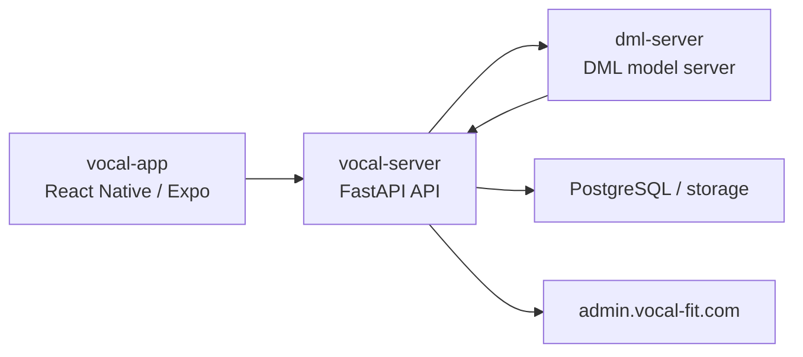
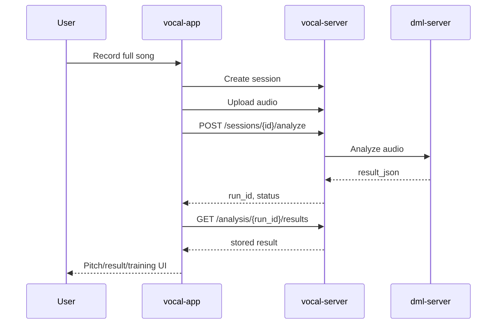
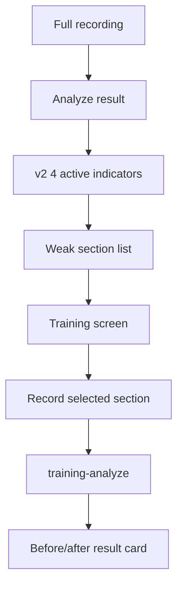

# Vocal Fit Project Overview

작성 기준: 2026-05-13
범위: `graduation-project` monorepo 안의 `vocal-app`, `vocal-server`, `dml-server`

## 목차

1. [프로젝트 개요](#프로젝트-개요)
2. [졸업작품 목표](#졸업작품-목표)
3. [전체 아키텍처](#전체-아키텍처)
4. [3개 워크스페이스 구조](#3개-워크스페이스-구조)
5. [도메인/인프라](#도메인인프라)
6. [사용자 흐름](#사용자-흐름)
7. [분석 흐름](#분석-흐름)
8. [v2 score_mapper 정책](#v2-score_mapper-정책)
9. [표시 4항목과 분류 정책](#표시-4항목과-분류-정책)
10. [API schema 요약](#api-schema-요약)
11. [앱 화면 구조](#앱-화면-구조)
12. [현재까지 구현된 기능](#현재까지-구현된-기능)
13. [5/10~5/13 진행 로그](#510513-진행-로그)
14. [현재 남은 검증 항목](#현재-남은-검증-항목)
15. [미해결 백로그](#미해결-백로그)
16. [실험 계획](#실험-계획)
17. [핵심 코드 스니펫](#핵심-코드-스니펫)
18. [Mermaid 시각화](#mermaid-시각화)
19. [앞으로의 개발 운영 방식](#앞으로의-개발-운영-방식)

## 프로젝트 개요

Vocal Fit은 보컬 연습 녹음, 서버 기반 발성 분석, 피치 비교, 약점 구간 훈련을 하나의 모바일 앱 흐름으로 연결하는 졸업작품 프로젝트다. 사용자는 앱에서 노래를 선택하고 녹음한 뒤, 백엔드가 DML 추론 서버에 분석을 요청한다. 분석 결과는 앱에서 피치 가이드, 실시간 피치, 9개 발성 평가 항목, 약점 구간, 훈련 화면으로 표시된다.

프로젝트는 GitHub `graduation-project` monorepo에서 관리한다. 기존 `vocal-server`와 `dml-server`를 보존하면서 `vocal-app/`을 새 하위 워크스페이스로 추가했다.

### 문서 기준과 출처

이 문서는 2026-05-13에 추가된 `vocal-app/` snapshot과 2026-05-14 Batch #1 안정화 반영 상태를 기준으로 작성했다.

| 기준 | 값 |
|---|---|
| GitHub repo | `kim-jeongwoo/graduation-project` |
| 작업 branch | `codex/vocal-app-batch1-2026-05-14` |
| base branch | `main` |
| base commit | `1606663 Merge pull request #2 from kim-jeongwoo/codex/v2-closeout-2026-05-13` |
| 앱 원본 작업 경로 | `/Users/kimjeongwoo/vocal-app` |
| 포함 범위 | Batch #1 검증 완료 앱 source/docs snapshot |
| 제외 범위 | `.git/`, `node_modules/`, `.expo/`, `.claude/`, 실제 `.env*`, `*.bak`, raw handover docs, `.codex/ACTIVE_PLAN.md` |

## 졸업작품 목표

- 스마트폰 앱에서 실제 보컬 연습 흐름을 기록한다.
- 서버에서 음성 파일을 받아 DML 모델 분석을 수행한다.
- AI 분석 결과를 보컬 트레이닝에 이해 가능한 항목으로 변환한다.
- 피치 정확도, 리듬 정확도, 발성 평가 항목을 앱에서 시각화한다.
- 사용자가 약점 구간을 다시 연습하고 사후 측정 결과를 비교할 수 있게 한다.

## 전체 아키텍처

| 레이어 | 워크스페이스 | 역할 |
|---|---|---|
| Mobile App | `vocal-app/` | React Native/Expo 앱, 녹음/피치 표시/분석 결과/훈련 UI |
| API Server | `vocal-server/` | FastAPI API, 인증, 세션, 파일 업로드, 분석 결과 저장 |
| DML Server | `dml-server/` | EGG 추정/음향 지표/score mapper/분석 추론 |

## 3개 워크스페이스 구조

### vocal-app

- React Native 0.81 / Expo SDK 54 / TypeScript 5.9
- React Navigation v7
- Axios + `expo-secure-store` JWT 저장
- `expo-av`, `react-native-pitchy`, `react-native-audio-record`
- `react-native-svg` 기반 피치/타임라인 시각화

### vocal-server

- FastAPI 백엔드
- 인증, 사용자, 세션, 파일 업로드, 곡/가사/피치가이드, 분석 결과 API
- DML 서버와 통신해 분석 결과를 저장하고 앱에 전달
- admin 화면과 운영 스크립트 포함

### dml-server

- EGG 추정 모델과 분석 파이프라인
- score mapper와 v2 지표 매핑
- 모델 서버, 데이터 준비 스크립트, 실험/검증 산출물 포함

## 도메인/인프라

| 도메인 | 역할 |
|---|---|
| `vocal-fit.com` | 서비스 대표 도메인 |
| `api.vocal-fit.com` | 앱이 접근하는 production API |
| `dml.vocal-fit.com` | DML 실시간/분석 서버 접근 도메인 |
| `admin.vocal-fit.com` | 운영/관리 화면 도메인 |

개발 검증은 당분간 tunnel dev-client와 local API 조합을 사용한다. 외부 검증 전에는 API URL을 production API로 전환한다.

## 사용자 흐름

1. 로그인 또는 회원가입
2. 홈/곡 선택
3. 노래방 화면에서 MR/가사/피치 가이드 확인
4. 완곡 녹음
5. 서버 분석 요청
6. 분석 결과 화면 진입
7. 피치 가이드와 사용자 피치 비교
8. 9개 발성 항목 카드 확인
9. 활성 항목의 약점 구간 선택
10. 훈련 화면에서 구간 반복 녹음 및 사후 측정

## 분석 흐름

1. `vocal-app`이 세션을 생성한다.
2. 녹음 파일을 `vocal-server`에 업로드한다.
3. `POST /sessions/{session_id}/analyze`로 분석을 요청한다.
4. `vocal-server`가 DML 서버에 분석을 위임한다.
5. DML 서버가 피치, timeline, score mapper 결과를 생성한다.
6. `vocal-server`가 결과 JSON을 저장한다.
7. 앱이 run id로 분석 결과를 조회한다.
8. 앱 adapter가 서버 JSON을 화면 타입으로 변환한다.

## v2 score_mapper 정책

v2는 서버 응답의 `score_mapper_version === "v2"`와 `scores_v2` 존재 여부를 기준으로 앱에서 분기한다. 앱은 v1 응답 호환을 유지하면서 v2 필드를 선택적으로 사용한다.

주요 v2 필드:

- `scores_v2`
- `scores_meta`
- `reliability.shown_v2`
- `reliability.academic_only_v2`
- `reliability.deferred_v2`
- `low_confidence_items`
- timeline chunk별 4항목 점수

## 표시 4항목과 분류 정책

앱에서 우선 활성 표시하는 v2 4항목:

| 서버 key | 앱 key | 화면 표시 | 상태 |
|---|---|---|---|
| `4_breathiness` | `breathiness` | 호흡식별 | 활성 |
| `3_vocal_fold_contact` | `vocal_fold_contact` | 접촉강도 | 활성 |
| `6_soft_palate` | `soft_palate` | 연구개위치 | 활성 |
| `8_tongue_tension` | `tongue_tension` | 혀경직도 | 활성 |

분류 정책:

- `shown_v2`: 앱에서 우선 표시/훈련 진입을 허용하는 항목
- `academic_only_v2`: 논문/연구 설명에는 남기되 앱 핵심 UX에서는 제한적으로 표시하는 항목
- `deferred_v2`: 데이터/검증이 더 필요해 후순위로 미루는 항목
- `excluded`: 현재 앱 UX와 분석 신뢰도 기준에서 제외하는 항목

Batch #1 결과 카드 표시 정책:

- 호흡식별 / 성대 접촉 강도는 기존 서버 feedback과 `high_star` 표시 흐름을 유지한다.
- 연구개 위치 / 혀 경직도는 서버 feedback이 비어 있을 때 zone 기반 보수 문구를 fallback으로 표시한다.
- 연구개 위치 / 혀 경직도는 `high_star` 노란 별을 표시하지 않는다.
- `shown_v2`에 포함되고 v2 점수가 있는 연구개/혀 항목은 legacy `unavailable` 때문에 “측정 불가” 뱃지가 뜨지 않도록 보정한다.
- low confidence 표시는 별도 hint로 유지하며 점수 계산이나 timeline threshold는 앱에서 바꾸지 않는다.

## API schema 요약

| API | 앱 역할 | 핵심 응답 |
|---|---|---|
| `POST /sessions` | 세션 생성 | `session_id` |
| `POST /sessions/{id}/files` | 녹음 파일 업로드 | file metadata |
| `POST /sessions/{id}/analyze` | 완곡 분석 시작 | `run_id`, `status` |
| `GET /analysis/{run_id}` | 분석 상태 확인 | `status` |
| `GET /analysis/{run_id}/results` | 분석 결과 조회 | `result_json` |
| `GET /songs/{id}/pitch-guide` | 피치 가이드 | points, midi segments, offset |
| `POST /sessions/{id}/training-analyze` | 약점 구간 사후 측정 | `scores_v2`, `scores_meta`, `low_confidence_items` |

### 주요 request/response shape

#### `POST /sessions/{id}/analyze`

앱은 완곡 녹음 파일 업로드 후 이 API를 호출한다. 현재 앱은 즉시 응답 body의 `status`를 확인하고 실패 terminal status면 결과 화면으로 이동하지 않는다.

```json
{
  "run_id": "analysis-run-id",
  "status": "success",
  "reason": null
}
```

앱에서 성공으로 처리하는 status:

- `success`
- `completed`
- `complete`
- `done`

앱에서 실패로 처리하는 status:

- `failed`
- `invalid`
- `no_voice`
- `error`

`no_voice`는 사용자가 목소리 없이 녹음했을 때 결과 화면으로 이동하지 않고 안내를 표시하는 검증이 완료된 상태다.

#### `GET /analysis/{run_id}/results`

분석 결과 조회는 서버가 저장한 `result_json`을 앱 adapter가 화면 타입으로 변환한다. v1/v2 모두 유지한다.

```json
{
  "run_id": "analysis-run-id",
  "status": "success",
  "result_json": {
    "score_mapper_version": "v2",
    "scores_v2": {
      "4_breathiness": 3.0,
      "3_vocal_fold_contact": 2.0
    },
    "scores_meta": {
      "4_breathiness": {
        "zone": "appropriate",
        "tier": "A",
        "tooltip": "..."
      }
    },
    "reliability": {
      "shown_v2": ["4_breathiness", "3_vocal_fold_contact", "6_soft_palate", "8_tongue_tension"],
      "academic_only_v2": [],
      "deferred_v2": []
    },
    "timeline_scores": []
  }
}
```

#### `POST /sessions/{id}/training-analyze`

약점 구간 훈련 후 사후 측정에 사용한다. `chunk_meta`는 선택된 구간 정보를 담고, 응답은 v2 필드를 optional로 처리한다.

```json
{
  "status": "success",
  "scores_v2": {
    "6_soft_palate": 2.0
  },
  "scores_meta": {
    "6_soft_palate": {
      "zone": "appropriate",
      "tier": "B"
    }
  },
  "low_confidence_items": []
}
```

v2 필드가 없거나 null이어도 앱은 기존 v1 흐름을 깨지 않도록 optional/null-safe로 처리한다.

## 앱 화면 구조

주요 화면:

- Auth: 로그인/회원가입
- Home: 홈, 세션 진입
- Karaoke: MR/가사/피치 가이드 기반 녹음
- EvalResult: 분석 결과, 피치/리듬, 9항목 카드, timeline
- SectionList: 약점 구간 리스트
- Training: 구간 반복 연습, 실시간 피드백, 사후 측정
- History: 곡별 기록
- Goals/Settings: 목표와 개발/설정 보조 화면

## 현재까지 구현된 기능

- 인증 화면과 JWT 저장
- 곡 목록, MR, LRC, pitch guide 연동
- 노래방 녹음과 분석 요청
- 분석 결과 화면
- 피치 가이드/사용자 피치 비교
- v1/v2 분석 결과 adapter
- 9개 발성 항목 카드
- v2 4항목 우선 표시
- 약점 구간 추출
- 훈련 화면과 사후 측정
- `no_voice` 등 실패 status에서 결과 화면 이동 차단
- pitch guide 중복 요청 캐시 및 과거 결과 재진입 안정화
- full analyze async polling UX
- 구간훈련 녹음 window와 `chunk_meta` 정렬
- production 완곡 업로드 timeout/UX 안정화
- song004 pitch-guide 현 단계 종료 및 앱 임의 offset 제거
- 결과 카드 피드백/신뢰도 UI 정리

## 5/10~5/14 진행 로그

| 날짜 | 진행 |
|---|---|
| 2026-05-10 | v1 baseline 안정 동작 상태 정리, `v1.0.0-pre-v2` tag 생성 |
| 2026-05-11~05-12 | v2 score mapper adapter, shown_v2, TierBadge, timeline 5 mode, weakSections 4항목 매핑 |
| 2026-05-12 | full analyze status UX hardening, no_voice/failed/invalid/error 처리 |
| 2026-05-13 | pitch-guide 재진입/중복 요청 문제 수정 검증, monorepo에 `vocal-app/` snapshot 추가 |
| 2026-05-14 | Batch #1 5/5 완료: async polling, 구간훈련 window/chunk_meta, production upload UX, song004 pitch-guide closeout, 결과 카드 신뢰도 UI |

## 현재 남은 검증 항목

| 항목 | 분류 | 완료 기준 |
|---|---|---|
| `npx tsc --noEmit` baseline navigation typing 오류 분리 | 앱 코드 정리 | 기존 navigation typing 오류와 신규 regression을 구분해 보고 |
| song004 및 다른 곡 pitch-guide 수동 정렬 완료 후 재반영 | 앱/asset | 수동 정렬된 guide asset 기준 재검증 |
| MR/LRC/pitch-guide 정합성 최종 검증 | 앱/asset | 여러 곡에서 청감/화면 timing 검증 |
| 구간훈련 입력 calibration 기능 | 앱 UX | 기기/환경별 입력 레벨 보정 |
| 연구개/혀경직도 문구 정교화 | 앱 UX/평가표 | 4/6~5/10 전체 평가표 기준으로 문구 확정 |
| 진단 로그 유지/제거 시점 결정 | 운영/개발 정책 | Galaxy/server 검증 완료 후 제거 또는 유지 범위 확정 |
| expo-av deprecated warning | 앱 코드 정리 | 대체 API 검토 |
| NativeEventEmitter warning | 앱 코드 정리 | 원인 모듈 확인 후 warning 제거 |
| production server auto-start/systemd 운영 정리 | 운영 | 서버 재시작/부팅 자동화 확인 |

## 미해결 백로그

| 항목 | 영역 | 우선순위 | 비고 |
|---|---|---|---|
| 401 token 만료 UX | vocal-app | 발표 전 권장 | 만료 시 로그인 화면 유도 |
| OTA 업데이트 전략 | vocal-app/운영 | 선택 | 네이티브 변경 없는 빠른 수정 배포용 |
| admin 사용자 상세/운영 화면 고도화 | vocal-server | 선택 | 운영 편의 |
| DML PCM/VAD 임계값 조정 | dml-server | 운영 검증 필요 | no_voice 민감도와 관련 |
| 마이크 입력 정규화 | vocal-app/dml-server | 운영 검증 필요 | 기기/환경별 입력 편차 완화 |
| deferred 항목 활성화 기준 정리 | dml-server/문서 | 연구 검증 필요 | 추가 데이터/검증 후 앱 표시 확대 |

## 검증 근거와 한계

2026-05-13 기준 Galaxy dev-client에서 곡 004를 사용한 완곡 녹음/분석 흐름이 확인되었다. 과거 분석 결과 재진입 시 pitch guide가 유지되고, 목소리 없는 녹음은 결과 화면으로 이동하지 않는 것도 확인되었다.

2026-05-14 Batch #1 검증에서는 production API 기준 앱 진입, 로그인, 곡 목록 로드, song004 Karaoke 진입, MR/가사/녹음, 완곡 업로드, full analyze async polling, 결과 화면 이동, 히스토리 저장, 구간훈련 한 소절 success, 연구개/혀경직도 결과 카드 feedback과 badge 보정이 확인되었다.

현재 한계:

- `npx tsc --noEmit`은 기존 navigation typing baseline 오류 때문에 실패 가능성이 있다.
- 이 문서는 서버/DML 최신 runtime을 직접 고정하지 않는다. server contract가 바뀌면 `vocal-server`와 `dml-server` 문서를 함께 확인해야 한다.
- pitch-guide asset 정렬은 현 단계에서 종료했으며, 여러 곡 수동 정렬 완료 후 재개한다.

## 실험 계획

1. 내부 Galaxy dev-client 반복 검증
2. 대표 노래 004 기준 완곡 분석 회귀 테스트
3. no_voice, 분석 실패, timeout UX 확인
4. 4항목 약점 구간 훈련 플로우 확인
5. 외부 검증 전 production API 전환
6. 발표 전 demo path 고정

## 핵심 코드 스니펫

### v2 항목 key mapping

```typescript
const SERVER_INDICATOR_KEY = {
  breathiness: '4_breathiness',
  vocal_fold_contact: '3_vocal_fold_contact',
  soft_palate: '6_soft_palate',
  tongue_tension: '8_tongue_tension',
};
```

### analyze status gate

```typescript
export function assertAnalyzeBodyStatus<T extends StartAnalysisResponse>(response: T): T {
  const normalized = normalizeAnalyzeStatus(response.status);
  if (normalized === undefined || isAnalyzeSuccessStatus(normalized)) return response;
  throw new AnalyzeStatusError(response);
}
```

### pitch-guide cache

```typescript
const pitchGuideCache = new Map<string, ServerPitchGuide>();
const pitchGuideRequests = new Map<string, Promise<ServerPitchGuide>>();
```

## Mermaid 시각화

### Architecture



### Analyze sequence



### Analyze to training



## 앞으로의 개발 운영 방식

- 기존 monorepo root와 server workspaces는 보존한다.
- 앱 변경은 `vocal-app/` 하위에서만 수행한다.
- 기능 확정 단위로 branch/commit/push한다.
- `main` 직접 push는 하지 않고 PR 또는 명시 승인 후 병합한다.
- force push, reset/revert, root overwrite는 금지한다.
- 민감 파일, 음원, 사용자 음성, 모델 가중치, `.env`는 commit하지 않는다.
- README는 hub 역할만 유지하고 상세 내용은 `docs/`와 각 workspace 문서로 분리한다.
