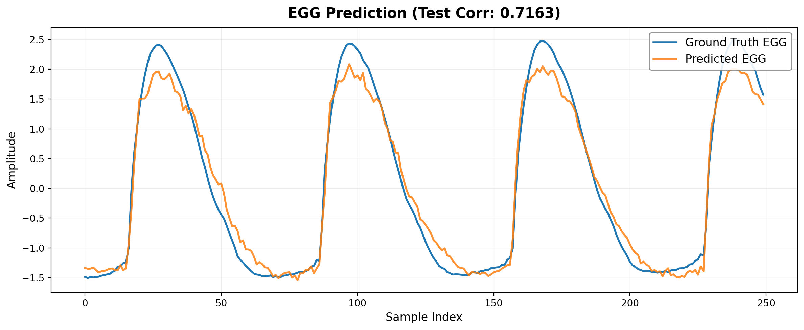
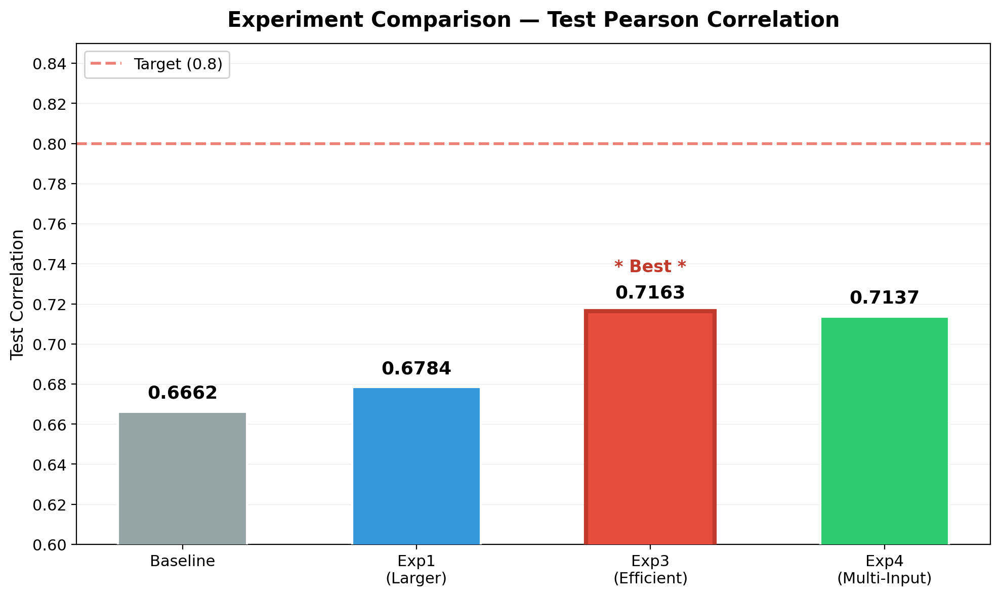
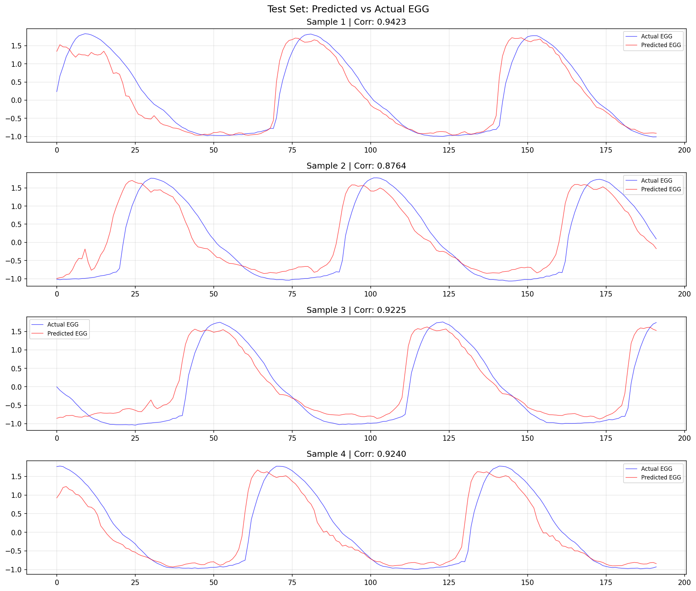
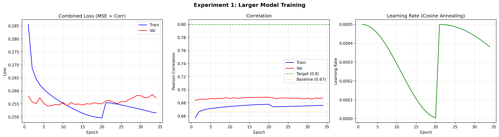
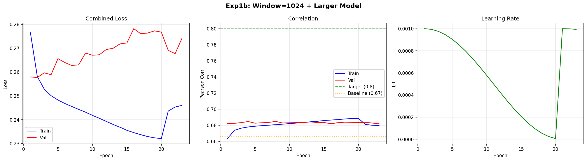
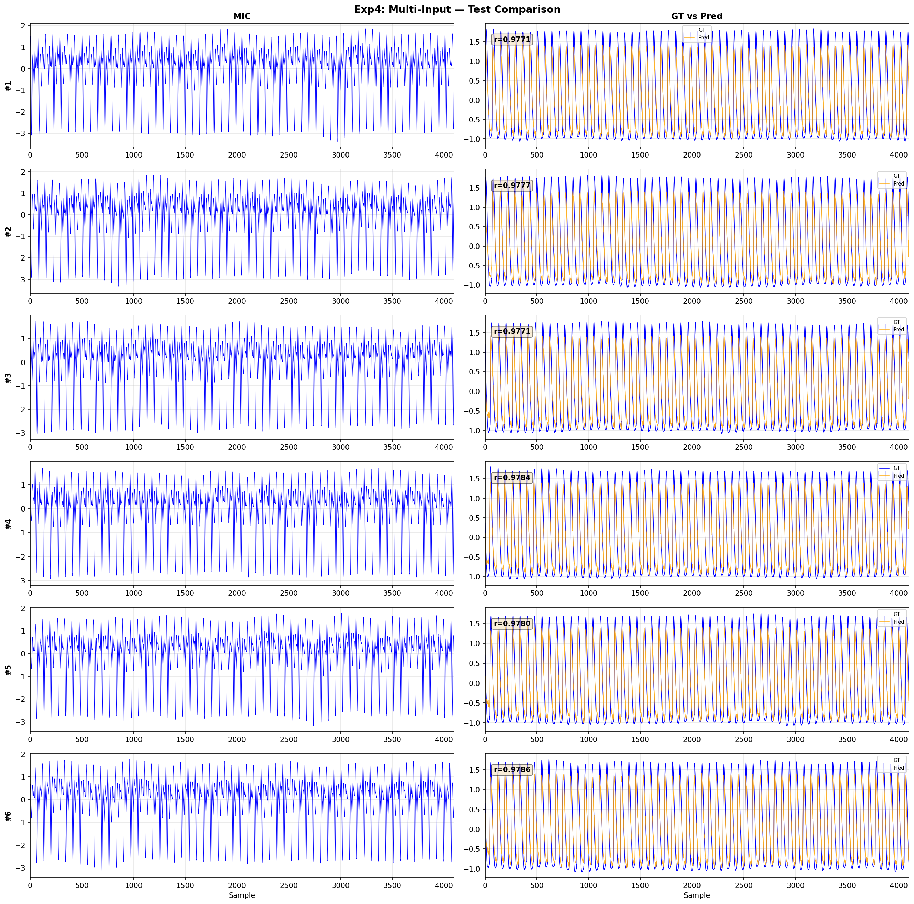
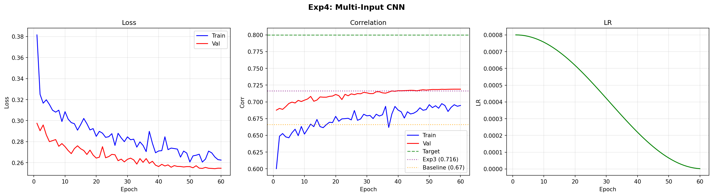
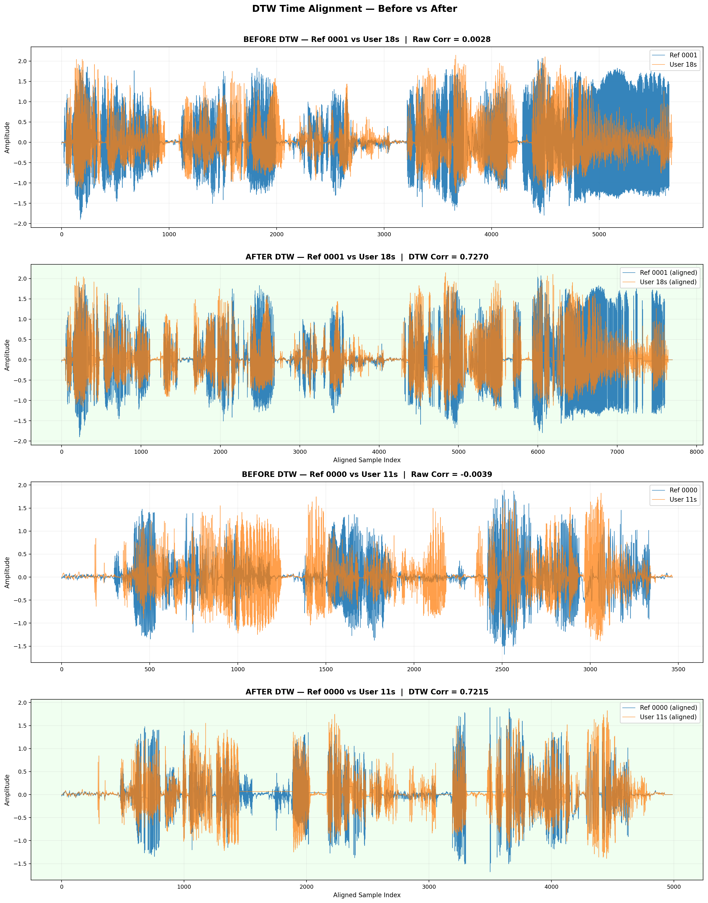
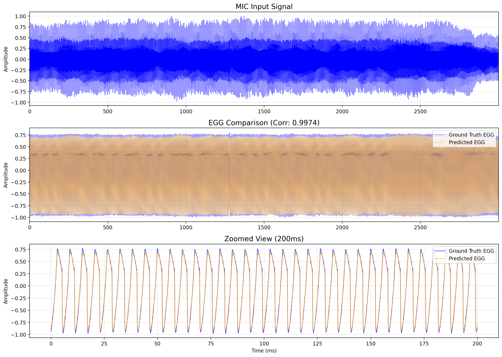

# images/

프로젝트 관련 이미지 저장소입니다.

아키텍처 다이어그램, 실험 결과 시각화, 모델 구조도, 발표자료 캡처 등 프로젝트 관련 이미지를 이 폴더에 저장합니다.
다른 문서(README.md 등)에서 이미지를 참조할 때 이 폴더의 경로를 사용합니다.

```markdown

```

---

## 이미지 목록

### 실험 비교 및 최종 결과

전체 실험을 비교하거나 최종 결과를 시각화한 이미지입니다.

| 파일명 | 설명 | 원래 위치 |
|--------|------|-----------|
| `final_comparison.png` | 최종 결과 비교 — 최고 성능 모델(Exp3)의 예측 vs 실제 EGG 파형 비교 | `results/` |
| `overlay_comparison.png` | 오버레이 비교 — 예측 EGG와 실제 EGG를 같은 축에 겹쳐서 비교 | `results/` |
| `experiment_comparison.png` | 전체 실험 비교 — Baseline~Exp4까지 모든 실험의 성능 비교 차트 | `results/` |






---

### Baseline (WaveNet, 72K params)

| 파일명 | 설명 | 원래 위치 |
|--------|------|-----------|
| `baseline_comparison.png` | Baseline 모델의 예측 vs 실제 EGG 파형 비교 (Test Corr: 0.6662) | `results/` |
| `baseline_training_history.png` | Baseline 학습 히스토리 — Loss/Correlation 변화 곡선 | `results/` |




---

### Exp1: Larger WaveNet (419K params)

| 파일명 | 설명 | 원래 위치 |
|--------|------|-----------|
| `exp1_all_samples.png` | Exp1 전체 테스트 샘플(6개) 예측 vs 실제 비교 (Test Corr: 0.6784) | `results/exp1_larger_model/` |
| `exp1_training_history.png` | Exp1 학습 히스토리 — Loss/Correlation 변화 곡선 | `results/exp1_larger_model/` |




---

### Exp1b: Longer Window (1024 samples)

| 파일명 | 설명 | 원래 위치 |
|--------|------|-----------|
| `exp1b_all_samples.png` | Exp1b 전체 테스트 샘플 비교 — Window 192→1024 확장 실험 (Test Corr: 0.6763) | `results/exp1b_longer_window/` |
| `exp1b_training_history.png` | Exp1b 학습 히스토리 | `results/exp1b_longer_window/` |




---

### Exp2: TCN-UNet (29.4M params, 중단)

| 파일명 | 설명 | 원래 위치 |
|--------|------|-----------|
| `exp2_training_history.png` | Exp2 학습 히스토리 — 5 에폭만 학습 후 중단 (너무 느림, 에폭당 ~19분) | `results/exp2_tcn_unet/` |


---

### Exp3: EfficientEGGNet ⭐ (1.8M params, 최고 성능)

| 파일명 | 설명 | 원래 위치 |
|--------|------|-----------|
| `exp3_all_samples.png` | Exp3 전체 테스트 샘플 비교 — 최고 성능 (Test Corr: **0.7163**) | `results/exp3_efficient/` |
| `exp3_training_history.png` | Exp3 학습 히스토리 — best epoch 10에서 Val Corr 0.7229 달성 | `results/exp3_efficient/` |


---

### Exp4: Multi-Input + Data Augmentation (2.4M params)

| 파일명 | 설명 | 원래 위치 |
|--------|------|-----------|
| `exp4_all_samples.png` | Exp4 전체 테스트 샘플 비교 — Mel spectrogram 경로 추가 (Test Corr: 0.7137) | `results/exp4_multi_input/` |
| `exp4_training_history.png` | Exp4 학습 히스토리 — 58 에폭까지 느리게 수렴 | `results/exp4_multi_input/` |





---

### 발성 유사도 검증 (Validation)

실제 녹음(라즈베리파이 + USB 마이크)에 대해 EGG를 예측하고, DTW 정렬 후 유사도를 비교한 결과입니다.

| 파일명 | 설명 | 원래 위치 |
|--------|------|-----------|
| `individual_predictions.png` | 각 녹음 파일별 EGG 예측 결과 시각화 | `results/validation/` |
| `similarity_matrix.png` | 4쌍(기준 2 × 사용자 2)의 DTW 유사도 행렬 | `results/validation/` |
| `validation_best_comparison.png` | 가장 높은 유사도 쌍의 상세 비교 | `results/validation/` |
| `dtw_alignment_comparison.png` | DTW 시간 정렬 전후의 correlation 비교 | `results/validation/` |
| `dtw_best_match.png` | DTW 최적 정렬 결과 — 정렬 전후 파형 비교 | `results/validation/` |
| `shuffle_validation.png` | 셔플 테스트 결과 — 1000번 무작위 셔플의 분포 vs 실제 DTW Corr (Z>40, p<0.001) | `results/validation/` |
| `spectrogram_comparison.png` | 두 녹음의 스펙트로그램 비교 (흉성/두성 영역 분석) | `results/validation/` |
| `spectrogram_0000.png` | 기준 파일 0000.wav의 스펙트로그램 | `results/validation/` |
| `spectrogram_0001.png` | 기준 파일 0001.wav의 스펙트로그램 | `results/validation/` |
| `spectrogram_user_11s.png` | 사용자 파일 usb_mic_test1_11s.wav의 스펙트로그램 | `results/validation/` |
| `spectrogram_user_18s.png` | 사용자 파일 usb_mic_test1_18s.wav의 스펙트로그램 | `results/validation/` |





---

### 초기 실험 (egg_from_mic — PTDB/OpenGlot 등)

SVD 데이터셋 사용 전, 다른 데이터셋(PTDB, OpenGlot 등)으로 수행한 초기 실험의 결과입니다.

| 파일명 | 설명 | 원래 위치 |
|--------|------|-----------|
| `egg_from_mic_visualization.png` | 초기 모델의 전체 예측 시각화 | `ai-model/egg_from_mic/results/` |
| `egg_from_mic_overlay.png` | 초기 모델의 예측 vs 실제 EGG 오버레이 비교 | `ai-model/egg_from_mic/results/` |
| `egg_from_mic_speaker_split.png` | Speaker-independent split 적용 전후 성능 비교 | `ai-model/egg_from_mic/results/` |
| `egg_from_mic_training_history.png` | 초기 모델 학습 히스토리 | `ai-model/egg_from_mic/results/` |
| `egg_from_mic_overfitting_comparison.png` | 과적합 해결 실험 4가지 비교 | `ai-model/egg_from_mic/results/overfitting_fix/` |
| `egg_from_mic_overfit_exp1.png` | 과적합 해결 Exp1: 정규화(Regularization) 학습 곡선 | `ai-model/egg_from_mic/results/overfitting_fix/` |
| `egg_from_mic_overfit_exp2.png` | 과적합 해결 Exp2: 모델 단순화(Simplified) 학습 곡선 | `ai-model/egg_from_mic/results/overfitting_fix/` |
| `egg_from_mic_overfit_exp3.png` | 과적합 해결 Exp3: Data Augmentation 학습 곡선 | `ai-model/egg_from_mic/results/overfitting_fix/` |
| `egg_from_mic_overfit_exp4.png` | 과적합 해결 Exp4: 전체 조합(Full Combination) 학습 곡선 | `ai-model/egg_from_mic/results/overfitting_fix/` |




---

## 참고

- 각 실험의 개별 샘플 이미지(sample_1~6.png)와 에폭별 결과(epoch_XX_corr_*.png)는 원본 `results/` 폴더에 그대로 보관되어 있습니다. 이 폴더에는 실험별 핵심 이미지만 정리했습니다.
- 원본 이미지 총 108개 중 핵심 34개를 선별했습니다.
